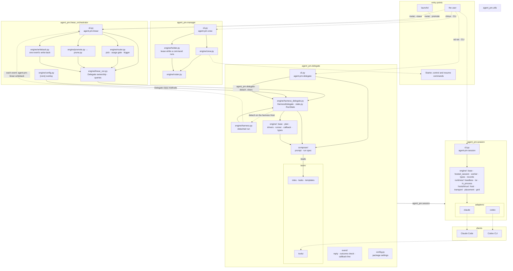
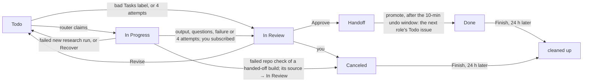
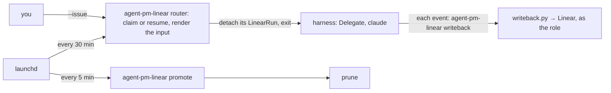

# agent-pm

[](https://github.com/ophis/agent-pm/actions/workflows/test.yml?query=branch%3Amain) [](LICENSE)

Runs Claude agents unattended from a Linear board. Each Linear project is a product, and an issue's assignee (a role account) is its stage. Each role works up to `max_runs` issues at once and hands its output back for your review. Once you approve, the next role takes it.

| Part | What it does | Start at |
|---|---|---|
| Core | Runs a role, which picks its task unless given one. A Claude Code and Codex plugin you can use alone. | [Install](#install) |
| Linear orchestrator | Runs the core from the board. | [Setup](#setup) |

Developers: `AGENTS.md`.


## Core architecture

Five layers, one project each: utils < session < delegate < linear-orchestrator < manager. Import rules: `AGENTS.md` › Import rules. The code, by package; terms in `CONTEXT.md`.



Solid arrow: an import, the only direction allowed, or a file read (`reads`); its label names the package imported, by its `__all__`. Dotted: runs a command or process. Dashed: shared modules, their imports not drawn.

## Install

Each client installs the plugin itself, with your git credentials (the repo is private). Before upgrading, see [Upgrading](#upgrading).

| Client | Install |
|---|---|
| Claude Code | `/plugin marketplace add ophis/agent-pm`, then `/plugin install agent-pm@agent-pm` |
| Codex 0.156.0+ | `codex plugin marketplace add ophis/agent-pm`, then `codex plugin add agent-pm@agent-pm` |

Nothing checks these. A missing one fails the agent run.

| Requirement | For |
|---|---|
| `claude` CLI, Python 3.11+, the `autopilot` plugin | every agent run |
| `superpowers` plugin | the `build` task |
| tmux 3.3+ | tui runs |
| `git`, `gh` logged in | checkouts, GitHub and pull-request destinations |
| iTerm2 running | the default iTerm2 split |

Agent runs load your user settings (plugins except `agent-pm`) and no MCP servers. A trusted cwd adds its project settings (`trusted_dirs` in `delegate/src/agent_pm/delegate/config.toml`).

| Command | Does |
|---|---|
| `/agent-pm:tmux` | Launch and direct workers, role runs and pipeline runs. |
| `ctmux <name>` | Open the commander's tmux session. `ctmux --install` puts it in `~/.agent-pm/bin/`. |
| `/agent-pm:manage` | The commander's guidelines. |
| `/agent-pm:act-as <role>[:<task>] <input>` | Run a core role in this conversation. |
| `agent-pm-delegate run --list` | List every role and task. |

Your own roles, tasks and templates: `team_dirs` in `delegate/src/agent_pm/delegate/config.toml`.

## Setup

Needs macOS and Install's requirements. The orchestrator runs this checkout's scripts, not the plugin. `<work_dir>` is `linear_orchestrator.work_dir`.

1. Create `~/.agent-pm/config.local.toml` from the `# local:` lines of each packaged `config.toml`, each under its layer's section. Include researcher's and pm's `[output]`. A required key left `""` stops every `agent-pm-linear` command.

   ```toml
   [delegate.roles.engineer]              # run settings
   tier = 2

   [linear_orchestrator.roles.engineer]   # board settings
   account = "engineer@example.com"
   max_runs = 1
   ```

2. Set `task_label_group` to the id of the `Tasks` label group (Linear query `issueLabels { nodes { id name isGroup } }`).
3. Router and promote act in Linear as the harness account `frank.agent.w@gmail.com`; each role writes back as its own `account`. For each role:
   1. Linear › Settings › Members: invite the `account`, a plus-alias such as `frank.agent.w+pm@gmail.com`.
   2. Open the invite in a private window and choose **Continue with email**.
   3. As the role account, create a personal API key.
   4. `security add-generic-password -s <key> -a <account> -w`, then paste the key.
4. Store the harness key:
   ```bash
   security add-generic-password -a frank.agent.w -s linear-api-key -w   # config.local.toml: [linear_orchestrator] harness_key
   ```
5. Dry-run each job:
   ```bash
   bin/agent-pm-linear router --dry-run
   bin/agent-pm-linear promote --dry-run
   ```
6. Install the launchd jobs:
   ```bash
   mkdir -p ~/.agent-pm/logs   # launchd can't start a job without it
   for job in router promote; do
     launchctl bootout gui/$(id -u)/com.ophis.agent-pm.$job 2>/dev/null   # fails harmlessly if none is loaded
     cp linear-orchestrator/launchd/com.ophis.agent-pm.$job.plist ~/Library/LaunchAgents/
     launchctl enable gui/$(id -u)/com.ophis.agent-pm.$job
     launchctl bootstrap gui/$(id -u) ~/Library/LaunchAgents/com.ophis.agent-pm.$job.plist
   done
   launchctl list | grep com.ophis.agent-pm   # exactly the two jobs
   ```

| Job | Schedule |
|---|---|
| router | :00 and :30, with `--now` (drop it to run only 01:00–06:59) |
| promote | every 5 min |

The plists hard-code this checkout's path and `~/.agent-pm` (launchd doesn't expand `~`). For another checkout or `work_dir`, edit them in `linear-orchestrator/launchd/` and rerun step 6. To uninstall a job:

```bash
launchctl bootout gui/$(id -u)/com.ophis.agent-pm.<job>
rm ~/Library/LaunchAgents/com.ophis.agent-pm.<job>.plist
```

## Using the board



- **New work:** a Todo issue in the product's project, assigned to a role account. The description is the brief, or an engineer issue's requirement. Add `Repo: <owner>/<name>` if the repo is not the project's `[project_repos]` entry.
- **Order work:** the router claims by priority, then later role, then oldest. A blocked issue waits until its blockers are Done, Canceled or Duplicate.
- **Approve:** move to Handoff and comment what's next. After 10 minutes (move it out of Handoff to undo), promote creates the next role's issue and marks this one Done.
- **Revise:** comment and move back to Todo. The agent resumes where it left off. On an engineer issue your PR comments and reviews count too. After 4 attempts the issue goes to In Review.
- **Finish:** set Done or Canceled. 24 hours later prune deletes the run's workspaces and the issue's pushed branches, and archives pm and engineer issues. Uncommitted and unpushed work is lost.

### Task labels

A label from the `Tasks` group picks the role's task, mapped by `[task_labels]`. No label: the agent picks and says why in its start comment. A bad label (unmapped, another role's, or several): the issue goes to In Review with a comment. To upgrade Light Research to Deep Research, swap the label, comment the claims to verify, and move it back to Todo.

## Operating



```bash
bin/agent-pm-linear router --issue <ID>   # run one issue now, skipping the hours, max_runs and usage gates
bin/agent-pm-linear attach-command <ID>   # the command that shows its agent run
tmux ls                                   # running agent runs
```

Run `bin/agent-pm-linear` by its absolute path; `--help` lists each command's options. Events go to `<work_dir>/logs/orchestrator.jsonl`. Keep `<work_dir>/logs/runs.jsonl`: resume, Recover and write-back read it.

Each session's `Run <sid>` comment holds its resume command. Move the issue out of In Progress before opening it, or the router may resume it after 30 idle minutes.

## agent-pm-session

`bin/agent-pm-session --help` lists its subcommands. `ls` prints a header, then one tab-separated row per session: `name`, `state` (`working`, `done`, `blocked`, `dead`), `client`, `sid`, `display`, with `-` for an empty value.

## Client policy

Role runs' client flags are `[policy.claude]` and `[policy.codex]` in `delegate/src/agent_pm/delegate/config.toml`. A local list replaces the default whole. Codex defaults to `danger-full-access`, which ignores writable roots and team dirs. For `workspace-write`:

```toml
[delegate.policy.codex]
flags = ["-s", "workspace-write", "-c", 'approval_policy="on-request"', "-c", 'approvals_reviewer="auto_review"', "-c", "sandbox_workspace_write.network_access=false", "-c", "sandbox_workspace_write.writable_roots=[]"]
```

## Upgrading

Nothing migrates automatically. Do each step that applies, once, by hand or through an agent.

| If you have | Do |
|---|---|
| running agent-pm sessions | Close them first. |
| a flat `config.local.toml` | Move top-level values under `[session]`, `[delegate]` or `[linear_orchestrator]`, per the layer's packaged `config.toml`, and prefix tables with that section: `[roles.engineer]` becomes `[delegate.roles.engineer]` (run) or `[linear_orchestrator.roles.engineer]` (board). `show` goes under `[delegate]` or `[delegate.roles.<role>]`. `core-new.local.toml` goes under `delegate`, `linear-new.local.toml` under `linear_orchestrator`. |
| a `runtime` key or `--runtime` | Rename it `client` everywhere. Records written with `runtime` are not read. |
| `~/.agent-pm/core-new-sessions/codex` | Close Codex TUI sessions, then `mkdir -m 700 -p ~/.agent-pm/sessions && mv ~/.agent-pm/core-new-sessions/codex ~/.agent-pm/sessions/ && rmdir ~/.agent-pm/core-new-sessions`. |
| `default_task` or `tasks` in a role table | Drop `default_task`. Move each `<prefix>.roles.<role>.tasks.<task>` table's keys to `<prefix>.roles.<role>`, for the prefixes `delegate`, `delegate.clients.<name>` and `linear_orchestrator.core`. |
| `[session.adapters.codex]` `sandbox`, `shell_network` | Express them in `[delegate.policy.codex]` `flags`. |
| `--permission-mode`, `--strict-mcp-config` in `[session.adapters.claude]` | Move them to `[delegate.policy.claude]`; keep there only flags every session needs. |
| `runs.jsonl` start, resume or limit rows without `delegate_kind` | Before deploying, add `"delegate_kind": "harness"` to each, changing nothing else. |
| an issue In Progress across the trigger-only router or `runs.jsonl` deploys | Deploy with nothing In Progress. |
| Claude runs started before `agent-pm-session client-resume claude` | Resume them by hand: their `Run <sid>` command has no saved launch to replay. |
| old logs in `<work_dir>/logs/` | `rm -rf ~/.agent-pm/logs/runs.log ~/.agent-pm/logs/router.log ~/.agent-pm/logs/promote.log ~/.agent-pm/logs/projects ~/.agent-pm/logs/tui` |

## Tests

```bash
export PYTHONPATH=.:.github:delegate/src:session/src:utils/src:manager/src:linear-orchestrator/src:linear-orchestrator/tests   # from the repo root
```

Lint (tool versions pinned in `.github/workflows/test.yml`):

```bash
python3 .github/comment_budget.py
ruff check --no-cache
ruff format --check --no-cache
pyright
lint-imports --no-cache
pylint --disable=all --enable=cyclic-import,duplicate-code manager/src linear-orchestrator/src delegate/src session/src utils/src
vulture
python3 -m tests.checks
python3 .github/run_tests.py "Repository integration" tests/integration
python3 .github/integration_jobs.py --check
actionlint -shellcheck= -pyflakes=
typos --config pyproject.toml
```

| Suite | Command |
|---|---|
| one project's unit tests | `python3 .github/run_tests.py "Session unit" session/tests/unit` |
| all unit tests | `python3 .github/run_tests.py Unit --unit` |
| integration shard 1–8 | `python3 .github/integration_jobs.py <N>` |

Run tests only through these entries; they sandbox each run.

| | Unit | Integration |
|---|---|---|
| Tests | pure logic, with fakes and recorded output | real tools in `utils/tests/sandbox.py` |
| Limits | no processes, no sockets, writes only in the runner's temp dir | tmux only on `session/tests/live_tmux.py` servers |
