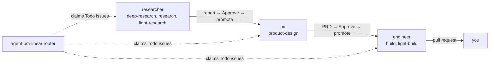

# agent-pm

 

Runs coding agents (Claude Code, Codex, more to come) unattended from a Linear board. Each Linear project is a product, and an issue's assignee (a role account) is its stage. Each role works up to `max_runs` issues at once and hands its output back for your review. Once you approve, the next role takes it.

| Part | What it does | Start at |
|---|---|---|
| Core | Runs a role, which picks its task unless given one. A Claude Code and Codex plugin you can use alone. | [Install](#install) |
| Linear orchestrator | Runs the core from the board. | [Linear board](docs/board.md) |

Developers: `AGENTS.md`.

## Why agent-pm

One agent keeps you waiting; many agents by hand route every prompt, check and approval through you. With agent-pm you talk to a manager, which launches, watches and reports on the workers.

## Demo: one manager, many workers

Without the board, you can run agent-pm by talking to one agent, the manager. Open its session with `ctmux <name>`, start Claude Code or Codex in it and invoke `/agent-pm:manage`. You give it work in plain words; it launches a worker for each task, watches their events, checks their pull requests and reports back.

- **Left:** the manager, here Claude Code. It lists which issues are running, waiting or not started, and reports what each worker just did.
- **Right:** one pane per engineer worker, each building one issue in its own worktree. Workers mix clients: most panes are Claude Code (`auto mode on` at the bottom), and the middle-left one is Codex (`GPT-6.1-Sol xhigh`, `Ask Codex to do anything`). Panes fill a grid as workers start and close when their work is done.

Commands: [Quick start](#quick-start).

## Install

Each client installs the plugin itself. Before upgrading, see [Upgrading](docs/upgrading.md).

| Client | Install |
|---|---|
| Claude Code | `/plugin marketplace add ophis/agent-pm`, then `/plugin install agent-pm@agent-pm` |
| Codex 0.156.0+ | `codex plugin marketplace add ophis/agent-pm` (to refresh an added one: `codex plugin marketplace upgrade agent-pm`), then `codex plugin add agent-pm@agent-pm`. `codex plugin list -m agent-pm` must show it installed and enabled. |

Nothing checks these. A missing one fails the agent run.

| Requirement | For |
|---|---|
| `claude` CLI, Python 3.11+, the `autopilot` plugin | every agent run |
| tmux 3.3+ | tui runs on the `tmux` Host |
| `git`, `gh` logged in | checkouts, GitHub and pull-request destinations |
| iTerm2 running | the default iTerm2 split |

How the sessions agent-pm starts load your settings, and why some commands refuse inside them: [Session settings](docs/sessions.md#session-settings).

| Command | Does |
|---|---|
| `ctmux <name>` | Open the commander's tmux session: native windows in iTerm2, a plain tmux attach in other terminals, a switch from inside tmux. `ctmux --install` puts ctmux and the four commands `agent-pm-crew`, `agent-pm-session`, `agent-pm-delegate` and `agent-pm-linear` in `~/.agent-pm/bin/`: run them by that path, or add it to `PATH`. Each runs that command from the plugin installed when it runs, Claude Code's install first, then Codex's newest, so an upgrade needs no reinstall; rerun `--install` to refresh them. |
| `/agent-pm:manage` | Launch and direct workers, role runs and pipeline runs, with the commander's guidelines. |
| `/agent-pm:act-as <role>[:<task>] <input>` | Run a core role in this conversation. |
| `agent-pm-delegate run --list` | List every role and task. |

## Quick start

1. [Install](#install) the plugin.
2. In a new Claude Code session, check it: `/agent-pm:act-as dummy-tester:echo hello` echoes `hello`.
3. Run a role: `/agent-pm:act-as researcher <question>`. With no local config the report is saved in `~/.agent-pm/adhoc/<date>-researcher-<name>/agent/prompt.md`; to publish it instead, set the role's destination ([Customizing roles and tasks](docs/customizing-roles-and-tasks.md#change-a-roles-run-settings)).
4. To run roles from Linear: [Linear board](docs/board.md).

## Customize roles and tasks

- Run settings per role (model tier, effort, client, destination, commands): `[delegate.roles.<role>]` in `~/.agent-pm/config.local.toml`.
- Your own roles, tasks and templates: a team dir listed in `[delegate] team_dirs`. It only adds; it never changes a built-in role.
- Check: `agent-pm-delegate run --list`, then `agent-pm-delegate run --role <role> --input <text> --dry-run`.

Formats, rules and the board's limits: [Customizing roles and tasks](docs/customizing-roles-and-tasks.md).

## Docs

| Page | Covers |
|---|---|
| [Customizing roles and tasks](docs/customizing-roles-and-tasks.md) | run settings, team dirs, role and task files, checks |
| [Linear board](docs/board.md) | setup, issue states and task labels, operating the router, Agent labels (client per issue) |
| [Sessions and client policy](docs/sessions.md) | session settings, `agent-pm-session`, role runs' client flags |
| [State root](docs/state-root.md) | `~/.agent-pm/` layout, what cleans each entry, what you may delete |
| [Upgrading](docs/upgrading.md) | upgrade steps, switching from v1, smoke checklist |
| [Core architecture](docs/architecture.md) | layers and packages (developers) |
| [Tests](docs/tests.md) | lint, test suites, coverage (developers) |
