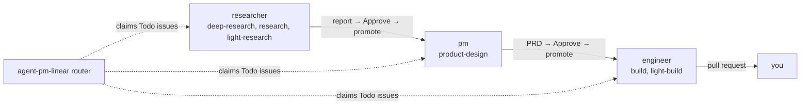
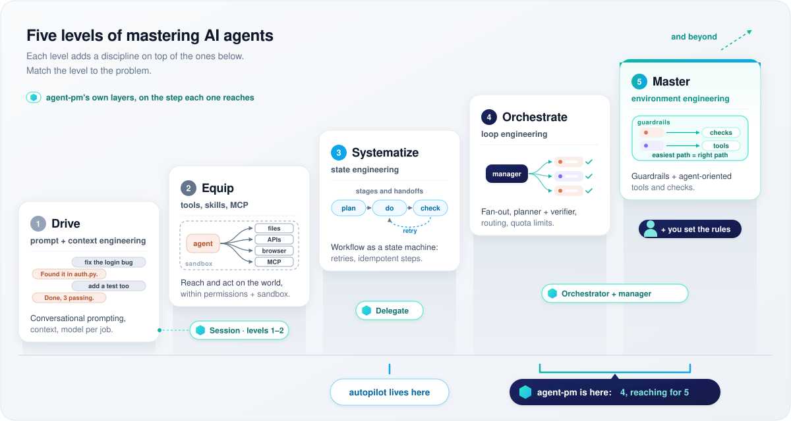
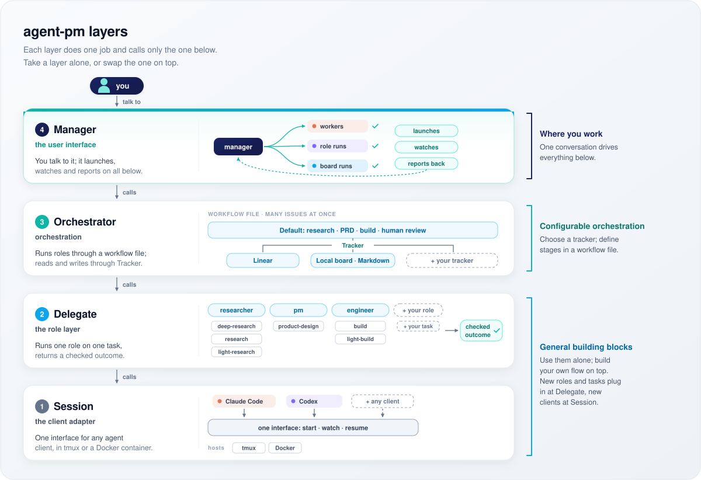
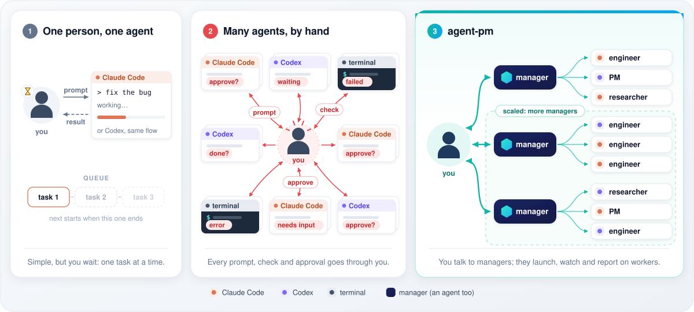
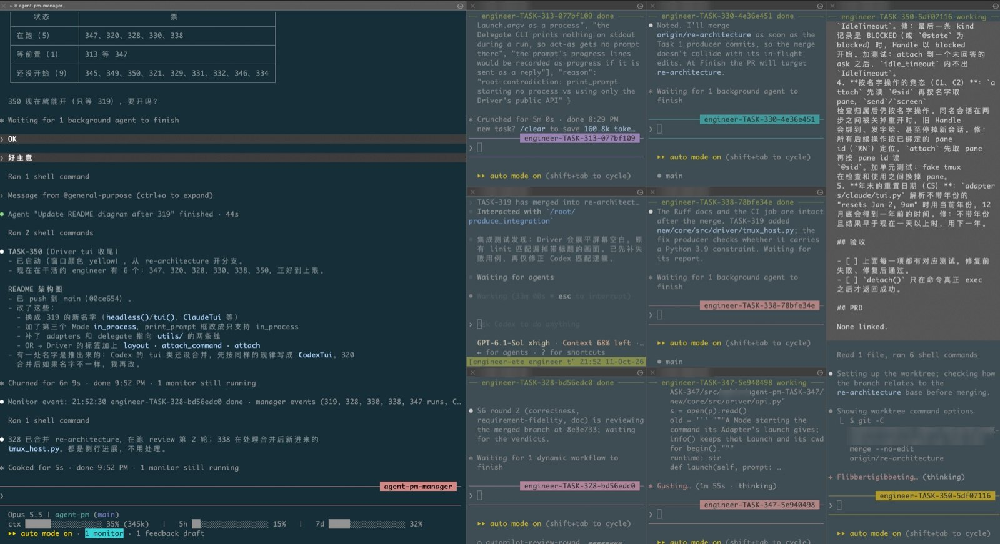

#  agent-pm

English · [中文](docs/readme/README.zh-CN.md) · [日本語](docs/readme/README.ja.md) · [한국어](docs/readme/README.ko.md) · [Español](docs/readme/README.es.md) · [Français](docs/readme/README.fr.md) · [Português](docs/readme/README.pt.md)

  

Runs coding agents (Claude Code, Codex, OpenCode on the host's Ollama models) unattended from a Linear board. Each Linear project is a product, and an issue's assignee (a role account) is its stage. Each role works up to `max_runs` issues at once and hands its output back for your review. Once you approve, the next role takes it.

Developers: `AGENTS.md`.

## Five levels of mastering AI agents

Working with coding agents is a ladder: each level adds an engineering discipline on top of the ones below, and the skill is matching the level to the problem.

| Level | Discipline | What it means |
|---|---|---|
| 1. Drive | prompt and context engineering | Conversational prompting, context management, knowing which model fits which job. |
| 2. Equip | tools, skills, MCP | Give the agent tools to reach and act on the world (files, APIs, a browser, MCP servers), within permissions and a sandbox. |
| 3. Systematize | state engineering | One workflow run as a state machine: defined stages, retries, idempotent steps, handoffs. |
| 4. Orchestrate | loop engineering | Many agents: fan-out, planner and verifier, routing, concurrency and quota limits. |
| 5. Master | environment engineering | Guardrails and an agent-oriented environment: tools, checks and verification built for agents, not humans, so the easiest path is the right path (an idea from Lauren Tan). |

Not at level 3 yet? Check out [autopilot](https://github.com/ophis/claude-autopilot): it gets you there, at least. agent-pm's layers ([Layered architecture](#layered-architecture)) climb further: Session runs the agent's conversation and gives it a host to act in (levels 1–2), Delegate runs one role on one task as a checked workflow (3), and the Linear orchestrator, with the manager on top, coordinates many agents (between 4 and 5). Put you on top, setting the environment, boundaries and gates, and that is Master, though agent-pm's verification is still a bit thin. The goal is level 5 and beyond.

## Layered architecture

agent-pm is built in layers: each does one job and calls only the one below. Take the bottom two, Session and Delegate, on their own as general building blocks, or swap the top: your own workflow can replace the Linear orchestrator. To extend it, plug a new agent client in at Session, or add roles and tasks at Delegate.

| Layer | What it does | Start at |
|---|---|---|
| Manager | A driver for the layers below: an agent you talk to that launches workers, role runs and board runs, watches them and reports back. | [Demo](#demo-one-manager-many-workers) |
| Linear orchestrator | Runs the roles from a Linear board: my own workflow. | [Linear board](docs/board.md) |
| Delegate (core) | Runs a role on one task through a session and returns a checked outcome. A Claude Code and Codex plugin you can use alone. | [Install](#install) |
| Session | Starts, watches and resumes a coding agent (Claude Code, Codex, OpenCode) in tmux or a Docker container, the same way for every client. | [Sessions](docs/sessions.md) |

The Linear orchestrator is my philosophy of how agents should work (research, then a PRD, then a build, with a human review between each stage). The roles and tasks themselves are yours to edit too ([Customizing roles and tasks](docs/customizing-roles-and-tasks.md)).

## Why agent-pm

One agent keeps you waiting; many agents by hand route every prompt, check and approval through you. With agent-pm you talk to a manager, which launches, watches and reports on the workers.

## System structure

Each session runs on a Host you pick: the local one (tmux), where the client runs on your Mac as you, or the Docker Host, where it runs isolated in its own container. The broker, on the Mac, keeps the logins in the login keychain and hands each container only its own credentials (GitHub tokens that last an hour), taking them back when the container closes.

![Flexible hosts: each session runs on a Host you pick, locally (tmux, not isolated) or in its own Docker container (isolated, so the client runs in yolo mode by default). The broker keeps the logins and gives each container only its own credentials: GitHub tokens valid an hour and revoked at close, a Codex access token without its refresh token, a Claude setup-token copy. The container cannot reach the host keychain, Linear keys, gh login or Docker socket, but reaches the host's 127.0.0.1 services (an accepted risk); its work leaves only through GitHub](docs/images/system.svg)

Details: [Docker host](docs/docker-host.md), [Credentials](docs/credentials.md).

## Demo: one manager, many workers

Without the board, you can run agent-pm by talking to one agent, the manager. Open its session with `ctmux <name>`, start Claude Code or Codex in it and invoke `/agent-pm:manage`. You give it work in plain words; it launches a worker for each task, watches their events, checks their pull requests and reports back.

- **Left:** the manager, here Claude Code. It lists which issues are running, waiting or not started, and reports what each worker just did.
- **Right:** one pane per engineer worker, each building one issue in its own worktree. Workers mix clients: most panes are Claude Code (`auto mode on` at the bottom), and the middle-left one is Codex (`GPT-6.1-Sol xhigh`, `Ask Codex to do anything`). Panes fill a grid as workers start and close when their work is done.

Commands: [Quick start](#quick-start).

## Install

Each client installs the plugin itself. Before upgrading, see [Upgrading](docs/upgrading.md).

| Client | Install |
|---|---|
| Claude Code | `/plugin marketplace add ophis/agent-pm`, then `/plugin install agent-pm@agent-pm` |
| Codex 0.156.0+ | `codex plugin marketplace add ophis/agent-pm` (to refresh an added one: `codex plugin marketplace upgrade agent-pm`), then `codex plugin add agent-pm@agent-pm`. `codex plugin list -m agent-pm` must show it installed and enabled. |

Nothing checks these. A missing one fails the agent run.

| Requirement | For |
|---|---|
| `claude` CLI, Python 3.11+ | every agent run |
| the [`autopilot`](https://github.com/ophis/claude-autopilot) plugin, in each client: Claude Code `/plugin marketplace add ophis/claude-autopilot`, then `/plugin install autopilot@claude-autopilot`; Codex `codex plugin marketplace add ophis/claude-autopilot`, then `codex plugin add autopilot@claude-autopilot` | the engineer's build tasks (`/autopilot:build`, `/autopilot:light-build`) and the PM's PRD review (`/autopilot:review`). Not needed otherwise. |
| tmux 3.3+ | tui runs on the `tmux` Host |
| [Ollama](https://ollama.com) on `127.0.0.1` with its context length at least 65536 and the tier model pulled; on `tmux` also OpenCode 1.x (`npm install -g opencode-ai@1.19.3`) | OpenCode runs only ([Docker host › OpenCode](docs/docker-host.md#opencode), [OpenCode sessions](docs/sessions.md#opencode-sessions)) |
| `git`, `gh` logged in | coding (checkouts, pull requests) and GitHub destinations. Not needed otherwise. |
| iTerm2 running | the default iTerm2 split |
| Docker Desktop running; the broker `B` (`/usr/local/libexec/agent-pm/agent-pm-broker`), installed by `sh <plugin dir>/broker/install.sh` (needs `sudo` and `gh` logged in); one login each: `B login claude` (paste a `claude setup-token`), `B login github agent-pm-bot`, and for Codex `sudo B install-codex <version>`, then `B login codex`; OpenCode needs none | the Docker Host only ([Docker host](docs/docker-host.md)); no Node on the host. What each credential grants, where it lives and how to revoke it: [Credentials](docs/credentials.md). |

How the sessions agent-pm starts load your settings, and why some commands refuse inside them: [Session settings](docs/sessions.md#session-settings).

| Command | Does |
|---|---|
| `ctmux <name>` | Open the commander's tmux session: native windows in iTerm2, a plain tmux attach in other terminals, a switch from inside tmux. `ctmux --install` puts ctmux and the four commands `agent-pm-crew`, `agent-pm-session`, `agent-pm-delegate` and `agent-pm-linear` in `~/.agent-pm/bin/`: run them by that path, or add it to `PATH`. Each runs that command from the plugin installed when it runs, Claude Code's install first, then Codex's newest, so an upgrade needs no reinstall; rerun `--install` to refresh them. |
| `/agent-pm:manage` | Launch and direct workers, role runs and pipeline runs, with the commander's guidelines. |
| `/agent-pm:act-as <role>[:<task>] <input>` | Run a core role in this conversation. |
| `/agent-pm:linear` | Read, find, create and change Linear issues with fixed `agent-pm-linear issue` commands. |
| `agent-pm-delegate run --list` | List every role and task. |

## Quick start

1. [Install](#install) the plugin.
2. In a new Claude Code session, check it: `/agent-pm:act-as dummy-tester:echo hello` echoes `hello`.
3. Run a role: `/agent-pm:act-as researcher <question>`. With no local config the report is saved in `~/.agent-pm/adhoc/<date>-researcher-<name>/agent/prompt.md`; to publish it instead, set the role's destination ([Customizing roles and tasks](docs/customizing-roles-and-tasks.md#change-a-roles-run-settings)).
4. To run roles from Linear: [Linear board](docs/board.md).

## Customize roles and tasks

- Run settings per role (model tier, effort, client, destination, commands): `[delegate.roles.<role>]` in `~/.agent-pm/config.local.toml`.
- Your own roles, tasks and templates: a team dir listed in `[delegate] team_dirs`. It only adds; it never changes a built-in role.
- Check: `agent-pm-delegate run --list`, then `agent-pm-delegate run --role <role> --input <text> --dry-run`.

Formats, rules and the board's limits: [Customizing roles and tasks](docs/customizing-roles-and-tasks.md).

## Docs

| Page | Covers |
|---|---|
| [Customizing roles and tasks](docs/customizing-roles-and-tasks.md) | run settings, team dirs, role and task files, checks |
| [Linear board](docs/board.md) | setup, issue states and task labels, operating the router, Agent labels (client per issue) |
| [Credentials](docs/credentials.md) | every credential agent-pm uses: who logs in, where it is stored, who can read it, lifetime, revocation; Linear presets |
| [Sessions and client policy](docs/sessions.md) | session settings, `agent-pm-session`, role runs' client flags, OpenCode sessions |
| [State root](docs/state-root.md) | `~/.agent-pm/` layout, what cleans each entry, what you may delete |
| [Upgrading](docs/upgrading.md) | upgrade steps from v0.6.20 on |
| [Core architecture](docs/architecture.md) | layers and packages (developers) |
| [Tests](docs/tests.md) | lint, test suites, coverage, live tests a local model can gate (developers) |
| [Docker host](docs/docker-host.md) | install `agent-pm-broker`, log in, build, start and close a worker container, run workers on the Docker Host, OpenCode on the host's Ollama, risks |
| [Docker checks](docs/docker-checks.md) | hand checks for each Docker Host step and the pending Codex live checks |
| [Credentials](docs/credentials.md) | every credential agent-pm uses: purpose, least privilege, storage, readers, lifetime, revocation |
| [Docker Codex](docs/docker-codex.md) | Codex install, login, sessions, refresh, version policy and the plan A verdict (probe records: `ophis/private_docs`) |
| [Docker broker protocol](docs/docker-broker-protocol.md) | broker schemas, errors and shared fixtures (developers) |
| [Docker relay protocol](docs/docker-relay-protocol.md) | hook relay wire format and shared fixtures (developers) |
