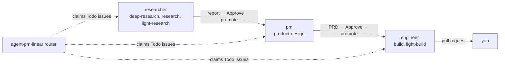
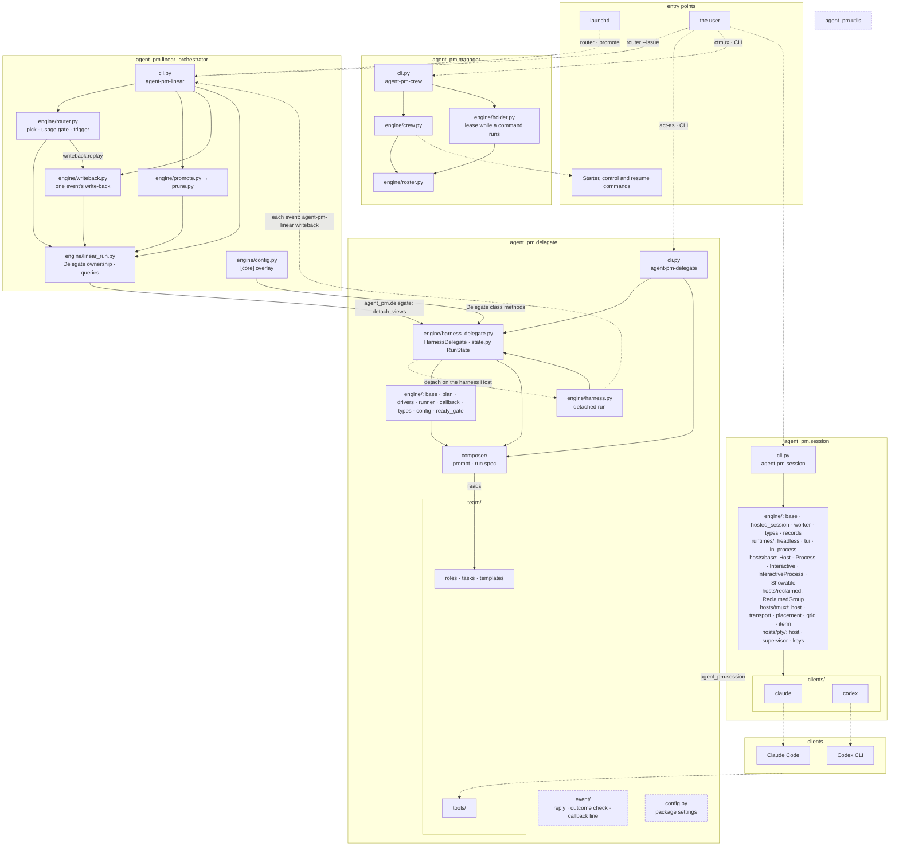
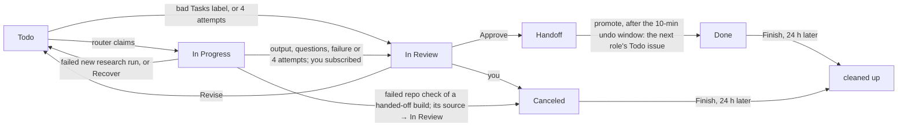
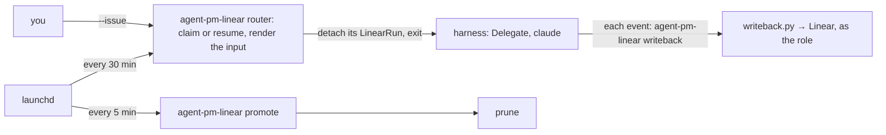

# agent-pm

[](https://github.com/ophis/agent-pm/actions/workflows/test.yml?query=branch%3Amain) [](LICENSE)

Runs Claude agents unattended from a Linear board. Each Linear project is a product, and an issue's assignee (a role account) is its stage. Each role works up to `max_runs` issues at once and hands its output back for your review. Once you approve, the next role takes it.

| Part | What it does | Start at |
|---|---|---|
| Core | Runs a role, which picks its task unless given one. A Claude Code and Codex plugin you can use alone. | [Install](#install) |
| Linear orchestrator | Runs the core from the board. | [Setup](#setup) |

Developers: `AGENTS.md`.



## Core architecture

Five layers, one project each: utils < session < delegate < linear-orchestrator < manager. Import rules: `AGENTS.md` › Import rules. The code, by package; terms in `CONTEXT.md`.



Solid arrow: an import, the only direction allowed, or a file read (`reads`); its label names the package imported, by its `__all__`. Dotted: runs a command or process. Dashed: shared modules, their imports not drawn.

## Install

Each client installs the plugin itself, with your git credentials (the repo is private). Before upgrading, see [Upgrading](#upgrading).

| Client | Install |
|---|---|
| Claude Code | `/plugin marketplace add ophis/agent-pm`, then `/plugin install agent-pm@agent-pm` |
| Codex 0.156.0+ | `codex plugin marketplace add ophis/agent-pm` (to refresh an added one: `codex plugin marketplace upgrade agent-pm`), then `codex plugin add agent-pm@agent-pm`. `codex plugin list -m agent-pm` must show it installed and enabled. |

Nothing checks these. A missing one fails the agent run.

| Requirement | For |
|---|---|
| `claude` CLI, Python 3.11+, the `autopilot` plugin | every agent run |
| tmux 3.3+ | tui runs on the `tmux` Host |
| `git`, `gh` logged in | checkouts, GitHub and pull-request destinations |
| iTerm2 running | the default iTerm2 split |

Every session agent-pm starts, agent runs and workers, loads your user settings with every plugin except `agent-pm` (`[clients.<client>] flags` in `session/src/agent_pm/session/config.toml`): only a client you start, the commander, has `/agent-pm:tmux`. Each such session's client also carries `AGENT_PM_AGENT_SESSION=1`, under which `agent-pm-crew` `run`/`hold`/`resume`, `agent-pm-session` `start`/`restart`/`resume`/`client-resume`, `agent-pm-delegate` `run`/`resume` and `agent-pm-linear` `router`/`resume` exit 2 (their forms that start nothing, such as `--dry-run`, `--list` and `--brake`, still run), even run by a checkout's `bin/` path: a guard against slips, not isolation (`env -u` clears it). Agent runs load no MCP servers. A trusted cwd adds its project settings (`trusted_dirs` in `delegate/src/agent_pm/delegate/config.toml`).

| Command | Does |
|---|---|
| `/agent-pm:tmux` | Launch and direct workers, role runs and pipeline runs. |
| `ctmux <name>` | Open the commander's tmux session: native windows in iTerm2, a plain tmux attach in other terminals, a switch from inside tmux. `ctmux --install` puts ctmux and the four commands `agent-pm-crew`, `agent-pm-session`, `agent-pm-delegate` and `agent-pm-linear` in `~/.agent-pm/bin/`: run them by that path, or add it to `PATH`. Each runs that command from the plugin installed when it runs, Claude Code's install first, then Codex's newest, so an upgrade needs no reinstall; rerun `--install` to refresh them. |
| `/agent-pm:manage` | The commander's guidelines. |
| `/agent-pm:act-as <role>[:<task>] <input>` | Run a core role in this conversation. |
| `agent-pm-delegate run --list` | List every role and task. |

Your own roles, tasks and templates: `team_dirs` in `delegate/src/agent_pm/delegate/config.toml`.

## Setup

Needs macOS and Install's requirements. The orchestrator runs this checkout's scripts, not the plugin. `<work_dir>` is `linear_orchestrator.work_dir`.

1. Create `~/.agent-pm/config.local.toml` from the `# local:` lines of each packaged `config.toml`, each under its layer's section. Include researcher's and pm's `[output]`. A required key left `""` stops every `agent-pm-linear` command.

   ```toml
   [delegate.roles.engineer]              # run settings
   tier = 2

   [linear_orchestrator.roles.engineer]   # board settings
   account = "engineer@example.com"
   max_runs = 1
   ```

2. Set `task_label_group` to the id of the `Tasks` label group (Linear query `issueLabels { nodes { id name isGroup } }`).
3. Router and promote act in Linear as the harness account `frank.agent.w@gmail.com`; each role writes back as its own `account`. For each role:
   1. Linear › Settings › Members: invite the `account`, a plus-alias such as `frank.agent.w+pm@gmail.com`.
   2. Open the invite in a private window and choose **Continue with email**.
   3. As the role account, create a personal API key.
   4. `security add-generic-password -s <key> -a <account> -w`, then paste the key.
4. Store the harness key:
   ```bash
   security add-generic-password -a frank.agent.w -s linear-api-key -w   # config.local.toml: [linear_orchestrator] harness_key
   ```
5. Dry-run each job:
   ```bash
   bin/agent-pm-linear router --dry-run
   bin/agent-pm-linear promote --dry-run
   ```
6. Install the launchd jobs:
   ```bash
   mkdir -p ~/.agent-pm/logs   # launchd can't start a job without it
   for job in router promote; do
     launchctl bootout gui/$(id -u)/com.ophis.agent-pm.$job 2>/dev/null   # fails harmlessly if none is loaded
     cp linear-orchestrator/launchd/com.ophis.agent-pm.$job.plist ~/Library/LaunchAgents/
     launchctl enable gui/$(id -u)/com.ophis.agent-pm.$job
     launchctl bootstrap gui/$(id -u) ~/Library/LaunchAgents/com.ophis.agent-pm.$job.plist
   done
   launchctl list | grep com.ophis.agent-pm   # exactly the two jobs
   ```

| Job | Schedule |
|---|---|
| router | :00 and :30, with `--now` (drop it to run only 01:00–06:59) |
| promote | every 5 min |

The plists hard-code this checkout's path and `~/.agent-pm` (launchd doesn't expand `~`). For another checkout or `work_dir`, edit them in `linear-orchestrator/launchd/` and rerun step 6. To uninstall a job:

```bash
launchctl bootout gui/$(id -u)/com.ophis.agent-pm.<job>
rm ~/Library/LaunchAgents/com.ophis.agent-pm.<job>.plist
```

## Using the board



- **New work:** a Todo issue in the product's project, assigned to a role account. The description is the brief, or an engineer issue's requirement. Add `Repo: <owner>/<name>` if the repo is not the project's `[project_repos]` entry.
- **Order work:** the router claims by priority, then later role, then oldest. A blocked issue waits until its blockers are Done, Canceled or Duplicate.
- **Duplicates:** on an issue's first claim the router searches the team's issues (archived too), the docs repo and the target repo's merged PRs by its title words and the issue ids its description names, and lists the matches, minus its Handoff chain, at the end of the agent's input under `## Related work`. A failed search logs `related-skip` and the run goes on.
- **Approve:** move to Handoff and comment what's next. After 10 minutes (move it out of Handoff to undo), promote creates the next role's issue and marks this one Done.
- **Revise:** comment and move back to Todo. The agent resumes where it left off. On an engineer issue your PR comments and reviews count too. After 4 attempts the issue goes to In Review.
- **Finish:** set Done or Canceled. 24 hours later prune deletes the run's workspaces and the issue's pushed branches, and archives pm and engineer issues; 7 days later it deletes the issue's whole workdir. Uncommitted and unpushed work is lost.

### Task labels

A label from the `Tasks` group picks the role's task, mapped by `[task_labels]`. No label: the agent picks (unsure: the researcher runs Research, which has no label; the engineer Build) and says why in its start comment. A bad label (unmapped, another role's, or several): the issue goes to In Review with a comment. To upgrade a report (Light Research → Research → Deep Research), set the next task's label (to Research: remove the label), comment the claims to verify, and move it back to Todo.

A label from `[option_labels]`, outside `Tasks`, adds its option to the input; `visual` (`Visual: yes`): the researcher also adds an HTML version of its report beside the Markdown (`delegate/src/agent_pm/delegate/team/roles/researcher.md` › Visual).

## Operating



```bash
bin/agent-pm-linear router --issue <ID>         # run one issue now, skipping the hours, max_runs and usage gates
bin/agent-pm-linear router --issue <ID> --tui   # the same, attended in a TUI (display, events file, exit codes: --help)
bin/agent-pm-linear attach-command <ID>         # the command that shows its agent run
bin/agent-pm-linear close <ID>                  # end the run and its TUI; the issue stays In Progress for Recover
bin/agent-pm-linear resume <ID>                 # resume an attended run where it was shown
tmux ls                                         # running agent runs
```

Run `bin/agent-pm-linear` by its absolute path; `--help` lists each command's options. Events go to `<work_dir>/logs/orchestrator.jsonl`. Keep `<work_dir>/logs/runs.jsonl`: resume, Recover, write-back and the first-claim search read it.

Each session's `Run <sid>` comment holds its resume command. Move the issue out of In Progress before opening it, or the router may resume it after 30 idle minutes.

## State root

agent-pm keeps its state in its state root, `~/.agent-pm/`. `work/` and `logs/` are in `<work_dir>` instead, `~/.agent-pm` by default.

```text
~/.agent-pm/
├── config.local.toml             this machine's settings
├── work/<ID>/                    an issue's agent-run workdir
│   ├── agent/                    the agent's cwd and only write grant
│   │   ├── src/  publish/        the run's checkouts; the report repo's clone
│   │   └── tmp/                  the run's temp files
│   ├── run/                      the harness's files, kept as the run's record
│   │   ├── delegate.json         the run's state, beside its locks
│   │   ├── run.jsonl             session records; resume reads them
│   │   └── out.md                the deliverable
│   └── writeback.json            the write-back ledger, beside its lock
├── logs/
│   ├── runs.jsonl                each run's start, resume and limit rows
│   ├── orchestrator.jsonl        the event log, also launchd's stdout and stderr
│   ├── orchestrator.jsonl.1      the event log before its last rotation
│   ├── orchestrator.jsonl.lock   one rotation at a time
│   └── router.lock               one router at a time
├── sessions/claude/  codex/      what a client session's resume command replays
├── tui/<name>/                   a running tui session's state and hook log
├── tui/<name>.lock               that name's start and close lock
├── pty/<name>/                   a pty-host session's files
├── pty/<name>.lock               that name's start lock
├── workers/<sid>/                a worker's state; by-name/<name>: its latest sid
├── hidden/<name>.json            whether that name's tmux session is hidden, for its sid
├── managers/<name>/              a manager's Roster and events file
├── adhoc/<date>-<role>-<name>/   workdirs of /agent-pm:act-as and /agent-pm:tmux role runs
├── probe/                        the empty cwd of the client usage check
└── bin/                          ctmux --install's launchers
```

| Entry | Cleaned by | Safe to delete by hand |
|---|---|---|
| `config.local.toml` | nobody | never: your settings |
| `work/<ID>/agent/` | prune ([Finish](#using-the-board)) | no: prune also drops the issue's worktrees and pushed branches in a `[local_clones]` clone |
| `work/<ID>/run/` | prune deletes the whole `work/<ID>/` 7 days after Done or Canceled, once `agent/` is gone and the run is not live | once you won't attach or resume the run; by hand where prune never reaches: the run's delegate kind is no longer configured, or the issue was deleted in Linear |
| `work/<ID>/writeback.json`, `writeback.lock` | prune, with `work/<ID>/run/` | once the issue's run won't resume or be recovered: Recover replays a write-back missing from the ledger; where prune never reaches: as `work/<ID>/run/` |
| `logs/runs.jsonl` | the router: rows over 7 days old, except each issue's latest run | never ([Operating](#operating)) |
| `logs/orchestrator.jsonl`, `.1`, `.lock` | each event's writer: at 10 MiB the file becomes `.1`, replacing the old `.1` | any time; keep `logs/` ([Setup](#setup) step 6) |
| `logs/router.lock` | nobody | while no router runs |
| `sessions/` | saving a client session's state: an entry not saved or resumed for 30 days | an entry once its session ended and you won't resume it |
| `tui/<name>/` | closing or stopping the session; the tui sweep | no: closing the session removes it |
| `tui/<name>.lock` | the tui sweep | while no session of that name starts or closes |
| `pty/<name>/`, `pty/<name>.lock` | closing the session or a detached session's exit (the dir); the pty sweep | no: closing the session removes it; a `<name>.lock` while no session of that name starts |
| `workers/<sid>/` | each `agent-pm-session` start, restart or resume that launches a worker's client: a sid whose `worker.json` is over 30 days old, that no `by-name/` entry names and no worker lock holds | once you won't restart or resume the worker |
| `hidden/<name>.json` | each write of one (a `--display none` start, `show`, `hide`): an entry unwritten for 30 days whose tmux session is gone | any time: that session then reads not hidden |
| `managers/<name>/` | `agent-pm-crew forget` drops an entry; `events` rotates to `events.1` past 1 MiB | while no manager holds it; its Roster is lost |
| `adhoc/` | nobody: your working directory | a folder whose run is not running (`agent-pm-delegate status <dir>`) |
| `probe/`, `bin/` | nobody | any time; `ctmux --install` restores `bin/` |

Each tui start runs the tui sweep and each pty start the pty sweep, over the other names of their dir whose files all went unchanged for 30 days: the tui sweep drops a name its host has no session of, the pty sweep one with no process left; a name whose lock is held stays.

## agent-pm-session

`bin/agent-pm-session --help` lists its subcommands. `ls` prints a header, then one tab-separated row per session: `name`, `state` (`working`, `done`, `blocked`, `dead`), `client`, `sid`, `display`, with `-` for an empty value.

Sessions run on `[session.hosts] default`: `tmux`, or `pty` (each on a pty its own supervisor holds, state in `~/.agent-pm/pty/<name>/`). A `pty` session cannot be shown: `show`, `hide`, `attach-command`, `read` and `tile` exit 1, and its `status` `attach` is null. `[delegate.delegates] harness_host = "pty"` puts only detached runs' harnesses there.

`start --display none` starts a worker without a pane, still opened by the caller, and hidden. Hidden (from that, `hide`, or closing its pane by hand; not from losing the manager's window or detaching its viewer) lasts through `restart` and `resume` until `show`.

## Client policy

Role runs' client flags are `[policy.claude]` and `[policy.codex]` in `delegate/src/agent_pm/delegate/config.toml`. A local list replaces the default whole. Codex defaults to `danger-full-access`, which ignores writable roots and team dirs. For `workspace-write`:

```toml
[delegate.policy.codex]
flags = ["-s", "workspace-write", "-c", 'approval_policy="on-request"', "-c", 'approvals_reviewer="auto_review"', "-c", "sandbox_workspace_write.network_access=false", "-c", "sandbox_workspace_write.writable_roots=[]"]
```

## Switching from v1

v1 is the `v1-runtime` checkout: `core/`, `orchestrator/`, and overrides in `~/.agent-pm/core.local.toml` and `~/.agent-pm/orchestrator.local.toml`. Nothing reads v1's files or state. Do these in order, in the checkout the launchd jobs ran:

1. **Drain the board.** Wait until nothing is In Progress and `tmux ls | grep '^agent-pm-'` prints nothing. v1 runs can't be resumed or written back.
2. **Stop v1.** Unload its jobs and kill every agent-pm tmux session (v1 tui sessions `<role>-<ID>-<8 hex>` and workers):
   ```bash
   for job in router promote; do launchctl bootout gui/$(id -u)/com.ophis.agent-pm.$job; done
   tmux kill-session -t '=<name>'   # each agent-pm session tmux ls lists
   ```
3. **Switch to main:** `git switch main && git pull --ff-only`. It fails while another worktree of the repo has `main` checked out: run `git switch --detach` there first. Then move `core/` and `orchestrator/` to the Trash if they remain: untracked, they hold only `__pycache__`.
4. **Reinstall the plugin.** v1 was also 0.4.0, so `claude plugin update` keeps v1's files. Reinstall it, then run `/reload-plugins` in each open Claude Code session:
   ```bash
   claude plugin uninstall agent-pm@agent-pm
   claude plugin marketplace update agent-pm
   claude plugin install agent-pm@agent-pm
   ```
   `~/.claude/plugins/cache/agent-pm/agent-pm/<version>/` must hold `delegate/` and `manager/`, not v1's `skills/`, `src/` and `team/`. Codex: [Install](#install), refreshing the added marketplace. Then `ctmux --install`.
5. **Move the overrides** into `~/.agent-pm/config.local.toml` by the table below, values unchanged, then delete the two v1 files. `bin/agent-pm-linear router --dry-run` must print no `config-error`.
6. **Do the [Upgrading](#upgrading) rows** that apply. Rotate any real credential ever passed in a Claude run's env: earlier resume commands printed it into `run.jsonl` and session comments.
7. **Run the [Smoke checklist](#smoke-checklist).**
8. **Install launchd** by [Setup](#setup) step 6 once the smoke checklist passes. Its first runs clear v1's leftovers: promote's prune deletes the checkouts and temp files `prune --dry-run` listed, and the router's Recover moves an issue left In Progress by v1 back to Todo (`recover`, `"reason": "no session"`).

`show` changed meaning: v1's `""` opened nothing. Now `""` opens a pane and `"none"` opens nothing until `show`.

| v1 | `config.local.toml` |
|---|---|
| `core.local.toml` `tier`, `effort`, `language`, `cwd`, `show`, `users`, `trusted_dirs`, `team_dirs` | `[delegate]` |
| `core.local.toml` `status_line`, `workers_per_column`, `grid_retile` | `[session.hosts.tmux]` |
| `core.local.toml` `[output]`, `[roles.<role>]` | `[delegate.output]`, `[delegate.roles.<role>]` |
| `core.local.toml` `[clients.claude]` `flags` | `--permission-mode`, `--strict-mcp-config` to `[delegate.policy.claude]`, the rest to `[session.clients.claude]` |
| `core.local.toml` `[clients.claude]` `allow`, `env`, `tiers`, `efforts` | `[session.clients.claude]`, same names |
| `core.local.toml` `[clients.codex]` `tiers`, `efforts` | `[session.clients.codex]`, same names |
| `core.local.toml` `[clients.codex]` `shell_network` | a `[delegate.policy.codex]` flag ([Client policy](#client-policy)) |
| `core.local.toml` `[clients.skill.…]`, `[clients.<name>]` `implementation` | drop |
| `orchestrator.local.toml` top-level keys | `[linear_orchestrator]` |
| `orchestrator.local.toml` `[states]`, `[task_labels]`, `[project_repos]`, `[local_clones]`, `[roles.<role>]`, `[core]` | the same tables under `linear_orchestrator.`; drop a `gate` copied into `[core]` |

## Smoke checklist

Run it right after switching to `main`, in order, from the checkout root inside tmux; stop at the first failure. Steps 1–6 change nothing in Linear. Steps 7–9 need two throwaway Todo issues in a test project: `<H>` for the engineer (Light Build, a `Repo: <owner>/<scratch repo>` line and a one-line change) and `<T>` for the researcher (Light Research, a one-line question).

| # | Check | Run | Passes when |
|---|---|---|---|
| 1 | Commands | each `bin/` command's `--help`, then `agent-pm-session ls`, `agent-pm-delegate run --list`, `agent-pm-crew status --manager <name>` | all exit 0; `run --list` shows researcher, pm, engineer and dummy-tester |
| 2 | Config validation | the block below | each command fails with `unknown key 'smoke_bad_key' in [<section>]` before any Linear call |
| 3 | Claude Code plugin | `/agent-pm:act-as dummy-tester:echo smoke` in a throwaway session | it echoes `smoke`; `/agent-pm:tmux` and `/agent-pm:manage` load |
| 4 | Codex plugin | `codex --version`; in a Codex session, pick agent-pm's `tmux` and ask it to run `agent-pm-session ls` | 0.156.0+; Codex runs `bin/agent-pm-session` by absolute path, with no literal `${CLAUDE_SKILL_DIR}` |
| 5 | Dry runs | `bin/agent-pm-linear` `router --dry-run`, `router --issue <H> --tui --events "$(mktemp)" --dry-run`, `promote --dry-run`, `prune --dry-run` | each prints the plan you expect and exits 0; no issue moves, no tmux session starts |
| 6 | Brake | `bin/agent-pm-linear router --brake researcher` | exit 0 or 1, not 2 |
| 7 | Headless run | `bin/agent-pm-linear router --issue <H>` | `<H>` goes In Progress with its start and `Run <sid>` comments and an `engineer-<H>-<sid8>-drive` session; it ends with a PR on the scratch repo linked in a comment, `<H>` In Review, the session gone |
| 8 | Attended run | `bin/agent-pm-linear router --issue <T> --tui --events "$(mktemp)"` | as step 7, with a `researcher-<T>-<sid8>` TUI; the report is published, linked, and `<T>` is In Review |
| 9 | Router lock | the block below, with `<H>` In Review | `router.py: another router is running; try again`, exit 2 |

```bash
# step 2: before each command, put `smoke_bad_key = 1` under only that section of the copy
smoke=$(mktemp -d) && mkdir "$smoke/.agent-pm" && cp ~/.agent-pm/config.local.toml "$smoke/.agent-pm/"
HOME=$smoke bin/agent-pm-session ls                 # [session]
HOME=$smoke bin/agent-pm-delegate run --list        # [delegate]
HOME=$smoke bin/agent-pm-linear router --dry-run    # [linear_orchestrator]
rm -r "${smoke:?}"

# step 9: hold <work_dir>/logs/router.lock for 60 s, then run the router
python3 -c 'import fcntl, os, time; f = open(os.path.expanduser("~/.agent-pm/logs/router.lock"), "a"); fcntl.flock(f, fcntl.LOCK_EX); time.sleep(60)' &
bin/agent-pm-linear router --issue <H>
```

On a failure, read `<work_dir>/logs/orchestrator.jsonl` and `<work_dir>/work/<ID>/run/run.jsonl`. End a stuck run with `bin/agent-pm-linear close <ID>`. A check that passes when it should fail (steps 2, 4, 9) is a bug: report it.

## Upgrading

Nothing migrates automatically. Do each step that applies, once, by hand or through an agent.

| If you have | Do |
|---|---|
| running agent-pm sessions | Close them first. |
| a flat `config.local.toml` | Move top-level values under `[session]`, `[delegate]` or `[linear_orchestrator]`, per the layer's packaged `config.toml`, and prefix tables with that section: `[roles.engineer]` becomes `[delegate.roles.engineer]` (run) or `[linear_orchestrator.roles.engineer]` (board). `show` goes under `[delegate]` or `[delegate.roles.<role>]`. `core-new.local.toml` goes under `delegate`, `linear-new.local.toml` under `linear_orchestrator`. |
| a `runtime` key or `--runtime` | Rename it `client` everywhere. Records written with `runtime` are not read. |
| `[session.adapters.<name>]` tables, or an `implementation` naming `agent_pm.session.adapters` or an `…Adapter` class | Rename them `[session.clients.<name>]`, `agent_pm.session.clients` and `…Client` (`ClaudeClient`, `CodexClient`); an extension's `Adapter` base is now `Client`; a Host's `HostProcess` is `Process`, `Terminal` is `InteractiveProcess` (its `send` / `press` in `Interactive`), `Displayable` / `NotDisplayable` are `Showable` / `NotShowable`. |
| `~/.agent-pm/core-new-sessions/codex` | Close Codex TUI sessions, then `mkdir -m 700 -p ~/.agent-pm/sessions && mv ~/.agent-pm/core-new-sessions/codex ~/.agent-pm/sessions/ && rmdir ~/.agent-pm/core-new-sessions`. |
| a v1 manager roster: `~/.agent-pm/managers/<name>/roster.json` with `"version": 1`, which fails `agent-pm-crew status` and `attach` with `want roster fields` | Back up `~/.agent-pm/managers/`, then move its contents to the Trash. The next `agent-pm-crew attach` starts an empty roster. |
| `default_task` or `tasks` in a role table | Drop `default_task`. Move each `<prefix>.roles.<role>.tasks.<task>` table's keys to `<prefix>.roles.<role>`, for the prefixes `delegate`, `delegate.clients.<name>` and `linear_orchestrator.core`. |
| `[session.clients.codex]` `sandbox`, `shell_network` | Express them in `[delegate.policy.codex]` `flags`. |
| a local `flags` list in `[session.clients.claude]` or `[session.clients.codex]` | A local list replaces the packaged one whole: add its agent-pm entry, Claude `"--settings", '{"enabledPlugins": {"agent-pm@agent-pm": false}}'`, Codex `"-c", "plugins.agent-pm@agent-pm.enabled=false"`. |
| `--permission-mode`, `--strict-mcp-config` in `[session.clients.claude]` | Move them to `[delegate.policy.claude]`; keep there only flags every session needs. |
| `runs.jsonl` start, resume or limit rows without `delegate_kind` | Before deploying, add `"delegate_kind": "harness"` to each, changing nothing else. |
| an issue In Progress across the trigger-only router or `runs.jsonl` deploys | Deploy with nothing In Progress. |
| Claude runs started before `agent-pm-session client-resume claude` | Resume them by hand: their `Run <sid>` command has no saved launch to replay. |
| a `~/.agent-pm/bin/ctmux` that is a copy of ctmux, not a launcher (its sessions exit at once outside Claude Code) | Run the plugin's ctmux once: `<plugin>/manager/skills/tmux/scripts/ctmux --install`, `<plugin>` being `~/.claude/plugins/cache/agent-pm/agent-pm/<version>` or `~/.codex/plugins/cache/agent-pm/agent-pm/<version>`. |
| old logs in `<work_dir>/logs/` | `rm -rf ~/.agent-pm/logs/runs.log ~/.agent-pm/logs/router.log ~/.agent-pm/logs/promote.log ~/.agent-pm/logs/projects ~/.agent-pm/logs/tui` |
| `src/` or `run.jsonl` directly in a `<work_dir>/work/<ID>/` or `~/.agent-pm/adhoc/*/`, or `~/.agent-pm/delegates/` | [Workdir split](#workdir-split). |

### Workdir split

A run's workdir, `<work_dir>/work/<ID>/` or an ad-hoc `~/.agent-pm/adhoc/<date>-<role>-<name>/`, now holds `agent/` and `run/`. Nothing reads the old layout, and no run started before the move resumes (its cwd moved). The move keeps each issue's checkouts, which prune then finds, and its records; Codex recovery state stays as a record.

1. With no live run and nothing In Progress, move each workdir's files (a finished ad-hoc folder can be deleted instead: [State root](#state-root)):
   ```bash
   for w in <work_dir>/work/*/ ~/.agent-pm/adhoc/*/; do
     [ -d "$w" ] && [ ! -d "$w/run" ] || continue
     mkdir "$w/agent" "$w/run"
     for f in src publish tmp prompt.md; do [ -e "$w/$f" ] && mv "$w/$f" "$w/agent/"; done
     for f in run.jsonl out.md delegate.json delegate.lock; do [ -e "$w/$f" ] && mv "$w/$f" "$w/run/"; done
   done
   ```
2. Reconnect each moved worktree (a checkout whose `.git` is a file) to its `[local_clones]` clone:
   ```bash
   for g in <work_dir>/work/*/agent/src/*/*/.git ~/.agent-pm/adhoc/*/agent/src/*/*/.git; do [ -f "$g" ] && git -C "${g%/.git}" worktree repair; done
   ```
3. `rm -rf ~/.agent-pm/delegates`

## Tests

```bash
export PYTHONPATH=.:.github:delegate/src:session/src:utils/src:manager/src:linear-orchestrator/src:linear-orchestrator/tests   # from the repo root
```

Lint (tool versions pinned in `.github/workflows/test.yml`):

```bash
python3 .github/comment_budget.py
ruff check --no-cache
ruff format --check --no-cache
pyright
lint-imports --no-cache
pylint --disable=all --enable=cyclic-import,duplicate-code manager/src linear-orchestrator/src delegate/src session/src utils/src
vulture
python3 -m tests.checks
python3 .github/run_tests.py "Repository integration" tests/integration
python3 .github/integration_jobs.py --check
actionlint -shellcheck= -pyflakes=
typos --config pyproject.toml
```

| Suite | Command |
|---|---|
| one project's unit tests | `python3 .github/run_tests.py "Session unit" session/tests/unit` |
| all unit tests | `python3 .github/run_tests.py Unit --unit` |
| integration shard 1–8 | `python3 .github/integration_jobs.py <N>` |

Run tests only through these entries; they sandbox each run.

A PR's added and changed `*/src` lines need unit coverage (lines and branches) of at least `THRESHOLD` in `.github/coverage_gate.py` (CI job `Coverage`). With coverage.py installed (version: `COVERAGE_VERSION` in `.github/workflows/test.yml`):

```bash
RUN_TESTS_COVERAGE=/tmp/coverage-data python3 .github/run_tests.py Unit --unit
python3 .github/coverage_gate.py /tmp/coverage-data origin/main
```

`# pragma: no cover` is allowed only in the header (`def` through its colon) of a function that only integration tests run, registered with a reason in `NO_COVER_ALLOWED` of its layer's `tests/guard_data/<package>.py` (check: `tests/guard_checks/suppressions.py` `coverage_pragmas`).

| | Unit | Integration |
|---|---|---|
| Tests | pure logic, with fakes and recorded output | real tools in `utils/tests/sandbox.py` |
| Limits | no processes, no sockets, writes only in the runner's temp dir | tmux only on `session/tests/live_tmux.py` servers |
