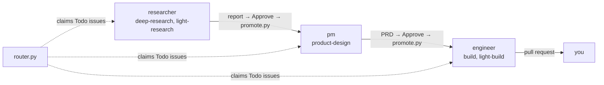
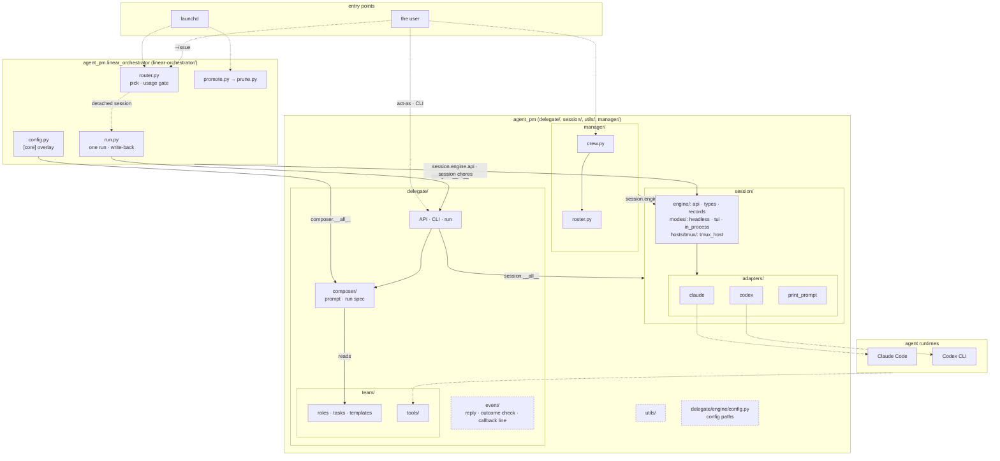
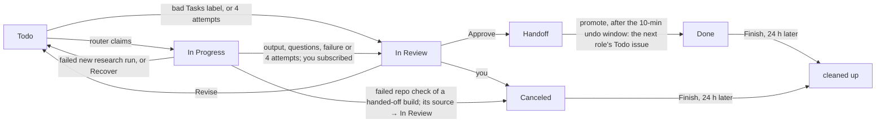
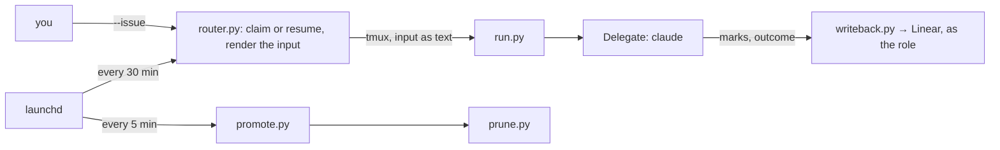

# agent-pm

[](https://github.com/ophis/agent-pm/actions/workflows/test.yml?query=branch%3Amain)

Runs Claude agents unattended from a Linear board. Each Linear project is a product; an issue's assignee, a role account, is its stage. Each role works up to `max_runs` issues at once, handing its output back for your review; once you approve, the next role takes it. The core runs a role, which picks its task unless given one, and is a Claude Code plugin you can use alone (Install); the Linear orchestrator runs it from the board (Setup). Their code: Layout; local headless Codex role runs: Runtime policy. Developers: `CLAUDE.md`.



### Core architecture

The code, by package; modules in Layout, terms in `CONTEXT.md`.



Solid arrow: an import, the only direction allowed, or a file read (`reads`); a label like `session.engine.api` names the only API it may import. Dotted: runs a command or process. Dashed: shared modules, their imports not drawn. The rules and their exceptions: Layout's import paragraph, checked by `tests/guards.py`.

## Install

`/plugin marketplace add ophis/agent-pm`, then `/plugin install agent-pm@agent-pm` (a private repo: your git credentials). Requires the `claude` CLI, Python 3.11+ (stdlib only), tmux 3.3+ (tui runs), `git` and `gh` logged in (checkouts, the `github` and `pull-request` destinations), the `autopilot` plugin (plus `superpowers` for `build`), GitHub and the web; `osascript`, `pgrep` and a running iTerm2 only for the default iTerm2 split. Nothing checks them: a missing one fails the agent run. Agent runs load your user settings (`~/.claude/CLAUDE.md`, skills, permissions, plugins but `agent-pm`) and no MCP servers; a trusted cwd adds its project settings, `CLAUDE.md`, skills and `.mcp.json` (`delegate/config.toml`'s `cwd` and `trusted_dirs`).

- `/agent-pm:tmux` and `ctmux`: removed, rebuilt by [TASK-356](https://linear.app/ophis-workgroup/issue/TASK-356).
- `/agent-pm:manage`: your guidelines for the commander session, the one you talk to; run it there. Only you can invoke it, so a worker starting its own workers never gets it: `manager/skills/manage/SKILL.md`.
- `/agent-pm:act-as <role>[:<task>] <input>`: run a core role in this conversation, on that task or one it picks: `delegate/skills/act-as/SKILL.md`.
- Your own roles, tasks and templates, outside the plugin: `delegate/config.toml`'s `team_dirs` comment; the Delegate CLI's `--list` (Layout) lists every role and task.

## Setup

Requires macOS, Install's requirements and `gh` logged in as you. The Linear orchestrator runs this checkout's scripts, not the plugin.

1. Create `~/.agent-pm/local.toml`, the one local file over every project's `config.toml` (layers, merge rules and key ownership: `utils/src/agent_pm/utils/config_file.py`'s docstring), from the `# local:` lines of `session/`, `delegate/` and `linear-orchestrator/config.toml`, with researcher's and pm's `[output]` (delegate's Destination comment); a required key left `""` stops router, run and promote. `<work_dir>` below is the `work_dir` key. Migrating: the old `~/.agent-pm/core-new.local.toml` and `~/.agent-pm/linear-new.local.toml` contents go into `local.toml` (a table both define, such as `[roles.<role>]`, once), `show = ""` becoming `show = "none"`.
2. Find `task_label_group` with the Linear API's `issueLabels { nodes { id name isGroup } }`; the router stops if it isn't a label group or a `[task_labels]` id isn't one of its labels.
3. Agent runs need no `linear` skill and get no Linear key: router and promote act in Linear as the harness account `frank.agent.w@gmail.com`, each role's write-back as its `[roles.<role>]` `account`, its API key in the Keychain under `key`. Per role:
   1. Linear → Settings → Members: invite the `account` (a Gmail plus-alias of the harness account, e.g. `frank.agent.w+pm@gmail.com`).
   2. Open the invite in a private window, choosing **Continue with email** (Google signs in as the harness account).
   3. As the role account, create a personal API key in its settings.
   4. `security add-generic-password -s <key> -a <account> -w`, pasting the key at the prompt. `router.py` checks the item exists; a missing one stops that role's agent runs with a `config-error` event in `<work_dir>/logs/orchestrator.jsonl`.
4. The harness account's key:
   ```bash
   security add-generic-password -a frank.agent.w -s linear-api-key -w   # the only item under local.toml's harness_key
   ```

launchd scheduling of router and promote returns after the re-architecture.

## Using the board



- **New work:** a Todo issue in the product's project, assigned to the role account that should do it; others (unassigned, or a person) are never picked. Researcher and pm issues take the brief from the description; a direct engineer issue's text is its requirement. A research or pm issue about a repo other than its project's `[project_repos]` entry, or a direct engineer issue whose project has none, needs a `Repo: <owner>/<name>` line.
- **Order work:** the router claims by priority, then later role, then oldest. "Y blocks X": X is claimed only once every direct blocker is Done, Canceled or Duplicate (archived counts as done, an unreadable blocker as not done); the router logs a `blocked` event naming Y.
- **Approve:** move to Handoff, commenting what's next (optional for a PRD). A PRD's target repo is the project's `[project_repos]` entry, which the PM's hand-off comment names; without one, comment `Repo: <owner>/<name>`; a `Repo:` line in your comment always wins. After a 10-minute undo window (pull it back out of Handoff), promote creates the next role's issue in the same project and marks this one Done; it carries the source's output links and your comments.
- **Revise:** comment, move back to Todo; the agent picks up where it left off. On an engineer issue your PR comments and reviews count too; other authors' reach the build as review input, but only yours start a new build. After 4 attempts an unfinished issue goes to In Review; a `human_members` user moving it back to Todo resets the count.
- **Finish:** Done and Canceled are yours to set. 24 hours later, `src/` (clones and worktrees), `publish/` (the docs clone) and `tmp/` in `<work_dir>/work/<ID>/` are deleted; the rest stays. In each local clone those worktrees came from, prune drops their records and deletes the issue's `<ID>-*` branches that origin holds, keeping and reporting the others. Lost: uncommitted changes, commits never pushed from a detached HEAD or a submodule, and, as `git worktree prune` covers the whole clone, the record of any of your worktrees whose folder is missing then, unless you `git worktree lock` it. pm and engineer issues are archived then too: restore one in Linear before reworking it.

### Task labels

The issue's label in the `Tasks` label group names one of the assignee role's tasks by its id, through `[task_labels]`, so renaming a label keeps working: the agent run does exactly that task. No such label → the agent run picks one from its role's task index (`delegate/src/agent_pm/delegate/team/roles/<role>.md` › Tasks: what each task does, when to use it, how heavy; unsure → the default it names), and its start comment names the pick and why. A label not in `[task_labels]`, a task not the role's, or several task labels → no agent run, no attempt counted: the router subscribes you, moves the issue to In Review and comments why; fix the label, move it back to Todo. To upgrade a Light Research issue, swap in the Deep Research label, comment the claims to verify and move it back to Todo: the next agent run is `deep-research`, with the earlier report in its input. A resumed agent run keeps its session's task whatever the labels say (`<work_dir>/logs/runs.jsonl` keeps only the role); an interrupted agent run whose logged role is not the assignee's goes to In Review with a comment.

**Upgrade** from task-level config: a role table holding `default_task` or `tasks` stops agent runs with a config error naming its new table. Drop `default_task`; move the keys of `local.toml`'s `[roles.<role>.tasks.<task>]` to `[roles.<role>]` and of its `[clients.<name>.roles.<role>.tasks.<task>]` to `[clients.<name>.roles.<role>]` (e.g. `[clients.skill.roles.<role>.output]`), of its `[core.roles.<role>.tasks.<task>]` to `[core.roles.<role>]`. Then do Operating's Upgrade too.

## Operating



The router's and promote's commands: Layout.

```bash
tmux ls                                                      # running sessions, agent-pm-<role>-<ID>
tmux attach -t '=agent-pm-<role>-<ID>'                       # watch one agent run; = matches the exact name
```

`--issue` skips the hours, `max_runs` and usage gates and Recover's waits (`tmux ls` is the truth): a ready Todo issue is claimed as in a tick; an In Progress one resumes its session in `runs.jsonl`, or, with none to resume, goes where Recover sends it; an issue with a live agent run gets its attach command instead (exit 1). While another router runs, nothing happens (exit 1).

| Log | Contents |
|---|---|
| `<work_dir>/logs/orchestrator.jsonl` | Every router, promote, prune, run and write-back event, one JSON object a line: `ts`, `src`, `kind`, then `issue` when it has one. An idle tick writes none; the same skip, config-load error or Linear outage (`linear-error`: a 5xx, rate limit, timeout or network error; the run stops, the next retries), once a day |
| `<work_dir>/logs/runs.jsonl` | Agent run start/resume lines of the last 7 days: keep it, resume and Recover read it |

An agent run's workdir `<work_dir>/work/<ID>/` holds `run.jsonl` (its record: input, sessions, progress, outcome; headless, the client's stderr), `writeback.json` (the write-back steps done) and, for a `local` or `orchestrator` destination, `out.md` (the deliverable); `src/`, `publish/` and `tmp/` are workspaces (Finish). Documents are published from the agent run's clone in `publish/`: `git pull` your own docs clone to see them. Each session gets a `Run <sid>` comment on its issue, holding `cd <cwd> && claude --resume <sid>`: to open the session, first move the issue out of In Progress, or the router may resume it once idle 30 minutes. Moving `<work_dir>` or a run's cwd breaks resuming its in-progress agent runs.

**Upgrade** to `orchestrator.jsonl` and `runs.jsonl`: deploy with no issue In Progress (nothing reads the old `runs.log`, so Recover would send such an issue back to Todo for a new session); delete the old logs, no archive (another `<work_dir>`: its `logs/`):

```bash
rm -rf ~/.agent-pm/logs/runs.log ~/.agent-pm/logs/router.log ~/.agent-pm/logs/promote.log ~/.agent-pm/logs/projects ~/.agent-pm/logs/tui
```

### Attended runs

The old router's `--tui` is gone; the new router (Layout) gains it in [TASK-332](https://linear.app/ophis-workgroup/issue/TASK-332).

## Layout

Paths from the repo root, where commands run. Each module's docstring states its behaviour.

| Path | What |
|---|---|
| `delegate/`, `session/`, `utils/`, `manager/`, `linear-orchestrator/` | the five projects, each `src/agent_pm/<its subpackage>/` (`delegate`, `session`, `utils`, `manager`, `linear_orchestrator`): `agent_pm` is one PEP 420 namespace package (no `__init__.py`) over the five `src/` import roots, imported by package path; set PYTHONPATH to this tree's five, never rely on an inherited one (each `tests/case.py` `Case` fails a test on another tree's `agent_pm`). An agent session with commands or a gate gets them as its PYTHONPATH, replacing the user's own (`agent_pm.delegate.composer.run`) |
| `session/src/agent_pm/session/`, `delegate/src/agent_pm/delegate/` | a package per layer: `session/` (layers `engine/api.py`, `engine/types.py`, `engine/records.py`, `modes/`, `hosts/`, `adapters/`), `delegate/` (layers `delegate/`, `composer/`; shared `event/` and `engine/config.py`; the built-in team `team/`, its `tools/` outside the layers); `manager/` and `utils/` outside the layers |
| `delegate/src/agent_pm/delegate/engine/config.py` | the only home of the delegate config's path (`CONFIG`) and of the import roots (`DELEGATE`, the delegate project dir; `IMPORT_ROOTS`, every `<repo root>/*/src` holding `agent_pm/`; `PYTHONPATH`, them joined: a child's); checks `[delegates]` `harness_host` against the hosts `Session.settings` parsed (`hosts()`) |
| `delegate/src/agent_pm/delegate/` | the Delegate: one role's run through the Composer and the Driver, read from its replies; `engine/` the Delegate class and how it runs (`base.py` its ABC `Delegate`, `types.py` its shared types, `plan.py`, `runner.py`, `detach.py`); `cli.py`, the layer's entry, its command line and the exit codes' home: `PYTHONPATH=<the five src dirs> python3 -m agent_pm.delegate.cli --role ROLE --input TEXT --out PATH\|- --workdir DIR`, `… --list`, `… --detach --events FILE` (the run in Driver session `<role>-<sid8>-drive`) |
| `delegate/src/agent_pm/delegate/composer/` | the Composer: a role's run config, access and prompt from the team root and team dirs; their formats: its `__init__.py` docstring |
| `delegate/src/agent_pm/delegate/team/` | the Composer's built-in team, the team root (`composer.TEAM`; `<team>` in team text, `{{team}}` in `delegate/config.toml`): main's root `core/team/` at a0bf18c (before the split), except that `output/output.md` and `output/destinations/{local,orchestrator}.md` name the outcome's `deliverable_file`, a method is `<team>/methods/<m>.md`, `outcome.schema.json` is in `event/` and `repo.py` in `tools/` |
| `delegate/src/agent_pm/delegate/team/tools/repo.py` | an agent-run CLI (git/gh side effects), outside the layers, run by path as `python3 -P <team>/tools/repo.py worktree …` / `status …` (`delegate/config.toml` `commands`); it imports `agent_pm` from the session's PYTHONPATH (`team/` and `tools/` are no packages) |
| `delegate/src/agent_pm/delegate/event/` | every message passed between layers, shared: agent to Delegate `reply.py` (the reply protocol's progress mark tag and outcome fence info; `marks`, `outcome_block`) and `outcome.py` (the outcome check, against `outcome.schema.json` beside it), Delegate to orchestration `delegate_event.py` (the callback line, `DelegateEvent`) |
| `utils/src/agent_pm/utils/` | shared utilities; `config_file.py` loads and merges TOML files and reads a project's config (`read_project`: the levels, `~/.agent-pm/local.toml`, key ownership); `paths.py` normalizes paths and checks containment, temporary roots and printable absolute paths (`printable_abs`); `files.py` reads regular files (`read_regular`), writes one atomically (`save`) and appends a line (`append_line`); `text.py` drops control characters (`printable`); `markdown.py` finds Markdown code fences; `args.py` holds argparse helpers (`Once`); `record.py` the Record and Status lines (`Record`, `Status`, `Display`); `registry.py` loads a `module.path:Class` (`load`); `repos.py` parses repo specs and origin URLs and resolves clones and checkout paths (`resolve`, `checkout`); `shell.py` runs a command with a timeout, URL userinfo masked in its stderr (`sh`, `err_text`); `git.py` holds git options that keep a checkout's fsmonitor and hooks off (`GUARD`), finds a worktree's clone (`common_dir`) and runs git with lock retries (`git`) |
| `session/src/agent_pm/session/` | `engine/` the Session ABC and how a session runs: `api.py`, `types.py`, `records.py`, and outside the layers `base.py` (ABC `Session`) and `status_log.py` (`SessionStatusLog`, the status log line's only home: `tests/guards.py` `status_log_format`); `hosts/base.py` (ABCs `Host`, `HostProcess`, `Terminal`, `Displayable`; `NotDisplayable`), outside the layers; `hosts/tables.py` the `[hosts]` parser (`parse`); `adapters/` one subpackage per runtime, `base.py` their interface, `registry.py` (what `Session.configure` stores: the session reads no config file), `selection.py` (session selection) |
| `session/src/agent_pm/session/adapters/claude/` | Claude Code's Adapter, runtime `claude` |
| `session/src/agent_pm/session/adapters/print_prompt/` | act-as's Adapter, runtime `print_prompt`: in_process only; hands the composed prompt back as the deliverable, no process |
| `session/src/agent_pm/session/hosts/tmux/tmux_host.py` | hosts a command in a detached tmux session and shows it in a pane or grid; the only module calling tmux (`tests/guards.py` `tmux_calls`) |
| `session/src/agent_pm/session/modes/` | the Driver's Modes: `headless.py` (a command on pipes), `tui.py` (a tmux session through `tmux_host.py`), `in_process.py` (an Adapter's run on a thread, no process); `tui_hook.py`, the command a tui session's hooks run |
| `manager/src/agent_pm/manager/roster.py` | a manager's roster, outside the layers: `~/.agent-pm/managers/<name>/roster.json`, beside its `events` file |
| `manager/src/agent_pm/manager/crew.py` | a manager's workers, each a tui session (`session/src/agent_pm/session/adapters/base.py`), and its roster, outside the layers: the old crew's CLI (`/agent-pm:tmux`: removed, rebuilt by TASK-356) as `env PYTHONPATH=<the import roots>[:<your PYTHONPATH>] python3 -P -m agent_pm.manager.crew …` (`env`: the act-as row; PYTHONPATH: its docstring) |
| `session/config.toml` | the session's `[adapters.<name>]` and `[hosts.<name>]` tables (tui display keys in `[hosts.tmux]`), which each entry reads (`read_project("session")`) and hands to `Session.configure` through `Session.settings` before it reaches the session (`delegate/engine/plan.py`'s `plan`, `manager/crew.py`'s `main`, the Linear orchestrator's `config.load`) |
| `delegate/config.toml` | the delegate's config, the core config: the Composer's run keys (`runtime` among them, also the manager's default worker runtime) and `[roles.<role>]` tables, `[delegates]` and `[policy.<runtime>]`; which layer reads which keys: the file's header |
| `.claude-plugin/plugin.json` | the Claude Code plugin `agent-pm`, root the repo root (an installed copy holds every package), its skills `delegate/skills/` and `manager/skills/`; `.claude-plugin/marketplace.json` lists it (source `./`). This checkout's: `claude --plugin-dir .`; check: `claude plugin validate .` (its `CLAUDE.md` warning is expected) |
| `linear-orchestrator/src/agent_pm/linear_orchestrator/` | the Linear orchestrator; `linear/` the Linear client (`linear.py`), issues, sessions and write-back; `engine/` the rest, its entries `router.py` (a tick or `--issue`: starts or resumes one agent run as `run.py` in a detached Driver session, its PYTHONPATH the five roots; `--brake ROLE`: ROLE's runtime usage check), `run.py` (one issue's agent run through `delegate.run`, its events written back to Linear) and `promote.py` (a Handoff becomes the next role's Todo issue; then `prune.py` closes finished issues' TUI sessions, deletes their checkouts and archives them): `PYTHONPATH=<the five src dirs> python3 -P -m agent_pm.linear_orchestrator.engine.router\|run\|promote …` |
| `linear-orchestrator/config.toml` | Linear ids, `[roles.<role>]` (over the delegate's), `work_dir` and the `[core]` overlay on `delegate/config.toml`; `config.load` reads it once per entry's `main` |
| `delegate/skills/act-as/SKILL.md` | `/agent-pm:act-as` on the new core: the Delegate CLI as `env PYTHONPATH=${CLAUDE_SKILL_DIR}/../../src:<session's, utils', manager's src as ${CLAUDE_SKILL_DIR}/../../../<project>/src> python3 -P -m agent_pm.delegate.cli …`, runtime `print_prompt`. `env`, not a leading `PYTHONPATH=`: Claude Code's allow rule must match the whole command, which such an assignment prevents |
| `manager/skills/manage/SKILL.md` | `/agent-pm:manage` (Install), text only |
| `<project>/tests/` | each project's tests, `unit/` and `integration/`, and `case.py` (its `Case`: a fresh temp HOME per test, none set at import) (where a test goes and the import scheme: `CLAUDE.md` › Tests); `session/tests/` also holds `fake_adapter/` (the test-only runtime `fake`), `live_tmux.py` (private tmux servers), `selection.py`, `integration/adapters/claude/fake_claude.py` (a fake `claude`), `fakes/` and `contracts/` (the Host's and Session's test doubles; their ABC contracts, a mixin run on each implementation), as `delegate/tests/` the Delegate's and `utils/tests/fakes/ctl.py` a fake Record's `ctl`; `linear-orchestrator/tests/integration/` also `fake_linear.py` and `fake_gh.py` |
| `tests/` | repo-wide only: `case.py` (`Case`, the repo-wide checks' base), `guards.py`, their tests and the namespace and imports checks |
| `~/.agent-pm/tui/<name>/` | tui session `<name>`'s dir: `session.json` (its state, which `session.engine.api.attach` reads), `hooks.jsonl` (its hook records); `session.engine.api.close` removes it. `~/.agent-pm/tui/<name>.lock` serializes a name's starts, closes and stops |
| `~/.agent-pm/workers/<sid>/` | crew worker `<sid>`'s dir, its `Spec.workdir`: `worker.json` (0600), its record for `agent_pm.manager.crew restart`, keeps the worker's flags and env in plain text |

Imports go one way: `delegate` → `delegate.composer`, `agent_pm.session` or `session.engine.api`; `session.engine.api` → `session.adapters`, `.modes`, `.hosts`, `.engine.types` or `.engine.records`; `session.modes` → `session.adapters`, `.hosts` or `.engine.types`; `session.adapters` → `session.engine.types`; `session/adapters/registry.py` → `session.hosts` (until TASK-368); `session/engine/base.py` → `session.adapters` (`Session.configure`); `delegate/engine/config.py` → `session/hosts/tables.py`; a module outside the layers → `agent_pm.session`, `session.engine.api` or `session.engine.types`; a module is in its longest matching package (`delegate.engine.plan` in `delegate`, `delegate.composer.teams` in `delegate.composer`, `delegate.event.reply` in the shared `delegate.event`); `delegate/` imports from the session layer only the names in `session/__init__.py`'s `__all__` (its public API); a layer never imports a module outside the layers but the shared ones (`utils/`, `delegate/engine/config.py`, `delegate/event/`), and a session layer no `delegate` module (the Delegate passes its reply protocol in `Spec.reply_tags`); `agent_pm.linear_orchestrator` → `delegate`, `delegate.composer` (`engine/config.py` only), `agent_pm.session`'s `api` (and `Session`, `engine/config.py` only), the shared modules, and no other `agent_pm` module imports it, nor does any file under `delegate/`, `session/`, `utils/` or `manager/` (but their `tests/`) name it; besides the standard library, `session/` imports only `session/` and `utils/` and names no config reader (`config_file`, `tomllib`, `agent_pm.delegate.engine.config`), reply protocol tag (`agent-pm-progress`, `agent-pm-outcome`) or `team/`, `utils/` imports only `utils/`, `delegate/engine/config.py` only `utils/` and `session/hosts/tables.py`, `delegate/event/` only the shared modules (`event/outcome.py` also `delegate.composer`), `delegate/team/tools/` only `utils/` and `delegate/engine/config.py`, and nothing imports it; `agent_pm.manager` sits on top, imported by nothing else: `manager/crew.py` imports only `utils/` and `manager/roster.py`, `roster.py` only `utils/`, besides the standard library, but for the named exceptions TASK-371 removes (both `agent_pm.delegate.engine.config` and `agent_pm.session`'s `api`, crew also `Session`). A layer reaches the next in-process: `session/`, `delegate/` (`team/tools/` included) and `agent_pm.linear_orchestrator` run no `agent-pm-*` command (`agent-pm-session` within `session/` excepted). `tests/guards.py` (`layer_imports`, `delegate_session`, `pure_utils`, `orchestrator_imports`, `layer_commands`, `standalone`, `session_only`, `manager_imports`) enforces it, with the other rules in its docstring.

## Runtime policy

Delegate reads `[policy.<runtime>]` `flags` (an argv list) and `env` (a string table) from core config with the local overlay, then supplies them as `Spec.flags/env`. Crew workers get no `[policy.*]`: their `Spec.flags/env` are their own. Every session then takes the same path: Adapters add runtime dialogue options, `[adapters.<runtime>]` keys and Access grants (crew workers included; a Claude worker's Access gives it `--setting-sources user,project,local`, Claude's default); Driver owns session selection and the child env: the caller's, minus every Adapter's identity markers, and minus an Adapter's injected defaults (Codex: `NO_COLOR`, `CODEX_CI`, `PAGER`, `GIT_PAGER`, `GH_PAGER`) only inside that runtime and at the injected value (`session/src/agent_pm/session/engine/api.py` `_identity_drop`), under the Launch env.

The default policy sets Claude `--permission-mode auto`, `--strict-mcp-config` and a `--settings` turning this core's plugin off (the tui hooks merge into it), and Codex `-s danger-full-access`, `approval_policy="on-request"`, `approvals_reviewer="auto_review"`. To use Codex `workspace-write`, replace its policy flags with `-s workspace-write`, the approval options, `-c sandbox_workspace_write.network_access=false`, and `-c sandbox_workspace_write.writable_roots=[]`. Full access does not enforce writable-root or team-dir boundaries.

For existing `~/.agent-pm/local.toml` overrides, remove `[adapters.codex]` `sandbox` and `shell_network`: those keys now fail validation. Express them in `[policy.codex].flags` using the options above. Move Claude `--permission-mode` and `--strict-mcp-config` from `[adapters.claude].flags` into `[policy.claude].flags`; keep there only flags every session, crew workers included, should get. Policy flag lists replace the defaults wholesale, so repeat every option you intend to keep.

Codex snapshots save flags and the merged Adapter, Access and Spec environment. Resume replays them, ignoring current policy and new Spec flags/env; grants are also saved. Snapshots from before this contract fail with `unsupported legacy Codex recovery snapshot: start a new session`; they are not migrated. Access write directories are always emitted as `--add-dir`, including full-access runs.

## Access

A run's `read` dirs and its role's tasks dir are never `--add-dir`: no runtime is granted write to them. Codex has no read-only-dir mechanism usable here, so it adds nothing for them: under `workspace-write` its sandbox reads the whole disk and writes only its roots; under the default `danger-full-access` (Runtime policy, above) it can write them too. Each runtime's grant and its limits: `delegate/config.toml`'s `read` comment.

## Tests

```bash
export PYTHONPATH=delegate/src:session/src:utils/src:manager/src:linear-orchestrator/src   # from the repo root
```

Commands and where a test goes: `CLAUDE.md` › Tests.

CI (`.github/workflows/test.yml`) runs Comment budget, Ruff over the whole repo, `Unit <project>` per project (`repo`: the root `tests/`) and `Integration <project> [shard]` per `.github/integration_jobs.py` `JOBS` entry (`--check` validates assignment).
