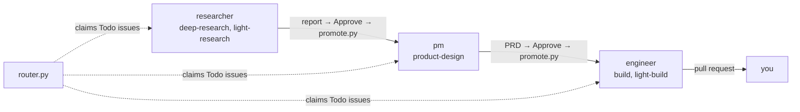
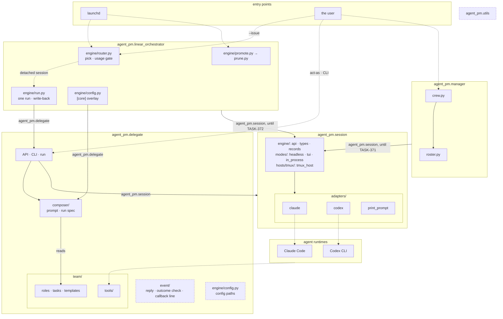
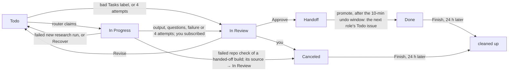
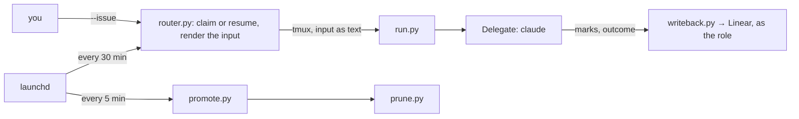

# agent-pm

[](https://github.com/ophis/agent-pm/actions/workflows/test.yml?query=branch%3Amain)

Runs Claude agents unattended from a Linear board. Each Linear project is a product; an issue's assignee, a role account, is its stage. Each role works up to `max_runs` issues at once, handing its output back for your review; once you approve, the next role takes it. The core runs a role, which picks its task unless given one, and is a Claude Code plugin you can use alone (Install); the Linear orchestrator runs it from the board (Setup). Their code: Layout; local headless Codex role runs: Runtime policy. Developers: `AGENTS.md`.



### Core architecture

Five layers, one project each: session and utils < delegate < linear-orchestrator < manager. Cross-layer imports use lower layers' public packages; the rules: `AGENTS.md` › Import rules. The code, by package; terms in `CONTEXT.md`.



Solid arrow: an import, the only direction allowed, or a file read (`reads`); its label names the package imported, by its `__all__`. Dotted: runs a command or process. Dashed: shared modules, their imports not drawn.

## Install

`/plugin marketplace add ophis/agent-pm`, then `/plugin install agent-pm@agent-pm` (a private repo: your git credentials). Requires the `claude` CLI, Python 3.11+ (stdlib only), tmux 3.3+ (tui runs), `git` and `gh` logged in (checkouts, the `github` and `pull-request` destinations), the `autopilot` plugin (plus `superpowers` for `build`), GitHub and the web; `osascript`, `pgrep` and a running iTerm2 only for the default iTerm2 split. Nothing checks them: a missing one fails the agent run. Agent runs load your user settings (`~/.claude/CLAUDE.md`, skills, permissions, plugins but `agent-pm`) and no MCP servers; a trusted cwd adds its project settings, `CLAUDE.md`, skills and `.mcp.json` (`delegate/config.toml`'s `cwd` and `trusted_dirs`).

- `/agent-pm:tmux` and `ctmux`: removed, rebuilt by [TASK-356](https://linear.app/ophis-workgroup/issue/TASK-356).
- `/agent-pm:manage`: your guidelines for the commander session, the one you talk to; run it there. Only you can invoke it, so a worker starting its own workers never gets it: `manager/skills/manage/SKILL.md`.
- `/agent-pm:act-as <role>[:<task>] <input>`: run a core role in this conversation, on that task or one it picks: `delegate/skills/act-as/SKILL.md`.
- Your own roles, tasks and templates, outside the plugin: `delegate/config.toml`'s `team_dirs` comment; the Delegate CLI's `--list` (`delegate/src/agent_pm/delegate/cli.py`) lists every role and task.

## Setup

Requires macOS, Install's requirements and `gh` logged in as you. The Linear orchestrator runs this checkout's scripts, not the plugin.

1. Create `~/.agent-pm/config.local.toml`, the one local file over every project's `config.toml` (layers, merge rules and key ownership: `utils/src/agent_pm/utils/config_file.py`'s docstring), from the `# local:` lines of `session/`, `delegate/` and `linear-orchestrator/config.toml`, with researcher's and pm's `[output]` (delegate's Destination comment); a required key left `""` stops router, run and promote. `<work_dir>` below is the `work_dir` key. Migrating: the old `~/.agent-pm/core-new.local.toml` and `~/.agent-pm/linear-new.local.toml` contents go into `config.local.toml` (a table both define, such as `[roles.<role>]`, once), `show = ""` becoming `show = "none"` (`show` is not used yet: a later change wires the display).
2. Find `task_label_group` with the Linear API's `issueLabels { nodes { id name isGroup } }`; the router stops if it isn't a label group or a `[task_labels]` id isn't one of its labels.
3. Agent runs need no `linear` skill and get no Linear key: router and promote act in Linear as the harness account `frank.agent.w@gmail.com`, each role's write-back as its `[roles.<role>]` `account`, its API key in the Keychain under `key`. Per role:
   1. Linear → Settings → Members: invite the `account` (a Gmail plus-alias of the harness account, e.g. `frank.agent.w+pm@gmail.com`).
   2. Open the invite in a private window, choosing **Continue with email** (Google signs in as the harness account).
   3. As the role account, create a personal API key in its settings.
   4. `security add-generic-password -s <key> -a <account> -w`, pasting the key at the prompt. `router.py` checks the item exists; a missing one stops that role's agent runs with a `config-error` event in `<work_dir>/logs/orchestrator.jsonl`.
4. The harness account's key:
   ```bash
   security add-generic-password -a frank.agent.w -s linear-api-key -w   # the only item under config.local.toml's harness_key
   ```

launchd scheduling of router and promote returns with [TASK-379](https://linear.app/ophis-workgroup/issue/TASK-379).

## Using the board



- **New work:** a Todo issue in the product's project, assigned to the role account that should do it; others (unassigned, or a person) are never picked. Researcher and pm issues take the brief from the description; a direct engineer issue's text is its requirement. A research or pm issue about a repo other than its project's `[project_repos]` entry, or a direct engineer issue whose project has none, needs a `Repo: <owner>/<name>` line.
- **Order work:** the router claims by priority, then later role, then oldest. "Y blocks X": X is claimed only once every direct blocker is Done, Canceled or Duplicate (archived counts as done, an unreadable blocker as not done); the router logs a `blocked` event naming Y.
- **Approve:** move to Handoff, commenting what's next (optional for a PRD). A PRD's target repo is the project's `[project_repos]` entry, which the PM's hand-off comment names; without one, comment `Repo: <owner>/<name>`; a `Repo:` line in your comment always wins. After a 10-minute undo window (pull it back out of Handoff), promote creates the next role's issue in the same project and marks this one Done; it carries the source's output links and your comments.
- **Revise:** comment, move back to Todo; the agent picks up where it left off. On an engineer issue your PR comments and reviews count too; other authors' reach the build as review input, but only yours start a new build. After 4 attempts an unfinished issue goes to In Review; a `human_members` user moving it back to Todo resets the count.
- **Finish:** Done and Canceled are yours to set. 24 hours later, `src/` (clones and worktrees), `publish/` (the docs clone) and `tmp/` in `<work_dir>/work/<ID>/` are deleted; the rest stays. In each local clone those worktrees came from, prune drops their records and deletes the issue's `<ID>-*` branches that origin holds, keeping and reporting the others. Lost: uncommitted changes, commits never pushed from a detached HEAD or a submodule, and, as `git worktree prune` covers the whole clone, the record of any of your worktrees whose folder is missing then, unless you `git worktree lock` it. pm and engineer issues are archived then too: restore one in Linear before reworking it.

### Task labels

The issue's label in the `Tasks` label group names one of the assignee role's tasks by its id, through `[task_labels]`, so renaming a label keeps working: the agent run does exactly that task. No such label → the agent run picks one from its role's task index (`delegate/src/agent_pm/delegate/team/roles/<role>.md` › Tasks: what each task does, when to use it, how heavy; unsure → the default it names), and its start comment names the pick and why. A label not in `[task_labels]`, a task not the role's, or several task labels → no agent run, no attempt counted: the router subscribes you, moves the issue to In Review and comments why; fix the label, move it back to Todo. To upgrade a Light Research issue, swap in the Deep Research label, comment the claims to verify and move it back to Todo: the next agent run is `deep-research`, with the earlier report in its input. A resumed agent run keeps its session's task whatever the labels say (`<work_dir>/logs/runs.jsonl` keeps only the role); an interrupted agent run whose logged role is not the assignee's goes to In Review with a comment.

**Upgrade** from task-level config: a role table holding `default_task` or `tasks` stops agent runs with a config error naming its new table. Drop `default_task`; move the keys of `config.local.toml`'s `[roles.<role>.tasks.<task>]` to `[roles.<role>]` and of its `[clients.<name>.roles.<role>.tasks.<task>]` to `[clients.<name>.roles.<role>]` (e.g. `[clients.skill.roles.<role>.output]`), of its `[core.roles.<role>.tasks.<task>]` to `[core.roles.<role>]`. Then do Operating's Upgrade too.

## Operating



The router's and promote's commands: `PYTHONPATH=<the five src dirs> python3 -P -m agent_pm.linear_orchestrator.engine.router|promote …`; the router's options: `linear-orchestrator/src/agent_pm/linear_orchestrator/engine/router.py`'s docstring.

```bash
tmux ls                                                      # running sessions, agent-pm-<role>-<ID>
tmux attach -t '=agent-pm-<role>-<ID>'                       # watch one agent run; = matches the exact name
```

`--issue` skips the hours, `max_runs` and usage gates and Recover's waits (`tmux ls` is the truth): a ready Todo issue is claimed as in a tick; an In Progress one resumes its session in `runs.jsonl`, or, with none to resume, goes where Recover sends it; an issue with a live agent run gets its attach command instead (exit 1). While another router runs, nothing happens (exit 1).

| Log | Contents |
|---|---|
| `<work_dir>/logs/orchestrator.jsonl` | Every router, promote, prune, run and write-back event, one JSON object a line: `ts`, `src`, `kind`, then `issue` when it has one. An idle tick writes none; the same skip, config-load error or Linear outage (`linear-error`: a 5xx, rate limit, timeout or network error; the run stops, the next retries), once a day |
| `<work_dir>/logs/runs.jsonl` | Agent run start/resume lines of the last 7 days: keep it, resume and Recover read it |

An agent run's workdir `<work_dir>/work/<ID>/` holds `run.jsonl` (its record: input, sessions, progress, outcome; headless, the client's stderr), `writeback.json` (the write-back steps done) and, for a `local` or `orchestrator` destination, `out.md` (the deliverable); `src/`, `publish/` and `tmp/` are workspaces (Finish). Documents are published from the agent run's clone in `publish/`: `git pull` your own docs clone to see them. Each session gets a `Run <sid>` comment on its issue, holding `cd <cwd> && claude --resume <sid>`: to open the session, first move the issue out of In Progress, or the router may resume it once idle 30 minutes. Moving `<work_dir>` or a run's cwd breaks resuming its in-progress agent runs.

**Upgrade** to `orchestrator.jsonl` and `runs.jsonl`: deploy with no issue In Progress (nothing reads the old `runs.log`, so Recover would send such an issue back to Todo for a new session); delete the old logs, no archive (another `<work_dir>`: its `logs/`):

```bash
rm -rf ~/.agent-pm/logs/runs.log ~/.agent-pm/logs/router.log ~/.agent-pm/logs/promote.log ~/.agent-pm/logs/projects ~/.agent-pm/logs/tui
```

### Attended runs

The old router's `--tui` is gone; the new router gains it in [TASK-332](https://linear.app/ophis-workgroup/issue/TASK-332).

## Layout

```text
delegate/             the Delegate (one role's run), the Composer, the built-in team; shared event/ and engine/config.py
session/              the session: an Adapter per runtime, Modes, Hosts (tmux)
utils/                shared utilities
manager/              crew: a manager's workers and roster
linear-orchestrator/  runs roles from a Linear board: router, run, promote, prune
tests/                repo-wide checks: guards.py (the repo's rules)
.github/              CI workflows and their helpers
```

Each project holds `src/agent_pm/<its package>/` (one PEP 420 namespace package `agent_pm` over the five `src/` roots), `tests/` and `config.toml`. Each module's docstring states its behaviour.

## Runtime policy

Delegate reads `[policy.<runtime>]` `flags` (an argv list) and `env` (a string table) from core config with the local overlay, then supplies them as `Spec.flags/env`. Crew workers get no `[policy.*]`: their `Spec.flags/env` are their own. Every session then takes the same path: Adapters add runtime dialogue options, `[adapters.<runtime>]` keys and Access grants (crew workers included; a Claude worker's Access gives it `--setting-sources user,project,local`, Claude's default); Driver owns session selection and the child env: the caller's, minus every Adapter's identity markers, and minus an Adapter's injected defaults (Codex: `NO_COLOR`, `CODEX_CI`, `PAGER`, `GIT_PAGER`, `GH_PAGER`) only inside that runtime and at the injected value (`session/src/agent_pm/session/engine/api.py` `_identity_drop`), under the Launch env.

The default policy sets Claude `--permission-mode auto`, `--strict-mcp-config` and a `--settings` turning this core's plugin off (the tui hooks merge into it), and Codex `-s danger-full-access`, `approval_policy="on-request"`, `approvals_reviewer="auto_review"`. To use Codex `workspace-write`, replace its policy flags with `-s workspace-write`, the approval options, `-c sandbox_workspace_write.network_access=false`, and `-c sandbox_workspace_write.writable_roots=[]`. Full access does not enforce writable-root or team-dir boundaries.

For existing `~/.agent-pm/config.local.toml` overrides, remove `[adapters.codex]` `sandbox` and `shell_network`: those keys now fail validation. Express them in `[policy.codex].flags` using the options above. Move Claude `--permission-mode` and `--strict-mcp-config` from `[adapters.claude].flags` into `[policy.claude].flags`; keep there only flags every session, crew workers included, should get. Policy flag lists replace the defaults wholesale, so repeat every option you intend to keep.

Codex snapshots save flags and the merged Adapter, Access and Spec environment. Resume replays them, ignoring current policy and new Spec flags/env; grants are also saved. Snapshots from before this contract fail with `unsupported legacy Codex recovery snapshot: start a new session`; they are not migrated. Access write directories are always emitted as `--add-dir`, including full-access runs.

## Access

A run's `read` dirs and its role's tasks dir are never `--add-dir`: no runtime is granted write to them. Codex has no read-only-dir mechanism usable here, so it adds nothing for them: under `workspace-write` its sandbox reads the whole disk and writes only its roots; under the default `danger-full-access` (Runtime policy, above) it can write them too. Each runtime's grant and its limits: `delegate/config.toml`'s `read` comment.

## Tests

```bash
export PYTHONPATH=delegate/src:session/src:utils/src:manager/src:linear-orchestrator/src:linear-orchestrator/tests   # from the repo root
```

Commands and where a test goes: `AGENTS.md` › Tests.

CI (`.github/workflows/test.yml`) uses Python 3.11 on Ubuntu; local checks use the Mac's own `python3` (3.14). Its checks, test runner and required aggregate `CI` job: `AGENTS.md` › Tests.
