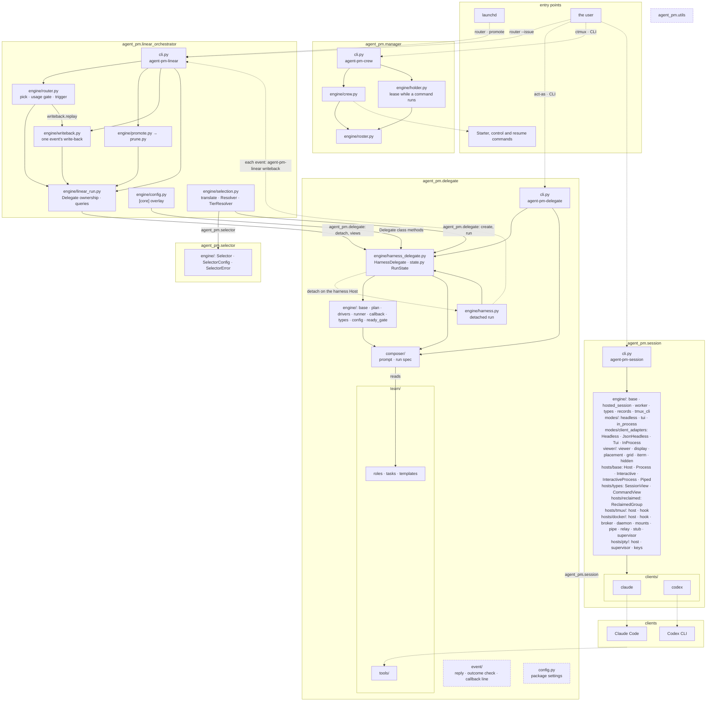
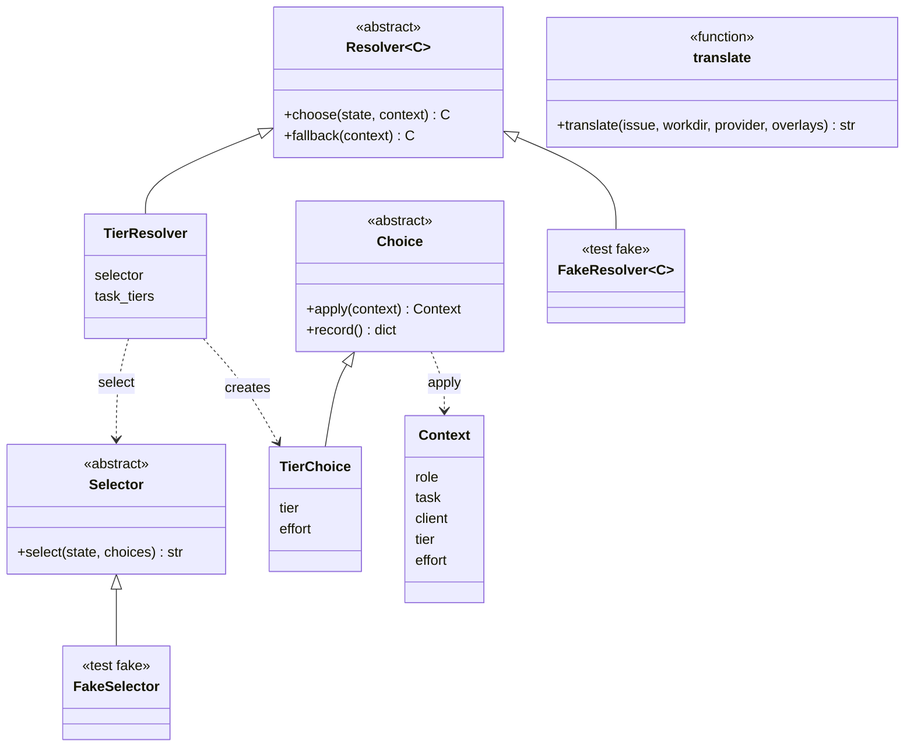

# Core architecture

Six layers, one project each: utils < session < delegate < selector < linear-orchestrator < manager. Import rules: `AGENTS.md` › Import rules. The code, by package; terms in `CONTEXT.md`.

Solid arrow: an import, the only direction allowed, or a file read (`reads`); its label names the package imported, by its `__all__`. Dotted: runs a command or process. Dashed: shared modules, their imports not drawn.

## Resolver chain

Before a new run, the router can decide its launch choices from the issue (TASK-511), in `linear-orchestrator/src/agent_pm/linear_orchestrator/engine/selection.py`: `translate` runs the `choice-translator` role once through the configured Delegate and returns the issue's state text; then each step of the chain, a `Resolver` paired with its `Choice`, lists its own options from config for the `Context` so far and asks a `Selector` (`agent_pm.selector`, a decision API such as Jev or Kev) to pick one. A step switched off, or failing with `SelectionError`, uses its `fallback`, today's choice. The router applies each `Choice` to the `Context` and records it on the run's start row. `TierResolver` picks the tier and effort among the client's `[clients.<client>.tiers]` and `efforts` in session's merged config. `engine/chain.py` runs the chain before each new run: `[linear_orchestrator.selection]` switches `translate` and each step, all off by default ([board.md › Task labels](board.md#task-labels)); `translate` runs only when a step is on; the run launches with the final `Context` (`engine/types.py`), and a resume reuses its start row's recorded tier and effort. Until the Jev and Kev selectors come, the router's Selector is `NoSelector` (every pick fails with `no-key`); tests use `FakeSelector` (`selector/tests/fakes/`) and `FakeResolver` (`linear-orchestrator/tests/orchestrator_tests/selection_fixtures.py`).

Dashed arrow: a call, use or creation; `<|--`: implements. `translate` runs the role through `agent_pm.delegate` (`Delegate.create` and `run`, as `LinearRun` does); `TierResolver` reads session's merged config by resource name, never importing session.
