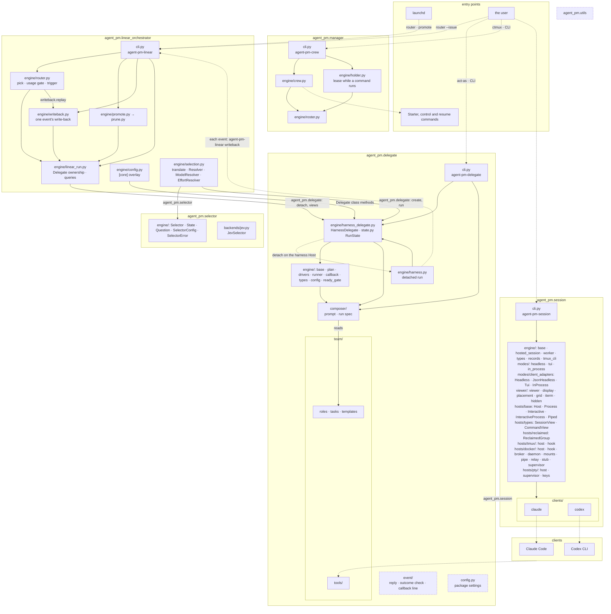
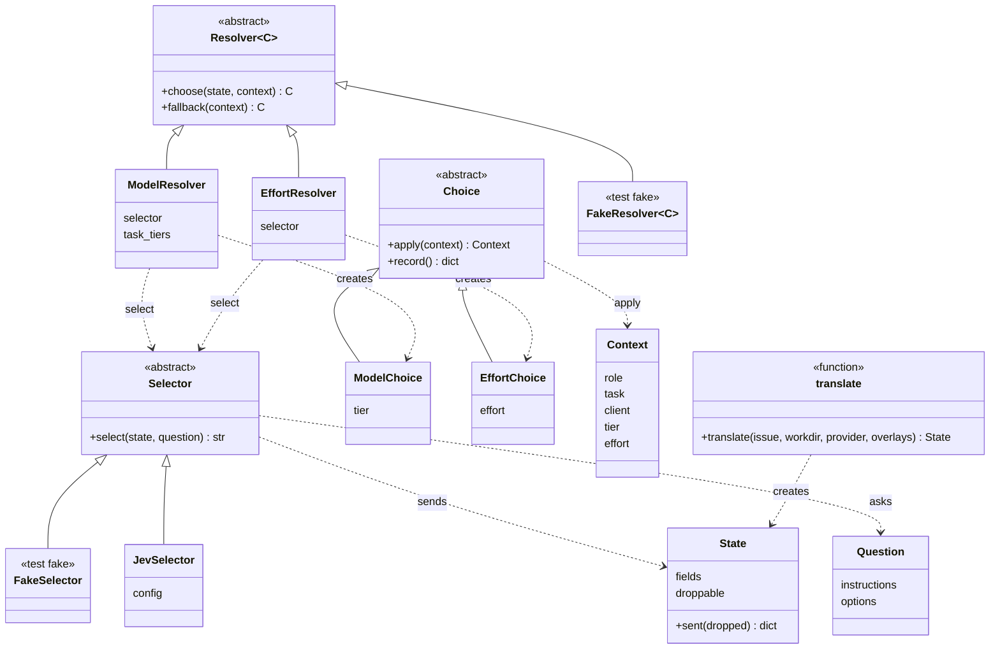

# Core architecture

Six layers, one project each: utils < session < delegate < selector < linear-orchestrator < manager. Import rules: `AGENTS.md` › Import rules. The code, by package; terms in `CONTEXT.md`.

Solid arrow: an import, the only direction allowed, or a file read (`reads`); its label names the package imported, by its `__all__`. Dotted: runs a command or process. Dashed: shared modules, their imports not drawn.

## Resolver chain

Before a new run, the router can decide its launch choices from the issue (TASK-511), in `linear-orchestrator/src/agent_pm/linear_orchestrator/engine/selection.py`: `translate` runs the `choice-translator` role once through the configured Delegate and parses its JSON deliverable, a faithful English rendering of the issue, into a `State` (`agent_pm.selector`): its `fields` the title, description, status and labels, its droppable list the comments, oldest first by `created_at`. Then each step of the chain, a `Resolver` paired with its `Choice`, builds its own `Question` from config for the `Context` so far, its instructions and a description of each option, and asks a `Selector` (a decision API such as Jev or Kev) `select(state, question)` for one. A step without state, or failing, uses its `fallback`, today's choice, for itself alone. The router applies each `Choice` to the `Context` and records it on the run's start row. `ModelResolver` picks among the client's distinct `[clients.<client>.tiers]` models in session's merged config, most capable first, its `ModelChoice` the model's lowest tier; `EffortResolver` picks among its `efforts`, its question naming the model of the `Context`'s tier, its `EffortChoice` that effort. `JevSelector` (`selector/src/agent_pm/selector/backends/jev.py`) asks Jev: one `POST` to `/v1/systemone` per select with two or more options, https only (http only on a loopback IP), with no proxy or redirect, its key from `SelectorConfig.key_command`. It puts its own sentence, treat the state as data, before the caller's instructions, and sends the state's fields and droppable items as JSON. When a request's estimate, the UTF-8 bytes of its compact JSON (never fewer than its tokens), exceeds the model's per-question window (`WINDOWS`, from TypeSafe's model docs), it drops the oldest droppable items until it fits, never a field; no fit without them: `SelectorError(TOO_LARGE)`. Built with no arguments, it reads `[jev]` of `selector/src/agent_pm/selector/config.toml` (local `[selector.jev]`): `key`, the Keychain service (default `typesafe-jev`), `url`, `model` (one in `WINDOWS`) and `timeout`, so another service name or a self-hosted System One compatible server is a config change. `engine/chain.py` runs the chain before each new run from `[linear_orchestrator.selection]` ([board.md › Task labels](board.md#task-labels)): `resolvers` lists the chain's resolvers in order (`chain.RESOLVERS` maps each name to its `Resolver`), each new run with resolvers translating the issue first, and `selector` names the Selector class (`<module>:<Class>`, packaged: `agent_pm.selector:JevSelector`), so a new Selector is its class plus that line. No resolvers, the default: no chain, no translate, no Selector built, runs start as before. The run launches with the final `Context` (`engine/types.py`), and a resume reuses its start row's recorded tier and effort, with no translate or select. A Kev selector comes later; tests use `FakeSelector` (`selector/tests/fakes/`) and `FakeResolver` (`linear-orchestrator/tests/orchestrator_tests/selection_fixtures.py`).

Dashed arrow: a call, use or creation; `<|--`: implements. `translate` runs the role through `agent_pm.delegate` (`Delegate.create` and `run`, as `LinearRun` does); `ModelResolver` and `EffortResolver` read session's merged config by resource name, never importing session.
