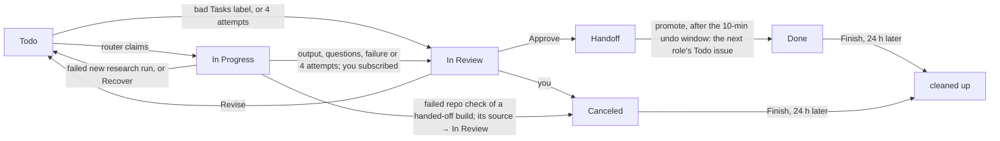
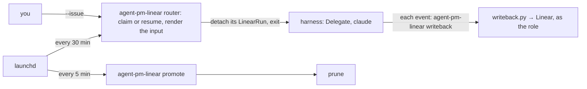
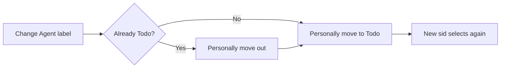
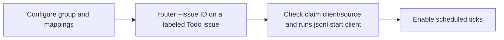

# Linear board

The Linear orchestrator runs the core from a Linear board: set it up once, then work through issue states.

## Setup

Needs macOS and [Install](../README.md#install)'s requirements. The orchestrator runs this checkout's scripts, not the plugin. `<work_dir>` is `linear_orchestrator.work_dir`.

1. Create `~/.agent-pm/config.local.toml` from the `# local:` lines of each packaged `config.toml`, each under its layer's section. Include researcher's and pm's `[output]`. A required key left `""` stops every `agent-pm-linear` command.

   ```toml
   [delegate.roles.engineer]              # run settings
   tier = 2

   [linear_orchestrator.roles.engineer]   # board settings
   account = "engineer@example.com"
   max_runs = 1
   ```

2. Set `task_label_group` to the id of the `Tasks` label group (Linear query `issueLabels { nodes { id name isGroup } }`).
3. Router and promote act in Linear as the harness account `frank.agent.w@gmail.com`; each role writes back as its own `account`. For each role:
   1. Linear › Settings › Members: invite the `account`, a plus-alias such as `frank.agent.w+pm@gmail.com`.
   2. Open the invite in a private window and choose **Continue with email**.
   3. As the role account, create a personal API key.
   4. `security add-generic-password -s <key> -a <account> -w`, then paste the key.
4. Store the harness key:
   ```bash
   security add-generic-password -a frank.agent.w -s linear-api-key -w   # config.local.toml: [linear_orchestrator] harness_key
   ```
5. Dry-run each job:
   ```bash
   bin/agent-pm-linear router --dry-run
   bin/agent-pm-linear promote --dry-run
   ```
6. Install the launchd jobs:
   ```bash
   mkdir -p ~/.agent-pm/logs   # launchd can't start a job without it
   for job in router promote; do
     launchctl bootout gui/$(id -u)/com.ophis.agent-pm.$job 2>/dev/null   # fails harmlessly if none is loaded
     cp linear-orchestrator/launchd/com.ophis.agent-pm.$job.plist ~/Library/LaunchAgents/
     launchctl enable gui/$(id -u)/com.ophis.agent-pm.$job
     launchctl bootstrap gui/$(id -u) ~/Library/LaunchAgents/com.ophis.agent-pm.$job.plist
   done
   launchctl list | grep com.ophis.agent-pm   # exactly the two jobs
   ```

| Job | Schedule |
|---|---|
| router | :00 and :30, with `--now` (drop it to run only 01:00–06:59) |
| promote | every 5 min |

The plists hard-code this checkout's path and `~/.agent-pm` (launchd doesn't expand `~`). For another checkout or `work_dir`, edit them in `linear-orchestrator/launchd/` and rerun step 6. To uninstall a job:

```bash
launchctl bootout gui/$(id -u)/com.ophis.agent-pm.<job>
rm ~/Library/LaunchAgents/com.ophis.agent-pm.<job>.plist
```

## Using the board



- **New work:** a Todo issue in the product's project, assigned to a role account. The description is the brief, or an engineer issue's requirement. Add `Repo: <owner>/<name>` if the repo is not the project's `[project_repos]` entry.
- **Order work:** the router claims by priority, then later role, then oldest. A blocked issue waits until its blockers are Done, Canceled or Duplicate.
- **Duplicates:** on an issue's first claim the router searches the team's issues (archived too), the docs repo and the target repo's merged PRs by its title words and the issue ids its description names, and lists the matches, minus its Handoff chain, at the end of the agent's input under `## Related work`. A failed search logs `related-skip` and the run goes on.
- **Approve:** move to Handoff and comment what's next. After 10 minutes (move it out of Handoff to undo), promote creates the next role's issue and marks this one Done.
- **Revise:** comment and move back to Todo. The agent resumes where it left off. On an engineer issue your PR comments and reviews count too. After 4 attempts the issue goes to In Review.
- **Finish:** set Done or Canceled. 24 hours later prune deletes the run's workspaces and the issue's pushed branches, and archives pm and engineer issues; 7 days later it deletes the issue's whole workdir. Uncommitted and unpushed work is lost.

### Task labels

A label from the `Tasks` group picks the role's task, mapped by `[task_labels]`. No label: the agent picks (unsure: the researcher runs Research, which has no label; the engineer Build) and says why in its start comment. A bad label (unmapped, another role's, or several): the issue goes to In Review with a comment. To upgrade a report (Light Research → Research → Deep Research), set the next task's label (to Research: remove the label), comment the claims to verify, and move it back to Todo.

A label from `[option_labels]`, outside `Tasks`, adds its option to the input; `visual` (`Visual: yes`): the researcher also adds an HTML version of its report beside the Markdown (`delegate/src/agent_pm/delegate/team/roles/researcher.md` › Visual).

## Operating



```bash
bin/agent-pm-linear router --issue <ID>         # run one issue now, skipping the hours, max_runs and usage gates
bin/agent-pm-linear router --issue <ID> --tui   # the same, attended in a TUI (display, events file, exit codes: --help)
bin/agent-pm-linear attach-command <ID>         # the command that shows its agent run
bin/agent-pm-linear close <ID>                  # end the run and its TUI; the issue stays In Progress for Recover
bin/agent-pm-linear resume <ID>                 # resume an attended run where it was shown
tmux ls                                         # running agent runs
```

Run `bin/agent-pm-linear` by its absolute path; `--help` lists each command's options. Events go to `<work_dir>/logs/orchestrator.jsonl`. Keep `<work_dir>/logs/runs.jsonl`: resume, Recover, write-back and the first-claim search read it.

Each session's `Run <sid>` comment holds its resume command. Move the issue out of In Progress before opening it, or the router may resume it after 30 idle minutes.

### Agent label

Copy `agent_label_group` and `[agent_labels]` from the `# local:` examples in [linear-orchestrator/config.toml](../linear-orchestrator/src/agent_pm/linear_orchestrator/config.toml) into this machine's `~/.agent-pm/config.local.toml`, with one line per client in place of the `"<client>"` line, and the Agent group's and its child labels' ids in place of the example ids. Both settings empty disables selection. Mapping keys name clients configured in Delegate; unknown clients are accepted at load time and checked when constructing a run.

| Agent-group labels at claim recheck | New run |
|---|---|
| Existing pin | Recorded client takes priority; invalid Agent labels do not block it |
| None | Resolved role default client |
| One mapped label | Its client, for any role; renaming the label preserves the mapping |
| Several, or an unmapped child | One comment listing label errors, including task-label errors; In Review, no attempt consumed |

Selection: [router.py:593](../linear-orchestrator/src/agent_pm/linear_orchestrator/engine/router.py#L593). The `claim` log records `client` and `client_source=pinned|label|default`. A label-selected client's quota configuration or construction `ConfigError` produces a comment with the client and error's first line, then In Review instead of an interruption retry ([router.py:830](../linear-orchestrator/src/agent_pm/linear_orchestrator/engine/router.py#L830)); fix it → move back to Todo.

**Pin:** the issue's latest `runs.jsonl` `start` client, retained across automatic retries until an account outside the harness viewer and all role accounts later moves the issue to Todo. This does not depend on `human_members`; `failed` rows never establish or replace a pin. Same-session resumes keep their recorded client. If the retained client differs from the current label selection (or labels are invalid), `client-pinned` logs the issue, sid and both values; one idempotent comment per sid explains the switch rule.



Switch only with no agent run live.

Scheduled quota checks use each candidate’s selected or recorded client, with at most one probe per client per tick; blocked usage logs `usage-skip` without switching clients ([gate.py:56](../linear-orchestrator/src/agent_pm/linear_orchestrator/engine/gate.py#L56)). Inside an agent run, `--brake <role>` uses its `AGENT_PM_CLIENT` environment, set at process launch from the effective client, including resumed snapshots; outside one it uses the role default ([runtimes/base.py:53](../session/src/agent_pm/session/runtimes/base.py#L53), [router.py:1096](../linear-orchestrator/src/agent_pm/linear_orchestrator/engine/router.py#L1096)).

`--dry-run` re-reads each new candidate's labels and prints `client` and `client_source` (`label`, `default`, or `pinned` for a retained client); a resume prints its recorded client as `pinned` without reading labels. Invalid labels print `would comment`; both scheduled and `--issue` previews leave issue state, comments and run logs unchanged ([router.py:561](../linear-orchestrator/src/agent_pm/linear_orchestrator/engine/router.py#L561), [router.py:608](../linear-orchestrator/src/agent_pm/linear_orchestrator/engine/router.py#L608)).

Rollout:



Use the installed `agent-pm-linear` absolute path. `--issue` skips the usage gate; it starts a real run. Use `--dry-run --issue ID` first to inspect label selection without starting a run.
