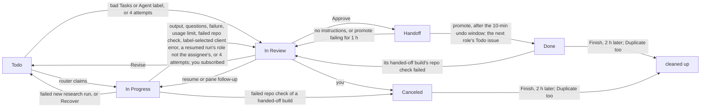
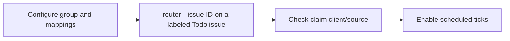

# Board

The orchestrator runs the core from a board, chosen by `[orchestrator] tracker`: a Linear board (`tracker = "linear"`; set it up once, then work through issue states) or a [local board](#local-board) of Markdown files (the default).

## Setup

[`scripts/install.sh`](../README.md#install) offers no Board (`--no-board`, the first-run default), a [local board](#local-board) (`--board local`), or Linear (`--board linear`). Local confirms `tracker = "local"`, then separately confirms creating missing board and `unassigned/` directories; it never asks for Linear keys or contacts Linear. The installer initializes `~/.agent-pm/board/`, the orchestrator's default when `AGENT_PM_BOARD_DIR` is unset. Linear does steps 1 and 2 below once the [Linear presets](credentials.md#linear-presets) exist: it asks each account's API key into the Keychain, reads the team, states, label groups, members, projects and role accounts from Linear, asks the team (when the harness key sees several), each project's repo and the document roles' docs repo, and shows the config it fills. Selecting a tracker can replace the existing tracker after confirmation; other configured Linear values stay as set.

For either tracker, the router and promote launchd jobs are a separate choice (`--launchd` or `--no-launchd`, otherwise asked once, default no); either flag without Board exits 2. Reruns keep both choices and skip completed setup. When no choice is saved, existing tracker config and installed jobs are kept without asking. Skipping Board or jobs leaves existing files and loaded jobs alone; uninstall instructions are below. Local jobs are installed only after the tracker and default board directories are ready; their plists use the orchestrator's default path without setting `AGENT_PM_BOARD_DIR`. Declining directory creation skips the jobs; a rerun offers the missing setup again. The remaining steps show manual Linear setup; for manual local jobs, initialize the board first and set `AGENT_PM_BOARD_DIR` in the plist when using a custom path.

`scripts/install-cleanup.sh` records and removes only directories the installer created for the board. It removes recorded board directories only when empty. Non-empty directories (issues or `.state/` included) stay in place with a message, and cleanup continues through credentials, plugins and files.

Needs macOS and [Install](../README.md#install)'s requirements. The orchestrator runs this checkout's scripts, not the plugin. `<work_dir>` is `orchestrator.work_dir`.

1. Create `~/.agent-pm/config.local.toml` from the `# local:` lines of each packaged `config.toml`, each under its layer's section. Include researcher's and pm's `[output]`. Set `tracker = "linear"` under `[orchestrator]`: unset, the orchestrator reads a [local board](#local-board) instead. The `[orchestrator.linear]` keys are needed only with `tracker = "linear"`; there, a required key left `""` stops every `agent-pm-orchestrator` command.

   ```toml
   [orchestrator]                         # the tracker
   tracker = "linear"

   [delegate.roles.engineer]              # run settings
   tier = 2

   [orchestrator.roles.engineer]          # board settings
   max_runs = 1

   [orchestrator.linear.roles.engineer]   # Linear settings
   account = "engineer@example.com"
   ```

   `[orchestrator.linear.roles.<role>]`'s `account` is its Linear user; the Claude account its board runs use is `[orchestrator.core.roles.<role>.accounts]` (`[delegate.roles.<role>.accounts]` for every run; [Claude accounts](docker-host.md#claude-accounts)).

2. Create the Linear presets, accounts and Keychain items, and fill their keys: [Linear presets](credentials.md#linear-presets).
3. Dry-run each job:
   ```bash
   bin/agent-pm-orchestrator router --dry-run
   bin/agent-pm-orchestrator promote --dry-run
   ```
4. Install the launchd jobs:
   The jobs use the orchestrator's default board directory; the templates need only HOME and PATH substitution.
   ```bash
   mkdir -p ~/.agent-pm/logs   # launchd can't start a job without it
   for job in router promote; do
     launchctl bootout gui/$(id -u)/com.ophis.agent-pm.$job 2>/dev/null   # fails harmlessly if none is loaded
     sed -e "s|@HOME@|$HOME|g" -e "s|@PATH@|$PATH|" \
       orchestrator/launchd/com.ophis.agent-pm.$job.plist \
       > ~/Library/LaunchAgents/com.ophis.agent-pm.$job.plist   # needs ctmux --install's ~/.agent-pm/bin
     launchctl enable gui/$(id -u)/com.ophis.agent-pm.$job
     launchctl bootstrap gui/$(id -u) ~/Library/LaunchAgents/com.ophis.agent-pm.$job.plist
   done
   launchctl list | grep com.ophis.agent-pm   # exactly the two jobs
   ```

| Job | Schedule |
|---|---|
| router | :00 and :30 |
| promote | every 5 min |

The plists hard-code this checkout's path and `~/.agent-pm` (launchd doesn't expand `~`). For another checkout or `work_dir`, edit them in `orchestrator/launchd/` and rerun step 4. To uninstall a job:

```bash
launchctl bootout gui/$(id -u)/com.ophis.agent-pm.<job>
rm ~/Library/LaunchAgents/com.ophis.agent-pm.<job>.plist
```

## Using the board



- **New work:** a Todo issue in the product's project, assigned to a role account. The description is the brief, or an engineer issue's requirement. Add `Repo: <owner>/<name>` if the repo is not the project's `[orchestrator.linear.project_repos]` entry.
- **Order work:** the router claims by priority, then later role, then oldest. A blocked issue waits until its blockers are Done, Canceled or Duplicate.
- **Duplicates:** on an issue's first claim the router searches the team's issues (archived too), the docs repo and the target repo's merged PRs by its title words and the issue ids its description names, and lists the matches, minus its Handoff chain, at the end of the agent's input under `## Related work`. A failed search logs `related-skip` and the run goes on.
- **Linked documents:** the agent's input inlines the docs-repo documents an issue links, in order, up to 50,000 bytes in all; each one that no longer fits is listed by path and URL for the agent to read. A PRD and an earlier version are always inlined.
- **Approve:** move to Handoff and comment what's next. After 10 minutes (move it out of Handoff to undo), promote creates the next role's issue and marks this one Done.
- **Revise:** comment and move back to Todo. The agent resumes where it left off. On an engineer issue your PR comments and reviews count too. After 4 attempts the issue goes to In Review; moving it back to Todo restarts the count.
- **Who counts as you:** every Linear account but the harness account, the role accounts and Linear automation, the manager included (its `agent-pm-orchestrator issue` commands act as `linear.manager_key`'s account): its comments are instructions and its moves to Todo restart the attempt count. Comments without a user, such as the GitHub integration's, are ignored. `linear.human_members` only picks who is subscribed on In Review. Anyone who can comment on or move the team's issues (members, guests, synced users) can so instruct agents: keep the team's membership and guest access tight.
- **Continue work:** every resumed or rerun board attempt re-reads the issue's state and returns it to In Progress; already there is a no-op. Write-back records this once per attempt, retries a failed move on progress, and ignores ended or older attempts. Pane answers, follow-ups, rework and PR-gate fixes after the harness ends follow `/agent-pm:manage`'s **Continue issue work** rule (`manager/skills/manage/SKILL.md`): the manager moves it before sending and applies the normal end state when that work finishes.
- **Runs without an outcome:** an error (invalid outcome, no outcome block, client failure or crash) is written back as a failure with its reason in a comment. The workflow's `first_failure` applies to a first attempt (packaged: researcher → Todo; pm/engineer → In Review); resumed failures go to In Review. Each failed attempt is written once, and a later valid outcome can still be delivered. A signal stop or keyboard interrupt stays In Progress for Recover; usage limits keep their own write-back. A refused write-back logs `writeback refused` with its reason in `orchestrator.jsonl`, and its `callback_error` row in the run's `run.jsonl` keeps the callback's stderr.
- **Finish:** set Done, Canceled or Duplicate. 2 hours later prune closes the run, deletes its `agent/` dir and the issue's pushed branches, and archives the issue (Canceled or Duplicate whoever is assigned, no one or researcher too; Done only pm and engineer issues: researcher reports stay) unless a sub-issue, at any depth, is still open (Linear would archive it too); 7 days later it deletes the issue's whole workdir. An issue left in any other state but Todo or In Progress (In Review, Handoff, Backlog) for 7 days since its latest move or run loses its checkouts and temp files (`agent/src`, `agent/publish`, `agent/tmp`), unless its run or agent session is still open; its other agent files, run records (`run/`), write-back ledger and branches stay, and a Revise rebuilds the checkouts. Each run's end also clears `agent/tmp`. Uncommitted and unpushed work is lost.

### Task labels

A label from the `Tasks` group picks the role's task, mapped by `[task_labels]`. No label: the agent picks (unsure: the researcher runs Research, which has no label; the engineer Build) and says why in its start comment. A bad label (unmapped, another role's, or several): the issue goes to In Review with a comment. To upgrade a report (Light Research → Research → Deep Research), set the next task's label (to Research: remove the label), comment the claims to verify, and move it back to Todo.

`[orchestrator.task_tiers]` sets a task's model tier, e.g. `light-build = 3` (1 = strongest): the router overlays it on the role's run, a resume taking its start's task; an issue with an unlisted task or no label keeps its role's or global tier.

## Operating

```bash
bin/agent-pm-orchestrator router --issue <ID>         # run one issue now, skipping the run limits and usage gates
bin/agent-pm-orchestrator router --issue <ID> --tui   # the same, attended in a TUI (display, events file, exit codes: --help)
bin/agent-pm-orchestrator status <ID>                 # alive: its run; once that ends, state is its open TUI's (done, working, blocked), gone once none is open
bin/agent-pm-orchestrator attach-command <ID>         # the command that shows its agent run
bin/agent-pm-orchestrator close <ID>                  # end the run and its TUI; the issue stays In Progress for Recover
bin/agent-pm-orchestrator resume <ID>                 # resume an attended run where it was shown
tmux ls                                         # running agent runs
```

Run `bin/agent-pm-orchestrator` by its absolute path; `--help` lists each command's options. Issue operations (`bin/agent-pm-orchestrator issue …`: read, list, create (`--parent` splits), edit, move, comment, relate, archive; on Linear also look up and swap a label), in abstract states, roles, task and client names: `/agent-pm:board` ([orchestrator/skills/board/SKILL.md](../orchestrator/skills/board/SKILL.md)), their one guide. Events go to `<work_dir>/logs/orchestrator.jsonl`. Keep `<work_dir>/logs/runs.jsonl`: deleting it breaks resume, Recover, write-back and the first-claim search.

A run that ended leaves its TUI open for pane follow-ups; the issue's next run, new or resumed, closes it.

Each session's `Run <sid>` comment holds its resume command. Move the issue out of In Progress before opening it, or the router may resume it after 30 idle minutes.

### Run limits

A run starts only when both layers have room: its role has fewer live runs than `[roles.<role>] max_runs` (packaged: 3 for researcher, pm and engineer; another stage's role without a table: 1), and its client fewer than its `[client_max_runs]` entry. No client is limited by default: an unlisted client is unlimited. Set limits in `~/.agent-pm/config.local.toml`, e.g. `opencode = 1`, as the host's local models run one job at a time:

```toml
[orchestrator.client_max_runs]
opencode = 1
claude = 3
```

Both layers count the live runs in `runs.jsonl`, a run between rounds included, a client's by the client its run records. A tick checks role, then client, then the usage gate. A full client's Todo issue logs `claim-skip` with reason `<client> is full` and the tick tries the next one; a full client's In Progress issue logs `recover-skip` and waits. `router --issue` skips both limits, but its run counts. Ad-hoc runs (`agent-pm-delegate run`, `agent-pm-session start`) and crew workers bypass the router and `runs.jsonl`: no limit applies to them and they count toward none, so an OpenCode crew worker adds to the local model's load.

### Linear MCP off

The commander needs no Linear MCP server: `/agent-pm:board`'s commands replace its tools. Turn it off in the project you run the commander from, and only there:

1. Open Claude Code in that project's directory and run `/mcp`.
2. Select the Linear entry and choose **Disable**. Claude Code records this for that project only ([Disable a server without removing it](https://code.claude.com/docs/en/mcp#disable-a-server-without-removing-it)); other servers and projects keep their settings. Never remove the server or edit its config by hand.
3. Start a new session there and check: `/mcp` shows the Linear entry disabled, no Linear MCP tool is offered, `bin/agent-pm-orchestrator issue read <ID>` still prints the issue, and every other server there keeps its earlier state. Another project's `/mcp` still shows the Linear entry as before.

### Agent label

Copy `[orchestrator.linear]`'s `agent_label_group` and `[orchestrator.linear.agent_labels]` from the `# local:` examples in [orchestrator/config.toml](../orchestrator/src/agent_pm/orchestrator/config.toml) into this machine's `~/.agent-pm/config.local.toml`, with one line per client in place of the `"<client>"` line, and the Agent group's and its child labels' ids in place of the example ids. Both settings empty disables selection. Mapping keys name clients configured in Delegate; unknown clients are accepted at load time and checked when constructing a run.

| Agent-group labels at claim recheck | New run |
|---|---|
| None | Resolved role default client |
| One mapped label | Its client, for any role; renaming the label preserves the mapping |
| Several, or an unmapped child | One comment listing label errors, including task-label errors; In Review, no attempt consumed |

The `claim` log records `client` and `client_source=label|default`. A label-selected client's quota configuration or configuration error produces a comment with the client and error's first line, then In Review instead of an interruption retry; fix it → move back to Todo.

Each new run selects again, retries included. A session resumes only in the client that created it, so an interrupted run re-reads its labels: when the selection differs from its session's client, the router starts a new session on the selected client instead, the issue staying In Progress. A usage-blocked restart waits for the next tick. Invalid Agent or task labels keep the resume.

Scheduled quota checks use each candidate’s selected or recorded client, caching each Delegate/role/client/tier context within a tick; blocked usage logs `usage-skip` without switching clients. On the Docker Host with two or more [Claude accounts](docker-host.md#claude-accounts), the Claude probe reads every account (cached 5 minutes) and passes while any is under the thresholds, the run then starting on the one with the most usage left; every account over logs `usage-skip` with reason `usage`. A role's selected account (`[orchestrator.core.roles.<role>.accounts]`) changes neither: probe and limit hold stay per client. Inside an agent run, `--brake <role>` uses its `AGENT_PM_CLIENT` environment, set at process launch from the effective client, including resumed snapshots; outside one it uses the role default.

`--dry-run` re-reads each new candidate's labels and prints `client`, `client_source` (`label` or `default`) and its task's `tier` ([Task labels](#task-labels)); a resume prints its recorded client, or `restart` when it starts a new session. Invalid labels print `would comment`; both scheduled and `--issue` previews leave issue state, comments and run logs unchanged.

Rollout:



Use the installed `agent-pm-orchestrator` absolute path. `--issue` skips the usage gate; it starts a real run. Use `--dry-run --issue ID` first to inspect label selection without starting a run.

### OpenCode

An issue with the Agent group's `OpenCode` label runs OpenCode on the host's Ollama models. Use local models only for live-test issues (the user's rule; nothing enforces it). Docker workers discover the image's autopilot skills, including build and light-build, through `skills.paths` ([Plugins](docker-host.md#plugins)). Beyond [Setup](#setup):

1. Ollama and its model: [Docker host › OpenCode](docker-host.md#opencode).
2. The Docker Host, with the harness on tmux: `[session.hosts] default = "docker"` and `[delegate.delegates] harness_host = "tmux"` ([Docker host › Role runs](docker-host.md#role-runs)). A board run's cwd is untrusted, so on tmux OpenCode refuses to start ([OpenCode sessions](sessions.md#opencode-sessions)). This puts every client's board runs in containers.
3. An `OpenCode` label in the Agent group, mapped as in [Agent label](#agent-label): `opencode = "<its label id>"` under `[orchestrator.linear.agent_labels]`.

The usage gate probes only the provider of the default `[session.clients.opencode] model`, independently of task tiers: Ollama uses the host's `127.0.0.1:<ollama_port>/api/tags`; configured providers use their `base_url` plus `/models`. A 2xx response permits the run; an unreachable or unauthorized endpoint stays `usage unknown`. Docker probes run in broker protocol 17 with its existing Keychain API key; tmux probes read the selected provider's API entry from OpenCode `auth.json`. Keys stay out of argv, diagnostics and responses; redirects are refused. Task-tier overrides still select each run's model, but do not change the usage probe.

## Local board

Create the first issue with `agent-pm-orchestrator issue create --title "First issue" --body-file <file>` on an initialized board (an empty `unassigned/` directory is enough). Its id is `LOC-1`. To choose the empty board's prefix, set `[orchestrator.local] issue_prefix = "AGE"` in `~/.agent-pm/config.local.toml` (uppercase letters/digits, starting with a letter). Once the board has an issue, creation and promote use the highest-numbered id's prefix instead; numbering still comes from `.next-id` under the board lock.

Unfinished `blocked_by` cycles (including an issue blocking itself) produce a `dependency-cycle` router diagnostic naming the closed path. Remove the cyclic links in those issue files. The same diagnostic is logged once per 24 hours; `router --dry-run` always shows it without writing. Missing blockers still block, and independent ready issues remain schedulable.

An issue-selected client whose usage probe requires a missing or non-executable program produces `launch-error`, a repair comment and a move to `review/`. An executable client whose usage cannot be read still produces `usage unknown`. Fix the client choice or installation, then move the issue to `ready/`.

### Mac mini regression checks

Use a separate initialized local test board with OpenCode, Strata and Docker configured. Upgrade the broker to protocol 17 first. These checks require the real mini; CI results do not replace them.

| Case | Action | Expected |
|---|---|---|
| First issue | Run `issue create --title "First" --body-file <file>` with only `unassigned/` present; repeat on a fresh board with `[orchestrator.local] issue_prefix = "AGE"` | `LOC-1`, then `AGE-1`; no hand-written seed issue |
| Strata gate | Set the default `[session.clients.opencode] model` to Strata and assign an OpenCode issue; run `router --dry-run`, then a scheduled tick | Provider probe passes and the issue can launch while Ollama is stopped; no API key in argv/logs |
| Dependency cycle | Set a ready issue's `blocked_by` to its own id, then test a two-issue cycle; run `router --dry-run` | `dependency-cycle` names the closed path and asks for `blocked_by` repair; independent ready issues remain candidates |
| Missing client | Choose Claude on an issue while its probe executable is absent; run one real router tick | `launch-error`, a comment naming the missing executable, issue in `review/` |
| Outcome error | Run an engineer test issue whose client ends with an invalid outcome after the harness's one correction attempt | A failure comment includes the reason and the issue moves to `review/`; repeated callback delivery does not duplicate it |

`[orchestrator] tracker` picks where issues live: `"local"` (the default) a local board, `"linear"` Linear (everything above). A local board is a directory of Markdown issue files, `$AGENT_PM_BOARD_DIR` (an absolute or `~` path), default `~/.agent-pm/board/`; no config key names it. One directory is one board: boards never sync, and a machine may keep several, each command reading the one its `$AGENT_PM_BOARD_DIR` names.

The router runs a local board by the Linear board's rules ([Order work](#using-the-board), [Task labels](#task-labels), [Agent label](#agent-label)): a tick or `--issue` claims a role's ready issue (its file moves to `running/`), its run writes back (`writeback`: the session, start, progress and completion comments) and moves it on (`review/`, as In Review), Recover replays an ended run's outcome, and `--dry-run` writes nothing. `router --brake`, `resume`, `status`, `show`, `hide`, `close`, `attach-command` and `content` work too, and so do `promote` and `prune`. With `scripts/install.sh --board local --launchd`, router and promote run on their schedules (step 4 above). Without jobs, the manager runs `agent-pm-orchestrator promote` (it prunes too) once an approved issue's 10-minute undo window has passed. The `agent-pm-orchestrator issue` commands (`/agent-pm:board`) work on one too, writing as `other`, a person: their comments and moves count as yours; `lookup`, `label swap`, `--label`, `--project` and `--milestone` exit 2 there. Their output keeps the Linear fields: the labels are the `task` and `client`, the assignee its directory, project and milestone `null`, a comment's id `<ID>#<n>` its position among the file's comments, the engine's archive note neither shown nor counted, so archiving never shifts it. A local board has no accounts: the engine writes as `self`, notifies no one, and checks no Keychain role key.

```text
<board>/
├── .next-id                 the next issue number, decimal, one line
├── .lock                    the board lock: programs take it to write; reads take none
├── .state/                  the board's runtime state, in place of <work_dir>: logs/ (runs.jsonl, router.lock,
│                            orchestrator.jsonl) and work/<ID>/ (State root)
├── unassigned/<state>/      assigned to no one: never listed
├── me/<state>/              assigned to you: never listed
├── <role>/<state>/          assigned to a role, one dir per [orchestrator.roles.<role>] role
└── archive/                 archived issue files, flat: archive/<ID> <title>.md
```

`<state>` is one of `backlog`, `ready`, `running`, `review`, `approved`, `done`, `canceled`. The directory an issue file sits in is its assignee and state: no front-matter key holds either, so moving a file from `review/` to `approved/` approves it, back to `ready/` revises it. Only role dirs' `ready/` issues are queued and only their `running/` ones recovered; `unassigned/`, `me/`, a dir named after no configured role, `archive/` and `.state/` are never listed. An archived issue's state is its last History entry's. Files not ending `.md`, and entries starting with `.`, are skipped.

An issue file, e.g. `engineer/review/LOC-12 Session registry.md`:

```markdown
---
id: LOC-12
title: "ENG: Session registry"
task: light-build
client: claude
priority: 2
created: 2026-10-19T14:02:00-04:00
blocked_by: [LOC-10]
related: [LOC-7]
parent: LOC-5
links:
  - title: Session registry PRD
    url: https://github.com/<owner>/<docs>/blob/main/Product%20Design/session-registry.md
---

### Description
Repo: <owner>/<name>
Add a session registry.

### Comments

#### other · 2026-10-19 14:05
Read LOC-7 first.

#### self · 2026-10-19 16:10
Build ready: https://github.com/<owner>/<name>/pull/1

###
Approved; hand it to the next stage.

### History
- 2026-10-19 14:02 ready other
- 2026-10-19 14:30 running self
- 2026-10-19 16:10 review self
```

- **Front matter:** one `key: value` line each, at most once. `id` (required) is the issue's identifier, e.g. `LOC-12`; the file name is only for you, so renaming a file changes nothing. `title` (required): plain text or a JSON string. `created` (required): ISO 8601 with an offset or `Z`. `priority`: 0 none (the default), 1 urgent … 4 low. `task` and `client` choose the run's task and client as the Tasks and Agent labels do: unset, the role picks its task and runs its default client; a task not among the role's bounces the issue as a bad Tasks label does. `blocked_by` and `related`: `[ID, …]`, `[]` for none. `parent`: one id. `links`: `  - title:` / `    url:` pairs. An empty value means none.
- **Blockers:** a ready issue waits while a `blocked_by` issue is not in `done/` or `canceled/` (an archived one by its last History state); an id with no issue file blocks too.
- **Sections:** `### Description`, `### Comments`, `### History`, each optional, at most once, in that order; nothing but blank lines before the first.
- **Comments:** each starts with `#### <self|other> · YYYY-MM-DD HH:MM`; `self` is the engine, `other` a person. To comment, add a line `###` at the end of Comments and your text below it: it counts as yours (`other`) at the file's modification time.
- **History:** one `- YYYY-MM-DD HH:MM <state> <self|other>` line per move, `self` the engine's. A file whose directory differs from its last History entry (or that has none) was moved by a person: it counts as an `other` move there at the file's modification time, as when a person moves a Linear issue. Times without an offset are local time.
- **Promote:** an approved issue becomes a ready issue for the next role, linked to the source; the source moves to `done/`. Its description starts `Handoff from <ID>`: the stable id, without a file URL that moving the source would break. Read the source with `agent-pm-orchestrator issue read <ID>`; related issues are read in both directions even when only the source file records the relation.
- **Archive:** prune archives by the [Finish](#using-the-board) rule, moving the issue file and every unarchived descendant flat into `archive/`, each given the engine's comment `Archived from <assignee>/<state>/.`; an issue with a descendant in neither `done/` nor `canceled/` stays. Restoring one (the source of a handoff the engineer's repo check bounces) moves it back to that comment's assignee dir, in its last History state; with no such comment, or one naming no plain directory, to `unassigned/`.
- **Errors:** a board file that cannot be read stops the router before any pick with `router.py: <absolute path>: <reason>`, exit 2 (`promote.py:` and `prune.py:` the same), e.g. `no front matter`, `unknown key 'owner'`, `bad priority '7'`, `unknown state dir 'doing'`, `duplicate id LOC-12, also in <path>`. No board directory: `router.py: <board>: no such board directory`; one holding no assignee dir: `router.py: <board>: empty board: no assignee directory`.

## State cleanup

agent-pm keeps its state in its state root, `~/.agent-pm/`. With `tracker = "linear"`, `work/` and `logs/` are in `<work_dir>` instead, `~/.agent-pm` by default; on a [local board](#local-board) they are in `<board>/.state/`.

| Entry | Safe to delete by hand |
|---|---|
| `config.local.toml` | never: your settings |
| `work/<ID>/agent/` | no: prune also drops the issue's worktrees and pushed branches in a `[local_clones]` clone |
| `work/<ID>/run/` | once you won't attach or resume the run; by hand where prune never reaches: the run's delegate kind is no longer configured, or the issue was deleted in Linear |
| `work/<ID>/writeback.json`, `writeback.lock` | once the issue's run won't resume or be recovered: Recover replays a write-back missing from the ledger; where prune never reaches: as `work/<ID>/run/` |
| `logs/runs.jsonl` | never ([Operating](#operating)) |
| `logs/orchestrator.jsonl`, `.1`, `.lock` | any time; keep `logs/` ([Setup](#setup) step 4) |
| `logs/prune.json` | any time: the next tick reads Linear again |
| `logs/router.lock` | while no router runs |
| `board/` (or `$AGENT_PM_BOARD_DIR`): issue files, `.next-id` | never: your issues and the next issue number |
| `board/.lock` | while no program writes the board |
| `board/.state/` | as `work/` and `logs/` |
| `sessions/` | an entry once its session ended and you won't resume it |
| `tui/<name>/` | no: closing the session removes it |
| `tui/<name>.lock` | while no session of that name starts or closes |
| `workers/<sid>/` | once you won't restart or resume the worker |
| `hidden/<name>.json` | any time: that session then reads not hidden |
| `managers/<name>/` | while no manager holds it; its Roster is lost |
| `adhoc/` | a folder whose run is not running (`agent-pm-delegate status <dir>`) |
| `docker/worker/` | never: your image definition; with it gone, `scripts/install.sh` seeds the default again |
| `docker-state/<name>/` | once you won't restart or resume that session |
| `probe/`, `bin/` | any time; `ctmux --install` restores `bin/` |
