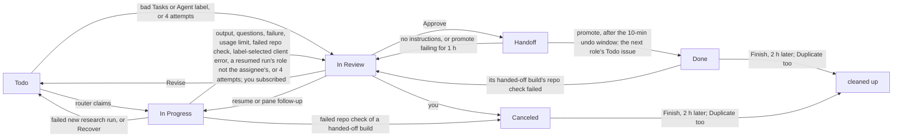
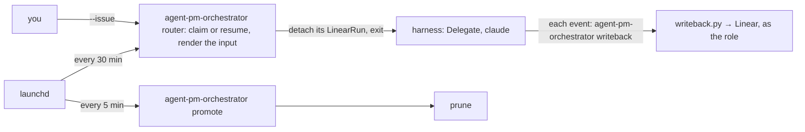
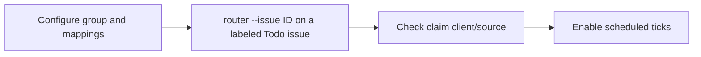

# Board

The orchestrator runs the core from a board, chosen by `[orchestrator] tracker`: a Linear board (`tracker = "linear"`; set it up once, then work through issue states) or a [local board](#local-board) of Markdown files (the default).

## Setup

Needs macOS and [Install](../README.md#install)'s requirements. The orchestrator runs this checkout's scripts, not the plugin. `<work_dir>` is `orchestrator.work_dir`.

1. Create `~/.agent-pm/config.local.toml` from the `# local:` lines of each packaged `config.toml`, each under its layer's section. Include researcher's and pm's `[output]`. Set `tracker = "linear"` under `[orchestrator]`: unset, the orchestrator reads a [local board](#local-board) instead. The `[orchestrator.linear]` keys are needed only with `tracker = "linear"`; there, a required key left `""` stops every `agent-pm-orchestrator` command.

   ```toml
   [orchestrator]                         # the tracker
   tracker = "linear"

   [delegate.roles.engineer]              # run settings
   tier = 2

   [orchestrator.roles.engineer]          # board settings
   max_runs = 1

   [orchestrator.linear.roles.engineer]   # Linear settings
   account = "engineer@example.com"
   ```

2. Create the Linear presets, accounts and Keychain items, and fill their keys: [Linear presets](credentials.md#linear-presets).
3. Dry-run each job:
   ```bash
   bin/agent-pm-orchestrator router --dry-run
   bin/agent-pm-orchestrator promote --dry-run
   ```
4. Install the launchd jobs:
   ```bash
   mkdir -p ~/.agent-pm/logs   # launchd can't start a job without it
   for job in router promote; do
     launchctl bootout gui/$(id -u)/com.ophis.agent-pm.$job 2>/dev/null   # fails harmlessly if none is loaded
     cp orchestrator/launchd/com.ophis.agent-pm.$job.plist ~/Library/LaunchAgents/
     launchctl enable gui/$(id -u)/com.ophis.agent-pm.$job
     launchctl bootstrap gui/$(id -u) ~/Library/LaunchAgents/com.ophis.agent-pm.$job.plist
   done
   launchctl list | grep com.ophis.agent-pm   # exactly the two jobs
   ```

| Job | Schedule |
|---|---|
| router | :00 and :30 |
| promote | every 5 min |

The plists hard-code this checkout's path and `~/.agent-pm` (launchd doesn't expand `~`). For another checkout or `work_dir`, edit them in `orchestrator/launchd/` and rerun step 4. To uninstall a job:

```bash
launchctl bootout gui/$(id -u)/com.ophis.agent-pm.<job>
rm ~/Library/LaunchAgents/com.ophis.agent-pm.<job>.plist
```

## Using the board



- **New work:** a Todo issue in the product's project, assigned to a role account. The description is the brief, or an engineer issue's requirement. Add `Repo: <owner>/<name>` if the repo is not the project's `[orchestrator.linear.project_repos]` entry.
- **Order work:** the router claims by priority, then later role, then oldest. A blocked issue waits until its blockers are Done, Canceled or Duplicate.
- **Duplicates:** on an issue's first claim the router searches the team's issues (archived too), the docs repo and the target repo's merged PRs by its title words and the issue ids its description names, and lists the matches, minus its Handoff chain, at the end of the agent's input under `## Related work`. A failed search logs `related-skip` and the run goes on.
- **Linked documents:** the agent's input inlines the docs-repo documents an issue links, in order, up to 50,000 bytes in all; each one that no longer fits is listed by path and URL for the agent to read. A PRD and an earlier version are always inlined.
- **Approve:** move to Handoff and comment what's next. After 10 minutes (move it out of Handoff to undo), promote creates the next role's issue and marks this one Done.
- **Revise:** comment and move back to Todo. The agent resumes where it left off. On an engineer issue your PR comments and reviews count too. After 4 attempts the issue goes to In Review; moving it back to Todo restarts the count.
- **Who counts as you:** every Linear account but the harness account, the role accounts and Linear automation, the manager included (its `agent-pm-orchestrator issue` commands act as `linear.manager_key`'s account): its comments are instructions and its moves to Todo restart the attempt count. Comments without a user, such as the GitHub integration's, are ignored. `linear.human_members` only picks who is subscribed on In Review. Anyone who can comment on or move the team's issues (members, guests, synced users) can so instruct agents: keep the team's membership and guest access tight.
- **Continue work:** every resumed or rerun board attempt re-reads the issue's state and returns it to In Progress; already there is a no-op. Write-back records this once per attempt, retries a failed move on progress, and ignores ended or older attempts. Pane answers, follow-ups, rework and PR-gate fixes after the harness ends follow `/agent-pm:manage`'s **Continue issue work** rule (`manager/skills/manage/SKILL.md`): the manager moves it before sending and applies the normal end state when that work finishes.
- **Runs without an outcome:** one whose client's turn failed (such as a context overflow) is written back as a failure, its error the comment; any other (no outcome block, a give-up, a crash or a stop) stays In Progress for Recover. A refused write-back logs `writeback refused` with its reason in `orchestrator.jsonl`, and its `callback_error` row in the run's `run.jsonl` keeps the callback's stderr.
- **Finish:** set Done, Canceled or Duplicate. 2 hours later prune closes the run, deletes its `agent/` dir and the issue's pushed branches, and archives the issue (Canceled or Duplicate whoever is assigned, no one or researcher too; Done only pm and engineer issues: researcher reports stay) unless a sub-issue, at any depth, is still open (Linear would archive it too); 7 days later it deletes the issue's whole workdir. An issue left in any other state but Todo or In Progress (In Review, Handoff, Backlog) for 7 days since its latest move or run loses its checkouts and temp files (`agent/src`, `agent/publish`, `agent/tmp`), unless its run or agent session is still open; its other agent files, run records (`run/`), write-back ledger and branches stay, and a Revise rebuilds the checkouts. Each run's end also clears `agent/tmp`. Uncommitted and unpushed work is lost.

### Task labels

A label from the `Tasks` group picks the role's task, mapped by `[task_labels]`. No label: the agent picks (unsure: the researcher runs Research, which has no label; the engineer Build) and says why in its start comment. A bad label (unmapped, another role's, or several): the issue goes to In Review with a comment. To upgrade a report (Light Research → Research → Deep Research), set the next task's label (to Research: remove the label), comment the claims to verify, and move it back to Todo.

`[orchestrator.task_tiers]` sets a task's model tier, e.g. `light-build = 3` (1 = strongest): the router overlays it on the role's run, a resume taking its start's task; an issue with an unlisted task or no label keeps its role's or global tier.

## Operating



```bash
bin/agent-pm-orchestrator router --issue <ID>         # run one issue now, skipping the run limits and usage gates
bin/agent-pm-orchestrator router --issue <ID> --tui   # the same, attended in a TUI (display, events file, exit codes: --help)
bin/agent-pm-orchestrator status <ID>                 # alive: its run; once that ends, state is its open TUI's (done, working, blocked), gone once none is open
bin/agent-pm-orchestrator attach-command <ID>         # the command that shows its agent run
bin/agent-pm-orchestrator close <ID>                  # end the run and its TUI; the issue stays In Progress for Recover
bin/agent-pm-orchestrator resume <ID>                 # resume an attended run where it was shown
tmux ls                                         # running agent runs
```

Run `bin/agent-pm-orchestrator` by its absolute path; `--help` lists each command's options. Issue operations (`bin/agent-pm-orchestrator issue …`: read, list, create (`--parent` splits), edit, move, comment, relate, archive; on Linear also look up and swap a label), in abstract states, roles, task and client names: `/agent-pm:board` ([orchestrator/skills/board/SKILL.md](../orchestrator/skills/board/SKILL.md)), their one guide. Events go to `<work_dir>/logs/orchestrator.jsonl`. Keep `<work_dir>/logs/runs.jsonl`: resume, Recover, write-back and the first-claim search read it.

A run that ended leaves its TUI open for pane follow-ups; the issue's next run, new or resumed, closes it.

Each session's `Run <sid>` comment holds its resume command. Move the issue out of In Progress before opening it, or the router may resume it after 30 idle minutes.

### Run limits

A run starts only when both layers have room: its role has fewer live runs than `[roles.<role>] max_runs` (packaged: 3 for researcher, pm and engineer; another stage's role without a table: 1), and its client fewer than its `[client_max_runs]` entry. No client is limited by default: an unlisted client is unlimited. Set limits in `~/.agent-pm/config.local.toml`, e.g. `opencode = 1`, as the host's local models run one job at a time:

```toml
[orchestrator.client_max_runs]
opencode = 1
claude = 3
```

Both layers count the live runs in `runs.jsonl`, a run between rounds included, a client's by the client its run records. A tick checks role, then client, then the usage gate. A full client's Todo issue logs `claim-skip` with reason `<client> is full` and the tick tries the next one; a full client's In Progress issue logs `recover-skip` and waits. `router --issue` skips both limits, but its run counts. Ad-hoc runs (`agent-pm-delegate run`, `agent-pm-session start`) and crew workers bypass the router and `runs.jsonl`: no limit applies to them and they count toward none, so an OpenCode crew worker adds to the local model's load.

### Linear MCP off

The commander needs no Linear MCP server: `/agent-pm:board`'s commands replace its tools. Turn it off in the project you run the commander from, and only there:

1. Open Claude Code in that project's directory and run `/mcp`.
2. Select the Linear entry and choose **Disable**. Claude Code records this for that project only ([Disable a server without removing it](https://code.claude.com/docs/en/mcp#disable-a-server-without-removing-it)); other servers and projects keep their settings. Never remove the server or edit its config by hand.
3. Start a new session there and check: `/mcp` shows the Linear entry disabled, no Linear MCP tool is offered, `bin/agent-pm-orchestrator issue read <ID>` still prints the issue, and every other server there keeps its earlier state. Another project's `/mcp` still shows the Linear entry as before.

### Agent label

Copy `[orchestrator.linear]`'s `agent_label_group` and `[orchestrator.linear.agent_labels]` from the `# local:` examples in [orchestrator/config.toml](../orchestrator/src/agent_pm/orchestrator/config.toml) into this machine's `~/.agent-pm/config.local.toml`, with one line per client in place of the `"<client>"` line, and the Agent group's and its child labels' ids in place of the example ids. Both settings empty disables selection. Mapping keys name clients configured in Delegate; unknown clients are accepted at load time and checked when constructing a run.

| Agent-group labels at claim recheck | New run |
|---|---|
| None | Resolved role default client |
| One mapped label | Its client, for any role; renaming the label preserves the mapping |
| Several, or an unmapped child | One comment listing label errors, including task-label errors; In Review, no attempt consumed |

Selection: [`router.py` `client_for`](../orchestrator/src/agent_pm/orchestrator/engine/router.py). The `claim` log records `client` and `client_source=label|default`. A label-selected client's quota configuration or construction `ConfigError` produces a comment with the client and error's first line, then In Review instead of an interruption retry ([`router.py` `_label_client_error`](../orchestrator/src/agent_pm/orchestrator/engine/router.py)); fix it → move back to Todo.

Each new run selects again, retries included. A session resumes only in the client that created it, so an interrupted run re-reads its labels: when the selection differs from its session's client, the router starts a new session on the selected client instead, the issue staying In Progress, its `plan` line saying `mode=new` with that `client`. Once the usage gate lets it start, the router logs `restart` with the old `sid`, `client`, `client_source` and the session's client as `resumed` ([`router.py` `Board.plan`](../orchestrator/src/agent_pm/orchestrator/engine/router.py)); a usage-blocked restart logs only `usage-skip`. Invalid Agent or task labels keep the resume.

Scheduled quota checks use each candidate’s selected or recorded client, with at most one probe per client per tick; blocked usage logs `usage-skip` without switching clients ([`gate.py` `Gate.blocked`](../orchestrator/src/agent_pm/orchestrator/engine/gate.py)). Inside an agent run, `--brake <role>` uses its `AGENT_PM_CLIENT` environment, set at process launch from the effective client, including resumed snapshots; outside one it uses the role default ([`modes/base.py` `child_env`](../session/src/agent_pm/session/modes/base.py), [`router.py` `brake`](../orchestrator/src/agent_pm/orchestrator/engine/router.py)).

`--dry-run` re-reads each new candidate's labels and prints `client`, `client_source` (`label` or `default`) and its task's `tier` ([Task labels](#task-labels)); a resume prints its recorded client (its `plan` line adds the tier), or `restart` when it starts a new session. Invalid labels print `would comment`; both scheduled and `--issue` previews leave issue state, comments and run logs unchanged ([`router.py` `Board.claim`](../orchestrator/src/agent_pm/orchestrator/engine/router.py)).

Rollout:



Use the installed `agent-pm-orchestrator` absolute path. `--issue` skips the usage gate; it starts a real run. Use `--dry-run --issue ID` first to inspect label selection without starting a run.

### OpenCode

An issue with the Agent group's `OpenCode` label runs OpenCode on the host's Ollama models. Use local models only for live-test issues (the user's rule; nothing enforces it): OpenCode does not load the image's plugins, so it cannot run `/autopilot:build` or `/autopilot:light-build`. Beyond [Setup](#setup):

1. Ollama and its model: [Docker host › OpenCode](docker-host.md#opencode).
2. The Docker Host, with the harness on tmux: `[session.hosts] default = "docker"` and `[delegate.delegates] harness_host = "tmux"` ([Docker host › Role runs](docker-host.md#role-runs)). A board run's cwd is untrusted, so on tmux OpenCode refuses to start ([OpenCode sessions](sessions.md#opencode-sessions)). This puts every client's board runs in containers.
3. An `OpenCode` label in the Agent group, mapped as in [Agent label](#agent-label): `opencode = "<its label id>"` under `[orchestrator.linear.agent_labels]`.

The usage gate lets an OpenCode run start while the host's Ollama answers on `127.0.0.1:<ollama_port>`, else logs `usage-skip` with reason `usage unknown`. Every tier maps to the same model by default, so `[task_tiers]` changes nothing for OpenCode unless `[session.clients.opencode.tiers]` maps tiers to different models.

## Local board

`[orchestrator] tracker` picks where issues live: `"local"` (the default) a local board, `"linear"` Linear (everything above). A local board is a directory of Markdown issue files, `$AGENT_PM_BOARD_DIR` (an absolute or `~` path), default `~/.agent-pm/board/`; no config key names it. One directory is one board: boards never sync, and a machine may keep several, each command reading the one its `$AGENT_PM_BOARD_DIR` names.

The router runs a local board by the Linear board's rules ([Order work](#using-the-board), [Task labels](#task-labels), [Agent label](#agent-label)): a tick or `--issue` claims a role's ready issue (its file moves to `running/`), its run writes back (`writeback`: the session, start, progress and completion comments) and moves it on (`review/`, as In Review), Recover replays an ended run's outcome, and `--dry-run` writes nothing. `router --brake`, `resume`, `status`, `show`, `hide`, `close`, `attach-command` and `content` work too. `promote`, `prune` and `issue` exit 2 with `<command> needs [orchestrator] tracker = "linear"`. A local board has no accounts: the engine writes as `self`, notifies no one, and checks no Keychain role key.

```text
<board>/
├── .next-id                 the next issue number, decimal, one line
├── .lock                    the board lock: programs take it to write; reads take none
├── .state/                  the board's runtime state, in place of <work_dir>: logs/ (runs.jsonl, router.lock,
│                            orchestrator.jsonl) and work/<ID>/ (State root)
├── unassigned/<state>/      assigned to no one: never listed
├── me/<state>/              assigned to you: never listed
├── <role>/<state>/          assigned to a role, one dir per [orchestrator.roles.<role>] role
└── archive/                 archived issue files, flat: archive/<ID> <title>.md
```

`<state>` is one of `backlog`, `ready`, `running`, `review`, `approved`, `done`, `canceled`. The directory an issue file sits in is its assignee and state: no front-matter key holds either, so moving a file from `review/` to `approved/` approves it, back to `ready/` revises it. Only role dirs' `ready/` issues are queued and only their `running/` ones recovered; `unassigned/`, `me/`, a dir named after no configured role, `archive/` and `.state/` are never listed. An archived issue's state is its last History entry's. Files not ending `.md`, and entries starting with `.` (an atomic write's temp file), are skipped.

An issue file, e.g. `engineer/review/LOC-12 Session registry.md`:

```markdown
---
id: LOC-12
title: "ENG: Session registry"
task: light-build
client: claude
priority: 2
created: 2026-10-19T14:02:00-04:00
blocked_by: [LOC-10]
related: [LOC-7]
parent: LOC-5
links:
  - title: Session registry PRD
    url: https://github.com/<owner>/<docs>/blob/main/Product%20Design/session-registry.md
---

### Description
Repo: <owner>/<name>
Add a session registry.

### Comments

#### other · 2026-10-19 14:05
Read LOC-7 first.

#### self · 2026-10-19 16:10 <!-- id=c3 key=result:ab12 -->
Build ready: https://github.com/<owner>/<name>/pull/1

###
Approved; hand it to the next stage.

### History
- 2026-10-19 14:02 ready other
- 2026-10-19 14:30 running self
- 2026-10-19 16:10 review self
```

- **Front matter:** one `key: value` line each, at most once. `id` (required) is the issue's identifier, e.g. `LOC-12`; the file name is only for you, so renaming a file changes nothing. `title` (required): plain text or a JSON string. `created` (required): ISO 8601 with an offset or `Z`. `priority`: 0 none (the default), 1 urgent … 4 low. `task` and `client` choose the run's task and client as the Tasks and Agent labels do: unset, the role picks its task and runs its default client; a task not among the role's bounces the issue as a bad Tasks label does. `blocked_by` and `related`: `[ID, …]`, `[]` for none. `parent`: one id. `links`: `  - title:` / `    url:` pairs. An empty value means none.
- **Blockers:** a ready issue waits while a `blocked_by` issue is not in `done/` or `canceled/` (an archived one by its last History state); an id with no issue file blocks too.
- **Sections:** `### Description`, `### Comments`, `### History`, each optional, at most once, in that order; nothing but blank lines before the first.
- **Comments:** each starts with `#### <self|other> · YYYY-MM-DD HH:MM`; `self` is the engine (its hidden `id` and `key` let it edit a comment in place and never post one twice), `other` a person. To comment, add a line `###` at the end of Comments and your text below it: it counts as yours (`other`) at the file's modification time.
- **History:** one `- YYYY-MM-DD HH:MM <state> <self|other>` line per move, `self` the engine's. A file whose directory differs from its last History entry (or that has none) was moved by a person: it counts as an `other` move there at the file's modification time, as when a person moves a Linear issue. Times without an offset are local time.
- **Errors:** a board file that cannot be read stops the router before any pick with `router.py: <absolute path>: <reason>`, exit 2, e.g. `no front matter`, `unknown key 'owner'`, `bad priority '7'`, `unknown state dir 'doing'`, `duplicate id LOC-12, also in <path>`. No board directory: `router.py: <board>: no such board directory`; one holding no assignee dir: `router.py: <board>: empty board: no assignee directory`.
- **Writes:** a program takes `.lock` before it changes the board, rereads the issue file, and writes it to a temp file beside it, then replaces it whole, only if the file still holds what it read (else it rereads, up to 3 times, then fails with `<path>: changed while writing`); every other line stays as you wrote it. A move renames the file into `<assignee>/<state>/` and adds a `self` History line; a move that names the state it expects (e.g. a run's to `review/` from `running/`) leaves an issue you moved elsewhere where it is. The engine's comments are `#### self` ones, those it may post again or edit in place (a run's session comment) carrying its hidden `id` and `key`; a body line that would read as a header or section starts with a space. Before its change, a write fixes what you did since the last one: each `###` comment gets its `#### other · <time>` header, and a file whose directory differs from its last History entry gets that `other` move as a History line, both at the file's modification time. A new issue's number comes from `.next-id`, under the lock.
