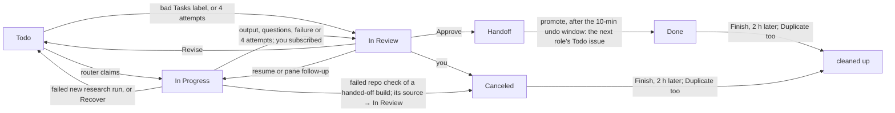
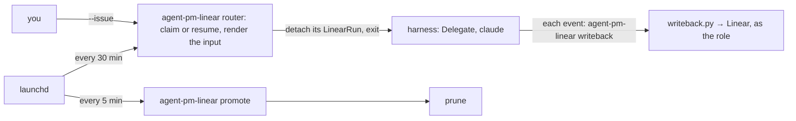
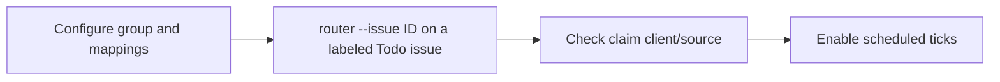

# Linear board

The Linear orchestrator runs the core from a Linear board: set it up once, then work through issue states.

## Setup

Needs macOS and [Install](../README.md#install)'s requirements. The orchestrator runs this checkout's scripts, not the plugin. `<work_dir>` is `linear_orchestrator.work_dir`.

1. Create `~/.agent-pm/config.local.toml` from the `# local:` lines of each packaged `config.toml`, each under its layer's section. Include researcher's and pm's `[output]`. A required key left `""` stops every `agent-pm-linear` command.

   ```toml
   [delegate.roles.engineer]              # run settings
   tier = 2

   [linear_orchestrator.roles.engineer]   # board settings
   account = "engineer@example.com"
   max_runs = 1
   ```

2. Create the Linear presets, accounts and Keychain items, and fill their keys: [Linear presets](credentials.md#linear-presets).
3. Dry-run each job:
   ```bash
   bin/agent-pm-linear router --dry-run
   bin/agent-pm-linear promote --dry-run
   ```
4. Install the launchd jobs:
   ```bash
   mkdir -p ~/.agent-pm/logs   # launchd can't start a job without it
   for job in router promote; do
     launchctl bootout gui/$(id -u)/com.ophis.agent-pm.$job 2>/dev/null   # fails harmlessly if none is loaded
     cp linear-orchestrator/launchd/com.ophis.agent-pm.$job.plist ~/Library/LaunchAgents/
     launchctl enable gui/$(id -u)/com.ophis.agent-pm.$job
     launchctl bootstrap gui/$(id -u) ~/Library/LaunchAgents/com.ophis.agent-pm.$job.plist
   done
   launchctl list | grep com.ophis.agent-pm   # exactly the two jobs
   ```

| Job | Schedule |
|---|---|
| router | :00 and :30, with `--now` (drop it to run only 01:00–06:59) |
| promote | every 5 min |

The plists hard-code this checkout's path and `~/.agent-pm` (launchd doesn't expand `~`). For another checkout or `work_dir`, edit them in `linear-orchestrator/launchd/` and rerun step 4. To uninstall a job:

```bash
launchctl bootout gui/$(id -u)/com.ophis.agent-pm.<job>
rm ~/Library/LaunchAgents/com.ophis.agent-pm.<job>.plist
```

## Using the board



- **New work:** a Todo issue in the product's project, assigned to a role account. The description is the brief, or an engineer issue's requirement. Add `Repo: <owner>/<name>` if the repo is not the project's `[project_repos]` entry.
- **Order work:** the router claims by priority, then later role, then oldest. A blocked issue waits until its blockers are Done, Canceled or Duplicate.
- **Duplicates:** on an issue's first claim the router searches the team's issues (archived too), the docs repo and the target repo's merged PRs by its title words and the issue ids its description names, and lists the matches, minus its Handoff chain, at the end of the agent's input under `## Related work`. A failed search logs `related-skip` and the run goes on.
- **Linked documents:** the agent's input inlines the docs-repo documents an issue links, in order, up to 50,000 bytes in all; each one that no longer fits is listed by path and URL for the agent to read. A PRD and an earlier version are always inlined.
- **Approve:** move to Handoff and comment what's next. After 10 minutes (move it out of Handoff to undo), promote creates the next role's issue and marks this one Done.
- **Concurrency:** the claim checks the role's `max_runs`, then `[client_max_runs]` for the client recorded in `runs.jsonl`, then the usage gate. A full client logs `claim-skip` with reason `<client> is full`; a full client on a resume logs `recover-skip` with the same reason. `--issue` bypasses both layers, `--dry-run --issue` prints the same `claim-skip`, and an ad-hoc run (`agent-pm-delegate run`, `agent-pm-session start`) or a crew worker, which never passes through the orchestrator, is not counted.
- **Revise:** comment and move back to Todo. The agent resumes where it left off. On an engineer issue your PR comments and reviews count too. After 4 attempts the issue goes to In Review.
- **Continue work:** every resumed or rerun board attempt re-reads the issue's state and returns it to In Progress; already there is a no-op. Write-back records this once per attempt, retries a failed move on progress, and ignores ended or older attempts. Pane answers, follow-ups, rework and PR-gate fixes after the harness ends follow `/agent-pm:manage`'s **Continue issue work** rule (`manager/skills/manage/SKILL.md`): the manager moves it before sending and applies the normal end state when that work finishes.
- **Finish:** set Done, Canceled or Duplicate. 2 hours later prune closes the run, deletes its `agent/` dir and the issue's pushed branches, and archives pm and engineer issues (not one with a sub-issue, at any depth, still open: Linear would archive it too); 7 days later it deletes the issue's whole workdir. An issue left in any other state but Todo or In Progress (In Review, Handoff, Backlog) for 7 days since its latest move or run loses its checkouts and temp files (`agent/src`, `agent/publish`, `agent/tmp`), unless its run or agent session is still open; its other agent files, run records (`run/`), write-back ledger and branches stay, and a Revise rebuilds the checkouts. Each run's end also clears `agent/tmp`. Uncommitted and unpushed work is lost.

### Task labels

A label from the `Tasks` group picks the role's task, mapped by `[task_labels]`. No label: the agent picks (unsure: the researcher runs Research, which has no label; the engineer Build) and says why in its start comment. A bad label (unmapped, another role's, or several): the issue goes to In Review with a comment. To upgrade a report (Light Research → Research → Deep Research), set the next task's label (to Research: remove the label), comment the claims to verify, and move it back to Todo.

`[linear_orchestrator.task_tiers]` sets a task's model tier, e.g. `light-build = 3` (1 = strongest): the router overlays it on the role's run, a resume taking its start's task; an issue with an unlisted task or no label keeps its role's or global tier.

## Operating



```bash
bin/agent-pm-linear router --issue <ID>         # run one issue now, skipping the hours, role max_runs, client caps and usage gates
bin/agent-pm-linear router --issue <ID> --tui   # the same, attended in a TUI (display, events file, exit codes: --help)
bin/agent-pm-linear status <ID>                 # alive: its run; once that ends, state is its open TUI's (done, working, blocked), gone once none is open
bin/agent-pm-linear attach-command <ID>         # the command that shows its agent run
bin/agent-pm-linear close <ID>                  # end the run and its TUI; the issue stays In Progress for Recover
bin/agent-pm-linear resume <ID>                 # resume an attended run where it was shown
tmux ls                                         # running agent runs
```

Run `bin/agent-pm-linear` by its absolute path; `--help` lists each command's options. Issue operations (`bin/agent-pm-linear issue …`: read, list, look up, create, move, comment, relate, swap a label, archive): `/agent-pm:linear` ([linear-orchestrator/skills/linear/SKILL.md](../linear-orchestrator/skills/linear/SKILL.md)), their one guide. Events go to `<work_dir>/logs/orchestrator.jsonl`. Keep `<work_dir>/logs/runs.jsonl`: resume, Recover, write-back and the first-claim search read it.

A run that ended leaves its TUI open for pane follow-ups; the issue's next run, new or resumed, closes it.

Each session's `Run <sid>` comment holds its resume command. Move the issue out of In Progress before opening it, or the router may resume it after 30 idle minutes.

### Linear MCP off

The commander needs no Linear MCP server: `/agent-pm:linear`'s commands replace its tools. Turn it off in the project you run the commander from, and only there:

1. Open Claude Code in that project's directory and run `/mcp`.
2. Select the Linear entry and choose **Disable**. Claude Code records this for that project only ([Disable a server without removing it](https://code.claude.com/docs/en/mcp#disable-a-server-without-removing-it)); other servers and projects keep their settings. Never remove the server or edit its config by hand.
3. Start a new session there and check: `/mcp` shows the Linear entry disabled, no Linear MCP tool is offered, `bin/agent-pm-linear issue read <ID>` still prints the issue, and every other server there keeps its earlier state. Another project's `/mcp` still shows the Linear entry as before.

### Agent label

Copy `agent_label_group` and `[agent_labels]` from the `# local:` examples in [linear-orchestrator/config.toml](../linear-orchestrator/src/agent_pm/linear_orchestrator/config.toml) into this machine's `~/.agent-pm/config.local.toml`, with one line per client in place of the `"<client>"` line, and the Agent group's and its child labels' ids in place of the example ids. Both settings empty disables selection. Mapping keys name clients configured in Delegate; unknown clients are accepted at load time and checked when constructing a run.

| Agent-group labels at claim recheck | New run |
|---|---|
| None | Resolved role default client |
| One mapped label | Its client, for any role; renaming the label preserves the mapping |
| Several, or an unmapped child | One comment listing label errors, including task-label errors; In Review, no attempt consumed |

Selection: [router.py:592](../linear-orchestrator/src/agent_pm/linear_orchestrator/engine/router.py#L592). The `claim` log records `client` and `client_source=label|default`. A label-selected client's quota configuration or construction `ConfigError` produces a comment with the client and error's first line, then In Review instead of an interruption retry ([router.py:826](../linear-orchestrator/src/agent_pm/linear_orchestrator/engine/router.py#L826)); fix it → move back to Todo.

Each new run selects again, retries included. A session resumes only in the client that created it, so an interrupted run re-reads its labels: when the selection differs from its session's client, the router starts a new session on the selected client instead, the issue staying In Progress, its `plan` line saying `mode=new` with that `client`. Once the usage gate lets it start, the router logs `restart` with the old `sid`, `client`, `client_source` and the session's client as `resumed` ([router.py:494](../linear-orchestrator/src/agent_pm/linear_orchestrator/engine/router.py#L494)); a usage-blocked restart logs only `usage-skip`. Invalid Agent or task labels keep the resume.

Scheduled quota checks use each candidate’s selected or recorded client, with at most one probe per client per tick; blocked usage logs `usage-skip` without switching clients ([gate.py:56](../linear-orchestrator/src/agent_pm/linear_orchestrator/engine/gate.py#L56)). Inside an agent run, `--brake <role>` uses its `AGENT_PM_CLIENT` environment, set at process launch from the effective client, including resumed snapshots; outside one it uses the role default ([modes/base.py:53](../session/src/agent_pm/session/modes/base.py#L53), [router.py:1074](../linear-orchestrator/src/agent_pm/linear_orchestrator/engine/router.py#L1074)).

`--dry-run` re-reads each new candidate's labels and prints `client`, `client_source` (`label` or `default`) and its task's `tier` ([Task labels](#task-labels)); a resume prints its recorded client (its `plan` line adds the tier), or `restart` when it starts a new session. Invalid labels print `would comment`; both scheduled and `--issue` previews leave issue state, comments and run logs unchanged ([router.py:622](../linear-orchestrator/src/agent_pm/linear_orchestrator/engine/router.py#L622)).

Rollout:



Use the installed `agent-pm-linear` absolute path. `--issue` skips the usage gate; it starts a real run. Use `--dry-run --issue ID` first to inspect label selection without starting a run.

### OpenCode

An issue with the Agent group's `OpenCode` label runs OpenCode on the host's Ollama models. Use local models only for live-test issues (the user's rule; nothing enforces it): OpenCode does not load the image's plugins, so it cannot run `/autopilot:build` or `/autopilot:light-build`. Beyond [Setup](#setup):

1. Ollama and its model: [Docker host › OpenCode](docker-host.md#opencode).
2. The Docker Host, with the harness on tmux: `[session.hosts] default = "docker"` and `[delegate.delegates] harness_host = "tmux"` ([Docker host › Role runs](docker-host.md#role-runs)). A board run's cwd is untrusted, so on tmux or pty OpenCode refuses to start ([OpenCode sessions](sessions.md#opencode-sessions)). This puts every client's board runs in containers.
3. An `OpenCode` label in the Agent group, mapped as in [Agent label](#agent-label): `opencode = "<its label id>"` under `[linear_orchestrator.agent_labels]`.

The usage gate lets an OpenCode run start while the host's Ollama answers on `127.0.0.1:<ollama_port>`, else logs `usage-skip` with reason `usage unknown`. Every tier maps to the same model by default, so `[task_tiers]` changes nothing for OpenCode unless `[session.clients.opencode.tiers]` maps tiers to different models.
