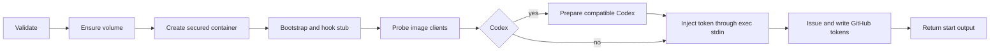

# Docker broker protocol

**Protocol 10** is the contract for TASK-559 (`agent-pm-broker`, Go) and TASK-560
(Session's Docker Host, Python). `version` writes `{"protocol_version":"10"}`.
This version is independent of the agent-pm package version. Python requires exact
equality before other calls; mismatch is a local preflight error that prints the
broker installation/upgrade command supplied by TASK-559. It creates no container.

The broker installs the hook stub, so this version also covers the stub's wire format.
Protocol 2 marked the stub's switch to the [relay wire format](docker-relay-protocol.md);
protocol 3 drops start's `update` (the clients come from the image) and adds build's `--max-age`;
protocol 4 mounts the manifest's `workspace` volume at `cwd` instead of binding the host cwd,
drops the mount roots and deny list, and adds `workspace-rm`; protocol 5 names every volume
`agent-pm-ws-<name>`, labelled `agent-pm.kind=ws`, and adds the manifest's `github`; protocol 6 issues
that App's installation tokens ([GitHub tokens](#github-tokens)): start's `github`, `refresh`, `status`, and the
codes `github_failed` and `refresh_failed`. Protocol 7 adds the optional administrative
`status.codex` object. Protocol 8 adds build's `--plugin`. Protocol 9 adds client-specific
manifest directories and start's `credential_expires_at`; relay messages and GitHub fields
remain unchanged. Protocol 10 adds start's `client_update` audit object.
Bump the version whenever that wire format changes. A plugin upgraded without
reinstalling the broker then fails the handshake, so an old stub never meets a new relay.

The broker is `broker/`; its Session client and the Docker Host:
[Docker Host](docker-host.md). Context: [TASK-545](https://linear.app/ophis-workgroup/issue/TASK-545).

## Schemas and channels

[protocol.schema.json](../protocol/docker-broker/protocol.schema.json) uses
[JSON Schema Draft 2020-12](https://json-schema.org/draft/2020-12/json-schema-validation).
Each `#/$defs/<name>` below is a schema entry point; the document root validates a
manifest. References are internal, so Go and Python can load it without network access.

| Invocation | Input definition | Success definition |
|---|---|---|
| `agent-pm-broker version` | `version_input` | `version_output` |
| `agent-pm-broker build --agent-pm /absolute/package [--plugin NAME]... [--max-age SECONDS]` | `build_input` | `build_output` |
| `agent-pm-broker start --manifest /absolute/manifest.json` | `start_input` plus `manifest` for file contents | `start_output` |
| `agent-pm-broker refresh --container <container> --manifest /absolute/manifest.json` | `refresh_input` | `refresh_output` |
| `agent-pm-broker close --container <container>` | `close_input` | `close_output` |
| `agent-pm-broker status` | `status_input` | `status_output` |
| `agent-pm-broker workspace-rm --volume <volume> [--force]` | `workspace_rm_input` | `workspace_rm_output` |

Input fixtures' `argv` arrays represent arguments after the executable, in canonical
order. They are test data, not JSON sent to the broker. These commands consume no
stdin. `login claude` reads a token, and `login github <app>` the login keychain password once when the
item's access needs a change, interactively without echo; neither has a JSON contract.
The administrative Codex commands are defined in [Codex operations](docker-codex.md).

`build`'s `--plugin NAME` repeats, every one before `--max-age`; `NAME` is a Claude Code plugin
the account installed at user scope, `name` or `name@marketplace` (`#/$defs/plugin`), which the
image holds ([Plugins](docker-host.md#plugins)). The schema checks each token; their pairing and
order, which JSON Schema cannot express, are the broker's, failing with `usage`.

| Result | Process exit | stdout | stderr |
|---|---|---|---|
| Success, including an absent container on close or volume on workspace-rm | `0` | One success JSON object plus LF | Empty; build: Docker's build progress, then one `agent-pm-broker: …` line per older image removed or kept; start: one `agent-pm-broker: start <phase> <seconds> s` line per phase, then `total` ([Docker Host](docker-host.md#start-timing)) |
| Failure | Table below | Empty | One `error` JSON object plus LF; build: after Docker's build progress, as the last line |

Use UTF-8. Reject duplicate object keys, non-JSON numeric constants, trailing JSON values,
unknown fields and missing required fields. JSON object key order is irrelevant.
Capture subprocess output rather than mixing progress lines into either channel, except
build's: it copies `docker build`'s stderr to its own as it arrives, ending it with an LF
when Docker's did not, so the lines after it start a line.
Output and diagnostics must contain no tokens, credentials, environment dumps or
manifest contents. `message`, `cause` and `cleanup_error` are nonempty, single-line
human diagnostics; escape control characters and redact secrets before serialization.
Callers branch on exit/code, not diagnostic text, and reject malformed responses.

## Manifest

| Field | Contract |
|---|---|
| `name` | Session name: `[A-Za-z0-9_-]+`, excluding `none` |
| `generation` | 32 lowercase hexadecimal characters, the session generation |
| `image` | `agent-pm-worker:<key>`; key is 64 lowercase hexadecimal characters computed by broker from both image-definition and agent-pm package contents |
| `cwd` | Absolute existing host directory: the container path the workspace volume is mounted at and the working directory; never a bind source |
| `workspace` | The workspace volume: `agent-pm-ws-<name>` |
| `client` | Required: `claude` or `codex` |
| `claude_dir` | Required only for Claude, forbidden for Codex; mounted read/write at the same container path |
| `codex_dir` | Required only for Codex, forbidden for Claude; volatile container home with only its `sessions/` host-bound |
| `github` | Required: `null` (no GitHub token), or `{"app": "agent-pm-bot"}`, the only App the broker serves; another name is `manifest_rejected` at `start` and `refresh` |
| `hook_path` | Optional absolute container executable path; omitted for step 1 manual acceptance; `null` is invalid |
| `labels` | Required string-to-string object, possibly empty; caller keys use letters/digits/`_`/`.`/`-`, start with a letter or digit, and cannot use the reserved `agent-pm.` prefix |

Session name and generation match
[engine/types.py](../session/src/agent_pm/session/engine/types.py#L193) and
[modes/tui.py](../session/src/agent_pm/session/modes/tui.py#L524).
Broker adds `agent-pm.session=<name>` and `agent-pm.generation=<generation>`.
Container name is `agent-pm-<name>-<generation>`; close accepts that complete name.
Paths are literal absolute paths: no `~` or environment expansion. Control characters
are invalid in paths, names, labels and output strings.

**Runtime validation** follows schema validation and precedes container creation.
Schemas cannot prove filesystem, keychain, image provenance or daemon state:

- Require cwd to be an existing host directory. Compare paths literally, by components.
  Reject a cwd equal to or containing `/`, `/usr`, `/etc`, `/opt`, `/run`, `/home`, `/tmp`,
  `/proc`, `/sys` or `/dev`, or inside `/usr`, `/etc`, `/opt/agent-pm`, `/run`, `/proc`,
  `/sys`, `/dev`, `/bin`, `/sbin`, `/lib`, `/lib32`, `/lib64`, `/libx32`, `/var/run`,
  `/var/lock` or `/home/agent`: a volume there would hide what the image runs.
- Require the selected directory to be exactly `<account-home>/.agent-pm/docker-state/<name>/<client>`,
  with no symlink component and not overlapping cwd. Codex additionally requires a
  symlink-free `sessions/` directory, its only bind mount; Claude binds its selected directory.
  Reject `hook_path` equal to or below cwd, the selected directory or `/run/agent-pm`, and a cwd
  below `hook_path`.
- Ensure the volume: create an absent one with labels `agent-pm.kind=ws` and
  `agent-pm.workspace=<cwd>`, read its labels back, and give its root to the
  image's agent user in a one-shot container with only `CHOWN` (on failure, delete the
  volume it created). Reject an existing volume whose labels differ or that a container
  mounts. Docker's `docker volume rm` is the only way to clear a same-named foreign one.
- Set `npm_config_cache`, `UV_CACHE_DIR` and `PIP_CACHE_DIR` to `<cwd>/.agent-pm-cache`,
  inside the volume.
- Require the image to exist, be broker-built and carry `agent-pm.version`; tag syntax
  alone does not establish provenance. Missing login fails before creation and tells
  the user to run `agent-pm-broker login <client>`; only that client's login is read.
- Use the system account home, never `$HOME`, for the fixed endpoint
  `unix://<account-home>/.docker/run/docker.sock`. Ignore `DOCKER_HOST`,
  `DOCKER_CONTEXT` and `~/.docker/config.json`.

## Success fields

| Command | Fields and meaning |
|---|---|
| `version` | `protocol_version`: exact string `10` |
| `build` | `image`: broker tag; `digest`: final image content digest (`sha256:` plus 64 lowercase hex); `rebuilt`: whether this call rebuilt it: with `--max-age` (1 to 9 digits), also when the image was built that many seconds ago or earlier (`0`: always), keeping it if that rebuild fails with `build_failed` (except `0`); without it, never for age |
| `start` | `container`: canonical name; `endpoint`: fixed daemon socket URL; `image_digest`: final image digest; `clients.claude` and `clients.codex`: actual runnable version strings after preparation; `client_update`: object below; `github`: one `{"account", "expires_at"}` per installation token written in (`[]` with `github` `null` or no installation), sorted by account; `credential_expires_at`: Codex's initial access-token UTC expiry, `null` for Claude |
| `refresh` | `container`: requested canonical name; `github`: the new tokens' `{"account", "expires_at"}` |
| `close` | `container`: requested canonical name; `removed`: true if deleted, false if already absent; both succeed. Its GitHub tokens are revoked first |
| `status` | `revocations`: each token still to revoke, `{"container", "account", "expires_at"}`; optional `codex`: the object below |
| `workspace-rm` | `volume`: requested name; `removed`: true if deleted, false if already absent. Without `--force`, the newest broker-built worker image's `/opt/agent-pm/lib/workspace-check` first runs on the volume mounted read-only at its `agent-pm.workspace` path, with no network, the worker's security flags and the label `agent-pm.check=1`; any repo up to three levels down with uncommitted, stashed or unpushed work (package caches aside), or a directory it cannot list, keeps the volume |

`client_update` is required for Codex starts and absent for Claude starts; null is
rejected. Schema and Python use non-null `credential_expires_at` as the existing
Codex response discriminator. The object has no secrets; all its fields are required,
extra fields rejected:

| Field | Meaning |
|---|---|
| `client` | Key in `clients` identifying the prepared executable; currently `codex` |
| `pinned_version` | Verified host installation version |
| `allowed_versions` | Nonempty exact stable-version rule snapshot |
| `image_version` | Original image Codex, required in the rule |
| `target_version` | Selected allowed registry version; empty for unavailable registry or no allowed release |
| `result` | `updated`, `current`, `registry_unavailable`, `no_allowed_release`, `update_failed` |

Stable versions use canonical `major.minor.patch`. `current` requires target=image;
`updated` requires an allowed different target and matching `clients.codex`;
`update_failed` requires an allowed different target and actual=image. The two empty-target
outcomes also require actual=image. Python checks these cross-field relationships.
Update operations and diagnostics: [Codex versions](docker-codex.md#container-versions).

`status.codex` has no identity or credential fields:

| Field | Meaning |
|---|---|
| `version`, `path`, `sha256` | Verified pinned native installation; empty strings if invalid |
| `allowed_versions` | Exact container compatibility set; initially empty, preserved by updates |
| `logged_in` | Local installation, ACL, credential shape and access-token expiry checks pass |
| `state` | `installation_invalid`, `login_unavailable`, `busy`, `expired` or `ready` |
| `expires_at` | Optional UTC access-token expiry; required for `ready`; no signature or online-validity claim |
| `repair` | Host repair command, empty for `ready` |

Status never prompts for Codex access or refreshes it. A held login lock reports `busy`
after 250 ms. Existing GitHub revocation retry behavior is unchanged. Schema rejects
unknown Codex fields, malformed types and expiry, and a ready state without installation
metadata and expiry.


Failure to determine either version is `start_failed`.
Any fatal failure after creation attempts container deletion before returning an error.

## Errors

The common `error` definition validates the exit/code/command combination. Example stderr:

```json
{"exit_code":5,"error":{"command":"start","code":"login_required","message":"Run agent-pm-broker login claude.","cleanup":"not_needed"}}
```

| Exit | `error.code` | Commands | Failure class |
|---|---|---|---|
| `2` | `usage` | All, or `unknown` | Unknown command/flag, missing/extra argument, malformed argument value |
| `3` | `manifest_rejected` | start/refresh | Manifest unreadable, malformed JSON, duplicate keys, missing/unknown field or schema violation; a `github` App other than `agent-pm-bot`; refresh: a manifest of another container or with `github` `null` |
| `4` | `mount_rejected` | start | Runtime cwd, `claude_dir`, symlink or hook-placement rejection; a workspace volume with other labels or in use |
| `5` | `login_required` | start/refresh | Setup-token entry, or the App's private-key item, absent or without an App ID account; message gives login command |
| `6` | `image_rejected` | start | Schema-valid tag references a missing/untrusted image or one missing `agent-pm.version` |
| `7` | `docker_unreachable` | build/start/refresh/close/workspace-rm | Cannot reach fixed Docker Desktop daemon, including connection loss during the command |
| `8` | `build_failed` | build | Package directory/version invalid, a `--plugin` not installed or unusable (message names it; before any Docker call), context hashing or either build stage failed |
| `9` | `start_failed` | start | Container creation, bootstrap, hook installation, client version probing or token injection failed |
| `10` | `close_failed` | close | Daemon reachable but container deletion failed |
| `11` | `keychain_failed` | start/refresh/close/status | Keychain access denied, locked or otherwise failed; distinguish from absent entry. close: the container is deleted, but its tokens could not be revoked |
| `12` | `workspace_dirty` | workspace-rm | The check found unsaved work; `message` names each repo (relative to the mount point) and the `--force` command |
| `13` | `workspace_rejected` | workspace-rm | The volume has no `agent-pm.kind` label, or its `agent-pm.workspace` path is not clean, absolute and outside the container's own trees |
| `14` | `workspace_failed` | workspace-rm | No worker image, the check failed or printed no result, or deletion failed |
| `15` | `github_failed` | start/refresh | A GitHub request failed (`message` gives the HTTP status, never a body), or the App private key is unusable |
| `16` | `refresh_failed` | refresh | No tokens recorded for the container, it was closed during the refresh, or writing a token into it failed |
| `70` | `internal_error` | All, or `unknown` | Unexpected broker failure |

Classify the first fatal failing stage; daemon connectivity failures use exit 7.
An unreachable daemon cannot establish absence, so close fails with exit 7 rather
than claiming success. For Docker Desktop file-sharing rejection, use `start_failed`,
put Docker's original diagnostic in optional `error.cause` subject to channel redaction,
and explain in `message` that `~/.agent-pm/docker-state` must be shared. workspace-rm's
check run and volume deletion also put Docker's diagnostic in `cause`.

`error.cleanup` is `not_needed` when no container was created, `removed` after rollback,
or `failed` when rollback failed. Only start can report the latter two. Keep the original
exit/code when cleanup fails; include required `error.cleanup_error` and the canonical
container name in required `error.container`. The caller retries close with
`close --container <error.container>`. Do not emit success for
partially completed start. Optional `cause` carries a sanitized underlying diagnostic.
Process termination by signal may prevent a JSON response; callers treat missing or
invalid responses and inconsistent process/JSON exit codes as transport failure.

## GitHub tokens

With `github` not `null`, start signs a JWT with the App's private key (its keychain item's account is the App
ID), lists every installation of the App, and issues one token per installation for all its repositories with
exactly `contents: write`, `pull_requests: write`, `checks: read`, `actions: read`. Each token goes through exec
stdin to `/run/agent-pm/secrets/github/<account login>` (0400, owned by agent) and nowhere else: no argv, output,
manifest or log.

| Keychain item (broker-only) | Account | Content |
|---|---|---|
| `agent-pm-tokens` | container name | `{"app", "tokens": [{"account", "installation", "token", "expires_at"}]}` |
| `agent-pm-revocations` | `pending` | `[{"container", "account", "token", "expires_at"}]` |

- Every token is recorded before it is written in, and revoked (`DELETE /installation/token`) only with the
  recorded value, never one read back from the container. A 401 or 404 answer counts as revoked.
- A failed start revokes the tokens it issued; refresh records and writes in a new token before revoking the old.
- close moves the container's tokens to the backlog, revokes it, then deletes the container.
- start, close and status retry the backlog: an expired entry is dropped, the first request with no answer stops
  the retry. A backlog the broker cannot read (a broker reinstalled since made it) is skipped by start and close,
  without stderr; close then revokes a readable record directly.
- `~/.agent-pm/docker/tokens.lock` serializes each read-modify-write of these items, never a GitHub request.
  If taking it fails, the tokens being discarded are revoked at once, any revoke that fails puts its token in
  the backlog without the lock, and the record drops those tokens only. start and refresh fail with
  `keychain_failed` naming the lock; close does too, or, when that backlog write fails as well, says its tokens
  could not be revoked.
- Nothing falls back to another credential.

## Shared fixtures

[fixtures/index.json](../protocol/docker-broker/fixtures/index.json) inventories every literal `.json`
sample beside it. Both implementations read these same files; no copied corpus.

| Index field | Meaning |
|---|---|
| `definition` | Schema entry point under `$defs` |
| `valid` | Expected schema acceptance, independent of runtime outcome |
| `expected.stage` | `schema` for inputs; `runtime` for a schema-valid manifest rejected against fake host state; `response` for output/error samples |
| `expected.exit_code`, `error_code` | Expected broker outcome; null exit for malformed responses which callers reject locally |
| `context` | Runtime-only fake host state: account home, whether cwd exists, the volume (`absent`, `matching`, `mismatched`, `in_use`), Claude-directory symlink flag, login/image/daemon state |

Runtime fixtures specify one failure with other state valid. Implementers supply fakes
at their own filesystem/keychain/Docker boundaries. This Python test checks structural
acceptance only, not those future implementations or real Docker behavior.
`image=broker_built` includes the version label; `untrusted` and `missing_version_label`
are rejection cases. `docker=sharing_denied` means a reachable daemon rejects creation.

Install the pinned test dependency and use the supervised test command in
[docs/tests.md](tests.md); the fixture test is `tests/unit/docker_broker_protocol_test.py`.
