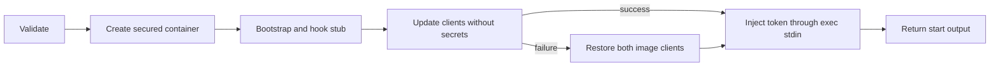

# Docker broker protocol

**Protocol 1** is the contract for TASK-559 (`agent-pm-broker`, Go) and TASK-560
(Session's Docker Host, Python). `version` writes `{"protocol_version":"1"}`.
This version is independent of the agent-pm package version. Python requires exact
equality before other calls; mismatch is a local preflight error that prints the
broker installation/upgrade command supplied by TASK-559. It creates no container.

This change supplies protocol artifacts only. Broker installation, interactive
`login claude`, image construction and Docker Host implementation belong to those
tickets. Context: [TASK-545](https://linear.app/ophis-workgroup/issue/TASK-545).

## Schemas and channels

[protocol.schema.json](../protocol/docker-broker/protocol.schema.json) uses
[JSON Schema Draft 2020-12](https://json-schema.org/draft/2020-12/json-schema-validation).
Each `#/$defs/<name>` below is a schema entry point; the document root validates a
manifest. References are internal, so Go and Python can load it without network access.

| Invocation | Input definition | Success definition |
|---|---|---|
| `agent-pm-broker version` | `version_input` | `version_output` |
| `agent-pm-broker build --agent-pm /absolute/package` | `build_input` | `build_output` |
| `agent-pm-broker start --manifest /absolute/manifest.json` | `start_input` plus `manifest` for file contents | `start_output` |
| `agent-pm-broker close --container <container>` | `close_input` | `close_output` |

Input fixtures' `argv` arrays represent arguments after the executable, in canonical
order. They are test data, not JSON sent to the broker. These commands consume no
stdin. `login claude` reads a token interactively without echo and has no JSON contract.

| Result | Process exit | stdout | stderr |
|---|---|---|---|
| Success, including update fallback or absent container on close | `0` | One success JSON object plus LF | Empty |
| Failure | Table below | Empty | One `error` JSON object plus LF |

Use UTF-8. Reject duplicate object keys, non-JSON numeric constants, trailing JSON values,
unknown fields and missing required fields. JSON object key order is irrelevant.
Capture subprocess output rather than mixing progress lines into either channel.
Output and diagnostics must contain no tokens, credentials, environment dumps or
manifest contents. `message`, `cause` and `cleanup_error` are nonempty, single-line
human diagnostics; escape control characters and redact secrets before serialization.
Callers branch on exit/code, not diagnostic text, and reject malformed responses.

## Manifest

| Field | Contract |
|---|---|
| `name` | Session name: `[A-Za-z0-9_-]+`, excluding `none` |
| `generation` | 32 lowercase hexadecimal characters, the session generation |
| `image` | `agent-pm-worker:<key>`; key is 64 lowercase hexadecimal characters computed by broker from both image-definition and agent-pm package contents |
| `cwd` | Absolute host directory, mounted read/write at the same container path |
| `claude_dir` | Absolute host directory, mounted read/write at the same container path |
| `hook_path` | Optional absolute container executable path; omitted for step 1 manual acceptance; `null` is invalid |
| `labels` | Required string-to-string object, possibly empty; caller keys use letters/digits/`_`/`.`/`-`, start with a letter or digit, and cannot use the reserved `agent-pm.` prefix |

Session name and generation match
[engine/types.py](../session/src/agent_pm/session/engine/types.py#L174) and
[runtimes/tui.py](../session/src/agent_pm/session/runtimes/tui.py#L510).
Broker adds `agent-pm.session=<name>` and `agent-pm.generation=<generation>`.
Container name is `agent-pm-<name>-<generation>`; close accepts that complete name.
Paths are literal absolute paths: no `~` or environment expansion. Control characters
are invalid in paths, names, labels and output strings.

**Runtime validation** follows schema validation and precedes container creation.
Schemas cannot prove filesystem, keychain, image provenance or daemon state:

- Resolve cwd and mount roots. Reject roots equal to the account home or its ancestors,
  empty roots, cwd outside every root, and cwd equal to, inside, or containing a denied
  path. Denied paths: home itself; `~/.agent-pm`, `~/.codex`, `~/.claude`, `~/.ssh`,
  `~/.config`, `~/.docker`, `~/Library`, `~/.aws`, `~/.gnupg`, `~/.kube`, `~/.npmrc`.
  The home entry rejects home and its ancestors, not every home descendant.
- Require `claude_dir` to be exactly `<account-home>/.agent-pm/docker-state/<name>/claude`,
  with no symlink component. It is the sole internal bind-mount exception. Resolve both
  mounts; reject `hook_path` equal to or below either mount, using path-component
  containment rather than string prefixes.
- Require the image to exist, be broker-built and carry `agent-pm.version`; tag syntax
  alone does not establish provenance. Missing login fails before creation and tells
  the user to run `agent-pm-broker login claude`.
- Use the system account home, never `$HOME`, for the fixed endpoint
  `unix://<account-home>/.docker/run/docker.sock`. Ignore `DOCKER_HOST`,
  `DOCKER_CONTEXT` and `~/.docker/config.json`.

## Success fields

| Command | Fields and meaning |
|---|---|
| `version` | `protocol_version`: exact string `1` |
| `build` | `image`: broker tag; `digest`: final image content digest (`sha256:` plus 64 lowercase hex); `rebuilt`: whether this call rebuilt it |
| `start` | `container`: canonical name; `endpoint`: fixed daemon socket URL; `image_digest`: final image digest; `clients.claude` and `clients.codex`: actual runnable version strings after update or restoration; `update`: below |
| `close` | `container`: requested canonical name; `removed`: true if deleted, false if already absent; both succeed |

`update` is either `{"status":"updated"}` or
`{"status":"fallback","reason":"timeout","message":"..."}`.
Fallback reasons: `network`, `timeout` (180 seconds), `command_failed`, `version_failed`.
Use `network` only when identified; otherwise use `command_failed`. Any update failure
restores **both** image versions, verifies both `--version` commands, then continues
start with exit 0. Failure to restore or determine either actual version is
`start_failed`. A fallback is reported in stdout, not as a fatal stderr error.


Any fatal failure after creation attempts container deletion before returning an error.

## Errors

The common `error` definition validates the exit/code/command combination. Example stderr:

```json
{"exit_code":5,"error":{"command":"start","code":"login_required","message":"Run agent-pm-broker login claude.","cleanup":"not_needed"}}
```

| Exit | `error.code` | Commands | Failure class |
|---|---|---|---|
| `2` | `usage` | All, or `unknown` | Unknown command/flag, missing/extra argument, malformed argument value |
| `3` | `manifest_rejected` | start | Manifest unreadable, malformed JSON, duplicate keys, missing/unknown field or schema violation |
| `4` | `mount_rejected` | start | Runtime path, mount-root, deny-list, symlink or hook-placement rejection |
| `5` | `login_required` | start | Setup-token entry absent; message gives login command |
| `6` | `image_rejected` | start | Schema-valid tag references a missing/untrusted image or one missing `agent-pm.version` |
| `7` | `docker_unreachable` | build/start/close | Cannot reach fixed Docker Desktop daemon, including connection loss during the command |
| `8` | `build_failed` | build | Package directory/version invalid, context hashing or either build stage failed |
| `9` | `start_failed` | start | Container creation, bootstrap, hook installation, client restoration/version probing or token injection failed |
| `10` | `close_failed` | close | Daemon reachable but container deletion failed |
| `11` | `keychain_failed` | start | Keychain access denied, locked or otherwise failed; distinguish from absent entry |
| `70` | `internal_error` | All, or `unknown` | Unexpected broker failure |

Classify the first fatal failing stage; daemon connectivity failures use exit 7.
An unreachable daemon cannot establish absence, so close fails with exit 7 rather
than claiming success. For Docker Desktop file-sharing rejection, use `start_failed`,
put Docker's original diagnostic in optional `error.cause` subject to channel redaction,
and explain in `message` that cwd and `~/.agent-pm/docker-state` must be shared.

`error.cleanup` is `not_needed` when no container was created, `removed` after rollback,
or `failed` when rollback failed. Only start can report the latter two. Keep the original
exit/code when cleanup fails; include required `error.cleanup_error` and the canonical
container name in required `error.container`. The caller retries close with
`close --container <error.container>`. Do not emit success for
partially completed start. Optional `cause` carries a sanitized underlying diagnostic.
Process termination by signal may prevent a JSON response; callers treat missing or
invalid responses and inconsistent process/JSON exit codes as transport failure.

## Shared fixtures

[fixtures/index.json](../protocol/docker-broker/fixtures/index.json) inventories every literal `.json`
sample beside it. Both implementations read these same files; no copied corpus.

| Index field | Meaning |
|---|---|
| `definition` | Schema entry point under `$defs` |
| `valid` | Expected schema acceptance, independent of runtime outcome |
| `expected.stage` | `schema` for inputs; `runtime` for a schema-valid manifest rejected against fake host state; `response` for output/error samples |
| `expected.exit_code`, `error_code` | Expected broker outcome; null exit for malformed responses which callers reject locally |
| `context` | Runtime-only fake host state: account home, mount roots, resolved cwd, Claude-directory symlink flag, login/image/daemon state |

Runtime fixtures specify one failure with other state valid. Implementers supply fakes
at their own filesystem/keychain/Docker boundaries. This Python test checks structural
acceptance only, not those future implementations or real Docker behavior.
`image=broker_built` includes the version label; `untrusted` and `missing_version_label`
are rejection cases. `docker=sharing_denied` means a reachable daemon rejects creation.

Install the pinned test dependency and use the supervised test command in
[docs/tests.md](tests.md); the fixture test is `tests/unit/docker_broker_protocol_test.py`.
