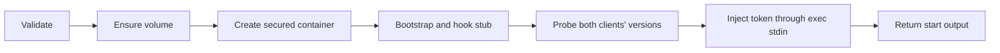

# Docker broker protocol

**Protocol 4** is the contract for TASK-559 (`agent-pm-broker`, Go) and TASK-560
(Session's Docker Host, Python). `version` writes `{"protocol_version":"4"}`.
This version is independent of the agent-pm package version. Python requires exact
equality before other calls; mismatch is a local preflight error that prints the
broker installation/upgrade command supplied by TASK-559. It creates no container.

The broker installs the hook stub, so this version also covers the stub's wire format.
Protocol 2 marked the stub's switch to the [relay wire format](docker-relay-protocol.md);
protocol 3 drops start's `update` (the clients come from the image) and adds build's `--max-age`;
protocol 4 mounts the manifest's `workspace` volume at `cwd` instead of binding the host cwd,
drops the mount roots and deny list, and adds `workspace-rm`.
Bump the version whenever that wire format changes. A plugin upgraded without
reinstalling the broker then fails the handshake, so an old stub never meets a new relay.

The broker is `broker/`; its Session client and the Docker Host:
[Docker Host](docker-host.md). Context: [TASK-545](https://linear.app/ophis-workgroup/issue/TASK-545).

## Schemas and channels

[protocol.schema.json](../protocol/docker-broker/protocol.schema.json) uses
[JSON Schema Draft 2020-12](https://json-schema.org/draft/2020-12/json-schema-validation).
Each `#/$defs/<name>` below is a schema entry point; the document root validates a
manifest. References are internal, so Go and Python can load it without network access.

| Invocation | Input definition | Success definition |
|---|---|---|
| `agent-pm-broker version` | `version_input` | `version_output` |
| `agent-pm-broker build --agent-pm /absolute/package [--max-age SECONDS]` | `build_input` | `build_output` |
| `agent-pm-broker start --manifest /absolute/manifest.json` | `start_input` plus `manifest` for file contents | `start_output` |
| `agent-pm-broker close --container <container>` | `close_input` | `close_output` |
| `agent-pm-broker workspace-rm --volume <volume> [--force]` | `workspace_rm_input` | `workspace_rm_output` |

Input fixtures' `argv` arrays represent arguments after the executable, in canonical
order. They are test data, not JSON sent to the broker. These commands consume no
stdin. `login claude` reads a token interactively without echo; it and `login github <app>`
have no JSON contract.

| Result | Process exit | stdout | stderr |
|---|---|---|---|
| Success, including an absent container on close or volume on workspace-rm | `0` | One success JSON object plus LF | Empty; build: Docker's build progress, then one `agent-pm-broker: …` line per older image removed or kept; start: one `agent-pm-broker: start <phase> <seconds> s` line per phase, then `total` ([Docker Host](docker-host.md#start-timing)) |
| Failure | Table below | Empty | One `error` JSON object plus LF; build: after Docker's build progress, as the last line |

Use UTF-8. Reject duplicate object keys, non-JSON numeric constants, trailing JSON values,
unknown fields and missing required fields. JSON object key order is irrelevant.
Capture subprocess output rather than mixing progress lines into either channel, except
build's: it copies `docker build`'s stderr to its own as it arrives, ending it with an LF
when Docker's did not, so the lines after it start a line.
Output and diagnostics must contain no tokens, credentials, environment dumps or
manifest contents. `message`, `cause` and `cleanup_error` are nonempty, single-line
human diagnostics; escape control characters and redact secrets before serialization.
Callers branch on exit/code, not diagnostic text, and reject malformed responses.

## Manifest

| Field | Contract |
|---|---|
| `name` | Session name: `[A-Za-z0-9_-]+`, excluding `none` |
| `generation` | 32 lowercase hexadecimal characters, the session generation |
| `image` | `agent-pm-worker:<key>`; key is 64 lowercase hexadecimal characters computed by broker from both image-definition and agent-pm package contents |
| `cwd` | Absolute existing host directory: the container path the workspace volume is mounted at and the working directory; never a bind source |
| `workspace` | The workspace volume: `agent-pm-crew-<name>`, or `agent-pm-run-<dir>-<8 hex>` for a role run |
| `claude_dir` | Absolute host directory, mounted read/write at the same container path |
| `hook_path` | Optional absolute container executable path; omitted for step 1 manual acceptance; `null` is invalid |
| `labels` | Required string-to-string object, possibly empty; caller keys use letters/digits/`_`/`.`/`-`, start with a letter or digit, and cannot use the reserved `agent-pm.` prefix |

Session name and generation match
[engine/types.py](../session/src/agent_pm/session/engine/types.py#L193) and
[modes/tui.py](../session/src/agent_pm/session/modes/tui.py#L524).
Broker adds `agent-pm.session=<name>` and `agent-pm.generation=<generation>`.
Container name is `agent-pm-<name>-<generation>`; close accepts that complete name.
Paths are literal absolute paths: no `~` or environment expansion. Control characters
are invalid in paths, names, labels and output strings.

**Runtime validation** follows schema validation and precedes container creation.
Schemas cannot prove filesystem, keychain, image provenance or daemon state:

- Require cwd to be an existing host directory. Compare paths literally, by components.
  Reject a cwd equal to or containing `/`, `/usr`, `/etc`, `/opt`, `/run`, `/home`, `/tmp`,
  `/proc`, `/sys` or `/dev`, or inside `/usr`, `/etc`, `/opt/agent-pm`, `/run`, `/proc`,
  `/sys`, `/dev`, `/bin`, `/sbin`, `/lib`, `/lib32`, `/lib64`, `/libx32`, `/var/run`,
  `/var/lock` or `/home/agent`: a volume there would hide what the image runs.
- Require `claude_dir` to be exactly `<account-home>/.agent-pm/docker-state/<name>/claude`,
  with no symlink component, and not overlapping cwd. It is the only bind mount.
  Reject `hook_path` equal to or below cwd, `claude_dir` or the secrets tmpfs, and a cwd
  below `hook_path`.
- Ensure the volume: create an absent one with labels `agent-pm.kind` (`crew` or `run`, from
  its name) and `agent-pm.workspace=<cwd>`, read its labels back, and give its root to the
  image's agent user in a one-shot container with only `CHOWN` (on failure, delete the
  volume it created). Reject an existing volume whose labels differ or that a container
  mounts. Docker's `docker volume rm` is the only way to clear a same-named foreign one.
- Set `npm_config_cache`, `UV_CACHE_DIR` and `PIP_CACHE_DIR` to `<cwd>/.agent-pm-cache`,
  inside the volume.
- Require the image to exist, be broker-built and carry `agent-pm.version`; tag syntax
  alone does not establish provenance. Missing login fails before creation and tells
  the user to run `agent-pm-broker login claude`.
- Use the system account home, never `$HOME`, for the fixed endpoint
  `unix://<account-home>/.docker/run/docker.sock`. Ignore `DOCKER_HOST`,
  `DOCKER_CONTEXT` and `~/.docker/config.json`.

## Success fields

| Command | Fields and meaning |
|---|---|
| `version` | `protocol_version`: exact string `3` |
| `build` | `image`: broker tag; `digest`: final image content digest (`sha256:` plus 64 lowercase hex); `rebuilt`: whether this call rebuilt it: with `--max-age` (1 to 9 digits), also when the image was built that many seconds ago or earlier (`0`: always), keeping it if that rebuild fails with `build_failed` (except `0`); without it, never for age |
| `start` | `container`: canonical name; `endpoint`: fixed daemon socket URL; `image_digest`: final image digest; `clients.claude` and `clients.codex`: the image's runnable version strings |
| `close` | `container`: requested canonical name; `removed`: true if deleted, false if already absent; both succeed |
| `workspace-rm` | `volume`: requested name; `removed`: true if deleted, false if already absent. Without `--force`, the newest broker-built worker image's `/opt/agent-pm/lib/workspace-check` first runs on the volume mounted read-only at its `agent-pm.workspace` path, with no network, the worker's security flags and the label `agent-pm.check=1`; any repo up to three levels down with uncommitted, stashed or unpushed work (package caches aside), or a directory it cannot list, keeps the volume |


Failure to determine either version is `start_failed`.
Any fatal failure after creation attempts container deletion before returning an error.

## Errors

The common `error` definition validates the exit/code/command combination. Example stderr:

```json
{"exit_code":5,"error":{"command":"start","code":"login_required","message":"Run agent-pm-broker login claude.","cleanup":"not_needed"}}
```

| Exit | `error.code` | Commands | Failure class |
|---|---|---|---|
| `2` | `usage` | All, or `unknown` | Unknown command/flag, missing/extra argument, malformed argument value |
| `3` | `manifest_rejected` | start | Manifest unreadable, malformed JSON, duplicate keys, missing/unknown field or schema violation |
| `4` | `mount_rejected` | start | Runtime cwd, `claude_dir`, symlink or hook-placement rejection; a workspace volume with other labels or in use |
| `5` | `login_required` | start | Setup-token entry absent; message gives login command |
| `6` | `image_rejected` | start | Schema-valid tag references a missing/untrusted image or one missing `agent-pm.version` |
| `7` | `docker_unreachable` | build/start/close/workspace-rm | Cannot reach fixed Docker Desktop daemon, including connection loss during the command |
| `8` | `build_failed` | build | Package directory/version invalid, context hashing or either build stage failed |
| `9` | `start_failed` | start | Container creation, bootstrap, hook installation, client version probing or token injection failed |
| `10` | `close_failed` | close | Daemon reachable but container deletion failed |
| `11` | `keychain_failed` | start | Keychain access denied, locked or otherwise failed; distinguish from absent entry |
| `12` | `workspace_dirty` | workspace-rm | The check found unsaved work; `message` names each repo (relative to the mount point) and the `--force` command |
| `13` | `workspace_rejected` | workspace-rm | The volume has no `agent-pm.kind` label, or its `agent-pm.workspace` path is not clean, absolute and outside the container's own trees |
| `14` | `workspace_failed` | workspace-rm | No worker image, the check failed or printed no result, or deletion failed |
| `70` | `internal_error` | All, or `unknown` | Unexpected broker failure |

Classify the first fatal failing stage; daemon connectivity failures use exit 7.
An unreachable daemon cannot establish absence, so close fails with exit 7 rather
than claiming success. For Docker Desktop file-sharing rejection, use `start_failed`,
put Docker's original diagnostic in optional `error.cause` subject to channel redaction,
and explain in `message` that `~/.agent-pm/docker-state` must be shared. workspace-rm's
check run and volume deletion also put Docker's diagnostic in `cause`.

`error.cleanup` is `not_needed` when no container was created, `removed` after rollback,
or `failed` when rollback failed. Only start can report the latter two. Keep the original
exit/code when cleanup fails; include required `error.cleanup_error` and the canonical
container name in required `error.container`. The caller retries close with
`close --container <error.container>`. Do not emit success for
partially completed start. Optional `cause` carries a sanitized underlying diagnostic.
Process termination by signal may prevent a JSON response; callers treat missing or
invalid responses and inconsistent process/JSON exit codes as transport failure.

## Shared fixtures

[fixtures/index.json](../protocol/docker-broker/fixtures/index.json) inventories every literal `.json`
sample beside it. Both implementations read these same files; no copied corpus.

| Index field | Meaning |
|---|---|
| `definition` | Schema entry point under `$defs` |
| `valid` | Expected schema acceptance, independent of runtime outcome |
| `expected.stage` | `schema` for inputs; `runtime` for a schema-valid manifest rejected against fake host state; `response` for output/error samples |
| `expected.exit_code`, `error_code` | Expected broker outcome; null exit for malformed responses which callers reject locally |
| `context` | Runtime-only fake host state: account home, whether cwd exists, the volume (`absent`, `matching`, `mismatched`, `in_use`), Claude-directory symlink flag, login/image/daemon state |

Runtime fixtures specify one failure with other state valid. Implementers supply fakes
at their own filesystem/keychain/Docker boundaries. This Python test checks structural
acceptance only, not those future implementations or real Docker behavior.
`image=broker_built` includes the version label; `untrusted` and `missing_version_label`
are rejection cases. `docker=sharing_denied` means a reachable daemon rejects creation.

Install the pinned test dependency and use the supervised test command in
[docs/tests.md](tests.md); the fixture test is `tests/unit/docker_broker_protocol_test.py`.
