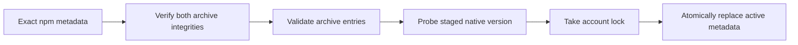
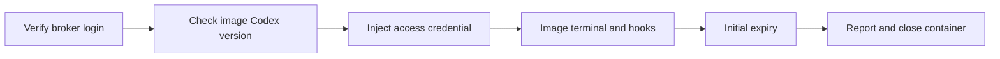

# Broker Codex operations

TASK-648 implements M4 step 2 FR-2 and FR-3 from
[Product Design/2026-10-16-2311-TASK-550-docker-host-m4.md](https://github.com/ophis/private_docs/blob/main/Product%20Design/2026-10-16-2311-TASK-550-docker-host-m4.md).
TASK-649 adds terminal container authentication and recovery. Refresh, headless Codex
and a general compatibility updater remain later work.

## Commands

Install or rebuild the hardened broker first with `sh <agent-pm plugin directory>/broker/install.sh`.
Replace `<version>` with an exact stable npm version, such as `0.162.1`:

| Action | Command |
|---|---|
| First pinned installation | `sudo /usr/local/libexec/agent-pm/agent-pm-broker install-codex <version>` |
| Explicit update or native-file repair | `sudo /usr/local/libexec/agent-pm/agent-pm-broker update-codex <version>` |
| Independent browser login, ordinary user | `/usr/local/libexec/agent-pm/agent-pm-broker login codex` |
| Inspect | `/usr/local/libexec/agent-pm/agent-pm-broker status` |

Administrative install/update success writes installation JSON (JavaScript Object Notation); failure exits 1 with a
diagnostic. Login is interactive text and exits 0 on success, 1 on failure/cancellation.
Malformed command arguments use the protocol usage error, exit 2. Status fields and
protocol version are defined only in [Docker broker protocol](docker-broker-protocol.md#success-fields).

## Installation trust

**Pinned installation** lives under `/usr/local/libexec/agent-pm/codex/`. It contains
root-owned immutable `releases/<id>/codex`, regular `active.json`, `install.lock` and
`auth.lock`; directories and executable are 0755, metadata and locks 0644. Ordinary
users can lock the fixed account file but cannot replace it. Old releases are retained.

Sources: `broker/internal/codex/install.go:110`, `broker/internal/codex/archive.go:15`.

Only `https://registry.npmjs.org/` is accepted, without redirects. The main package and
its exact macOS arm64 dependency require SHA-512 (Secure Hash Algorithm, 512 bit) integrity. Archive links, special
files, traversal, duplicate entries and excessive sizes are refused. Limits are 256 MiB (mebibytes) compressed, 512 MiB expanded and 4096 entries; unused
entries are streamed and discarded. The installer keeps only the native `vendor/aarch64-apple-darwin/bin/codex`, never scripts or Node.

Before execution the broker verifies root ownership, write permissions and symlink
absence for the native file and every ancestor, plus its SHA-256 (Secure Hash Algorithm, 256 bit) against protected
metadata. Native commands use an absolute path, private working directory and a fresh
environment containing only private `HOME`/`CODEX_HOME`, system `PATH` and `LANG`.
Personal npm configuration, `NODE_OPTIONS`, `npm_config_*` and Codex environment
overrides are not inherited. Failed validation/publication preserves the active
installation. Updates preserve `allowed_versions`; no untested container version is
granted by installing a host binary.

## Login trust

```mermaid
flowchart LR
    L[Take account lock] --> R[Reread keychain]
    R --> H[Private random temporary home]
    H --> B[Pinned browser login]
    B --> V[Validate subscription auth and expiry]
    V --> D[Delete temporary home]
    D --> P[Restrict partition list]
    P --> A[Restrict read and export entries]
    A --> C[Verify access and save auth]
    C --> U[Verify saved auth and release lock]
```

Sources: `broker/internal/broker/codex.go:141`, TASK-642's `broker/internal/broker/keychain.go:255`.

The entire temporary home is 0700 under `/private/tmp`; file credential storage and
ChatGPT browser login are forced. It is removed on success, child failure and normal
signal cancellation. SIGKILL or host failure cannot run cleanup. Full credentials
exist only in this directory, broker memory and login-keychain service
`agent-pm-codex`, account `auth`. Personal `~/.codex` is neither imported nor changed.
Other processes running as the same user can still read the temporary data.

A new keychain item starts with a nonsecret placeholder. TASK-642's implementation
applies the diagram ordering to the access control list (ACL), using a hidden
keychain password once when needed and the same dialog fallback. Credentials
are written in place only after verification; existing GitHub App items are unchanged.
If final access/readback verification fails, the broker restores and re-verifies an
earlier usable login; any restoration failure is reported explicitly.
Reinstalling the broker changes its ad hoc code identity: rerun `login codex` to
authorize the new broker. No `security` subprocess receives credential data.

The access-token JSON Web Token (JWT) `exp` is a local expiry source, not signature verification or
proof that the upstream still accepts the subscription. Official references:
[credential storage](https://learn.chatgpt.com/docs/auth),
[browser login](https://learn.chatgpt.com/docs/cli/reference).
Version-specific field/expiry evidence:
[AuthDotJson](https://github.com/openai/codex/blob/rust-v0.162.1/codex-rs/login/src/auth/storage.rs#L49),
[TokenData and JWT expiry parsing](https://github.com/openai/codex/blob/rust-v0.162.1/codex-rs/login/src/token_data.rs#L11).

## Acceptance boundary

Automated tests use fake transports, processes and keychain/Security adapters. Linux,
Docker and integration verification run only in GitHub CI. The pull request lists
the separate user-run macOS installation, browser-login, cancellation, trust-denial
and personal-login-isolation checks. No live result is claimed here.

## Docker terminals

After installation/login and the [Docker Host setup](docker-host.md#crew-workers),
`agent-pm-crew worker w --client codex` and a Codex `agent-pm-crew role` use the same
terminal authentication. The host needs the broker, not a personal Codex executable.
Headless Codex remains rejected; use a terminal worker for this milestone.

**Access-only authentication** uses the broker login's access token and account ID
(identifier). The external-token document has no refresh credential or original ID
token. The required Rust `refresh_token` string is empty; `id_token` holds the access
token and `last_refresh` retains the original nonsecret timestamp. The exact wire
fields are defined in [Docker broker protocol](docker-broker-protocol.md).

| Resource | Lifetime |
|---|---|
| `~/.agent-pm/docker-state/<name>/codex/sessions/` | Only host-bound client state; native history survives restart and close/resume |
| Container `CODEX_HOME`, at the corresponding host path | Entirely tmpfs; image-created configuration and credential-link replacements disappear on close |
| `/run/agent-pm/secrets/codex/auth.json` | Agent-owned 0400 tmpfs file, injected over Docker standard input |
| `/run/agent-pm/codex-store/` | Volatile projection of only the current `(workdir, sid)` recovery record; host events own identity |
| `<generation>.credential.json` | Host control record containing only initial expiry; GitHub renewal does not extend it |

This milestone does not refresh credentials or establish cross-refresh compatibility.

**Expiry** produces `client_auth_expired` in the session event log and closes that
generation. Log in again with `agent-pm-broker login codex`, then resume the worker.
A recovered supervisor reads the same saved initial deadline. No run login or personal
credential fallback is attempted. Missing login, invalid pinned installation and expired
credentials fail preflight with repair instructions.

**Version boundary** is exactly `0.162.1`, installed in the worker overlay under
`/opt/agent-pm/clients/`, exposed at `/opt/agent-pm/bin/codex`. A different runtime version
is rejected before any client or GitHub secret is injected. The host install's
`allowed_versions` stays unchanged; this source-verified terminal boundary does not
grant the PRD's broader compatibility matrix.

| Source evidence, rust-v0.162.1 | Established behavior |
|---|---|
| [auth/manager.rs:328-425](https://github.com/openai/codex/blob/rust-v0.162.1/codex-rs/login/src/auth/manager.rs#L328) | File-backed loader constructs `ChatgptAuthTokens` |
| [auth/manager.rs:580-588](https://github.com/openai/codex/blob/rust-v0.162.1/codex-rs/login/src/auth/manager.rs#L580) | Token reading requires `last_refresh` |
| [auth/manager.rs:1732-1761](https://github.com/openai/codex/blob/rust-v0.162.1/codex-rs/login/src/auth/manager.rs#L1732) | Access-only external-token document shape |
| [auth/manager.rs:2999-3022](https://github.com/openai/codex/blob/rust-v0.162.1/codex-rs/login/src/auth/manager.rs#L2999) | Automatic managed refresh applies to `Chatgpt` |

GitHub CI's [worker_codex.py](../.github/worker_codex.py) uses synthetic credentials with
network disabled. It checks the real Codex auth loader, agent identity, nested mounts,
atomic replacement of the auth link and history-only persistence across two containers.
It does not test model access, native conversation recovery or macOS file sharing.

## User-run acceptance, pending

Use an authorized broker test login. Workers do not run these checks or inspect real
credentials; record versions, time, status and redacted error locations only.

| Check | Expected observation |
|---|---|
| Start two Codex crew workers and one terminal role run | No login/onboarding prompt; responses reach `crew report` and completion events; no role-specific Docker manifest |
| Hide personal host Codex from PATH for these commands | Terminal and container hook trust still start using image files |
| Inspect mounts/security without dumping environment or secret files | One workspace volume; only client history bind; volatile home/secrets; user agent, CapDrop ALL, no-new-privileges; no Docker socket or privileged/host namespaces |
| Restart, then close and resume a worker | Same native identity and history; no duplicate completed event; missing history produces failure |
| Restart the host supervisor, then query/send | Relay resumes, same identity; original access deadline retained |
| Let the initial access token expire | `client_auth_expired`, container removed, no login prompt or identity change; host login plus resume repairs it |
| Check state after native credential replacement and close | Host client directory contains only allowed history; no auth/token file or credential value in host state/workspace; personal login unchanged |
