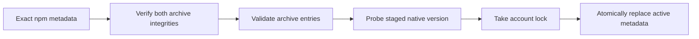
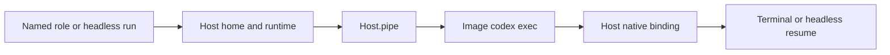
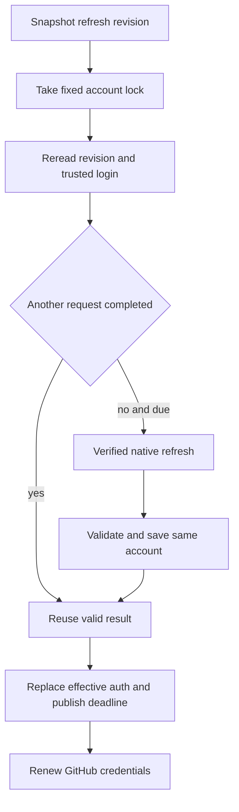
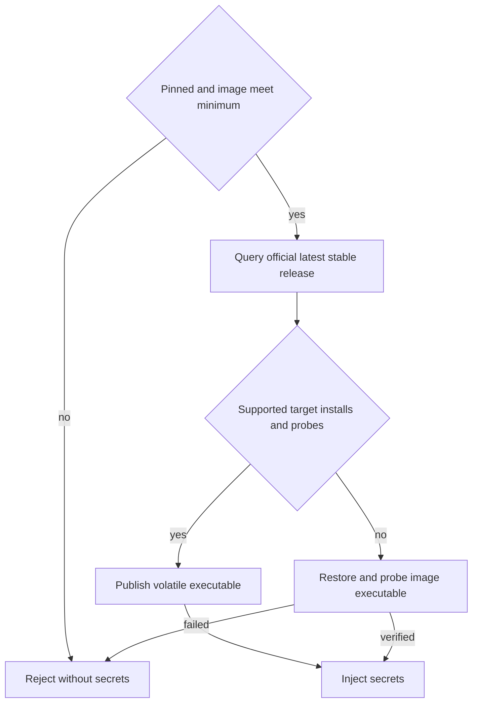
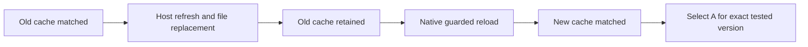

# Broker Codex operations

TASK-648 implements M4 step 2 FR-2 and FR-3 from
[Product Design/2026-10-16-2311-TASK-550-docker-host-m4.md](https://github.com/ophis/private_docs/blob/main/Product%20Design/2026-10-16-2311-TASK-550-docker-host-m4.md).
TASK-649 adds terminal container authentication and recovery; TASK-651 adds headless
execution and whitelisted native plugin skills ([Docker sessions](#docker-sessions)).
TASK-652 adds FR-9's container version policy. TASK-650 adds serialized broker
refresh and supervisor renewal ([Refresh and recovery](#refresh-and-recovery)).

## Commands

Install or upgrade the hardened broker first with `sh <agent-pm plugin directory>/broker/install.sh`.
Replace `<version>` with an exact stable npm version meeting the [minimum version](#container-versions):

| Action | Command |
|---|---|
| First pinned installation | `sudo /usr/local/libexec/agent-pm/agent-pm-broker install-codex <version>` |
| Explicit update or native-file repair | `sudo /usr/local/libexec/agent-pm/agent-pm-broker update-codex <version>` |
| Independent browser login, ordinary user | `/usr/local/libexec/agent-pm/agent-pm-broker login codex` |
| Inspect | `/usr/local/libexec/agent-pm/agent-pm-broker status` |

Administrative install/update success writes installation JSON (JavaScript Object Notation); failure exits 1 with a
diagnostic. Login is interactive text and exits 0 on success, 1 on failure/cancellation.
Malformed command arguments use the protocol usage error, exit 2. Status fields and
protocol version are defined only in [Docker broker protocol](docker-broker-protocol.md#success-fields).

## Installation trust

**Pinned installation** lives under `/usr/local/libexec/agent-pm/codex/`. It contains
root-owned immutable `releases/<id>/codex`, regular `active.json`, `install.lock` and
`auth.lock`; directories and executable are 0755, metadata and locks 0644. Ordinary
users can lock the fixed account file but cannot replace it. Old releases are retained.


Sources: `broker/internal/codex/install.go:110`, `broker/internal/codex/archive.go:15`.

Only `https://registry.npmjs.org/` is accepted, without redirects. The main package and
its exact macOS arm64 dependency require SHA-512 (Secure Hash Algorithm, 512 bit) integrity. Archive links, special
files, traversal, duplicate entries and excessive sizes are refused. Limits are 256 MiB (mebibytes) compressed, 512 MiB expanded and 4096 entries; unused
entries are streamed and discarded. The installer keeps only the native `vendor/aarch64-apple-darwin/bin/codex`, never scripts or Node.

Before execution the broker verifies root ownership, write permissions and symlink
absence for the native file and every ancestor, plus its SHA-256 (Secure Hash Algorithm, 256 bit) against protected
metadata. Native commands use an absolute path, private working directory and a fresh
environment containing only private `HOME`/`CODEX_HOME`, system `PATH` and `LANG`.
Personal npm configuration, `NODE_OPTIONS`, `npm_config_*` and Codex environment
overrides are not inherited. Failed validation/publication preserves the active
installation. Install and update accept only stable versions meeting the
[minimum version](#container-versions).

## Login trust

```mermaid
flowchart LR
    L[Take account lock] --> R[Reread keychain]
    R --> N[Create placeholder item]
    N --> P[Restrict partition list]
    P --> A[Restrict read and export entries]
    A --> T[Verify access]
    T --> H[Private random temporary home]
    H --> B[Pinned browser login]
    B --> V[Validate subscription auth and expiry]
    V --> D[Delete temporary home]
    D --> C[Save auth]
    C --> U[Verify saved auth and release lock]
```


Sources: `broker/internal/broker/codex.go:147`, TASK-642's `broker/internal/broker/keychain.go:325`.
The placeholder is created only when the item is absent; the partition and entry steps run only
when not yet in place.

The entire temporary home is 0700 under `/private/tmp`; file credential storage and
ChatGPT browser login are forced. It is removed on success, child failure and normal
signal cancellation. SIGKILL or host failure cannot run cleanup. Full credentials
exist only in this directory, broker memory and login-keychain service
`agent-pm-codex`, account `auth`. Personal `~/.codex` is neither imported nor changed.
Other processes running as the same user can still read the temporary data.

A new keychain item starts with a nonsecret placeholder. TASK-642's implementation
applies the diagram ordering to the access control list (ACL), using a hidden
keychain password once when needed and the same dialog fallback. Every terminal
question comes before the browser: once it opens, login needs nothing more from the
terminal and exits by itself. A failed browser login leaves the placeholder, which
reads as no login. Credentials
are written in place only after verification; existing GitHub App items are unchanged.
If final access/readback verification fails, the broker restores and re-verifies an
earlier usable login, without asking for a password it did not read before the browser;
any restoration failure is reported explicitly.
Reinstalling the broker changes its ad hoc code identity: rerun `login codex` to
authorize the new broker. No `security` subprocess receives credential data.

The access-token JSON Web Token (JWT) `exp` is a local expiry source, not signature verification or
proof that the upstream still accepts the subscription. Official references:
[credential storage](https://learn.chatgpt.com/docs/auth),
[browser login](https://learn.chatgpt.com/docs/cli/reference).
Version-specific field/expiry evidence:
[AuthDotJson](https://github.com/openai/codex/blob/rust-v0.162.1/codex-rs/login/src/auth/storage.rs#L49),
[TokenData and JWT expiry parsing](https://github.com/openai/codex/blob/rust-v0.162.1/codex-rs/login/src/token_data.rs#L11).

## Acceptance boundary

Automated tests use fake transports, processes and keychain/Security adapters. Linux,
Docker and integration verification run only in GitHub CI. The pull request lists
the separate user-run macOS installation, browser-login, cancellation, trust-denial
and personal-login-isolation checks. No live result is claimed here.

## Docker sessions

After installation/login and the [Docker Host setup](docker-host.md#crew-workers),
`agent-pm-crew worker w --client codex`, Codex role runs and unattended board runs use
the same container authentication. The host needs the broker, not a personal Codex executable.

**No Codex sandbox** in the container: Codex's `workspace-write` sandbox runs each command under bwrap, which needs
new namespaces, and the container grants none (no capabilities, `no-new-privileges`), so every command fails with
`bwrap: No permissions to create new namespace` and Codex then asks to run it unsandboxed, stalling an unattended
run. The container is the isolation: Codex runs in yolo mode, `--dangerously-bypass-approvals-and-sandbox`, with no
sandbox and no approval ([Client policy](sessions.md#client-policy)).

**Login shells**: Codex runs commands in a login shell (`bash -lc`), whose `/etc/profile` resets `PATH`. The image's
`/etc/profile.d/agent-pm.sh` puts `/opt/agent-pm/bin` back first, so `gh` (with the session's GitHub token), `codex`
and `python3` resolve to the image's own in login and other shells alike.

**Access-only authentication** uses managed ChatGPT mode with the broker login's
original ID token, access token and account ID (identifier), an empty refresh string
and its refresh timestamp. The wire fields are defined only in
[Docker broker protocol](docker-broker-protocol.md).

| Resource | Lifetime |
|---|---|
| `~/.agent-pm/docker-state/<name>/codex/sessions/` | Only host-bound client state; native history survives restart and close/resume |
| Container `CODEX_HOME`, at the corresponding host path | Entirely tmpfs; image-created configuration and credential-link replacements disappear on close |
| `/run/agent-pm/secrets/codex/auth.json` | Agent-owned 0400 tmpfs file, injected over Docker standard input |
| `/run/agent-pm/codex-store/` | Terminal launcher's volatile projection of only the current `(workdir, sid)` recovery record |
| `<generation>.credential.json` | Broker-owned control record containing only the latest published Codex expiry |

See [Refresh and recovery](#refresh-and-recovery) for renewal and failure handling.
Container admission follows [Container versions](#container-versions); source evidence
and synthetic checks alone do not certify terminal cross-refresh compatibility.

### Headless and terminal recovery


Native binding comes from `thread.started`; only host-received client events update recovery state.

Headless uses `/opt/agent-pm/bin/codex exec` with the existing JSON event parser, so
replies and completion events reach Delegate reporting. The host prepares its native
resume selector directly; only the terminal's Python launcher needs a projected store.
Both modes retain the original snapshot, native ID and CODEX_HOME when resuming on the
same Host. Missing or mismatched history and symlinked history paths fail before launch.
The harness uses the same Codex renewal owner as terminals; ending the run cancels it. A killed harness leaves cleanup to the next Docker sweep.

### Native plugins

The shared [plugin whitelist](docker-host.md#plugins) supplies both clients from the
same installed payload. Plugin staging consults neither a host Codex installation
nor personal CODEX_HOME.

| Artifact | Codex behavior |
|---|---|
| Explicit `.codex-plugin/plugin.json` | Preserved; name must match, declared skill directories must stay inside the plugin |
| Claude-only payload | Generate a native skills manifest from name, optional description/version, default `skills/` and declared extra skill directories |
| Default Claude hook/server files | Excluded from the generated adapter: `hooks/hooks.json`, `.mcp.json`, `.app.json`; commands are not migrated |
| `/opt/agent-pm/codex-plugins/inline/<name>/local/` | Image-owned, read-only native cache; skill-relative scripts and references retained |
| `CODEX_HOME/plugins/cache` | Volatile link to that image cache; generated config enables `<name>@inline` |

An explicit native manifest retains its Codex behavior, including its hook/server
configuration. Skill names are namespaced, for example
`autopilot:build`. Invalid native names/skill paths and escaping or dangling links fail
the build before Docker. The broker checks resolved links before reading metadata.

The pinned format is grounded in Codex `rust-v0.162.1`:
[cache lookup](https://github.com/openai/codex/blob/rust-v0.162.1/codex-rs/core-plugin-common/src/installed.rs#L47),
[native skill discovery](https://github.com/openai/codex/blob/rust-v0.162.1/codex-rs/core-plugins/src/loader.rs#L1045),
and [namespaced inventory](https://github.com/openai/codex/blob/rust-v0.162.1/codex-rs/app-server/tests/suite/v2/skills_list.rs#L650).

| Source evidence, rust-v0.162.1 | Established behavior |
|---|---|
| [auth/manager.rs:328-425](https://github.com/openai/codex/blob/rust-v0.162.1/codex-rs/login/src/auth/manager.rs#L328) | File-backed loader constructs `ChatgptAuthTokens` |
| [auth/manager.rs:580-588](https://github.com/openai/codex/blob/rust-v0.162.1/codex-rs/login/src/auth/manager.rs#L580) | Token reading requires `last_refresh` |
| [auth/manager.rs:1732-1761](https://github.com/openai/codex/blob/rust-v0.162.1/codex-rs/login/src/auth/manager.rs#L1732) | Access-only external-token document shape |
| [auth/manager.rs:2999-3022](https://github.com/openai/codex/blob/rust-v0.162.1/codex-rs/login/src/auth/manager.rs#L2999) | Automatic managed refresh applies to `Chatgpt` |

GitHub CI's [worker_codex.py](../.github/worker_codex.py) uses synthetic credentials with
network disabled. It queries app-server `skills/list` for the native probe skill,
its enabled state, plugin ID and path, and verifies cache ownership/non-writability.
It also checks the real Codex auth loader, agent identity, nested mounts,
atomic replacement of the auth link and history-only persistence across two containers.
Its managed-carrier check distinguishes disk replacement from cached adoption on
one app-server connection, then exercises explicit guarded reload and proactive
auth() reload using independently generated synthetic values. It does not test
model access, ordinary terminal turns, native conversation recovery or macOS file sharing.

## Refresh and recovery

**Renewal** uses the earlier Codex or GitHub deadline minus 600 seconds. TASK-647
measured 2 seconds; the existing 600-second floor remains. A short lifetime triggers
an immediate attempt, then at least 60 seconds between attempts, bounded by expiry.
Recovery rereads the broker-owned publication deadline.


Sources: `broker/internal/broker/codex.go`, `codex_revision.go`, `codex_refresh.go`;
`broker/internal/launcher/refresh.go:15`. Login uses the same lock. The revision record
contains no account or credential value.

The pinned native app-server follows the [minimum version](#container-versions) and
performs managed account refresh in a private temporary home, with bounded output
and a 120-second deadline. The broker
requires unchanged account, changed access value, later expiry and verified keychain
readback. Temporary state is removed on normal completion, failure and cancellation;
uncatchable termination retains the limitation described under [Login trust](#login-trust).
The broker never implements an upstream refresh request itself.

Publication replaces the effective volatile `CODEX_HOME/auth.json`, including after
native replacement of its original link. The broker durably saves the corresponding
Codex expiry before attempting GitHub renewal. A lost response or GitHub failure
therefore cannot erase that deadline; retries repair publication independently.

The embedded native terminal keeps its existing launch, permissions and history.
Pinned source provides managed proactive reload within 300 seconds of the old access
expiry and same-account reload on unauthorized recovery, before attempting native
managed refresh (see [Pinned source evidence](#pinned-source-evidence)). Adoption is
eventual: file publication is not an acknowledgment from the running terminal.
The synthetic backend check exercises auth() without a model request; it does not
certify ordinary terminal-turn continuity.

Failures emit `client_refresh_failed` and retry each minute. After a final failed
reconciliation at expiry, `client_auth_expired` and the harness log contain:

> Client authentication expired; run /usr/local/libexec/agent-pm/agent-pm-broker login codex on the host, then resume

The generation closes, with one-minute close retries. Follow the message on the host,
then explicitly resume the worker; preserved native history remains authoritative.
Missing login or invalid pinned files fail preflight with repair instructions.
No run login, personal cache or different identity is selected.
Source: `session/src/agent_pm/session/hosts/docker/supervisor.py:273`.

### TASK-650 user-run acceptance, pending

Run on authorized macOS Apple silicon with Docker Desktop after release. Workers
run none of these checks. Use versions meeting the minimum rule and
record only versions, times, statuses, counts and redacted errors. Do not dump auth,
keychain, environment or token values; do not change credential dates or test real expiry.

| Check | Required observation |
|---|---|
| Keep the independently logged-in personal host Codex and two container terminal sessions talking before and after one genuine broker renewal | All three continue; unchanged native identities and personal login; running container processes actually adopt the new access value, not just a replaced file or new process |
| With the broker login naturally due for renewal, concurrently invoke `/usr/local/libexec/agent-pm/agent-pm-broker refresh --container <container> --manifest <manifest>` for each run | Exactly one genuine native rotation; the waiter reuses it; no lock-contention failure or lost login; a later due renewal also succeeds |
| Record the two preceding checks | Fixed/image/actual versions, generation digests, actual rotation count, per-stage timing and safe evidence of same-process adoption; missing adoption evidence stays incomplete |
| Interrupt networking during a scheduled renewal, then restore it before expiry | Classified events and one-minute retries; same identity continues after recovery; no interactive run login |
| Restart the supervisor, then interact | Current published deadline is reread and renewal continues for the same native history |
| A failed generation is encountered | Exact repair message above; after the host command, explicit resume retains native identity/history |

Final expiry and close-retry behavior are covered with fake clocks and credentials;
this checklist adds no real-expiry experiment. TASK-651 owns the corresponding
headless live check. No TASK-650 concurrent live result is recorded yet.

## Container versions

**Minimum version** is compiled into the broker as `codex.MinVersion`, currently
`0.163.0`. Both the pinned host installation and the image must meet it. A lower host
version refuses startup with `update-codex 0.163.0`; a lower image version requires
rebuilding the worker image. Claude needs no pinned Codex and makes no registry query
or update. No administrator-maintained version list remains.


Source: `broker/internal/launcher/versions.go`; Codex start, restart and resume share
this preparation. Attach leaves its running generation alone.

Versions compare canonical stable components numerically. The registry's `latest`
release is the update target when it meets the minimum. `no_supported_release`
replaces the old no-match outcome when that target is below the minimum; its audit
target is empty. Invalid registry responses or lookup failures report
`registry_unavailable`. Only official metadata/artifacts are used; both main and Linux
arm64/amd64 archives retain installation integrity and extraction checks. No npm
scripts, user npm configuration or workspace cache runs.

The immutable image installation stays under `/opt/agent-pm/clients/`; its public
wrapper selects the updated native file in root-owned executable tmpfs
`/opt/agent-pm/runtime/`. Programs never enter workspace/history. Download, staging,
publication, probe and registry failures restore and reverify the supported image.
A below-minimum image rejects even if an update exists.

Each Codex generation's `<generation>.result.json` retains the image digest, actual
clients and [version audit object](docker-broker-protocol.md#success-fields), including
`min_version`. Startup stderr reports the classified outcome. Preflight's three-second
advisory `latest` lookup prints a pinned-upgrade command when newer; lookup failure
does not block a supported start. The hint never upgrades the host.

### Upgrade existing installations

Protocol 12 requires upgrading the plugin and broker together; close Docker sessions
first, following [broker reinstall precautions](upgrading.md#upgrading-steps).
Old exact-list `active.json` metadata fails the existing strict decoder. Neither
`update-codex` nor `install-codex` overwrites that existing metadata. After upgrading
the broker, preserve it under a new backup name, then install again:

```bash
sudo mv -i /usr/local/libexec/agent-pm/codex/active.json /usr/local/libexec/agent-pm/codex/active.json.before-minimum
sudo /usr/local/libexec/agent-pm/agent-pm-broker install-codex 0.163.0
```

If the backup name exists, choose another; confirm `active.json` moved before installing.
This leaves releases and account locks intact and does not modify keychain entries.
Rebuild worker images containing an older Codex with
`/usr/local/libexec/agent-pm/agent-pm-broker build --agent-pm <plugin-dir> --max-age 0`,
where `<plugin-dir>` is the installed plugin root; include the existing `--plugin`
options for whitelisted skills. See [image rebuild](docker-host.md#build).
Use the new image on subsequent starts. Later host upgrades use
`sudo /usr/local/libexec/agent-pm/agent-pm-broker update-codex <version>` with a stable
version at least the minimum. No version-list publication step is needed.

## Post-release acceptance, moved out of TASK-647

The following product checks belong to the live checklists of [PR #408](https://github.com/ophis/agent-pm/pull/408),
[PR #409](https://github.com/ophis/agent-pm/pull/409) and [PR #411](https://github.com/ophis/agent-pm/pull/411)
after the M4 release. Independent-host/two-container concurrent refresh belongs to
[TASK-650](https://linear.app/ophis-workgroup/issue/TASK-650). They are moved,
not pending TASK-647 gates. Use an authorized isolated login and redacted records;
workers run none of these checks. Real expiry is outside TASK-647.

| Check | Expected observation |
|---|---|
| Start two Codex crew workers, a terminal role run and an unattended Codex board role run | No login/onboarding prompt; responses reach `crew report` and completion events; no role-specific Docker manifest |
| Hide personal host Codex from PATH for these commands | Both modes and container hook trust still start using image files |
| Inspect mounts/security without dumping environment or secret files | One workspace volume; only client history bind; volatile home/secrets; user agent, CapDrop ALL, no-new-privileges; no Docker socket or privileged/host namespaces |
| Restart, then close and resume a worker | Same native identity and history; no duplicate completed event; missing history produces failure |
| Complete a headless run, reopen it as a terminal, then close and resume headless on the same Host | Same native ID, CODEX_HOME, history and workspace; replies and outcomes appear once |
| Restart the host supervisor, then query/send | Hook relay resumes, same identity; current published access deadline retained |
| Check state after native credential replacement and close | Host client directory contains only allowed history; no auth/token file or credential value in host state/workspace; personal login unchanged |
| Start, restart, then close/resume with supported pinned/image versions and a newer registry stable release | Each generation runs registry latest; audit and progress agree; runtime program is outside workspace/history |
| Repeat with registry unavailable, then an unavailable/corrupt supported update | Image version restored and recorded; no secret injection precedes preparation |
| Use a below-minimum image, then a below-minimum pinned host; also try equal and higher versions | Low versions refuse before any client/GitHub secret, with rebuild/upgrade instructions; equal and higher versions pass admission; advisory lookup failure permits supported startup |
| Close after a successful update, then resume | Executable tmpfs disappears; next generation repeats selection; native history remains |
| Use a whitelisted skill in both modes | Namespaced skill executes from the image; its scripts/references resolve; empty whitelist loads none |
| Concurrent real refresh and failure recovery | [TASK-650 pending checklist](#task-650-user-run-acceptance-pending) |

## Plan A validation report

Historical observations; current admission follows [Container versions](#container-versions).

**Verdict: A, for the narrowed 2026-10-18 scope.** The running native app-server
loaded the replaced access token without restart. TASK-647 certifies `0.163.0`;
the TASK-647 report recorded the then-product `0.162.1` baseline separately.
TASK-650 advances the image pin to the tested `0.163.0`; installed admission metadata
remains unchanged. Sources:
[TASK-647](https://linear.app/ophis-workgroup/issue/TASK-647) and the
[M4 requirements](https://github.com/ophis/private_docs/blob/main/Product%20Design/2026-10-16-2311-TASK-550-docker-host-m4.md).

Plan B was dropped by the user on 2026-10-18; no model-request relay is in scope.

**Retained gates**, per the user's 2026-10-18 decision: a running Codex process
loads a replaced access token without restart; version matrix, compatibility rule
and measured refresh lead. No real-expiry check. Missing observations and network
failures stay incomplete; C requires reproducible A failure.

### Verification matrix

All live results are user/manager observations, not worker reruns. A new exec process
reading a replacement is distinct from a running process changing its cached value.

| Retained item | Status and evidence | Qualification |
|---|---|---|
| Running-process token replacement | Pass: initial old cache matched; cache stayed old after replacement; native guarded reload loaded the new value through the same process connection ([live reload](docker-codex-evidence/2026-10-18-a-live-reload.json), 2026-10-18 04:46 UTC) | None within retained scope |
| Version matrix and rule | Pass for exact `0.163.0`: fixed host/container verified, same-minor/latest coincide, image content ID captured in live evidence. Then-product baseline `0.162.1` was untested/excluded | No range or additional version admitted |
| Refresh trigger and measured lead | Pass: third genuine own-Codex rotation; complete refresh/write/reload interval 1.467578 s, rounded-up observed lead 2 s | Scheduler floor 600 s applies; observation is not a worst-case bound |

| Moved item | Destination |
|---|---|
| Concurrent refresh with independent host Codex and two containers | TASK-650 |
| Restart/close/resume and credential-residue checks | PR #408/#409/#411 live checklists after M4 release |
| Host.pipe, manifest and hook acceptance, including terminal/headless integration | PR #408/#409/#411 live checklists after M4 release |

The one-off [docker_codex_a_probe.py](../scripts/docker_codex_a_probe.py) actions
include `live-reload`, `inject`, `host-refresh`, `versions` and historical observation
helpers. From the repository root:
`python3 -I scripts/docker_codex_a_probe.py --user-run --live-root <isolated-root> live-reload task647-codex-a-1`.
The live root is required and absolute; personal login directories have no default.
The manager runs these nonprivileged commands, including credential injection and
host refresh. Only sudo/password steps go to the user.
Workers never run live probes or inspect real credentials. No browser/login flow.
Source inventory: `python3 -I scripts/docker_codex_probe.py inventory`.
Exact task handoffs stay outside this user document.

### Observed results

| Evidence | Observation | Limit |
|---|---|---|
| [Host baseline](docker-codex-evidence/2026-10-18-user-host.json), 2026-10-18 | Device-code disabled; isolated browser login succeeded. Headless baseline completed once, 01:27:36–01:27:40 UTC, 4 s. Docker 29.8.2 synthetic mount/restart passed twice | Initial standalone version output and mount timestamp were not captured; later host runtime output confirms `0.163.0` |
| [Carrier](docker-codex-evidence/2026-10-18-user-a-carrier.json), 01:48–01:49 UTC | Missing refresh field: `schema_missing_refresh_token`; empty refresh: both loaders succeed. Concurrent execs each exit0, complete one turn and reply OK | Strict helpers remain incomplete; the original rejected event category was not captured |
| [Expiry claims and resume](docker-codex-evidence/2026-10-18-user-a-resume.json), 02:06 UTC | Claimed lifetime 864000 s, original `exp` 2026-10-28T01:27:14Z; both native resumes retain identity, exit0, complete one turn and end OK | Signature unverified; claims do not establish actual upstream expiry. One unclassified error item per run keeps strict status incomplete |
| [Notice](docker-codex-evidence/2026-10-18-manager-a-notice.json), 02:22 UTC | Same native identity, exit0, final OK; one `unknown` error item | Raw message discarded; earlier categories cannot be reconstructed |
| [Categorized notice](docker-codex-evidence/2026-10-18-manager-a-code-mode.json), 03:27 UTC | Same native identity, exit0, final OK; one `code_mode_unavailable` item | Category is diagnostic only; helper exit1 and incomplete remain |
| [Real refresh](docker-codex-evidence/2026-10-18-user-a-refresh.json), 03:49–03:58 UTC | One proactive host request rotates access and refresh values, retains account, advances `last_refresh` and `exp` to 2026-10-28T03:57:02Z. Unchanged containers resume before/after; a-2 resumes again after reinjection. Each native run exits0, retains identity, completes one turn and ends OK | Helper exits are 1/0/1/0/1 in execution order. Every resume has only `code_mode_unavailable`, so strict status stays incomplete. No live-process reload, old-value invalidation or refresh duration was measured |
| [Second refresh](docker-codex-evidence/2026-10-18-a-second-refresh.json), 04:22–04:24 UTC | External-access injection excludes original ID/refresh values. Second genuine rotation retains account and advances expiry. Unchanged and replaced carriers each produce new-process replies | Helper exits0/1/0/1/0/0/1; each resume remains incomplete solely on the known notice. Native host interval 1.222276 s includes process/RPC overhead; no running-process reload inferred |
| [Live reload and inventory](docker-codex-evidence/2026-10-18-a-live-reload.json), 04:46 UTC | Both helpers exit0. Four cache/connection checks true; both injections exclude original refresh value. Third rotation retains account; native cleanup exits0 with error null. Pipeline 1.467578 s gives observed lead 2 s | Proves the same native app-server cache reload with a managed empty-refresh carrier. Ordinary terminal/headless acceptance is moved; no expiry crossing or latency guarantee inferred |

The dedicated synthetic workflow and its mount/image-only files were retired after
these observations. The [mount evidence](docker-codex-evidence/2026-10-17-mount-ci.json)
retains its historical command and result, not a current reproduction command.
Product-image checks remain in [Worker image CI](../.github/workflows/worker-image.yml),
which invokes [worker_codex.py](../.github/worker_codex.py).

The inventory's `live_refresh_count=0` is a source-only constant. The observed live
rotation count is now **3**. An unchanged old carrier remaining usable after rotation
records acceptance; it does not prove invalidation or recovery from rejection.

### Pinned source evidence

Read official [authentication](https://learn.chatgpt.com/docs/auth/ci-cd-auth) and
[app-server documentation](https://learn.chatgpt.com/docs/app-server), then source at
`rust-v0.163.0`, commit `83086188ae0614bd882818ff1aa23f3194962012`.
Source behavior does not replace live observations.

| Source | Established behavior |
|---|---|
| [token_data.rs:11](https://github.com/openai/codex/blob/83086188ae0614bd882818ff1aa23f3194962012/codex-rs/login/src/token_data.rs#L11), [storage.rs:192](https://github.com/openai/codex/blob/83086188ae0614bd882818ff1aa23f3194962012/codex-rs/login/src/auth/storage.rs#L192) | File loading deserializes required ID/access/refresh strings; account ID is optional. Missing refresh and empty refresh are distinct carriers |
| [manager.rs:328](https://github.com/openai/codex/blob/83086188ae0614bd882818ff1aa23f3194962012/codex-rs/login/src/auth/manager.rs#L328), [manager.rs:1733](https://github.com/openai/codex/blob/83086188ae0614bd882818ff1aa23f3194962012/codex-rs/login/src/auth/manager.rs#L1733), [auth.rs:14](https://github.com/openai/codex/blob/83086188ae0614bd882818ff1aa23f3194962012/codex-rs/protocol/src/auth.rs#L14) | File loading accepts `chatgptAuthTokens`; the external-access constructor uses access-token claims, empty refresh and account ID. The probe's `external-access` carrier excludes the original ID token; new-process headless replies are observed; terminal integration is moved |
| [manager.rs:2180](https://github.com/openai/codex/blob/83086188ae0614bd882818ff1aa23f3194962012/codex-rs/login/src/auth/manager.rs#L2180), [manager.rs:2391](https://github.com/openai/codex/blob/83086188ae0614bd882818ff1aa23f3194962012/codex-rs/login/src/auth/manager.rs#L2391), [manager.rs:2735](https://github.com/openai/codex/blob/83086188ae0614bd882818ff1aa23f3194962012/codex-rs/login/src/auth/manager.rs#L2735) | Loading that file mode does not install an external-auth provider. The provider-triggered reload branch therefore cannot establish file-based live reload |
| [storage.rs:214](https://github.com/openai/codex/blob/83086188ae0614bd882818ff1aa23f3194962012/codex-rs/login/src/auth/storage.rs#L214) | Native save truncates/writes/flushes the file; synthetic atomic rename does not exercise this save path |
| [manager.rs:1850](https://github.com/openai/codex/blob/83086188ae0614bd882818ff1aa23f3194962012/codex-rs/login/src/auth/manager.rs#L1850), [manager.rs:2040](https://github.com/openai/codex/blob/83086188ae0614bd882818ff1aa23f3194962012/codex-rs/login/src/auth/manager.rs#L2040) | Authentication is cached; external file changes require explicit reload. Unauthorized recovery reloads matching-account state before trying managed refresh |
| [manager.rs:3001](https://github.com/openai/codex/blob/83086188ae0614bd882818ff1aa23f3194962012/codex-rs/login/src/auth/manager.rs#L3001) | Proactive refresh uses access `exp` with a 300 s window, falling back to the 8-day `last_refresh` threshold |
| [account_processor.rs:1103](https://github.com/openai/codex/blob/83086188ae0614bd882818ff1aa23f3194962012/codex-rs/app-server/src/request_processors/account_processor.rs#L1103), [manager.rs:2845](https://github.com/openai/codex/blob/83086188ae0614bd882818ff1aa23f3194962012/codex-rs/login/src/auth/manager.rs#L2845), [manager.rs:3089](https://github.com/openai/codex/blob/83086188ae0614bd882818ff1aa23f3194962012/codex-rs/login/src/auth/manager.rs#L3089) | Requested managed refresh locks and rereads state, then refreshes/persists/reloads when unchanged. Successful account-read response alone does not prove rotation |
| [account_processor.rs:1118](https://github.com/openai/codex/blob/83086188ae0614bd882818ff1aa23f3194962012/codex-rs/app-server/src/request_processors/account_processor.rs#L1118), [protocol/common.rs:1493](https://github.com/openai/codex/blob/83086188ae0614bd882818ff1aa23f3194962012/codex-rs/app-server-protocol/src/protocol/common.rs#L1493) | Deprecated `getAuthStatus` can return the cached token for in-memory comparison. A managed carrier's requested refresh reloads changed same-account disk state before contacting the authority; external file mode skips that refresh request |
| [JSON event processor:409](https://github.com/openai/codex/blob/83086188ae0614bd882818ff1aa23f3194962012/codex-rs/exec/src/event_processor_with_jsonl_output.rs#L409) | Warning/config-warning notifications become `ErrorItem` while execution remains running |
| [tools/mod.rs:63](https://github.com/openai/codex/blob/83086188ae0614bd882818ff1aa23f3194962012/codex-rs/core/src/tools/mod.rs#L63), [code_mode/mod.rs:110](https://github.com/openai/codex/blob/83086188ae0614bd882818ff1aa23f3194962012/codex-rs/core/src/tools/code_mode/mod.rs#L110), [turn_context.rs:1409](https://github.com/openai/codex/blob/83086188ae0614bd882818ff1aa23f3194962012/codex-rs/core/src/session/turn_context.rs#L1409) | Unavailable requested Code Mode emits a warning; effective mode determines direct-tool fallback versus fail-closed behavior |

**Code Mode disposition:** the category does not identify which branch occurred.
Tool-free OK replies do not establish tool availability. It is not automatically a
benign release warning; classification never changes a strict result to pass. Only
fixed category IDs/counts leave classifier memory; unknown stays unknown.

### Compatibility and decision

| Version role | Version | Retained-gate result |
|---|---|---|
| Fixed host | `0.163.0` | Pass: three real rotations and measured refresh pipeline |
| Experimental container | `0.163.0` | Pass: same-process cache reload; image `sha256:0979a801ea59c7ef5e4f124b7d9dbf060007172e631490a4a1355daefdb94361` |
| Latest same minor | `0.163.0` | Pass: same tested artifact, not a separate test |
| Latest stable | `0.163.0` | Pass: same artifact; registry observed 2026-10-18 04:46 UTC, published 2026-10-15T21:37:11.083Z |
| TASK-647 product baseline, historical | `0.162.1` | Untested for retained gates; excluded from this validation's rule |

Final inventory and live observation are in the [live-reload evidence](docker-codex-evidence/2026-10-18-a-live-reload.json).
Untested same-minor versions gain no admission; an unproved range narrows to an exact
passing set. TASK-650 aligns the product image with this tested version; terminal
acceptance remains pending above. This report does not change installed admission metadata.

```json
{
  "verdict_gate_revision": "user-2026-10-18-live-reload-version-lead-only",
  "real_access_expiry_crossing_required": false,
  "fixed_codex_version": "0.163.0",
  "container_version_rule": {"kind": "exact", "versions": ["0.163.0"]},
  "observed_live_refresh_count": 3,
  "measured_refresh_lead_seconds": 2,
  "scheduler_floor_seconds": 600,
  "effective_refresh_lead_seconds": 600,
  "selected_scheme": "A"
}
```

**Validated carrier:** managed `auth_mode=chatgpt`, original ID/access/account
fields and refresh timestamp, with an empty refresh string. Original refresh values
never enter this probe's container. File-based `chatgptAuthTokens` was not certified
for the explicit reload path. The deprecated diagnostic is pinned to this version;
product integration must preserve an effective native reload trigger.


All cache comparisons stayed in memory through one native app-server connection.
The measured lead is the rounded-up observed monotonic interval, not a worst-case
bound; the effective scheduler lead is shown in the rule. This decision certifies
the retained backend/version/lead gates only; moved product acceptance remains with
its named owners above. No additional TASK-647 live commands remain.
