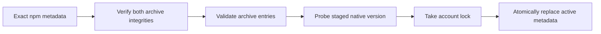

# Broker Codex operations

TASK-648 implements M4 step 2 FR-2 and FR-3 from
[Product Design/2026-10-16-2311-TASK-550-docker-host-m4.md](https://github.com/ophis/private_docs/blob/main/Product%20Design/2026-10-16-2311-TASK-550-docker-host-m4.md).
Container authentication, refresh and compatibility selection remain later work.

## Commands

Install or rebuild the hardened broker first with `sh <agent-pm plugin directory>/broker/install.sh`.
Replace `<version>` with an exact stable npm version, such as `0.162.1`:

| Action | Command |
|---|---|
| First pinned installation | `sudo /usr/local/libexec/agent-pm/agent-pm-broker install-codex <version>` |
| Explicit update or native-file repair | `sudo /usr/local/libexec/agent-pm/agent-pm-broker update-codex <version>` |
| Independent browser login, ordinary user | `/usr/local/libexec/agent-pm/agent-pm-broker login codex` |
| Inspect | `/usr/local/libexec/agent-pm/agent-pm-broker status` |

Administrative install/update success writes installation JSON; failure exits 1 with a
diagnostic. Login is interactive text and exits 0 on success, 1 on failure/cancellation.
Malformed command arguments use the protocol usage error, exit 2. Status fields and
protocol version are defined only in [Docker broker protocol](docker-broker-protocol.md#success-fields).

## Installation trust

**Pinned installation** lives under `/usr/local/libexec/agent-pm/codex/`. It contains
root-owned immutable `releases/<id>/codex`, regular `active.json`, `install.lock` and
`auth.lock`; directories and executable are 0755, metadata and locks 0644. Ordinary
users can lock the fixed account file but cannot replace it. Old releases are retained.

Sources: `broker/internal/codex/install.go:110`, `broker/internal/codex/archive.go:15`.

Only `https://registry.npmjs.org/` is accepted, without redirects. The main package and
its exact macOS arm64 dependency require SHA-512 integrity. Archive links, special
files, traversal, duplicate entries and excessive sizes are refused. The installer
keeps only the native `vendor/aarch64-apple-darwin/bin/codex`, never scripts or Node.

Before execution the broker verifies root ownership, write permissions and symlink
absence for the native file and every ancestor, plus its SHA-256 against protected
metadata. Native commands use an absolute path, private working directory and a fresh
environment containing only private `HOME`/`CODEX_HOME`, system `PATH` and `LANG`.
Personal npm configuration, `NODE_OPTIONS`, `npm_config_*` and Codex environment
overrides are not inherited. Failed validation/publication preserves the active
installation. Updates preserve `allowed_versions`; no untested container version is
granted by installing a host binary.

## Login trust

```mermaid
flowchart LR
    L[Take account lock] --> R[Reread keychain]
    R --> H[Private random temporary home]
    H --> B[Pinned browser login]
    B --> V[Validate subscription auth and expiry]
    V --> D[Delete temporary home]
    D --> P[Restrict partition list]
    P --> A[Restrict read and export entries]
    A --> C[Verify access and save auth]
    C --> U[Verify saved auth and release lock]
```

Sources: `broker/internal/broker/codex.go:141`, TASK-642's `broker/internal/broker/keychain.go:255`.

The entire temporary home is 0700 under `/private/tmp`; file credential storage and
ChatGPT browser login are forced. It is removed on success, child failure and normal
signal cancellation. SIGKILL or host failure cannot run cleanup. Full credentials
exist only in this directory, broker memory and login-keychain service
`agent-pm-codex`, account `auth`. Personal `~/.codex` is neither imported nor changed.
Other processes running as the same user can still read the temporary data.

A new keychain item starts with a nonsecret placeholder. TASK-642's implementation
sets the partition list first, then broker-only read/export ACL entries, using a
hidden keychain password once when needed and the same dialog fallback. Credentials
are written in place only after verification; existing GitHub App items are unchanged.
Reinstalling the broker changes its ad hoc code identity: rerun `login codex` to
authorize the new broker. No `security` subprocess receives credential data.

The access-token JWT `exp` is a local expiry source, not signature verification or
proof that the upstream still accepts the subscription. Expired credentials require
host login in this milestone. Official references:
[credential storage](https://learn.chatgpt.com/docs/auth),
[browser login](https://learn.chatgpt.com/docs/cli/reference).
Version-specific field/expiry evidence:
[AuthDotJson](https://github.com/openai/codex/blob/rust-v0.162.1/codex-rs/login/src/auth/storage.rs#L49),
[TokenData and JWT expiry parsing](https://github.com/openai/codex/blob/rust-v0.162.1/codex-rs/login/src/token_data.rs#L11).

## Acceptance boundary

Automated tests use fake transports, processes and keychain/Security adapters. Linux,
Docker and integration verification run only in GitHub CI. The pull request lists
the separate user-run macOS installation, browser-login, cancellation, trust-denial
and personal-login-isolation checks. No live result is claimed here.
