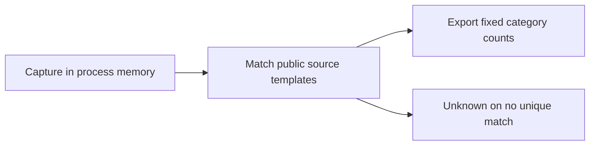
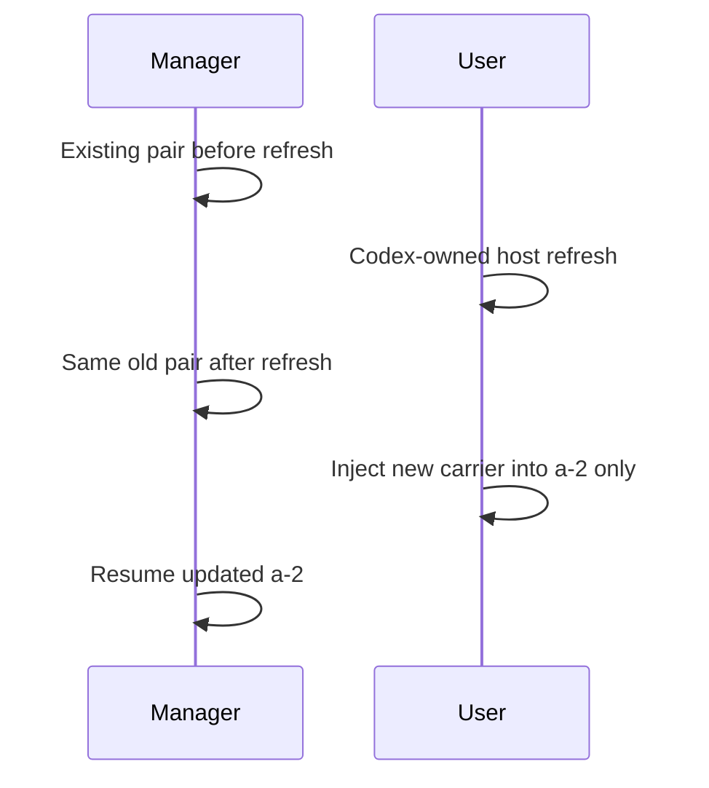
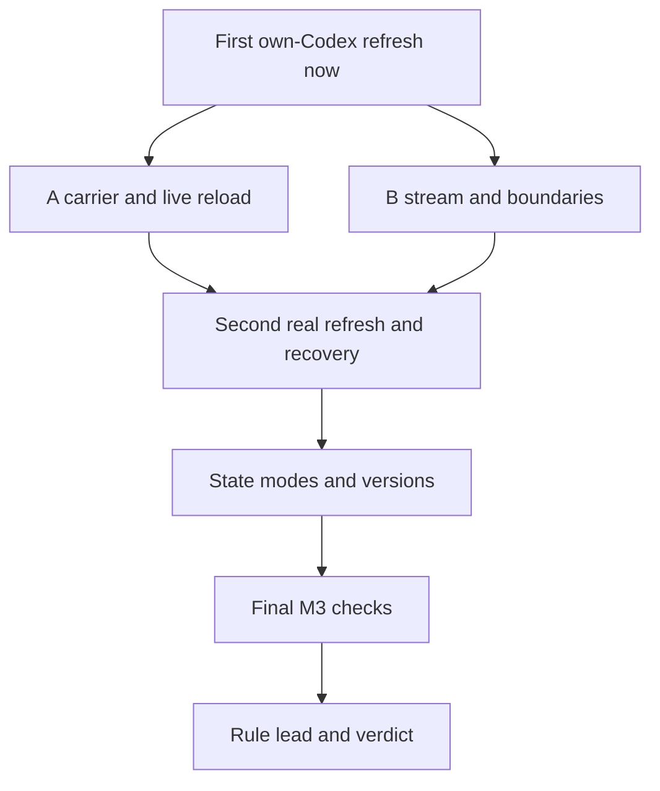
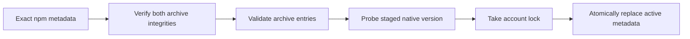
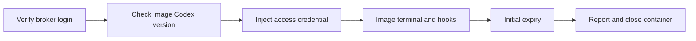

# Docker Codex：TASK-647 验证记录

## 结论

**未完成**。A 已开始用户订阅身份实测，B 尚未实测；共同门槛未齐，不能定案，也不能选择 C。本调查尚不授予 Docker Codex 兼容许可；本次不改产品代码。本文是 FR-1 的进行中记录，不是验收通过记录。

依据：[TASK-647](https://linear.app/ophis-workgroup/issue/TASK-647)、[M4 PRD（产品需求文档）](https://github.com/ophis/private_docs/blob/main/Product%20Design/2026-10-16-2311-TASK-550-docker-host-m4.md)。用户 2026-10-17 的提前开跑要求取代其中的 M3 全合并开工门槛；M3 相关项见末节。

| 方案 | 状态 | 尚缺的决定性证据 |
|---|---|---|
| A 集中刷新 | 未完成 | 最小载体、活进程取得新 token、真实刷新后续用及共同门槛 |
| B relay（转发程序） | 未完成 | 无 token 的实际模型流、刷新续用、受限边界及共同门槛 |
| C 本机回退 | 不满足选择条件 | A、B 各自可复现失败，或共同宿主刷新失败证据 |

以下区分**源码证据**、**合成检查**、**订阅观察**。前两者不能代替第三者。缺身份、断网、待依赖均记未完成；单次模型回复或仅认证头成功不能通过共同门槛。

The upstream broker operations below describe a separate `0.162.1` product baseline. They do not establish the FR-1 live gates for this investigation’s `0.163.0` candidate.

**Current gate revision**, user decision 2026-10-17: do not wait for or test a real access-token expiry. Crossing real expiry is removed from the TASK-647 A/B verdict gate; every other evidence item remains. Expiry claims, refresh lead, two real refreshes, old-value acceptance/rejection and live reload are still recorded. Historical command groups retain their original scope; they are not instructions to resume expiry testing. The upstream broker operations at the end describe a separate product milestone.

## 版本与兼容规则

调查日期为 2026-10-17 America/New_York，元数据采集时间见 [原始记录](docker-codex-evidence/2026-10-17-source.json)。命令：在仓库根运行 `python3 -I scripts/docker_codex_probe.py inventory`。只访问 npm 公共 registry，不读取个人配置或登录。

| 角色 | 版本 | 终端／headless（无界面运行）／真实刷新／resume（恢复） |
|---|---|---|
| 固定宿主候选 | 0.163.0；用户已回传运行时版本 | 宿主 headless 基线通过；其余未完成，见用户观察 |
| 同 minor（次版本）最新稳定版 | 0.163.0 | 与上一行同一产物，全部未完成 |
| 当日最新稳定版 | 0.163.0 | 与上一行同一产物，全部未完成 |
| 用户镜像实际版本、digest（内容摘要） | 未采集 | 全部未完成 |
| 第二组独立实验镜像 | 两容器均为 0.163.0；实验镜像 digest 未采集 | 各完成一轮并回复 OK；严格探针仍未完成，见第二组观察；其余未完成 |

镜像定义在 [broker/worker/Dockerfile:21](../broker/worker/Dockerfile#L21) 使用未固定版本的安装命令，因此不能从定义推断用户镜像的实际 Codex 版本。

**兼容规则**如下，是调查结果的数据形状，不是新增产品配置；没有任何获准版本。各候选必须分别覆盖终端、headless、跨刷新与恢复。未验证版本不因同 minor 自动获准；当日最新版失败也不取消其他已证明通过的版本。

```json
{
  "verdict_gate_revision": "user-2026-10-17-no-real-expiry",
  "real_access_expiry_crossing_required": false,
  "fixed_codex_version": "0.163.0",
  "container_version_rule": {"kind": "exact", "versions": []},
  "measured_refresh_lead_seconds": null,
  "scheduler_floor_seconds": 600,
  "selected_scheme": null
}
```

**提前量**尚无实测值。源码中的 300 秒是 Codex 自身的主动刷新窗口，不是本方案测出的提前量。后续记录两次真实刷新耗时、写入／重载延迟、容器及宿主时钟差和旧值失效时间；调度取实测提前量与 M3 的 600 秒中的较大值。有效期从真实 access token（访问令牌）的 `exp` 获取并与上游接受情况核对；解码不等于验证签名。不得改日期制造刷新。

## 源码证据

固定标签 `rust-v0.163.0`，提交 `83086188ae0614bd882818ff1aa23f3194962012`。以下均读取对应文件；它们描述该版本代码，不能证明生产上游行为。

| 编号 | 已核实的行为 | 文件与行 |
|---|---|---|
| S1 | `TokenData` 要求 `id_token`、`access_token`、`refresh_token`；`account_id` 是可选字段。删除 refresh 字段与设为空字符串不是同一个实验。后者仅满足字符串类型，不能据此认定认证成功。 | [token_data.rs:11](https://github.com/openai/codex/blob/83086188ae0614bd882818ff1aa23f3194962012/codex-rs/login/src/token_data.rs#L11) |
| S2 | `AuthDotJson` 包含可选 `tokens`、`last_refresh`、`auth_mode`。文件加载直接反序列化。 | [storage.rs:49](https://github.com/openai/codex/blob/83086188ae0614bd882818ff1aa23f3194962012/codex-rs/login/src/auth/storage.rs#L49)、[storage.rs:192](https://github.com/openai/codex/blob/83086188ae0614bd882818ff1aa23f3194962012/codex-rs/login/src/auth/storage.rs#L192) |
| S3 | 保存路径用 `OpenOptions.truncate(true)` 写文件，创建模式 0600；此路径没有原子重命名。不能把合成 rename 检查写成实际 Codex 保存测试。 | [storage.rs:214](https://github.com/openai/codex/blob/83086188ae0614bd882818ff1aa23f3194962012/codex-rs/login/src/auth/storage.rs#L214) |
| S4 | 认证有内存缓存。未授权恢复先按账号匹配重载，再尝试自身刷新；仅替换磁盘文件不证明活进程已取新值。 | [manager.rs:1850](https://github.com/openai/codex/blob/83086188ae0614bd882818ff1aa23f3194962012/codex-rs/login/src/auth/manager.rs#L1850)、[manager.rs:2040](https://github.com/openai/codex/blob/83086188ae0614bd882818ff1aa23f3194962012/codex-rs/login/src/auth/manager.rs#L2040) |
| S5 | 主动刷新优先看 access token 的 `exp`，窗口为 5 分钟；无法取得到期时间时才看 `last_refresh` 的 8 天阈值。 | [manager.rs:203](https://github.com/openai/codex/blob/83086188ae0614bd882818ff1aa23f3194962012/codex-rs/login/src/auth/manager.rs#L203)、[manager.rs:3001](https://github.com/openai/codex/blob/83086188ae0614bd882818ff1aa23f3194962012/codex-rs/login/src/auth/manager.rs#L3001) |
| S6 | app-server 的请求刷新分支调用 `AuthManager.refresh_token()`；它先在锁内重读，相同凭据才向认证方刷新。刷新成功后保存并重载。 | [account_processor.rs:1103](https://github.com/openai/codex/blob/83086188ae0614bd882818ff1aa23f3194962012/codex-rs/app-server/src/request_processors/account_processor.rs#L1103)、[manager.rs:2845](https://github.com/openai/codex/blob/83086188ae0614bd882818ff1aa23f3194962012/codex-rs/login/src/auth/manager.rs#L2845)、[manager.rs:3089](https://github.com/openai/codex/blob/83086188ae0614bd882818ff1aa23f3194962012/codex-rs/login/src/auth/manager.rs#L3089) |
| S7 | provider `auth.command` 获取 bearer token 并缓存，可按间隔或认证错误再执行；解析结果为 API（应用程序编程接口）key 型认证，不自动构成 ChatGPT 身份。不能与 `env_key`、`experimental_bearer_token` 或 `requires_openai_auth` 同设。 | [external_bearer.rs:33](https://github.com/openai/codex/blob/83086188ae0614bd882818ff1aa23f3194962012/codex-rs/login/src/auth/external_bearer.rs#L33)、[lib.rs:368](https://github.com/openai/codex/blob/83086188ae0614bd882818ff1aa23f3194962012/codex-rs/model-provider-info/src/lib.rs#L368) |

官方 [CI/CD（持续集成与持续交付）认证说明](https://learn.chatgpt.com/docs/auth/ci-cd-auth) 要求同一托管登录串行使用，让 Codex 刷新并保留回写结果，不自行调用刷新端点。其中 8 天描述不足以覆盖 S5 的优先到期逻辑，应采用固定版本源码及实际到期记录。

[app-server 文档](https://learn.chatgpt.com/docs/app-server) 的 `chatgptAuthTokens` 是宿主供 token、响应刷新请求的实验性模式。它不是终端或 `codex exec` 的外部 token 接口证明。`account/read` 的 `refreshToken: true` 是 S6 的宿主刷新候选；成功响应本身不证明 token 已换新或可用。

## 验证矩阵

各行完整验收均未完成，版本为 0.163.0 候选；源码调查日期见上文，用户执行日期见观察。没有执行过的命令不记录退出码；部分通过的子项不升级为整行通过。

| 验证项 | A 状态／证据 | B 状态／证据 | 待执行及判据 |
|---|---|---|---|
| 认证载体 | 未完成；S1、S2、S7；已测子项见第二组观察 | 未完成；下节协议候选 | 在独立测试登录上比较删除字段、空 refresh 字符串、必要身份字段及 S7；两种现有 client 都要实际回复。容器从未获得 refresh token（刷新令牌）；B 无 ChatGPT token。 |
| Multi-turn and refresh | Incomplete; S4, S5 | Incomplete | Same terminal process across real refreshes; headless consecutive tasks and native resume separately. Record expiry claims and response/reload behavior without waiting for natural expiry. Separate exec processes never prove live-process reload. |
| 刷新与并发 | 未完成；S6 | 未完成 | 两容器和独立本机登录，第一次真实宿主刷新前后各一轮，下一次仍成功；并发请求共享账号锁。分别记录旧 access token 被接受还是拒绝、活进程使用新值的证据，不推定立即失效。 |
| B 协议 | 不适用 | 未完成；下节 | 多轮实际流、流中断、取消、账号头与受限路由；禁止只凭一次转发定案。 |
| 版本兼容 | 未完成；版本表 | 未完成；版本表 | 每个不同候选产物都跑终端、headless、跨刷新、restart（重启）、close 后 resume；记录原生会话标识相同。 |
| 易失状态 | 未完成；合成检查命令见下节 | 未完成；同左 | 用户 macOS Docker Desktop、真实 Codex 保存及重建后的宿主检查尚缺；只持久化 `sessions/`，工作区也检查凭据残留，close 后易失目录消失。 |
| 刷新触发 | 未完成；S5、S6 | 未完成；共用宿主路径 | 通过固定 Codex 自身路径刷新，两次都验证新 `exp`、新凭据可用；记录真实次数和耗时。不得直接请求 OAuth（开放授权）刷新端点。 |

### B 的候选协议

以下是需实测的最小起点，不是已通过的允许清单。正式 broker origin 必须固定为 HTTPS（加密超文本传输协议）；用户测试身份若要求其他地域 origin，应停止并重新调查，不能放开任意目的地址。

| 内容 | 源码观察／待验证 |
|---|---|
| origin 与 base | 默认 ChatGPT base 为 `https://chatgpt.com/backend-api/codex`；自定义 provider 可显式覆盖 base。[lib.rs:80](https://github.com/openai/codex/blob/83086188ae0614bd882818ff1aa23f3194962012/codex-rs/model-provider-info/src/lib.rs#L80)、[lib.rs:428](https://github.com/openai/codex/blob/83086188ae0614bd882818ff1aa23f3194962012/codex-rs/model-provider-info/src/lib.rs#L428) |
| 方法与相对路径 | 模型流候选 `POST /responses`；模型列表候选 `GET /models`。实际启用的压缩及其他请求必须补全观察，当前获准路由为空。[responses.rs:138](https://github.com/openai/codex/blob/83086188ae0614bd882818ff1aa23f3194962012/codex-rs/codex-api/src/endpoint/responses.rs#L138)、[models.rs:43](https://github.com/openai/codex/blob/83086188ae0614bd882818ff1aa23f3194962012/codex-rs/codex-api/src/endpoint/models.rs#L43) |
| 认证与账号 | bearer provider 添加 `Authorization: Bearer …`，有账号时加 `ChatGPT-Account-ID`，FedRAMP 账号另有路由头；值仅在宿主，转发端不信任来路身份头。[bearer_auth_provider.rs:32](https://github.com/openai/codex/blob/83086188ae0614bd882818ff1aa23f3194962012/codex-rs/model-provider/src/bearer_auth_provider.rs#L32) |
| 配置候选 | `model_provider`、`model_providers.<id>.base_url`、`wire_api="responses"`、`requires_openai_auth=false`；容器指向 `http://127.0.0.1:18765`，不传 `env_key`。这些组合的订阅与身份行为仍需验证。[配置文档](https://learn.chatgpt.com/docs/config-file/config-reference) |
| 传输 | 内置 OpenAI provider 默认支持 WebSocket；连接路径为 `/responses`。优先验证显式 `supports_websockets=false` 的 HTTP（超文本传输协议）／SSE（服务器发送事件）流；若仍使用 WebSocket，现有候选传输不算通过。[lib.rs:560](https://github.com/openai/codex/blob/83086188ae0614bd882818ff1aa23f3194962012/codex-rs/model-provider-info/src/lib.rs#L560)、[connector.rs:32](https://github.com/openai/codex/blob/83086188ae0614bd882818ff1aa23f3194962012/codex-rs/codex-api/src/endpoint/responses_websocket/connector.rs#L32) |

FR-10 独立边界尚未运行：绝对地址／路径穿越／非允许路由／伪造 Host 拒绝且不出网，正文上限 10 MiB（兆二进制字节），来路 Cookie／认证／账号头丢弃，302 不跟随，401 最多一次安全重放且未输出响应，部分流报错。session（会话）、generation（启动实例）、hook（回调）、close 边界依赖 M3，见末节。

### 易失挂载合成检查

Docker [tmpfs（内存文件系统）文档](https://docs.docker.com/engine/storage/tmpfs/) 和 [bind mount（目录挂载）文档](https://docs.docker.com/engine/storage/bind-mounts/) 没有给出此嵌套布局的完整保证，因此准备一次性合成实验。

命令：`bash scripts/docker-codex-mount-probe.sh`，由 `.github/workflows/codex-probe.yml` 的 `Codex synthetic mounts` 运行。[脚本:24](../scripts/docker-codex-mount-probe.sh#L24) 使用无身份、无网络容器、非 root、只读根目录、`CapDrop=ALL`、`no-new-privileges`；整个 `/probe/home` 为 tmpfs，仅其 `sessions/` bind。写入合成 auth、原子 rename、写历史、重启后确认 auth 消失，再删除容器。仅输出版本、digest 和状态；底层错误不输出原文。

Linux 合成检查通过：Docker 28.0.4，2026-10-18 01:03:40 UTC（协调世界时），两次启动检查成功。[脱敏记录](docker-codex-evidence/2026-10-17-mount-ci.json) 包含测试提交、命令、镜像 digest 和 [GitHub 运行证据](https://github.com/ophis/agent-pm/actions/runs/39085070423/job/117549791580)。macOS 用户观察见下节；两者均不证明 S3 的实际保存、凭据无残留、原生历史可恢复或真实账号续用。

## 用户观察

[2026-10-18 宿主记录](docker-codex-evidence/2026-10-18-user-host.json) 仅记录用户回传，worker 未复跑。

| 项目 | 观察 | 未采集／未验证 |
|---|---|---|
| 隔离登录 | 账号禁用 device-code；同一隔离 `CODEX_HOME` 改用浏览器登录成功 | 登录时间未采集 |
| 宿主 headless 基线 | `host_baseline_pass`，1 次；`2026-10-18T01:27:36Z` 至 `01:27:40Z`，4 秒 | 未观察真实刷新；不表示 A 或 B 的容器认证成功 |
| 首轮原生版本 | 原基线标签是命令常量，独立版本输出未采集 | 后续运行时证据见第二组观察 |
| macOS 合成挂载 | Docker 29.8.2，`synthetic_mount_restart_only` 通过，2 次；Alpine digest 与 Linux 记录相同 | 挂载执行时间未采集；未运行真实 Codex 凭据保存检查 |

### 第二组观察

[完整脱敏记录](docker-codex-evidence/2026-10-18-user-a-carrier.json) 保留原始状态，探针版本为 `3fa9774d`。用户依次执行全部命令，未做其他改动；两容器保留。以下时间均为 2026-10-18 UTC。

| 项目 | 观察 | 范围 |
|---|---|---|
| 版本与启动 | Linux arm64 下载核验、构建和两个容器启动成功；宿主输出 `codex-cli 0.163.0`，01:48:10 两容器版本均通过 | 补齐宿主运行时版本；独立实验镜像不等于产品镜像 |
| 删除 refresh 字段 | 01:48:40 注入成功；`login status` 退出 1，`schema_missing_refresh_token` | 该载体加载失败，不代表 A 全部失败 |
| refresh 为空字符串 | 01:49:05 两次注入与两容器 `login status` 均成功；注入报告原 refresh 值计数为 0 | 载体加载通过，最少身份字段及容器凭据残留扫描尚未验证 |
| 两容器初次 headless | a-1：01:49:05.704614–01:49:09.286037；a-2：01:49:05.702833–01:49:09.453389；时间重叠，各退出 0、完成 1 轮、出现 1 条 OK 回复 | 严格探针均为 `incomplete`，原判定原因未采集；不升级为通过，不记作认证失败 |

**严格判定**还要求：最后一条回复为 OK、没有 `error`／`turn.failed`、没有 `agent_message`／`reasoning` 之外的非空 item 类型。[原探针:145](https://github.com/ophis/agent-pm/blob/3fa9774d5300e631d49539a24c4e7e727bc98b7a/scripts/docker_codex_a_probe.py#L145) 没有回传这三项的原因；OK 计数不证明最后一条也是 OK，白名单外 item 也不必是工具调用。现有记录只能确定至少一项未通过，无法唯一定位，原始输出已丢弃。保留这次未完成结果；后续增加脱敏计数，判定条件不变，不重跑初次基线。

### 第三组观察

[完整脱敏记录](docker-codex-evidence/2026-10-18-user-a-resume.json) 来自用户，探针版本为 `93c25337`；没有 worker 复跑。

| 项目 | 观察 | 尚未证明 |
|---|---|---|
| 到期声明 | 2026-10-18T02:06:30.590905Z 读取；`exp` 对应 2026-10-28T01:27:14Z，剩余 861644 秒，声明寿命 864000 秒（10 天），签名未验证 | 实际上游到期、旧值失效时间、刷新提前量；不能将声明寿命当成实测有效期 |
| a-1 原生恢复 | 02:06:46.515968–02:06:51.371292Z，0.163.0；同一原生身份，退出 0，完成 1 轮，末条 OK，顶层错误 0，`error` item 1 | 严格状态 `incomplete`，通知具体类别未采集 |
| a-2 原生恢复 | 02:06:46.515564–02:06:51.776535Z，其余观察与 a-1 相同；两次执行重叠 | 同上；不把后续 a-1 分类套到此轮或 a-2 |

本轮唯一未通过的是白名单外的 `error` item；原生身份与回复子项已观察到成功，整组不补记通过。第二组原始事件已丢弃，不能据第三组推断第二组拒绝原因。真实刷新与 A/B 定案仍未完成。

### Group 4 observation

[Redacted record](docker-codex-evidence/2026-10-18-manager-a-notice.json): the manager ran a-1 once, as reported in this session. Native Codex exited 0, completed one turn with final OK, retained the native session and emitted no top-level error. One `ErrorItem` matched no existing category. The helper exited 1 with `incomplete`; its body was not retained. No category can be reconstructed from this record or assigned retrospectively to earlier runs.

### Group 5 observation and Code Mode disposition

[Redacted record](docker-codex-evidence/2026-10-18-manager-a-code-mode.json), manager executed each command once:

| Observation | Recorded result |
|---|---|
| Public inventory, 2026-10-18T03:27:19.001075Z | Candidate, same-minor latest and latest stable all `0.163.0`; inventory `live_refresh_count=0` is a source-only constant, not a measurement of runtime requests. |
| a-1 resume, 03:27:19.166041–03:27:26.249180Z | Same native session; Codex exit0, one completed turn, final OK, no top-level error; one `code_mode_unavailable`. Helper exit1 and `incomplete` remain unchanged. |

**Code Mode disposition**: the requested tool runtime is unavailable. The pinned source emits either `Falling back to direct tools` or `Code mode will fail closed`, depending on the effective tool mode: [tools/mod.rs:63](https://github.com/openai/codex/blob/83086188ae0614bd882818ff1aa23f3194962012/codex-rs/core/src/tools/mod.rs#L63), [code_mode/mod.rs:110](https://github.com/openai/codex/blob/83086188ae0614bd882818ff1aa23f3194962012/codex-rs/core/src/tools/code_mode/mod.rs#L110), [turn_context.rs:1410](https://github.com/openai/codex/blob/83086188ae0614bd882818ff1aa23f3194962012/codex-rs/core/src/session/turn_context.rs#L1410). The exported category combines both branches; this record does not identify one.

For A, this turn shows that a tool-free reply completed using the injected carrier; the notice is not evidence of token rejection. It is a known non-fatal notice for this observation, **not an unconditional benign-warning exemption**: the fail-closed branch can prevent tools, and direct-tool fallback has not been validated here. No strict-gate waiver, warning suppression or retrospective pass is adopted. Do not spend another round merely reclassifying this notice; continue independent refresh/transport evidence while retaining `incomplete`.

### ErrorItem 的含义与判据

官方 [非交互说明](https://learn.chatgpt.com/docs/non-interactive-mode) 定义 JSON 事件流，但未区分下面的通知映射；固定源码补齐此项。`ErrorItem` 只有 `message`，没有原始通知类型或严重性字段，见 [exec_events.rs:310](https://github.com/openai/codex/blob/83086188ae0614bd882818ff1aa23f3194962012/codex-rs/exec/src/exec_events.rs#L310)。

| 进入 JSON 输出器的来源 | 输出／运行状态 | 固定源码 |
|---|---|---|
| `Warning` 与本地 `process_warning` | `item.completed` + `ErrorItem`；继续运行 | [输出器:409](https://github.com/openai/codex/blob/83086188ae0614bd882818ff1aa23f3194962012/codex-rs/exec/src/event_processor_with_jsonl_output.rs#L409)、[输出器:442](https://github.com/openai/codex/blob/83086188ae0614bd882818ff1aa23f3194962012/codex-rs/exec/src/event_processor_with_jsonl_output.rs#L442)、[输出器:623](https://github.com/openai/codex/blob/83086188ae0614bd882818ff1aa23f3194962012/codex-rs/exec/src/event_processor_with_jsonl_output.rs#L623) |
| `ConfigWarning` | 同上；消息为摘要及可选详情 | [输出器:427](https://github.com/openai/codex/blob/83086188ae0614bd882818ff1aa23f3194962012/codex-rs/exec/src/event_processor_with_jsonl_output.rs#L427) |
| `DeprecationNotice` | 同上；弃用通知 | [输出器:459](https://github.com/openai/codex/blob/83086188ae0614bd882818ff1aa23f3194962012/codex-rs/exec/src/event_processor_with_jsonl_output.rs#L459) |
| `ModelRerouted` | 同上；记录模型改路由 | [输出器:494](https://github.com/openai/codex/blob/83086188ae0614bd882818ff1aa23f3194962012/codex-rs/exec/src/event_processor_with_jsonl_output.rs#L494) |
| 服务端 `Error`／回合 `Failed` | 顶层 `error`／`turn.failed`，与 `ErrorItem` 分开 | [输出器:447](https://github.com/openai/codex/blob/83086188ae0614bd882818ff1aa23f3194962012/codex-rs/exec/src/event_processor_with_jsonl_output.rs#L447)、[输出器:538](https://github.com/openai/codex/blob/83086188ae0614bd882818ff1aa23f3194962012/codex-rs/exec/src/event_processor_with_jsonl_output.rs#L538) |

**放行建议**：不能仅因类型名为 `error` 判认证失败；已确认无害的具体通知可另记警告。但不能一概放行：同一通道包含[事件丢失](https://github.com/openai/codex/blob/83086188ae0614bd882818ff1aa23f3194962012/codex-rs/exec/src/lib.rs#L1668)、[凭据遮蔽失效](https://github.com/openai/codex/blob/83086188ae0614bd882818ff1aa23f3194962012/codex-rs/core/src/config/mod.rs#L4876)与[自定义规则未应用](https://github.com/openai/codex/blob/83086188ae0614bd882818ff1aa23f3194962012/codex-rs/app-server/src/in_process.rs#L381)。这些会影响完整性或安全边界；模型、传输降级也影响兼容与 B 的协议证据。先取得具体类别，再决定是否提出窄范围豁免；本次只增加分类，不放宽严格判定，不关闭警告或改沙箱。

## 用户实测交接

**Execution owners**, under the user's latest standing mandate:

| Owner | Allowed experiment commands |
|---|---|
| manager | Checks touching no secrets; redacted Codex requests using credentials already injected into the two existing containers. No secret printing, extraction or copying. |
| user | Reading host credential files or keychain; login, injection and host refresh. |
| worker | Source, fake-data unit tests and lint only; Docker/Linux execution stays on GitHub CI. No real credentials or keychain. |

Ownership follows the entire process tree. `--user-run` remains the helper's explicit live-execution opt-in, not an ownership override. Earlier command groups below are historical: use only the next group unless instructed otherwise. Return only the wrapper's redacted record and exit code; do not run the raw child commands, capture verbose logs or paste login output.

先在现有工作树准备独立原生文件。[下载器:77](../scripts/docker_codex_probe.py#L77) 只读公共 registry、核对 SHA-512（安全散列算法 512 位）integrity、只取精确平台的普通文件、不执行包脚本，目标存在则失败。逐条执行，任一步失败即停，目录已存在时不复用：

```sh
mkdir -m 700 /Users/francis/.agent-pm/work/TASK-647/agent/tmp/codex-live-0.163.0
mkdir -m 700 /Users/francis/.agent-pm/work/TASK-647/agent/tmp/codex-live-0.163.0/home
mkdir -m 700 /Users/francis/.agent-pm/work/TASK-647/agent/tmp/codex-live-0.163.0/broker
python3 -I /Users/francis/.agent-pm/work/TASK-647/agent/src/ophis/agent-pm-TASK-647/scripts/docker_codex_probe.py native --platform darwin-arm64 --destination /Users/francis/.agent-pm/work/TASK-647/agent/tmp/codex-live-0.163.0/codex
env -i HOME=/Users/francis/.agent-pm/work/TASK-647/agent/tmp/codex-live-0.163.0/home CODEX_HOME=/Users/francis/.agent-pm/work/TASK-647/agent/tmp/codex-live-0.163.0/broker PATH=/usr/bin:/bin /Users/francis/.agent-pm/work/TASK-647/agent/tmp/codex-live-0.163.0/codex --version
env -i HOME=/Users/francis/.agent-pm/work/TASK-647/agent/tmp/codex-live-0.163.0/home CODEX_HOME=/Users/francis/.agent-pm/work/TASK-647/agent/tmp/codex-live-0.163.0/broker PATH=/usr/bin:/bin TERM=xterm-256color /Users/francis/.agent-pm/work/TASK-647/agent/tmp/codex-live-0.163.0/codex -c 'cli_auth_credentials_store="file"' login --device-auth
```

该目录名 `broker` 仅表示实验身份，没有实现 broker 登录。设备登录不可用时，保持同一隔离环境，最后命令去掉 `--device-auth` 改用浏览器登录。不要改用个人缓存。

用户接着执行一次隔离宿主 headless 基线，记录开始／结束时间及状态，丢弃原始回复与错误：

```sh
date -u '+%Y-%m-%dT%H:%M:%SZ'
if env -i HOME=/Users/francis/.agent-pm/work/TASK-647/agent/tmp/codex-live-0.163.0/home CODEX_HOME=/Users/francis/.agent-pm/work/TASK-647/agent/tmp/codex-live-0.163.0/broker PATH=/usr/bin:/bin /Users/francis/.agent-pm/work/TASK-647/agent/tmp/codex-live-0.163.0/codex -C /Users/francis/.agent-pm/work/TASK-647/agent/tmp/codex-live-0.163.0/home -c 'cli_auth_credentials_store="file"' exec --skip-git-repo-check --sandbox read-only --json 'Reply exactly OK. Do not use tools.' >/dev/null 2>&1; then
  printf '%s\n' '{"version":"0.163.0","status":"host_baseline_pass","count":1}'
else
  printf '%s\n' '{"version":"0.163.0","status":"host_baseline_failed","error":"redacted"}'
fi
date -u '+%Y-%m-%dT%H:%M:%SZ'
env AGENT_PM_CODEX_USER_PROBE=1 bash /Users/francis/.agent-pm/work/TASK-647/agent/src/ophis/agent-pm-TASK-647/scripts/docker-codex-mount-probe.sh
```

首轮命令已收到上述用户观察，保留命令供追溯，不重复登录或重建该目录。继续下一组；尚未执行的命令不算验证完成。

### 第二组：A 载体与两个容器

本组只验证载体加载和两个容器的初次 headless 回复，无须 TASK-643。保留真实 `id_token`、`access_token`、`account_id` 及原有 `last_refresh`；比较删除 `refresh_token` 字段与空字符串。没有修改宿主登录文件，也不改变凭据日期。最少身份字段、provider command、终端活进程、真实刷新、原生恢复仍未完成。

以下为第二组历史命令，不再执行。除明确列出的“省略字段”加载失败外，任一步非零即停，回传脱敏状态；不更改沙箱或容器隔离标志。构建目录和容器名必须是新的，已存在时不复用。

准备无凭据镜像，构建上下文只含公开 Linux arm64 原生文件。使用独立实验镜像，不代表产品 worker 镜像版本已验证：

```sh
mkdir -m 700 /Users/francis/.agent-pm/work/TASK-647/agent/tmp/codex-a-0.163.0
mkdir -m 700 /Users/francis/.agent-pm/work/TASK-647/agent/tmp/codex-a-0.163.0/image
python3 -I /Users/francis/.agent-pm/work/TASK-647/agent/src/ophis/agent-pm-TASK-647/scripts/docker_codex_probe.py native --platform linux-arm64 --destination /Users/francis/.agent-pm/work/TASK-647/agent/tmp/codex-a-0.163.0/image/codex
docker build --platform linux/arm64 --network=none --file /Users/francis/.agent-pm/work/TASK-647/agent/src/ophis/agent-pm-TASK-647/scripts/docker-codex-probe.Dockerfile --tag task647-codex-probe:0.163.0 /Users/francis/.agent-pm/work/TASK-647/agent/tmp/codex-a-0.163.0/image
docker run --detach --name task647-codex-a-1 --platform linux/arm64 --read-only --cap-drop ALL --security-opt no-new-privileges --tmpfs /codex:rw,noexec,nosuid,nodev,size=64m,mode=0700,uid=10001,gid=10001 --tmpfs /work:rw,noexec,nosuid,nodev,size=64m,mode=0700,uid=10001,gid=10001 --tmpfs /tmp:rw,nosuid,nodev,size=64m,mode=1777 task647-codex-probe:0.163.0
docker run --detach --name task647-codex-a-2 --platform linux/arm64 --read-only --cap-drop ALL --security-opt no-new-privileges --tmpfs /codex:rw,noexec,nosuid,nodev,size=64m,mode=0700,uid=10001,gid=10001 --tmpfs /work:rw,noexec,nosuid,nodev,size=64m,mode=0700,uid=10001,gid=10001 --tmpfs /tmp:rw,nosuid,nodev,size=64m,mode=1777 task647-codex-probe:0.163.0
env -i HOME=/Users/francis/.agent-pm/work/TASK-647/agent/tmp/codex-live-0.163.0/home CODEX_HOME=/Users/francis/.agent-pm/work/TASK-647/agent/tmp/codex-live-0.163.0/broker PATH=/usr/bin:/bin /Users/francis/.agent-pm/work/TASK-647/agent/tmp/codex-live-0.163.0/codex --version
python3 -I /Users/francis/.agent-pm/work/TASK-647/agent/src/ophis/agent-pm-TASK-647/scripts/docker_codex_a_probe.py --user-run versions
```

两容器不挂任何宿主目录，不发布端口；`CODEX_HOME=/codex`、工作区及临时目录均为 tmpfs，用户为 `agent`。版本命令须分别采集宿主输出及两容器的实际版本；版本不匹配时脚本停止，不注入凭据。

**载体探针**只读取前轮固定隔离路径 `…/codex-live-0.163.0/broker/auth.json`，拒绝链接和非私有权限。它按允许字段重建载体、检查原 refresh 值未混入，再通过 `docker exec -i` 的标准输入写入容器 tmpfs，0400；原始内容不打印、不在宿主生成载体文件。

```sh
python3 -I /Users/francis/.agent-pm/work/TASK-647/agent/src/ophis/agent-pm-TASK-647/scripts/docker_codex_a_probe.py --user-run inject task647-codex-a-1 missing-refresh
python3 -I /Users/francis/.agent-pm/work/TASK-647/agent/src/ophis/agent-pm-TASK-647/scripts/docker_codex_a_probe.py --user-run status task647-codex-a-1
```

此处只做 `codex login status`，不登录。若返回非零且 `error="schema_missing_refresh_token"`，记录为该载体的加载拒绝后继续；其他非零停止。不能据此判 A 失败，空值候选尚未验证。

```sh
python3 -I /Users/francis/.agent-pm/work/TASK-647/agent/src/ophis/agent-pm-TASK-647/scripts/docker_codex_a_probe.py --user-run inject task647-codex-a-2 empty-refresh
python3 -I /Users/francis/.agent-pm/work/TASK-647/agent/src/ophis/agent-pm-TASK-647/scripts/docker_codex_a_probe.py --user-run status task647-codex-a-2
python3 -I /Users/francis/.agent-pm/work/TASK-647/agent/src/ophis/agent-pm-TASK-647/scripts/docker_codex_a_probe.py --user-run inject task647-codex-a-1 empty-refresh
python3 -I /Users/francis/.agent-pm/work/TASK-647/agent/src/ophis/agent-pm-TASK-647/scripts/docker_codex_a_probe.py --user-run status task647-codex-a-1
python3 -I /Users/francis/.agent-pm/work/TASK-647/agent/src/ophis/agent-pm-TASK-647/scripts/docker_codex_a_probe.py --user-run pair
```

[`summarize_pair`](../scripts/docker_codex_a_probe.py#L405) 并发执行下面两个普通命令，捕获并丢弃原始标准输出／错误；成功条件见严格判定，另要求两次执行时间重叠。事件形状依据固定源码 [exec_events.rs:10](https://github.com/openai/codex/blob/83086188ae0614bd882818ff1aa23f3194962012/codex-rs/exec/src/exec_events.rs#L10)。下面仅展示完整子命令，不要绕过脚本直接运行，以免回传原始输出：

```sh
docker exec task647-codex-a-1 codex -c 'cli_auth_credentials_store="file"' exec --skip-git-repo-check --sandbox read-only --json 'Reply exactly OK. Do not use tools.'
docker exec task647-codex-a-2 codex -c 'cli_auth_credentials_store="file"' exec --skip-git-repo-check --sandbox read-only --json 'Reply exactly OK. Do not use tools.'
```

本组**回传**：宿主版本输出、载体探针的全部脱敏 JSON（JavaScript 对象表示法）记录及每步非零状态。保留两容器等待下一组，不把两次新 exec 称为同一活进程多轮。遇到 `timeout_recreate_containers` 或需要暂停时，仅清理本组新建的容器，并回传已清理状态：

```sh
docker rm -f task647-codex-a-1 task647-codex-a-2
```

第二组结果已记录，保留命令供追溯，不重跑。继续第三组，不先启动刷新实验。

### 第三组：到期观察与现有原生会话恢复

沿用保留的两容器和隔离登录，不重建、重登录或重新注入。官方 [命令参考](https://learn.chatgpt.com/docs/cli/reference) 支持 `codex exec resume`；固定源码 [cli.rs:206](https://github.com/openai/codex/blob/83086188ae0614bd882818ff1aa23f3194962012/codex-rs/exec/src/cli.rs#L206) 定义显式身份参数。文档和源码不能证明当前登录的到期值、实际恢复身份或上轮未记录的拒绝原因，因此仅用户执行以下新增观察。

先只读隔离宿主 access token 的 JWT（JSON 网络令牌）时间声明；不执行 Codex，不刷新、不修改登录文件，只回传到期时间、剩余秒数和声明寿命。`signature_status="not_verified"` 表示未校验签名，不将该时间单独当作上游有效性证明：

```sh
python3 -I /Users/francis/.agent-pm/work/TASK-647/agent/src/ophis/agent-pm-TASK-647/scripts/docker_codex_a_probe.py --user-run expiry
```

命令非零或 `remaining_seconds <= 300` 时停下并回传结果，先安排宿主刷新验证；300 秒只是避开 S5 主动刷新窗口的本组执行条件，不是实测提前量。否则执行一次恢复组：

```sh
python3 -I /Users/francis/.agent-pm/work/TASK-647/agent/src/ophis/agent-pm-TASK-647/scripts/docker_codex_a_probe.py --user-run resume-pair
```

[`resume_turn`](../scripts/docker_codex_a_probe.py#L751) 在每个容器查找唯一既有 rollout 文件，从文件名取得原生身份，再通过普通 `docker exec codex exec … resume <原生身份>` 各发一轮。文件名结构依据 [recorder.rs:99](https://github.com/openai/codex/blob/83086188ae0614bd882818ff1aa23f3194962012/codex-rs/rollout/src/recorder.rs#L99)、[recorder.rs:1739](https://github.com/openai/codex/blob/83086188ae0614bd882818ff1aa23f3194962012/codex-rs/rollout/src/recorder.rs#L1739)。身份只在内存和本地进程参数中使用，不回传。缺历史、多份历史或路径不符即停；不用可能新开会话的 `--last`，其无匹配回退分支见 [lib.rs:1030](https://github.com/openai/codex/blob/83086188ae0614bd882818ff1aa23f3194962012/codex-rs/exec/src/lib.rs#L1030)。保留原 read-only 沙箱和严格判定，另要求输出身份与既有身份相同。

| 新增脱敏字段 | 观察含义 |
|---|---|
| `last_reply_ok` | 最后一条 agent 回复是否恰为 OK |
| `error_event_count` | 顶层 `error`／`turn.failed` 次数，不包含消息正文 |
| `rejected_item_type_counts` | 白名单外 item 的事件次数，含 started／updated／completed；仅回传固定源码中的类型，其他归为 `other`；不等于工具调用次数 |
| `same_native_session` | 本次 `thread.started` 身份是否恰好一次且匹配既有身份 |

字段实现见 [summarize_turn](../scripts/docker_codex_a_probe.py#L318)。回传两条命令的全部脱敏记录及非零状态；非零后停止，不反复尝试。即使本次通过，也只证明保留容器内的 headless 原生恢复，不补记第二组为通过，不代表同一活进程、多轮跨到期、restart 或 close 后恢复。保留容器，等待下一组；超时清理沿用第二组的固定命令。

第三组结果已记录；以下只补缺失的通知类别，不重复到期命令或双容器基线。

### 第四组：单容器通知分类

第三组仅回传了类型计数，旧消息已丢弃；源码又说明类型不能唯一确定来源。第四组已在现有 a-1 原生会话上执行一次，结果见 Group 4 observation；a-2 不重复。沿用第三组的到期执行条件，不重建、不重登录、不重新注入，不刷新宿主登录。

```sh
python3 -I /Users/francis/.agent-pm/work/TASK-647/agent/src/ophis/agent-pm-TASK-647/scripts/docker_codex_a_probe.py --user-run resume task647-codex-a-1
```

The original six-category classifier returned `unknown` in Group 4. Its historical command above is retained for traceability; do not repeat it with that revision.

### Group 5: expanded source-template classification

**Catalog**: [`ERROR_ITEM_TEMPLATES`](../scripts/docker_codex_a_probe.py#L169) contains 19 fixed category IDs with source locations under pinned Codex commit `83086188ae0614bd882818ff1aa23f3194962012`. It covers config/requirements and credential-masking warnings, unapplied rules, Code Mode availability, transcript-save failures, compaction, resumed-model changes and service-tier notices in addition to the original families. Full-message patterns discard all substitutions; unmatched, ambiguous, non-string or over-64-KiB messages remain `unknown`. The catalog is finite, not an exhaustive decoder of notification origins.



The classifier writes no raw events, message fragments, substitutions or message hashes. This describes the probe's diagnostic handling; native Codex persistence remains a separate pending gate. The unchanged strict turn gate rejects every `ErrorItem`, including recognized categories.

#### Manager commands

The public inventory refresh is needed for the current-latest version row; it reads no login/config and does not execute Codex:

```sh
python3 -I /Users/francis/.agent-pm/work/TASK-647/agent/src/ophis/agent-pm-TASK-647/scripts/docker_codex_probe.py inventory
```

Then run exactly one a-1 resume using the already-injected credentials. This is a new observation because prior message bodies were discarded; do not repeat a-2, login, build, injection or baseline. The last reported expiry claim was 2026-10-28T01:27:14Z; if that time has arrived, or the container/login changed since Group 4, stop and hand off to the user instead.

```sh
python3 -I /Users/francis/.agent-pm/work/TASK-647/agent/src/ophis/agent-pm-TASK-647/scripts/docker_codex_a_probe.py --user-run resume task647-codex-a-1
```

Return the two redacted records and the helper exit code, then stop. Exit 1 may remain expected from the strict notice gate; neither retry nor treat a recognized category as a pass. If still `unknown`, retain that result rather than exporting more message detail.

#### User commands

None in Group 5. Host credential reads, injection and refresh remain user-owned and are not prerequisites for this diagnostic observation. The next group below exercises Codex-owned refresh; no manual refresh endpoint or credential-date edit.

### Group 6: first proactive host refresh and unchanged-versus-updated carriers

No expiry wait, new login or rebuild. Use only the retained a-1/a-2 containers and isolated test login. There must be no other login or refresh of that identity during this group. The per-login probe lock serializes this harness; it does not yet prove the product broker's cross-process account locking.

The [official app-server documentation](https://learn.chatgpt.com/docs/app-server#1-check-auth-state) permits proactive refresh in managed ChatGPT mode. Pinned source confirms `account/read` invokes the own-Codex refresh path without an expiry condition: [GetAccountParams:543](https://github.com/openai/codex/blob/83086188ae0614bd882818ff1aa23f3194962012/codex-rs/app-server-protocol/src/protocol/v2/account.rs#L543), [workspace_routing.rs:174](https://github.com/openai/codex/blob/83086188ae0614bd882818ff1aa23f3194962012/codex-rs/app-server/src/request_processors/account_processor/workspace_routing.rs#L174), [manager.rs:2845](https://github.com/openai/codex/blob/83086188ae0614bd882818ff1aa23f3194962012/codex-rs/login/src/auth/manager.rs#L2845). These sources cannot tell whether this isolated identity will actually rotate or whether its old access value will remain accepted, hence the live observations below.



Run in this order, once per step. The sequence preserves a-1's original carrier as an immediate old-value comparison; it creates no calendar-based expiry test.

**Step 1, manager:**

```sh
python3 -I /Users/francis/.agent-pm/work/TASK-647/agent/src/ophis/agent-pm-TASK-647/scripts/docker_codex_a_probe.py --user-run resume-pair
```

This is the before-refresh observation, not another classification-only rerun. Keep the strict status. If each observation has native exit0, same session, completed turn, final OK and no top-level error, record any notice-only `incomplete` without upgrading it; the independent host-refresh observation can proceed. Other failures stop this group for diagnosis, without retrying or re-login.

**Step 2, user:**

```sh
python3 -I /Users/francis/.agent-pm/work/TASK-647/agent/src/ophis/agent-pm-TASK-647/scripts/docker_codex_a_probe.py --user-run host-refresh
```

`rotation_observed` describes changed access, advanced normalized expiry/last-refresh metadata and stable account in the isolated file; it is not an A/B pass or proof that the replacement is usable. The [host-refresh helper](../scripts/docker_codex_a_probe.py#L689) uses bounded private stdio, discards raw responses/stderr and calls no OAuth endpoint itself. Codex alone rewrites its login. A returned account/read result is insufficient because its handler discards refresh errors: [account_processor.rs:1103](https://github.com/openai/codex/blob/83086188ae0614bd882818ff1aa23f3194962012/codex-rs/app-server/src/request_processors/account_processor.rs#L1103). An unchanged refresh token is allowed by [persist_tokens:1600](https://github.com/openai/codex/blob/83086188ae0614bd882818ff1aa23f3194962012/codex-rs/login/src/auth/manager.rs#L1600); record its changed boolean, not its value. The RPC request count is not a measured upstream-request count. Nonzero, cancellation, timeout, account change or no observed rotation: return the redacted record and stop, with no automatic retry.

**Step 3, manager:**

```sh
python3 -I /Users/francis/.agent-pm/work/TASK-647/agent/src/ophis/agent-pm-TASK-647/scripts/docker_codex_a_probe.py --user-run resume-pair
```

Both containers still hold the pre-refresh carrier. Return this observation even if a request fails; successful replies show old-value acceptance at this point, while redacted failures alone do not prove rejection. Do not retry the old requests. Stop on timeout, missing container/history or malformed output; otherwise proceed to the planned new-value comparison on a-2 only.

**Step 4, user:**

```sh
python3 -I /Users/francis/.agent-pm/work/TASK-647/agent/src/ophis/agent-pm-TASK-647/scripts/docker_codex_a_probe.py --user-run inject task647-codex-a-2 empty-refresh
```

Proceed only on `injected`/exit0. a-1 is unchanged.

**Step 5, manager:**

```sh
python3 -I /Users/francis/.agent-pm/work/TASK-647/agent/src/ophis/agent-pm-TASK-647/scripts/docker_codex_a_probe.py --user-run resume task647-codex-a-2
```

This new exec process must retain a-2’s native identity; it does not prove a live process reloaded a changed value. Return all five redacted records with owner, step and helper exit code, then stop. Preserve the containers and isolated login; no expiry command or repeated classification/inventory is needed.

## Remaining gates before TASK-650 can use an A/B verdict

The current gate revision above removes the calendar wait, not the remaining FR-1 requirements. Run shared, likely-disqualifying checks first; prepare independent A/B work in parallel. No pending work selects C.



Arrows show the order of live evidence; source/fake harness preparation and final-M3 source checks can run alongside Group6.

| Priority | Run now / next | Missing evidence and owner |
|---|---|---|
| 1 | Group6 now | Shared host refresh path, immediate old/new carrier observations. manager uses existing copies; user owns host read/refresh/injection. A reproducible host-refresh failure needs cause-specific evidence; network/unavailability is still incomplete. |
| 2 | Prepare now, execute after first refresh observations | A minimum identity fields, applicable external-token interfaces for existing clients and same live terminal reload; independently prepare B's token-free container, fixed-origin model stream, routes/headers/config/transports and FR-10 limits. Source/fake preparation by worker; identity setup by user, existing-credential requests by manager. |
| 3 | Next, without waiting for expiry | Second real refresh; two containers plus independently logged-in host before/after each; account serialization, actual use of changed values and rejection recovery. If old access remains accepted, record that observation; do not call it invalid or treat it as proof of recovery after rejection. Live-process evidence remains separate from the Group6 snapshots. |
| 4 | Now in preparation, complete after candidate modes work | Terminal/headless multi-turn, native save and restart/close/resume, credential-residue scanning, executable/history compatibility, image digest and each distinct version. Use the Group5 registry record; product0.162.1 is not substituted for the investigation candidate. User handles credential reads/scans/injection; manager handles metadata and allowed existing-credential operations. |
| 5 | Source checks now; live checks once prerequisites exist | Final M3 checks below; they do not wait for a date. Retain each unavailable dependency with its issue, not a fabricated pass. |
| 6 | After all retained gates | Exact passing version set, measured refresh/injection/reload timing plus clock uncertainty, lead=max(measured,600s), then A preferred; B only if A fails and B passes; C only with reproducible dual failure. Final review stays pending until then. |

Nothing is scheduled for the 10-28 expiry window. A remaining rejection-recovery or integration gap must be reported as its own pending evidence; the removed real-expiry gate is not reintroduced as its workaround. The prepared TASK-647 dependency comment is still unpublished because this session has no issue connector; manager must post it.

## M3 待补项

| pending 项 | 依赖 issue | 待补验证 |
|---|---|---|
| 正式 headless 容器启动 | [TASK-643](https://linear.app/ophis-workgroup/issue/TASK-643) | [PR #402](https://github.com/ophis/agent-pm/pull/402) 已于 2026-10-18T01:57:15Z 合并；经 `Host.pipe` 的 Codex exec、正式 run 事件与恢复仍待补验，普通 exec 不代替此项。 |
| 清单与最终 broker 协议 | [TASK-549](https://linear.app/ophis-workgroup/issue/TASK-549) | 最终版本、单一工作区卷、统一 App、换发循环与监管恢复；当前不递增协议。 |
| B session／generation 与进程通道 | TASK-549、TASK-643 | 跨 session／旧 generation 拒绝，模型流不阻塞 hook／close／刷新，取消与 close 结束请求。 |

用户订阅实测不是 M3 依赖。M3 合并后继续本任务的上述未完成项；未证明的 FR-1 门槛不由 TASK-649 或 TASK-651 自动承接。

## Broker Codex operations

TASK-648 implements M4 step 2 FR-2 and FR-3 from
[Product Design/2026-10-16-2311-TASK-550-docker-host-m4.md](https://github.com/ophis/private_docs/blob/main/Product%20Design/2026-10-16-2311-TASK-550-docker-host-m4.md).
TASK-649 adds terminal container authentication and recovery. Refresh, headless Codex
and a general compatibility updater remain later work.

### Commands

Install or rebuild the hardened broker first with `sh <agent-pm plugin directory>/broker/install.sh`.
Replace `<version>` with an exact stable npm version, such as `0.162.1`:

| Action | Command |
|---|---|
| First pinned installation | `sudo /usr/local/libexec/agent-pm/agent-pm-broker install-codex <version>` |
| Explicit update or native-file repair | `sudo /usr/local/libexec/agent-pm/agent-pm-broker update-codex <version>` |
| Independent browser login, ordinary user | `/usr/local/libexec/agent-pm/agent-pm-broker login codex` |
| Inspect | `/usr/local/libexec/agent-pm/agent-pm-broker status` |

Administrative install/update success writes installation JSON (JavaScript Object Notation); failure exits 1 with a
diagnostic. Login is interactive text and exits 0 on success, 1 on failure/cancellation.
Malformed command arguments use the protocol usage error, exit 2. Status fields and
protocol version are defined only in [Docker broker protocol](docker-broker-protocol.md#success-fields).

### Installation trust

**Pinned installation** lives under `/usr/local/libexec/agent-pm/codex/`. It contains
root-owned immutable `releases/<id>/codex`, regular `active.json`, `install.lock` and
`auth.lock`; directories and executable are 0755, metadata and locks 0644. Ordinary
users can lock the fixed account file but cannot replace it. Old releases are retained.


Sources: `broker/internal/codex/install.go:110`, `broker/internal/codex/archive.go:15`.

Only `https://registry.npmjs.org/` is accepted, without redirects. The main package and
its exact macOS arm64 dependency require SHA-512 (Secure Hash Algorithm, 512 bit) integrity. Archive links, special
files, traversal, duplicate entries and excessive sizes are refused. Limits are 256 MiB (mebibytes) compressed, 512 MiB expanded and 4096 entries; unused
entries are streamed and discarded. The installer keeps only the native `vendor/aarch64-apple-darwin/bin/codex`, never scripts or Node.

Before execution the broker verifies root ownership, write permissions and symlink
absence for the native file and every ancestor, plus its SHA-256 (Secure Hash Algorithm, 256 bit) against protected
metadata. Native commands use an absolute path, private working directory and a fresh
environment containing only private `HOME`/`CODEX_HOME`, system `PATH` and `LANG`.
Personal npm configuration, `NODE_OPTIONS`, `npm_config_*` and Codex environment
overrides are not inherited. Failed validation/publication preserves the active
installation. Updates preserve `allowed_versions`; no untested container version is
granted by installing a host binary.

### Login trust


Sources: `broker/internal/broker/codex.go:141`, TASK-642's `broker/internal/broker/keychain.go:255`.

The entire temporary home is 0700 under `/private/tmp`; file credential storage and
ChatGPT browser login are forced. It is removed on success, child failure and normal
signal cancellation. SIGKILL or host failure cannot run cleanup. Full credentials
exist only in this directory, broker memory and login-keychain service
`agent-pm-codex`, account `auth`. Personal `~/.codex` is neither imported nor changed.
Other processes running as the same user can still read the temporary data.

A new keychain item starts with a nonsecret placeholder. TASK-642's implementation
applies the diagram ordering to the access control list (ACL), using a hidden
keychain password once when needed and the same dialog fallback. Credentials
are written in place only after verification; existing GitHub App items are unchanged.
If final access/readback verification fails, the broker restores and re-verifies an
earlier usable login; any restoration failure is reported explicitly.
Reinstalling the broker changes its ad hoc code identity: rerun `login codex` to
authorize the new broker. No `security` subprocess receives credential data.

The access-token JSON Web Token (JWT) `exp` is a local expiry source, not signature verification or
proof that the upstream still accepts the subscription. Official references:
[credential storage](https://learn.chatgpt.com/docs/auth),
[browser login](https://learn.chatgpt.com/docs/cli/reference).
Version-specific field/expiry evidence:
[AuthDotJson](https://github.com/openai/codex/blob/rust-v0.162.1/codex-rs/login/src/auth/storage.rs#L49),
[TokenData and JWT expiry parsing](https://github.com/openai/codex/blob/rust-v0.162.1/codex-rs/login/src/token_data.rs#L11).

### Acceptance boundary

Automated tests use fake transports, processes and keychain/Security adapters. Linux,
Docker and integration verification run only in GitHub CI. The pull request lists
the separate user-run macOS installation, browser-login, cancellation, trust-denial
and personal-login-isolation checks. No live result is claimed here.

### Docker terminals

After installation/login and the [Docker Host setup](docker-host.md#crew-workers),
`agent-pm-crew worker w --client codex` and a Codex `agent-pm-crew role` use the same
terminal authentication. The host needs the broker, not a personal Codex executable.
Headless Codex remains rejected; use a terminal worker for this milestone.

**Access-only authentication** uses the broker login's access token and account ID
(identifier). The external-token document has no refresh credential or original ID
token. The required Rust `refresh_token` string is empty; `id_token` holds the access
token and `last_refresh` retains the original nonsecret timestamp. The exact wire
fields are defined in [Docker broker protocol](docker-broker-protocol.md).

| Resource | Lifetime |
|---|---|
| `~/.agent-pm/docker-state/<name>/codex/sessions/` | Only host-bound client state; native history survives restart and close/resume |
| Container `CODEX_HOME`, at the corresponding host path | Entirely tmpfs; image-created configuration and credential-link replacements disappear on close |
| `/run/agent-pm/secrets/codex/auth.json` | Agent-owned 0400 tmpfs file, injected over Docker standard input |
| `/run/agent-pm/codex-store/` | Volatile projection of only the current `(workdir, sid)` recovery record; host events own identity |
| `<generation>.credential.json` | Host control record containing only initial expiry; GitHub renewal does not extend it |


This milestone does not refresh credentials or establish cross-refresh compatibility.

**Expiry** produces `client_auth_expired` in the session event log and closes that
generation. Log in again with `agent-pm-broker login codex`, then resume the worker.
A recovered supervisor reads the same saved initial deadline. No run login or personal
credential fallback is attempted. Missing login, invalid pinned installation and expired
credentials fail preflight with repair instructions.

**Version boundary** is exactly `0.162.1`, installed in the worker overlay under
`/opt/agent-pm/clients/`, exposed at `/opt/agent-pm/bin/codex`. A different runtime version
is rejected before any client or GitHub secret is injected. The host install's
`allowed_versions` stays unchanged; this source-verified terminal boundary does not
grant the PRD's broader compatibility matrix.

| Source evidence, rust-v0.162.1 | Established behavior |
|---|---|
| [auth/manager.rs:328-425](https://github.com/openai/codex/blob/rust-v0.162.1/codex-rs/login/src/auth/manager.rs#L328) | File-backed loader constructs `ChatgptAuthTokens` |
| [auth/manager.rs:580-588](https://github.com/openai/codex/blob/rust-v0.162.1/codex-rs/login/src/auth/manager.rs#L580) | Token reading requires `last_refresh` |
| [auth/manager.rs:1732-1761](https://github.com/openai/codex/blob/rust-v0.162.1/codex-rs/login/src/auth/manager.rs#L1732) | Access-only external-token document shape |
| [auth/manager.rs:2999-3022](https://github.com/openai/codex/blob/rust-v0.162.1/codex-rs/login/src/auth/manager.rs#L2999) | Automatic managed refresh applies to `Chatgpt` |

GitHub CI's [worker_codex.py](../.github/worker_codex.py) uses synthetic credentials with
network disabled. It checks the real Codex auth loader, agent identity, nested mounts,
atomic replacement of the auth link and history-only persistence across two containers.
It does not test model access, native conversation recovery or macOS file sharing.

### User-run acceptance, pending

Use an authorized broker test login. Workers do not run these checks or inspect real
credentials; record versions, time, status and redacted error locations only.

| Check | Expected observation |
|---|---|
| Start two Codex crew workers and one terminal role run | No login/onboarding prompt; responses reach `crew report` and completion events; no role-specific Docker manifest |
| Hide personal host Codex from PATH for these commands | Terminal and container hook trust still start using image files |
| Inspect mounts/security without dumping environment or secret files | One workspace volume; only client history bind; volatile home/secrets; user agent, CapDrop ALL, no-new-privileges; no Docker socket or privileged/host namespaces |
| Restart, then close and resume a worker | Same native identity and history; no duplicate completed event; missing history produces failure |
| Restart the host supervisor, then query/send | Relay resumes, same identity; original access deadline retained |
| Let the initial access token expire | `client_auth_expired`, container removed, no login prompt or identity change; host login plus resume repairs it |
| Check state after native credential replacement and close | Host client directory contains only allowed history; no auth/token file or credential value in host state/workspace; personal login unchanged |
