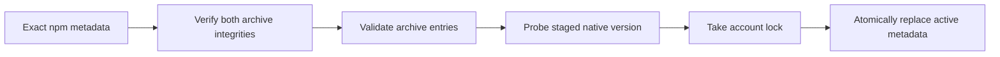
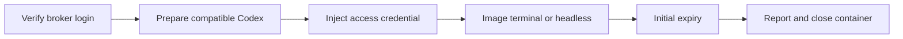
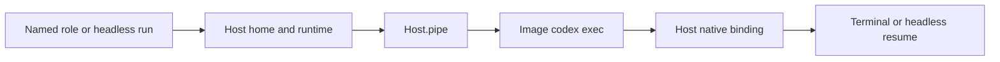
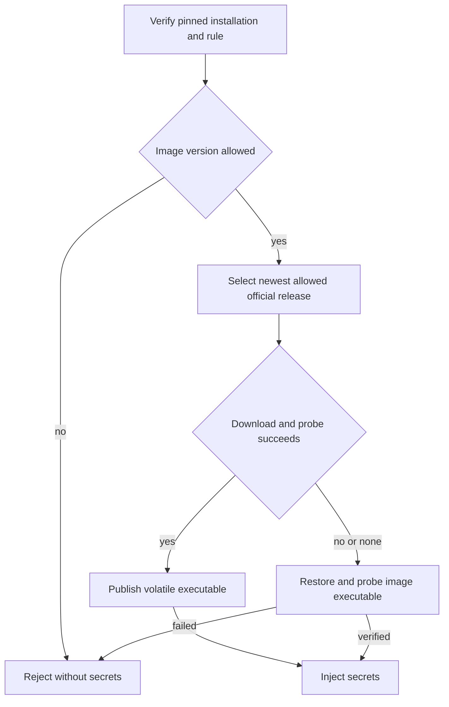
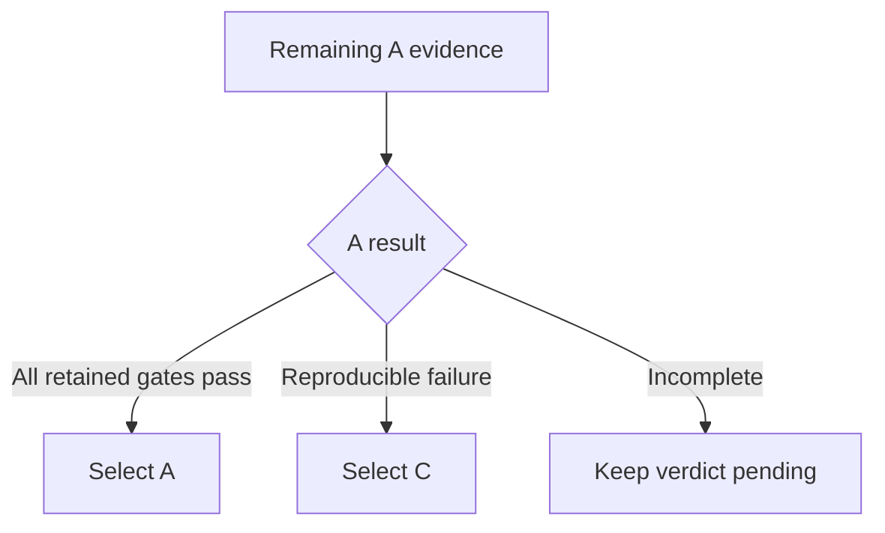

# Broker Codex operations

TASK-648 implements M4 step 2 FR-2 and FR-3 from
[Product Design/2026-10-16-2311-TASK-550-docker-host-m4.md](https://github.com/ophis/private_docs/blob/main/Product%20Design/2026-10-16-2311-TASK-550-docker-host-m4.md).
TASK-649 adds terminal container authentication and recovery; TASK-651 adds headless
execution and whitelisted native plugin skills ([Docker sessions](#docker-sessions)).
TASK-652 adds FR-9's container version policy. Authentication refresh remains separate work.

## Commands

Install or upgrade the hardened broker first with `sh <agent-pm plugin directory>/broker/install.sh`.
Replace `<version>` with an exact stable npm version, such as `0.162.1`:

| Action | Command |
|---|---|
| First pinned installation | `sudo /usr/local/libexec/agent-pm/agent-pm-broker install-codex <version>` |
| Explicit update or native-file repair | `sudo /usr/local/libexec/agent-pm/agent-pm-broker update-codex <version>` |
| Independent browser login, ordinary user | `/usr/local/libexec/agent-pm/agent-pm-broker login codex` |
| Inspect | `/usr/local/libexec/agent-pm/agent-pm-broker status` |

Administrative install/update success writes installation JSON (JavaScript Object Notation); failure exits 1 with a
diagnostic. Login is interactive text and exits 0 on success, 1 on failure/cancellation.
Malformed command arguments use the protocol usage error, exit 2. Status fields and
protocol version are defined only in [Docker broker protocol](docker-broker-protocol.md#success-fields).

## Installation trust

**Pinned installation** lives under `/usr/local/libexec/agent-pm/codex/`. It contains
root-owned immutable `releases/<id>/codex`, regular `active.json`, `install.lock` and
`auth.lock`; directories and executable are 0755, metadata and locks 0644. Ordinary
users can lock the fixed account file but cannot replace it. Old releases are retained.


Sources: `broker/internal/codex/install.go:110`, `broker/internal/codex/archive.go:15`.

Only `https://registry.npmjs.org/` is accepted, without redirects. The main package and
its exact macOS arm64 dependency require SHA-512 (Secure Hash Algorithm, 512 bit) integrity. Archive links, special
files, traversal, duplicate entries and excessive sizes are refused. Limits are 256 MiB (mebibytes) compressed, 512 MiB expanded and 4096 entries; unused
entries are streamed and discarded. The installer keeps only the native `vendor/aarch64-apple-darwin/bin/codex`, never scripts or Node.

Before execution the broker verifies root ownership, write permissions and symlink
absence for the native file and every ancestor, plus its SHA-256 (Secure Hash Algorithm, 256 bit) against protected
metadata. Native commands use an absolute path, private working directory and a fresh
environment containing only private `HOME`/`CODEX_HOME`, system `PATH` and `LANG`.
Personal npm configuration, `NODE_OPTIONS`, `npm_config_*` and Codex environment
overrides are not inherited. Failed validation/publication preserves the active
installation. Updates preserve `allowed_versions`; no untested container version is
granted by installing a host binary.

## Login trust

```mermaid
flowchart LR
    L[Take account lock] --> R[Reread keychain]
    R --> H[Private random temporary home]
    H --> B[Pinned browser login]
    B --> V[Validate subscription auth and expiry]
    V --> D[Delete temporary home]
    D --> P[Restrict partition list]
    P --> A[Restrict read and export entries]
    A --> C[Verify access and save auth]
    C --> U[Verify saved auth and release lock]
```


Sources: `broker/internal/broker/codex.go:141`, TASK-642's `broker/internal/broker/keychain.go:255`.

The entire temporary home is 0700 under `/private/tmp`; file credential storage and
ChatGPT browser login are forced. It is removed on success, child failure and normal
signal cancellation. SIGKILL or host failure cannot run cleanup. Full credentials
exist only in this directory, broker memory and login-keychain service
`agent-pm-codex`, account `auth`. Personal `~/.codex` is neither imported nor changed.
Other processes running as the same user can still read the temporary data.

A new keychain item starts with a nonsecret placeholder. TASK-642's implementation
applies the diagram ordering to the access control list (ACL), using a hidden
keychain password once when needed and the same dialog fallback. Credentials
are written in place only after verification; existing GitHub App items are unchanged.
If final access/readback verification fails, the broker restores and re-verifies an
earlier usable login; any restoration failure is reported explicitly.
Reinstalling the broker changes its ad hoc code identity: rerun `login codex` to
authorize the new broker. No `security` subprocess receives credential data.

The access-token JSON Web Token (JWT) `exp` is a local expiry source, not signature verification or
proof that the upstream still accepts the subscription. Official references:
[credential storage](https://learn.chatgpt.com/docs/auth),
[browser login](https://learn.chatgpt.com/docs/cli/reference).
Version-specific field/expiry evidence:
[AuthDotJson](https://github.com/openai/codex/blob/rust-v0.162.1/codex-rs/login/src/auth/storage.rs#L49),
[TokenData and JWT expiry parsing](https://github.com/openai/codex/blob/rust-v0.162.1/codex-rs/login/src/token_data.rs#L11).

## Acceptance boundary

Automated tests use fake transports, processes and keychain/Security adapters. Linux,
Docker and integration verification run only in GitHub CI. The pull request lists
the separate user-run macOS installation, browser-login, cancellation, trust-denial
and personal-login-isolation checks. No live result is claimed here.

## Docker sessions

After installation/login and the [Docker Host setup](docker-host.md#crew-workers),
`agent-pm-crew worker w --client codex`, Codex role runs and unattended board runs use
the same container authentication. The host needs the broker, not a personal Codex executable.

**Access-only authentication** uses the broker login's access token and account ID
(identifier). The external-token document has no refresh credential or original ID
token. The required Rust `refresh_token` string is empty; `id_token` holds the access
token and `last_refresh` retains the original nonsecret timestamp. The exact wire
fields are defined in [Docker broker protocol](docker-broker-protocol.md).

| Resource | Lifetime |
|---|---|
| `~/.agent-pm/docker-state/<name>/codex/sessions/` | Only host-bound client state; native history survives restart and close/resume |
| Container `CODEX_HOME`, at the corresponding host path | Entirely tmpfs; image-created configuration and credential-link replacements disappear on close |
| `/run/agent-pm/secrets/codex/auth.json` | Agent-owned 0400 tmpfs file, injected over Docker standard input |
| `/run/agent-pm/codex-store/` | Terminal launcher's volatile projection of only the current `(workdir, sid)` recovery record |
| `<generation>.credential.json` | Host control record containing only initial expiry; GitHub renewal does not extend it |


Source: `session/src/agent_pm/session/hosts/docker/supervisor.py:204`.

**Expiry** produces `client_auth_expired` in the terminal session event log or headless
harness log and closes that generation. Log in again with `agent-pm-broker login codex`, then resume the worker.
A recovered supervisor reads the same saved initial deadline. No run login or personal
credential fallback is attempted. Missing login, invalid pinned installation and expired
credentials fail preflight with repair instructions.
Credential refresh and cross-refresh compatibility remain later M4 work.

The authentication implementation's source evidence below does not certify the PRD's
cross-refresh version matrix. Container admission uses [Container versions](#container-versions).

### Headless and terminal recovery


Native binding comes from `thread.started`; only host-received client events update recovery state.

Headless uses `/opt/agent-pm/bin/codex exec` with the existing JSON event parser, so
replies and completion events reach Delegate reporting. The host prepares its native
resume selector directly; only the terminal's Python launcher needs a projected store.
Both modes retain the original snapshot, native ID and CODEX_HOME when resuming on the
same Host. Missing or mismatched history and symlinked history paths fail before launch.
The harness supervises headless GitHub refresh and client expiry concurrently; ending
the run cancels both tasks. A killed harness leaves cleanup to the next Docker sweep.

### Native plugins

The shared [plugin whitelist](docker-host.md#plugins) supplies both clients from the
same installed payload. Plugin staging consults neither a host Codex installation
nor personal CODEX_HOME.

| Artifact | Codex behavior |
|---|---|
| Explicit `.codex-plugin/plugin.json` | Preserved; name must match, declared skill directories must stay inside the plugin |
| Claude-only payload | Generate a native skills manifest from name, optional description/version, default `skills/` and declared extra skill directories |
| Default Claude hook/server files | Excluded from the generated adapter: `hooks/hooks.json`, `.mcp.json`, `.app.json`; commands are not migrated |
| `/opt/agent-pm/codex-plugins/inline/<name>/local/` | Image-owned, read-only native cache; skill-relative scripts and references retained |
| `CODEX_HOME/plugins/cache` | Volatile link to that image cache; generated config enables `<name>@inline` |

An explicit native manifest retains its Codex behavior, including its hook/server
configuration. Skill names are namespaced, for example
`autopilot:build`. Invalid native names/skill paths and escaping or dangling links fail
the build before Docker. The broker checks resolved links before reading metadata.

The pinned format is grounded in Codex `rust-v0.162.1`:
[cache lookup](https://github.com/openai/codex/blob/rust-v0.162.1/codex-rs/core-plugin-common/src/installed.rs#L47),
[native skill discovery](https://github.com/openai/codex/blob/rust-v0.162.1/codex-rs/core-plugins/src/loader.rs#L1045),
and [namespaced inventory](https://github.com/openai/codex/blob/rust-v0.162.1/codex-rs/app-server/tests/suite/v2/skills_list.rs#L650).

| Source evidence, rust-v0.162.1 | Established behavior |
|---|---|
| [auth/manager.rs:328-425](https://github.com/openai/codex/blob/rust-v0.162.1/codex-rs/login/src/auth/manager.rs#L328) | File-backed loader constructs `ChatgptAuthTokens` |
| [auth/manager.rs:580-588](https://github.com/openai/codex/blob/rust-v0.162.1/codex-rs/login/src/auth/manager.rs#L580) | Token reading requires `last_refresh` |
| [auth/manager.rs:1732-1761](https://github.com/openai/codex/blob/rust-v0.162.1/codex-rs/login/src/auth/manager.rs#L1732) | Access-only external-token document shape |
| [auth/manager.rs:2999-3022](https://github.com/openai/codex/blob/rust-v0.162.1/codex-rs/login/src/auth/manager.rs#L2999) | Automatic managed refresh applies to `Chatgpt` |

GitHub CI's [worker_codex.py](../.github/worker_codex.py) uses synthetic credentials with
network disabled. It queries app-server `skills/list` for the native probe skill,
its enabled state, plugin ID and path, and verifies cache ownership/non-writability.
It also checks the real Codex auth loader, agent identity, nested mounts,
atomic replacement of the auth link and history-only persistence across two containers.
It does not test model access, native conversation recovery or macOS file sharing.

## Container versions

**Compatibility rule** is the protected pinned installation's `active.json`
`allowed_versions` exact set. Only Codex container generations read it; an initial
empty set refuses Codex starts. Claude needs no pinned Codex and makes no registry
query or update. An administrator must publish
only versions backed by the M4 compatibility matrix in that root-owned metadata;
this task neither certifies versions nor changes the installed rule. Host upgrades
preserve it; matching major/minor alone grants nothing.


Source: `broker/internal/launcher/versions.go`; Codex start, restart and resume share this
preparation. Attach leaves its running generation alone.

Selection compares stable version components numerically, querying each allowed npm
release from newest downward. Only official registry metadata/artifacts are used;
both main and Linux arm64/amd64 platform archives retain the installation integrity
and extraction checks. No npm scripts, user npm configuration or workspace cache runs.

The immutable image installation stays under `/opt/agent-pm/clients/`; its public
wrapper selects the updated native file in root-owned executable tmpfs
`/opt/agent-pm/runtime/`. Programs never enter workspace/history. Failed downloads,
staging, publication or actual-version verification remove the override and require
a successful image reprobe. Registry failure or no allowed release follows the same
fallback. An incompatible image always rejects, even if an update exists.

Each Codex generation's `<generation>.result.json` retains the image digest, actual clients
and [version audit object](docker-broker-protocol.md#success-fields). Startup stderr
reports its classified update outcome. Preflight's three-second advisory lookup of
the official stable `latest` release prints the explicit pinned-upgrade command from
the command table with its version; lookup failure does not block a compatible start.
The hint neither upgrades the host nor expands the rule.

## User-run acceptance, pending

Use an authorized broker test login. Workers do not run these checks or inspect real
credentials; record versions, time, status and redacted error locations only.

| Check | Expected observation |
|---|---|
| Start two Codex crew workers, a terminal role run and an unattended Codex board role run | No login/onboarding prompt; responses reach `crew report` and completion events; no role-specific Docker manifest |
| Hide personal host Codex from PATH for these commands | Both modes and container hook trust still start using image files |
| Inspect mounts/security without dumping environment or secret files | One workspace volume; only client history bind; volatile home/secrets; user agent, CapDrop ALL, no-new-privileges; no Docker socket or privileged/host namespaces |
| Restart, then close and resume a worker | Same native identity and history; no duplicate completed event; missing history produces failure |
| Complete a headless run, reopen it as a terminal, then close and resume headless on the same Host | Same native ID, CODEX_HOME, history and workspace; replies and outcomes appear once |
| Restart the host supervisor, then query/send | Hook relay resumes, same identity; original access deadline retained |
| Let the initial access token expire | `client_auth_expired`, container removed, no login prompt or identity change; host login plus resume repairs it |
| Check state after native credential replacement and close | Host client directory contains only allowed history; no auth/token file or credential value in host state/workspace; personal login unchanged |
| Start, restart, then close/resume using an evidence-backed rule containing an image and newer registry version | Each generation runs the newest allowed version; audit and progress agree; runtime program is outside workspace/history |
| Repeat with registry unavailable, then an unavailable/corrupt allowed update | Image version restored and recorded; no secret injection precedes preparation |
| Use an image outside the rule, and separately an empty rule | Startup refuses before any client/GitHub secret; existing compatible image remains usable if only advisory lookup fails |
| Close after a successful update, then resume | Executable tmpfs disappears; next generation repeats selection; native history remains |
| Use a whitelisted skill in both modes | Namespaced skill executes from the image; its scripts/references resolve; empty whitelist loads none |
| After M4 refresh support lands: two containers and an independently logged-in host across a real refresh | Both modes continue with unchanged identity and personal login; record actual refresh count, versions and timings |

## Plan A validation report

**Verdict: pending.** TASK-647 validates M4 FR-1 against candidate `0.163.0`;
[the operations above](#docker-sessions) describe the separate `0.162.1` product
baseline. Neither grants the other's compatibility. Sources:
[TASK-647](https://linear.app/ophis-workgroup/issue/TASK-647) and the
[M4 requirements](https://github.com/ophis/private_docs/blob/main/Product%20Design/2026-10-16-2311-TASK-550-docker-host-m4.md).

Plan B was dropped by the user on 2026-10-18; no model-request relay is in scope.

The user's 2026-10-17 revision removes waiting for or crossing real access-token
expiry from this verdict. Every other evidence item remains required. Missing tests,
network failures and unavailable identities stay incomplete; they cannot select C.
The product expiry acceptance check above remains a separate milestone check.

### Verification matrix

All live observations below are user/manager reports, not worker reruns. Versions,
execution times and redacted counts are in the linked evidence. Whole-row status
stays incomplete when a subcheck succeeds.

| Item | A evidence and status | Remaining evidence |
|---|---|---|
| Authentication carrier | Incomplete: missing refresh field fails loading; empty string loads and produces headless replies ([carrier](docker-codex-evidence/2026-10-18-user-a-carrier.json)) | Minimum identity fields; terminal and headless; no refresh credential in containers |
| Multiple turns and reload | Incomplete: new-process native resume retains identity and replies OK ([resume](docker-codex-evidence/2026-10-18-user-a-resume.json), [refresh](docker-codex-evidence/2026-10-18-user-a-refresh.json)) | Same live terminal process obtains new access value; headless consecutive turns/resume; record old-value rejection/recovery if rejected |
| Refresh and concurrency | Incomplete: one real host rotation; two unchanged containers reply afterward; reinjected a-2 also replies ([refresh](docker-codex-evidence/2026-10-18-user-a-refresh.json)) | Second real refresh; two containers plus independent host before/after; account-lock contention; old-value acceptance/rejection and unchanged personal login |
| Version compatibility | Incomplete: host and two experimental containers report `0.163.0` ([carrier](docker-codex-evidence/2026-10-18-user-a-carrier.json)) | Every distinct candidate: terminal/headless, refresh, restart, close/resume; image digest and unchanged native identity |
| Volatile state | Incomplete: Linux and macOS synthetic nested-mount/restart checks pass ([CI](docker-codex-evidence/2026-10-17-mount-ci.json), [host](docker-codex-evidence/2026-10-18-user-host.json)) | Real Codex writes, history-only persistence, credential-residue scan, restart/close/resume and volatile-state removal |
| Refresh trigger and lead | Incomplete: fixed Codex `account/read` with `refreshToken: true` causes one observed rotation ([refresh](docker-codex-evidence/2026-10-18-user-a-refresh.json)) | Second rotation, refreshed-credential model use, measured refresh/write/reload durations and clock difference; no direct refresh-endpoint calls |

The existing probe actions are `status`, `pair`, `resume`, `resume-pair`, `versions`,
`inject`, `expiry` and `host-refresh` in [docker_codex_a_probe.py](../scripts/docker_codex_a_probe.py).
They are one-off evidence helpers, not product commands. From the repository root,
`python3 -I scripts/docker_codex_a_probe.py --user-run resume-pair` uses the existing
injected containers. Host credential operations require an explicit absolute root,
for example `python3 -I scripts/docker_codex_a_probe.py --user-run --live-root <isolated-root> host-refresh`.
Only the user reads/injects/refreshes host credentials; the manager may use credentials
already in place without printing or copying them. Workers do neither.
`expiry` reads claims only; there is no real-expiry experiment scheduled. Source inventory is reproducible with
`python3 -I scripts/docker_codex_probe.py inventory`; the synthetic mount check is
`bash scripts/docker-codex-mount-probe.sh`, run on Linux only by GitHub CI and on
macOS by the authorized host operator.

### Observed results

| Evidence | Observation | Limit |
|---|---|---|
| [Host baseline](docker-codex-evidence/2026-10-18-user-host.json), 2026-10-18 | Device-code disabled; isolated browser login succeeded. Headless baseline completed once, 01:27:36–01:27:40 UTC, 4 s. Docker 29.8.2 synthetic mount/restart passed twice | Initial standalone version output and mount timestamp were not captured; later host runtime output confirms `0.163.0` |
| [Carrier](docker-codex-evidence/2026-10-18-user-a-carrier.json), 01:48–01:49 UTC | Missing refresh field: `schema_missing_refresh_token`; empty refresh: both loaders succeed. Concurrent execs each exit0, complete one turn and reply OK | Strict helpers remain incomplete; the original rejected event category was not captured |
| [Expiry claims and resume](docker-codex-evidence/2026-10-18-user-a-resume.json), 02:06 UTC | Claimed lifetime 864000 s, original `exp` 2026-10-28T01:27:14Z; both native resumes retain identity, exit0, complete one turn and end OK | Signature unverified; claims do not establish actual upstream expiry. One unclassified error item per run keeps strict status incomplete |
| [Notice](docker-codex-evidence/2026-10-18-manager-a-notice.json), 02:22 UTC | Same native identity, exit0, final OK; one `unknown` error item | Raw message discarded; earlier categories cannot be reconstructed |
| [Categorized notice](docker-codex-evidence/2026-10-18-manager-a-code-mode.json), 03:27 UTC | Same native identity, exit0, final OK; one `code_mode_unavailable` item | Category is diagnostic only; helper exit1 and incomplete remain |
| [Real refresh](docker-codex-evidence/2026-10-18-user-a-refresh.json), 03:49–03:58 UTC | One proactive host request rotates access and refresh values, retains account, advances `last_refresh` and `exp` to 2026-10-28T03:57:02Z. Unchanged containers resume before/after; a-2 resumes again after reinjection. Each native run exits0, retains identity, completes one turn and ends OK | Helper exits are 1/0/1/0/1 in execution order. Every resume has only `code_mode_unavailable`, so strict status stays incomplete. No live-process reload, old-value invalidation or refresh duration was measured |

The inventory's `live_refresh_count=0` is a source-only constant. The observed live
rotation count is now **1**. An unchanged old carrier remaining usable after rotation
records acceptance; it does not prove invalidation or recovery from rejection.

### Pinned source evidence

Read official [authentication](https://learn.chatgpt.com/docs/auth/ci-cd-auth) and
[app-server documentation](https://learn.chatgpt.com/docs/app-server), then source at
`rust-v0.163.0`, commit `83086188ae0614bd882818ff1aa23f3194962012`.
Source behavior does not replace live observations.

| Source | Established behavior |
|---|---|
| [token_data.rs:11](https://github.com/openai/codex/blob/83086188ae0614bd882818ff1aa23f3194962012/codex-rs/login/src/token_data.rs#L11), [storage.rs:192](https://github.com/openai/codex/blob/83086188ae0614bd882818ff1aa23f3194962012/codex-rs/login/src/auth/storage.rs#L192) | File loading deserializes required ID/access/refresh strings; account ID is optional. Missing refresh and empty refresh are distinct carriers |
| [manager.rs:328](https://github.com/openai/codex/blob/83086188ae0614bd882818ff1aa23f3194962012/codex-rs/login/src/auth/manager.rs#L328), [manager.rs:1733](https://github.com/openai/codex/blob/83086188ae0614bd882818ff1aa23f3194962012/codex-rs/login/src/auth/manager.rs#L1733), [auth.rs:14](https://github.com/openai/codex/blob/83086188ae0614bd882818ff1aa23f3194962012/codex-rs/protocol/src/auth.rs#L14) | File loading accepts `chatgptAuthTokens`; the external-access constructor uses access-token claims, empty refresh and account ID. The probe's `external-access` carrier excludes the original ID token; its live terminal/headless behavior is pending |
| [manager.rs:2180](https://github.com/openai/codex/blob/83086188ae0614bd882818ff1aa23f3194962012/codex-rs/login/src/auth/manager.rs#L2180), [manager.rs:2391](https://github.com/openai/codex/blob/83086188ae0614bd882818ff1aa23f3194962012/codex-rs/login/src/auth/manager.rs#L2391), [manager.rs:2735](https://github.com/openai/codex/blob/83086188ae0614bd882818ff1aa23f3194962012/codex-rs/login/src/auth/manager.rs#L2735) | Loading that file mode does not install an external-auth provider. The provider-triggered reload branch therefore cannot establish file-based live reload |
| [storage.rs:214](https://github.com/openai/codex/blob/83086188ae0614bd882818ff1aa23f3194962012/codex-rs/login/src/auth/storage.rs#L214) | Native save truncates/writes/flushes the file; synthetic atomic rename does not exercise this save path |
| [manager.rs:1850](https://github.com/openai/codex/blob/83086188ae0614bd882818ff1aa23f3194962012/codex-rs/login/src/auth/manager.rs#L1850), [manager.rs:2040](https://github.com/openai/codex/blob/83086188ae0614bd882818ff1aa23f3194962012/codex-rs/login/src/auth/manager.rs#L2040) | Authentication is cached; external file changes require explicit reload. Unauthorized recovery reloads matching-account state before trying managed refresh |
| [manager.rs:3001](https://github.com/openai/codex/blob/83086188ae0614bd882818ff1aa23f3194962012/codex-rs/login/src/auth/manager.rs#L3001) | Proactive refresh uses access `exp` with a 300 s window, falling back to the 8-day `last_refresh` threshold |
| [account_processor.rs:1103](https://github.com/openai/codex/blob/83086188ae0614bd882818ff1aa23f3194962012/codex-rs/app-server/src/request_processors/account_processor.rs#L1103), [manager.rs:2845](https://github.com/openai/codex/blob/83086188ae0614bd882818ff1aa23f3194962012/codex-rs/login/src/auth/manager.rs#L2845), [manager.rs:3089](https://github.com/openai/codex/blob/83086188ae0614bd882818ff1aa23f3194962012/codex-rs/login/src/auth/manager.rs#L3089) | Requested managed refresh locks and rereads state, then refreshes/persists/reloads when unchanged. Successful account-read response alone does not prove rotation |
| [JSON event processor:409](https://github.com/openai/codex/blob/83086188ae0614bd882818ff1aa23f3194962012/codex-rs/exec/src/event_processor_with_jsonl_output.rs#L409) | Warning/config-warning notifications become `ErrorItem` while execution remains running |
| [tools/mod.rs:63](https://github.com/openai/codex/blob/83086188ae0614bd882818ff1aa23f3194962012/codex-rs/core/src/tools/mod.rs#L63), [code_mode/mod.rs:110](https://github.com/openai/codex/blob/83086188ae0614bd882818ff1aa23f3194962012/codex-rs/core/src/tools/code_mode/mod.rs#L110), [turn_context.rs:1409](https://github.com/openai/codex/blob/83086188ae0614bd882818ff1aa23f3194962012/codex-rs/core/src/session/turn_context.rs#L1409) | Unavailable requested Code Mode emits a warning; effective mode determines direct-tool fallback versus fail-closed behavior |

**Code Mode disposition:** the category does not identify which branch occurred.
Tool-free OK replies do not establish tool availability. It is not automatically a
benign release warning; classification never changes a strict result to pass. Only
fixed category IDs/counts leave classifier memory; unknown stays unknown.

### Compatibility and remaining work

The [inventory](docker-codex-evidence/2026-10-18-manager-a-code-mode.json) captured on
2026-10-18 identifies fixed candidate, same-minor latest and latest stable as `0.163.0`,
published 2026-10-15T21:37:11.083Z. They are one distinct artifact, not three tests.
The experimental image digest was not captured. No candidate has completed the
terminal/headless/refresh/recovery matrix, so the machine-readable rule is:

```json
{
  "verdict_gate_revision": "user-2026-10-18-a-only-no-real-expiry",
  "real_access_expiry_crossing_required": false,
  "fixed_codex_version": "0.163.0",
  "container_version_rule": {"kind": "exact", "versions": []},
  "observed_live_refresh_count": 1,
  "measured_refresh_lead_seconds": null,
  "scheduler_floor_seconds": 600,
  "selected_scheme": null
}
```

The source's 300 s window is not a measured refresh lead. The eventual scheduler uses
the greater of the measured lead and the 600 s M3 floor. Same-minor releases are
candidates only; an unproved range narrows to exact passing versions. A failing latest
version does not disqualify a separately passing version.


Remaining evidence follows the matrix; none waits for the October 28 expiry.

TASK-643 `Host.pipe` and TASK-651 headless integration are now in the merged baseline,
as described above. Their final live acceptance remains pending, rather than blocked
on an unmerged implementation. Final M3 manifest and hook-protocol behavior still needs explicit
verification against TASK-549; no protocol result is inferred from the plain
`docker exec ... codex exec` experiments.
