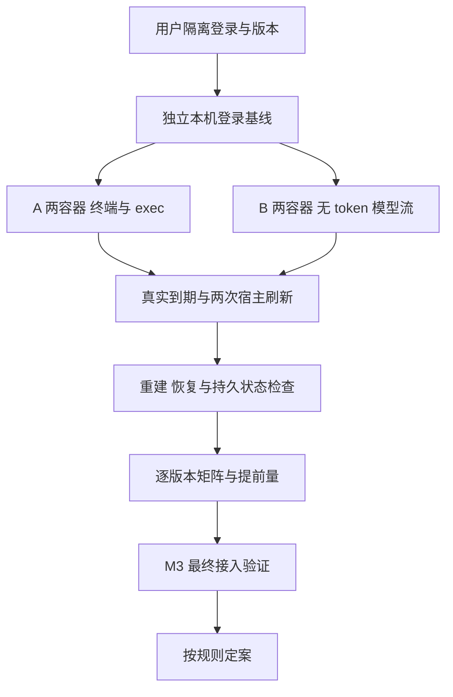

# Docker Codex：TASK-647 验证记录

## 结论

**未完成**。A、B 均未经过用户订阅身份实测，不能定案，也不能选择 C。继续拒绝 Docker Codex；本次不改产品代码。本文是 FR-1 的进行中记录，不是验收通过记录。

依据：[TASK-647](https://linear.app/ophis-workgroup/issue/TASK-647)、[M4 PRD（产品需求文档）](https://github.com/ophis/private_docs/blob/main/Product%20Design/2026-10-16-2311-TASK-550-docker-host-m4.md)。用户 2026-10-17 的提前开跑要求取代其中的 M3 全合并开工门槛；M3 相关项见末节。

| 方案 | 状态 | 尚缺的决定性证据 |
|---|---|---|
| A 集中刷新 | 未完成 | 最小载体、活进程取得新 token、真实到期后续用及共同门槛 |
| B relay（转发程序） | 未完成 | 无 token 的实际模型流、刷新续用、受限边界及共同门槛 |
| C 本机回退 | 不满足选择条件 | A、B 各自可复现失败，或共同宿主刷新失败证据 |

以下区分**源码证据**、**合成检查**、**订阅观察**。前两者不能代替第三者。缺身份、断网、待依赖均记未完成；单次模型回复或仅认证头成功不能通过共同门槛。

## 版本与兼容规则

调查日期为 2026-10-17 America/New_York，元数据采集时间见 [原始记录](docker-codex-evidence/2026-10-17-source.json)。命令：在仓库根运行 `python3 -I scripts/docker_codex_probe.py inventory`。只访问 npm 公共 registry，不读取个人配置或登录。

| 角色 | 版本 | 终端／headless（无界面运行）／真实刷新／resume（恢复） |
|---|---|---|
| 固定宿主候选 | 0.163.0 下载目标；独立版本输出未采集 | 宿主 headless 基线通过；其余未完成，见用户观察 |
| 同 minor（次版本）最新稳定版 | 0.163.0 | 与上一行同一产物，全部未完成 |
| 当日最新稳定版 | 0.163.0 | 与上一行同一产物，全部未完成 |
| 用户镜像实际版本、digest（内容摘要） | 未采集 | 全部未完成 |

镜像定义在 [broker/worker/Dockerfile:21](../broker/worker/Dockerfile#L21) 使用未固定版本的安装命令，因此不能从定义推断用户镜像的实际 Codex 版本。

**兼容规则**如下，是调查结果的数据形状，不是新增产品配置；没有任何获准版本。各候选必须分别覆盖终端、headless、跨刷新与恢复。未验证版本不因同 minor 自动获准；当日最新版失败也不取消其他已证明通过的版本。

```json
{
  "fixed_codex_version": "0.163.0",
  "container_version_rule": {"kind": "exact", "versions": []},
  "measured_refresh_lead_seconds": null,
  "scheduler_floor_seconds": 600,
  "selected_scheme": null
}
```

**提前量**尚无实测值。源码中的 300 秒是 Codex 自身的主动刷新窗口，不是本方案测出的提前量。后续记录两次真实刷新耗时、写入／重载延迟、容器及宿主时钟差和旧值失效时间；调度取实测提前量与 M3 的 600 秒中的较大值。有效期从真实 access token（访问令牌）的 `exp` 获取并与上游接受情况核对；解码不等于验证签名。不得改日期制造刷新。

## 源码证据

固定标签 `rust-v0.163.0`，提交 `83086188ae0614bd882818ff1aa23f3194962012`。以下均读取对应文件；它们描述该版本代码，不能证明生产上游行为。

| 编号 | 已核实的行为 | 文件与行 |
|---|---|---|
| S1 | `TokenData` 要求 `id_token`、`access_token`、`refresh_token`；`account_id` 是可选字段。删除 refresh 字段与设为空字符串不是同一个实验。后者仅满足字符串类型，不能据此认定认证成功。 | [token_data.rs:11](https://github.com/openai/codex/blob/83086188ae0614bd882818ff1aa23f3194962012/codex-rs/login/src/token_data.rs#L11) |
| S2 | `AuthDotJson` 包含可选 `tokens`、`last_refresh`、`auth_mode`。文件加载直接反序列化。 | [storage.rs:49](https://github.com/openai/codex/blob/83086188ae0614bd882818ff1aa23f3194962012/codex-rs/login/src/auth/storage.rs#L49)、[storage.rs:192](https://github.com/openai/codex/blob/83086188ae0614bd882818ff1aa23f3194962012/codex-rs/login/src/auth/storage.rs#L192) |
| S3 | 保存路径用 `OpenOptions.truncate(true)` 写文件，创建模式 0600；此路径没有原子重命名。不能把合成 rename 检查写成实际 Codex 保存测试。 | [storage.rs:214](https://github.com/openai/codex/blob/83086188ae0614bd882818ff1aa23f3194962012/codex-rs/login/src/auth/storage.rs#L214) |
| S4 | 认证有内存缓存。未授权恢复先按账号匹配重载，再尝试自身刷新；仅替换磁盘文件不证明活进程已取新值。 | [manager.rs:1850](https://github.com/openai/codex/blob/83086188ae0614bd882818ff1aa23f3194962012/codex-rs/login/src/auth/manager.rs#L1850)、[manager.rs:2040](https://github.com/openai/codex/blob/83086188ae0614bd882818ff1aa23f3194962012/codex-rs/login/src/auth/manager.rs#L2040) |
| S5 | 主动刷新优先看 access token 的 `exp`，窗口为 5 分钟；无法取得到期时间时才看 `last_refresh` 的 8 天阈值。 | [manager.rs:203](https://github.com/openai/codex/blob/83086188ae0614bd882818ff1aa23f3194962012/codex-rs/login/src/auth/manager.rs#L203)、[manager.rs:3001](https://github.com/openai/codex/blob/83086188ae0614bd882818ff1aa23f3194962012/codex-rs/login/src/auth/manager.rs#L3001) |
| S6 | app-server 的请求刷新分支调用 `AuthManager.refresh_token()`；它先在锁内重读，相同凭据才向认证方刷新。刷新成功后保存并重载。 | [account_processor.rs:1103](https://github.com/openai/codex/blob/83086188ae0614bd882818ff1aa23f3194962012/codex-rs/app-server/src/request_processors/account_processor.rs#L1103)、[manager.rs:2845](https://github.com/openai/codex/blob/83086188ae0614bd882818ff1aa23f3194962012/codex-rs/login/src/auth/manager.rs#L2845)、[manager.rs:3089](https://github.com/openai/codex/blob/83086188ae0614bd882818ff1aa23f3194962012/codex-rs/login/src/auth/manager.rs#L3089) |
| S7 | provider `auth.command` 获取 bearer token 并缓存，可按间隔或认证错误再执行；解析结果为 API（应用程序编程接口）key 型认证，不自动构成 ChatGPT 身份。不能与 `env_key`、`experimental_bearer_token` 或 `requires_openai_auth` 同设。 | [external_bearer.rs:33](https://github.com/openai/codex/blob/83086188ae0614bd882818ff1aa23f3194962012/codex-rs/login/src/auth/external_bearer.rs#L33)、[lib.rs:368](https://github.com/openai/codex/blob/83086188ae0614bd882818ff1aa23f3194962012/codex-rs/model-provider-info/src/lib.rs#L368) |

官方 [CI/CD（持续集成与持续交付）认证说明](https://learn.chatgpt.com/docs/auth/ci-cd-auth) 要求同一托管登录串行使用，让 Codex 刷新并保留回写结果，不自行调用刷新端点。其中 8 天描述不足以覆盖 S5 的优先到期逻辑，应采用固定版本源码及实际到期记录。

[app-server 文档](https://learn.chatgpt.com/docs/app-server) 的 `chatgptAuthTokens` 是宿主供 token、响应刷新请求的实验性模式。它不是终端或 `codex exec` 的外部 token 接口证明。`account/read` 的 `refreshToken: true` 是 S6 的宿主刷新候选；成功响应本身不证明 token 已换新或可用。

## 验证矩阵

每行的订阅观察均为未完成，版本为 0.163.0 候选，日期为上文调查日期；没有执行过的命令不记录退出码。用户证据补入本目录的脱敏记录后，才逐项改为通过或失败。

| 验证项 | A 状态／证据 | B 状态／证据 | 待执行及判据 |
|---|---|---|---|
| 认证载体 | 未完成；S1、S2、S7 | 未完成；下节协议候选 | 在独立测试登录上比较删除字段、空 refresh 字符串、必要身份字段及 S7；两种现有 client 都要实际回复。容器从未获得 refresh token（刷新令牌）；B 无 ChatGPT token。 |
| 多轮与到期 | 未完成；S4、S5 | 未完成 | 同一终端活进程到期前后各两轮，记录实际 `exp`、服务器状态及继续／报错／退出／等登录；headless 另测连续任务与原生恢复，不能把多个 exec 进程称为一个活进程。 |
| 刷新与并发 | 未完成；S6 | 未完成 | 两容器和独立本机登录，第一次真实宿主刷新前后各一轮，下一次仍成功；并发请求共享账号锁。分别记录旧 access token 被接受还是拒绝、活进程使用新值的证据，不推定立即失效。 |
| B 协议 | 不适用 | 未完成；下节 | 多轮实际流、流中断、取消、账号头与受限路由；禁止只凭一次转发定案。 |
| 版本兼容 | 未完成；版本表 | 未完成；版本表 | 每个不同候选产物都跑终端、headless、跨刷新、restart（重启）、close 后 resume；记录原生会话标识相同。 |
| 易失状态 | 未完成；合成检查命令见下节 | 未完成；同左 | 用户 macOS Docker Desktop、真实 Codex 保存及重建后的宿主检查尚缺；只持久化 `sessions/`，工作区也检查凭据残留，close 后易失目录消失。 |
| 刷新触发 | 未完成；S5、S6 | 未完成；共用宿主路径 | 通过固定 Codex 自身路径刷新，两次都验证新 `exp`、新凭据可用；记录真实次数和耗时。不得直接请求 OAuth（开放授权）刷新端点。 |

### B 的候选协议

以下是需实测的最小起点，不是已通过的允许清单。正式 broker origin 必须固定为 HTTPS（加密超文本传输协议）；用户测试身份若要求其他地域 origin，应停止并重新调查，不能放开任意目的地址。

| 内容 | 源码观察／待验证 |
|---|---|
| origin 与 base | 默认 ChatGPT base 为 `https://chatgpt.com/backend-api/codex`；自定义 provider 可显式覆盖 base。[lib.rs:80](https://github.com/openai/codex/blob/83086188ae0614bd882818ff1aa23f3194962012/codex-rs/model-provider-info/src/lib.rs#L80)、[lib.rs:428](https://github.com/openai/codex/blob/83086188ae0614bd882818ff1aa23f3194962012/codex-rs/model-provider-info/src/lib.rs#L428) |
| 方法与相对路径 | 模型流候选 `POST /responses`；模型列表候选 `GET /models`。实际启用的压缩及其他请求必须补全观察，当前获准路由为空。[responses.rs:138](https://github.com/openai/codex/blob/83086188ae0614bd882818ff1aa23f3194962012/codex-rs/codex-api/src/endpoint/responses.rs#L138)、[models.rs:43](https://github.com/openai/codex/blob/83086188ae0614bd882818ff1aa23f3194962012/codex-rs/codex-api/src/endpoint/models.rs#L43) |
| 认证与账号 | bearer provider 添加 `Authorization: Bearer …`，有账号时加 `ChatGPT-Account-ID`，FedRAMP 账号另有路由头；值仅在宿主，转发端不信任来路身份头。[bearer_auth_provider.rs:32](https://github.com/openai/codex/blob/83086188ae0614bd882818ff1aa23f3194962012/codex-rs/model-provider/src/bearer_auth_provider.rs#L32) |
| 配置候选 | `model_provider`、`model_providers.<id>.base_url`、`wire_api="responses"`、`requires_openai_auth=false`；容器指向 `http://127.0.0.1:18765`，不传 `env_key`。这些组合的订阅与身份行为仍需验证。[配置文档](https://learn.chatgpt.com/docs/config-file/config-reference) |
| 传输 | 内置 OpenAI provider 默认支持 WebSocket；连接路径为 `/responses`。优先验证显式 `supports_websockets=false` 的 HTTP（超文本传输协议）／SSE（服务器发送事件）流；若仍使用 WebSocket，现有候选传输不算通过。[lib.rs:560](https://github.com/openai/codex/blob/83086188ae0614bd882818ff1aa23f3194962012/codex-rs/model-provider-info/src/lib.rs#L560)、[connector.rs:32](https://github.com/openai/codex/blob/83086188ae0614bd882818ff1aa23f3194962012/codex-rs/codex-api/src/endpoint/responses_websocket/connector.rs#L32) |

FR-10 独立边界尚未运行：绝对地址／路径穿越／非允许路由／伪造 Host 拒绝且不出网，正文上限 10 MiB（兆二进制字节），来路 Cookie／认证／账号头丢弃，302 不跟随，401 最多一次安全重放且未输出响应，部分流报错。session（会话）、generation（启动实例）、hook（回调）、close 边界依赖 M3，见末节。

### 易失挂载合成检查

Docker [tmpfs（内存文件系统）文档](https://docs.docker.com/engine/storage/tmpfs/) 和 [bind mount（目录挂载）文档](https://docs.docker.com/engine/storage/bind-mounts/) 没有给出此嵌套布局的完整保证，因此准备一次性合成实验。

命令：`bash scripts/docker-codex-mount-probe.sh`，由 `.github/workflows/codex-probe.yml` 的 `Codex synthetic mounts` 运行。[脚本:24](../scripts/docker-codex-mount-probe.sh#L24) 使用无身份、无网络容器、非 root、只读根目录、`CapDrop=ALL`、`no-new-privileges`；整个 `/probe/home` 为 tmpfs，仅其 `sessions/` bind。写入合成 auth、原子 rename、写历史、重启后确认 auth 消失，再删除容器。仅输出版本、digest 和状态；底层错误不输出原文。

Linux 合成检查通过：Docker 28.0.4，2026-10-18 01:03:40 UTC（协调世界时），两次启动检查成功。[脱敏记录](docker-codex-evidence/2026-10-17-mount-ci.json) 包含测试提交、命令、镜像 digest 和 [GitHub 运行证据](https://github.com/ophis/agent-pm/actions/runs/39085070423/job/117549791580)。macOS 用户观察见下节；两者均不证明 S3 的实际保存、凭据无残留、原生历史可恢复或真实账号续用。

## 用户观察

[2026-10-18 宿主记录](docker-codex-evidence/2026-10-18-user-host.json) 仅记录用户回传，worker 未复跑。

| 项目 | 观察 | 未采集／未验证 |
|---|---|---|
| 隔离登录 | 账号禁用 device-code；同一隔离 `CODEX_HOME` 改用浏览器登录成功 | 登录时间未采集 |
| 宿主 headless 基线 | `host_baseline_pass`，1 次；`2026-10-18T01:27:36Z` 至 `01:27:40Z`，4 秒 | 未观察真实刷新；不表示 A 或 B 的容器认证成功 |
| 原生版本 | 下载目标及基线固定标签均为 `0.163.0` | `codex --version` 原始输出未采集；基线标签是前轮命令的常量，不能当成运行时版本探测 |
| macOS 合成挂载 | Docker 29.8.2，`synthetic_mount_restart_only` 通过，2 次；Alpine digest 与 Linux 记录相同 | 挂载执行时间未采集；未运行真实 Codex 凭据保存检查 |

## 用户实测交接

**身份边界**：以下命令仅用户在 macOS Apple silicon 宿主执行。worker 不运行 Docker、不读取真实 `auth.json`、不调用 keychain（钥匙串）或 Security API。所有测试登录在新建 0700 目录；不复制或挂载个人 `~/.codex`，不写用户配置。登录输出只在用户终端显示，不记录或粘贴授权码。回传仅版本、时间、状态、次数及脱敏错误。

先在现有工作树准备独立原生文件。[下载器:77](../scripts/docker_codex_probe.py#L77) 只读公共 registry、核对 SHA-512（安全散列算法 512 位）integrity、只取精确平台的普通文件、不执行包脚本，目标存在则失败。逐条执行，任一步失败即停，目录已存在时不复用：

```sh
mkdir -m 700 /Users/francis/.agent-pm/work/TASK-647/agent/tmp/codex-live-0.163.0
mkdir -m 700 /Users/francis/.agent-pm/work/TASK-647/agent/tmp/codex-live-0.163.0/home
mkdir -m 700 /Users/francis/.agent-pm/work/TASK-647/agent/tmp/codex-live-0.163.0/broker
python3 -I /Users/francis/.agent-pm/work/TASK-647/agent/src/ophis/agent-pm-TASK-647/scripts/docker_codex_probe.py native --platform darwin-arm64 --destination /Users/francis/.agent-pm/work/TASK-647/agent/tmp/codex-live-0.163.0/codex
env -i HOME=/Users/francis/.agent-pm/work/TASK-647/agent/tmp/codex-live-0.163.0/home CODEX_HOME=/Users/francis/.agent-pm/work/TASK-647/agent/tmp/codex-live-0.163.0/broker PATH=/usr/bin:/bin /Users/francis/.agent-pm/work/TASK-647/agent/tmp/codex-live-0.163.0/codex --version
env -i HOME=/Users/francis/.agent-pm/work/TASK-647/agent/tmp/codex-live-0.163.0/home CODEX_HOME=/Users/francis/.agent-pm/work/TASK-647/agent/tmp/codex-live-0.163.0/broker PATH=/usr/bin:/bin TERM=xterm-256color /Users/francis/.agent-pm/work/TASK-647/agent/tmp/codex-live-0.163.0/codex -c 'cli_auth_credentials_store="file"' login --device-auth
```

该目录名 `broker` 仅表示实验身份，没有实现 broker 登录。设备登录不可用时，保持同一隔离环境，最后命令去掉 `--device-auth` 改用浏览器登录。不要改用个人缓存。

用户接着执行一次隔离宿主 headless 基线，记录开始／结束时间及状态，丢弃原始回复与错误：

```sh
date -u '+%Y-%m-%dT%H:%M:%SZ'
if env -i HOME=/Users/francis/.agent-pm/work/TASK-647/agent/tmp/codex-live-0.163.0/home CODEX_HOME=/Users/francis/.agent-pm/work/TASK-647/agent/tmp/codex-live-0.163.0/broker PATH=/usr/bin:/bin /Users/francis/.agent-pm/work/TASK-647/agent/tmp/codex-live-0.163.0/codex -C /Users/francis/.agent-pm/work/TASK-647/agent/tmp/codex-live-0.163.0/home -c 'cli_auth_credentials_store="file"' exec --skip-git-repo-check --sandbox read-only --json 'Reply exactly OK. Do not use tools.' >/dev/null 2>&1; then
  printf '%s\n' '{"version":"0.163.0","status":"host_baseline_pass","count":1}'
else
  printf '%s\n' '{"version":"0.163.0","status":"host_baseline_failed","error":"redacted"}'
fi
date -u '+%Y-%m-%dT%H:%M:%SZ'
env AGENT_PM_CODEX_USER_PROBE=1 bash /Users/francis/.agent-pm/work/TASK-647/agent/src/ophis/agent-pm-TASK-647/scripts/docker-codex-mount-probe.sh
```

首轮命令已收到上述用户观察，保留命令供追溯，不重复登录或重建该目录。继续下一组；尚未执行的命令不算验证完成。

### 第二组：A 载体与两个容器

本组只验证载体加载和两个容器的初次 headless 回复，无须 TASK-643。保留真实 `id_token`、`access_token`、`account_id` 及原有 `last_refresh`；比较删除 `refresh_token` 字段与空字符串。没有修改宿主登录文件，也不改变凭据日期。最少身份字段、provider command、终端活进程、真实到期与刷新、原生恢复仍未完成。

全部命令仍由用户逐条执行。除明确列出的“省略字段”加载失败外，任一步非零即停，回传脱敏状态；不更改沙箱或容器隔离标志。构建目录和容器名必须是新的，已存在时不复用。

准备无凭据镜像，构建上下文只含公开 Linux arm64 原生文件。使用独立实验镜像，不代表产品 worker 镜像版本已验证：

```sh
mkdir -m 700 /Users/francis/.agent-pm/work/TASK-647/agent/tmp/codex-a-0.163.0
mkdir -m 700 /Users/francis/.agent-pm/work/TASK-647/agent/tmp/codex-a-0.163.0/image
python3 -I /Users/francis/.agent-pm/work/TASK-647/agent/src/ophis/agent-pm-TASK-647/scripts/docker_codex_probe.py native --platform linux-arm64 --destination /Users/francis/.agent-pm/work/TASK-647/agent/tmp/codex-a-0.163.0/image/codex
docker build --platform linux/arm64 --network=none --file /Users/francis/.agent-pm/work/TASK-647/agent/src/ophis/agent-pm-TASK-647/scripts/docker-codex-probe.Dockerfile --tag task647-codex-probe:0.163.0 /Users/francis/.agent-pm/work/TASK-647/agent/tmp/codex-a-0.163.0/image
docker run --detach --name task647-codex-a-1 --platform linux/arm64 --read-only --cap-drop ALL --security-opt no-new-privileges --tmpfs /codex:rw,noexec,nosuid,nodev,size=64m,mode=0700,uid=10001,gid=10001 --tmpfs /work:rw,noexec,nosuid,nodev,size=64m,mode=0700,uid=10001,gid=10001 --tmpfs /tmp:rw,nosuid,nodev,size=64m,mode=1777 task647-codex-probe:0.163.0
docker run --detach --name task647-codex-a-2 --platform linux/arm64 --read-only --cap-drop ALL --security-opt no-new-privileges --tmpfs /codex:rw,noexec,nosuid,nodev,size=64m,mode=0700,uid=10001,gid=10001 --tmpfs /work:rw,noexec,nosuid,nodev,size=64m,mode=0700,uid=10001,gid=10001 --tmpfs /tmp:rw,nosuid,nodev,size=64m,mode=1777 task647-codex-probe:0.163.0
env -i HOME=/Users/francis/.agent-pm/work/TASK-647/agent/tmp/codex-live-0.163.0/home CODEX_HOME=/Users/francis/.agent-pm/work/TASK-647/agent/tmp/codex-live-0.163.0/broker PATH=/usr/bin:/bin /Users/francis/.agent-pm/work/TASK-647/agent/tmp/codex-live-0.163.0/codex --version
python3 -I /Users/francis/.agent-pm/work/TASK-647/agent/src/ophis/agent-pm-TASK-647/scripts/docker_codex_a_probe.py --user-run versions
```

两容器不挂任何宿主目录，不发布端口；`CODEX_HOME=/codex`、工作区及临时目录均为 tmpfs，用户为 `agent`。版本命令须分别采集宿主输出及两容器的实际版本；版本不匹配时脚本停止，不注入凭据。

**载体探针**只读取前轮固定隔离路径 `…/codex-live-0.163.0/broker/auth.json`，拒绝链接和非私有权限。它按允许字段重建载体、检查原 refresh 值未混入，再通过 `docker exec -i` 的标准输入写入容器 tmpfs，0400；原始内容不打印、不在宿主生成载体文件。

```sh
python3 -I /Users/francis/.agent-pm/work/TASK-647/agent/src/ophis/agent-pm-TASK-647/scripts/docker_codex_a_probe.py --user-run inject task647-codex-a-1 missing-refresh
python3 -I /Users/francis/.agent-pm/work/TASK-647/agent/src/ophis/agent-pm-TASK-647/scripts/docker_codex_a_probe.py --user-run status task647-codex-a-1
```

此处只做 `codex login status`，不登录。若返回非零且 `error="schema_missing_refresh_token"`，记录为该载体的加载拒绝后继续；其他非零停止。不能据此判 A 失败，空值候选尚未验证。

```sh
python3 -I /Users/francis/.agent-pm/work/TASK-647/agent/src/ophis/agent-pm-TASK-647/scripts/docker_codex_a_probe.py --user-run inject task647-codex-a-2 empty-refresh
python3 -I /Users/francis/.agent-pm/work/TASK-647/agent/src/ophis/agent-pm-TASK-647/scripts/docker_codex_a_probe.py --user-run status task647-codex-a-2
python3 -I /Users/francis/.agent-pm/work/TASK-647/agent/src/ophis/agent-pm-TASK-647/scripts/docker_codex_a_probe.py --user-run inject task647-codex-a-1 empty-refresh
python3 -I /Users/francis/.agent-pm/work/TASK-647/agent/src/ophis/agent-pm-TASK-647/scripts/docker_codex_a_probe.py --user-run status task647-codex-a-1
python3 -I /Users/francis/.agent-pm/work/TASK-647/agent/src/ophis/agent-pm-TASK-647/scripts/docker_codex_a_probe.py --user-run pair
```

[`pair`:193](../scripts/docker_codex_a_probe.py#L193) 并发执行下面两个普通命令，捕获并丢弃原始标准输出／错误，只回传实际版本、时间、退出状态与完成次数。成功要求两次执行时间重叠，且各自退出 0、收到 `turn.completed` 及末条回复 `OK`，没有失败或工具事件；事件形状依据固定源码 [exec_events.rs:10](https://github.com/openai/codex/blob/83086188ae0614bd882818ff1aa23f3194962012/codex-rs/exec/src/exec_events.rs#L10)。下面仅展示完整子命令，不要绕过脚本直接运行，以免回传原始输出：

```sh
docker exec task647-codex-a-1 codex -c 'cli_auth_credentials_store="file"' exec --skip-git-repo-check --sandbox read-only --json 'Reply exactly OK. Do not use tools.'
docker exec task647-codex-a-2 codex -c 'cli_auth_credentials_store="file"' exec --skip-git-repo-check --sandbox read-only --json 'Reply exactly OK. Do not use tools.'
```

本组**回传**：宿主版本输出、载体探针的全部脱敏 JSON（JavaScript 对象表示法）记录及每步非零状态。保留两容器等待下一组，不把两次新 exec 称为同一活进程多轮。遇到 `timeout_recreate_containers` 或需要暂停时，仅清理本组新建的容器，并回传已清理状态：

```sh
docker rm -f task647-codex-a-1 task647-codex-a-2
```

停在这里等待用户结果，不先启动下一组刷新实验。

### 后续验证

完整订阅流程保留以下待办，不能据初次回复跳过：



箭头表示证据依赖；本图不表示任何节点已通过。

| 待补用户命令组 | 必须记录的观察 |
|---|---|
| A 剩余载体与多轮 | 第二组的字段删除／空值和双容器命令已备，结果未完成；后续补最少身份字段、provider command、终端及 headless 的多轮观察。 |
| B 独立传输探针 | 根据实际镜像版本准备限定 origin 的一次性流式探针；token 只留宿主，容器无登录，禁止宿主监听 TCP（传输控制协议）；覆盖上节独立边界。正式 exec 帧协议仍 pending。 |
| 真实刷新与到期 | 不更改时间；等待实际到期窗口，运行 S6 的固定 Codex 路径。留旧 access token 的隔离拒绝探针，证明旧值失效后的续用；第二次刷新重复。 |
| 终端与恢复 | 同一终端活进程多轮；headless 原生 resume 另计。restart、close 后 resume 保持会话身份。每个不同候选版本重复，记录是否继续／报错／退出／等登录。 |
| 状态扫描 | 用户本地扫描测试持久目录及工作区，检测器只报位置和命中种类，不回传任何值；实际保存和原子替换情形分别记录。 |

上述组仍属本任务，待补具体命令和观察，未移交后续产品实现票。用户结束全部实测后需清理新测试登录目录；在跨刷新和恢复验证结束前保留它，不上传该目录。

## M3 待补项

| pending 项 | 等待 issue | 合并后补验 |
|---|---|---|
| 正式 headless 容器启动 | [TASK-643](https://linear.app/ophis-workgroup/issue/TASK-643) | 经 `Host.pipe` 的 Codex exec 与正式 run 事件、恢复；初步普通 exec 不代替此项。 |
| 清单与最终 broker 协议 | [TASK-549](https://linear.app/ophis-workgroup/issue/TASK-549) | 最终版本、单一工作区卷、统一 App、换发循环与监管恢复；当前不递增协议。 |
| B session／generation 与进程通道 | TASK-549、TASK-643 | 跨 session／旧 generation 拒绝，模型流不阻塞 hook／close／刷新，取消与 close 结束请求。 |

用户订阅实测不是 M3 依赖。M3 合并后继续本任务的上述未完成项；未证明的 FR-1 门槛不由 TASK-649 或 TASK-651 自动承接。
