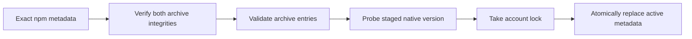
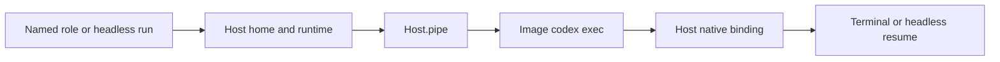
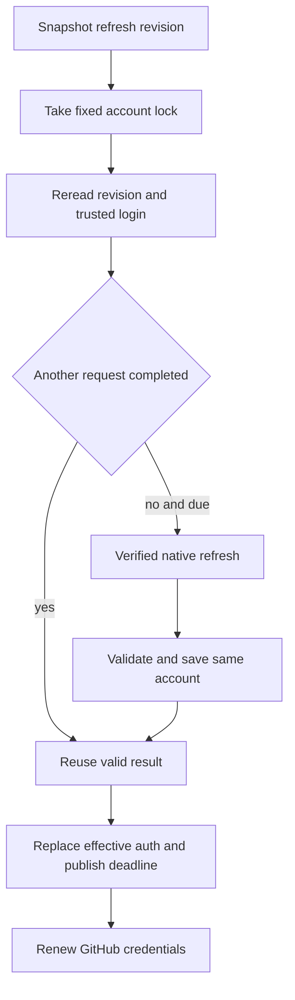
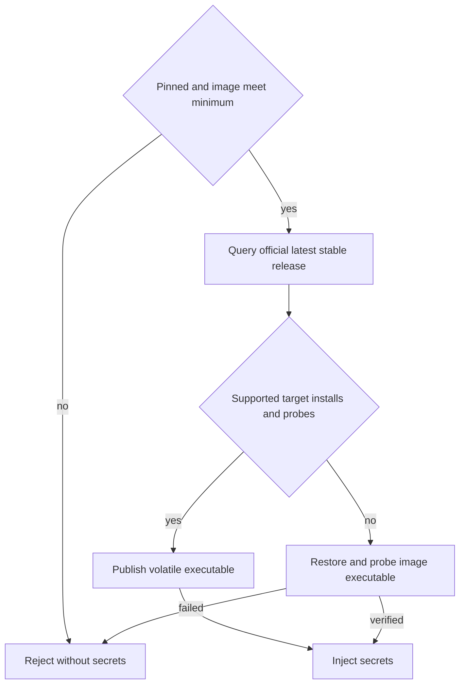

# Broker Codex operations

Codex on the Docker Host: install, log in, run, refresh. Host setup: [Docker host](docker-host.md);
wire fields: [Docker broker protocol](docker-broker-protocol.md). `B` is `/usr/local/libexec/agent-pm/agent-pm-broker`.

## Commands

Install or upgrade the broker first ([Install](docker-host.md#install)). `<version>` is an exact stable npm
version meeting the [minimum version](#container-versions):

| Action | Command |
|---|---|
| First pinned installation | `sudo /usr/local/libexec/agent-pm/agent-pm-broker install-codex <version>` |
| Explicit update or native-file repair | `sudo /usr/local/libexec/agent-pm/agent-pm-broker update-codex <version>` |
| Browser login, as yourself | `/usr/local/libexec/agent-pm/agent-pm-broker login codex` |
| Inspect | `/usr/local/libexec/agent-pm/agent-pm-broker status` ([fields](docker-broker-protocol.md#success-fields)) |

Install/update print installation JSON on success, exit 1 with a diagnostic on failure. Login is interactive
text: exit 0 on success, 1 on failure or cancel. Malformed arguments: the protocol's `usage` error, exit 2.

## Installation trust

The **pinned installation** lives under `/usr/local/libexec/agent-pm/codex/`: root-owned immutable
`releases/<id>/codex`, regular `active.json`, `install.lock` and `auth.lock`; directories and executable 0755,
metadata and locks 0644. Ordinary users can lock the account file but not replace it. Old releases stay.


Sources: `broker/internal/codex/install.go:110`, `broker/internal/codex/archive.go:15`.

- Only `https://registry.npmjs.org/`, no redirects. The main package and its exact macOS arm64 dependency need
  SHA-512 integrity.
- Archives: links, special files, traversal, duplicate entries and oversize are refused; limits 256 MiB
  compressed, 512 MiB expanded, 4096 entries. Only the native `vendor/aarch64-apple-darwin/bin/codex` is kept,
  never scripts or Node.
- Before each run the broker verifies root ownership, write permissions and no symlink for the file and every
  ancestor, and its SHA-256 against the metadata. Native commands get an absolute path, a private working
  directory and a fresh environment of only private `HOME`/`CODEX_HOME`, system `PATH` and `LANG`: no personal npm
  config, `NODE_OPTIONS`, `npm_config_*` or Codex overrides.
- A failed validation or publication keeps the active installation. Install and update accept only stable
  versions meeting the minimum.

## Login trust

```mermaid
flowchart LR
    L[Take account lock] --> R[Reread keychain]
    R --> N[Create placeholder item]
    N --> P[Restrict partition list]
    P --> A[Restrict read and export entries]
    A --> T[Verify access]
    T --> H[Private random temporary home]
    H --> B[Pinned browser login]
    B --> V[Validate subscription auth and expiry]
    V --> D[Delete temporary home]
    D --> C[Save auth]
    C --> U[Verify saved auth and release lock]
```


Sources: `broker/internal/broker/codex.go:147`, `broker/internal/broker/keychain.go:325`. The placeholder is
created only when the item is absent; the access steps run only when not yet in place, asking for the keychain
password as `login github` does ([Log in](docker-host.md#log-in)).

- The temporary home is 0700 under `/private/tmp`, with file credential storage and ChatGPT browser login forced.
  It is removed on success, child failure and normal cancellation; SIGKILL or host failure cannot clean it up.
  Other processes running as you can read it meanwhile.
- Full credentials exist only there, in broker memory and in keychain service `agent-pm-codex`, account `auth`.
  Personal `~/.codex` is neither read nor changed. No `security` subprocess receives credential data.
- Every terminal question comes before the browser; once it opens, login exits by itself. A failed browser login
  leaves the nonsecret placeholder, which reads as no login.
- Credentials are written in place only after verification; GitHub App items are untouched. If the final
  access/readback check fails, the broker restores and re-verifies the earlier login, without asking for a
  password it did not read before the browser, and reports any restore failure.
- The access token's JWT `exp` is a local expiry, not signature verification or proof upstream still accepts it.

Official references: [credential storage](https://learn.chatgpt.com/docs/auth),
[browser login](https://learn.chatgpt.com/docs/cli/reference). Field/expiry source, `rust-v0.162.1`:
[AuthDotJson](https://github.com/openai/codex/blob/rust-v0.162.1/codex-rs/login/src/auth/storage.rs#L49),
[TokenData](https://github.com/openai/codex/blob/rust-v0.162.1/codex-rs/login/src/token_data.rs#L11).

## Docker sessions

Once installed and logged in, with the [Docker Host](docker-host.md#run-workers) set up, `agent-pm-crew worker w
--client codex`, Codex role runs and unattended board runs all use this authentication. The host needs no
personal Codex.

- **No Codex sandbox**: its `workspace-write` sandbox runs commands under bwrap, which needs namespaces the
  container lacks (no capabilities, `no-new-privileges`), so every command fails with `bwrap: No permissions to
  create new namespace` and Codex asks to run unsandboxed, stalling an unattended run. Codex runs in yolo mode
  instead ([Client policy](sessions.md#client-policy)).
- **Login shells**: Codex runs commands in `bash -lc`, whose `/etc/profile` resets `PATH`; the image's
  `/etc/profile.d/agent-pm.sh` puts `/opt/agent-pm/bin` first again, so `gh` (with the session's token), `codex`
  and `python3` are the image's.
- **Access-only authentication**: managed ChatGPT mode with the broker login's original ID token, access token,
  account ID and refresh timestamp, and an empty refresh string.

| Resource | Lifetime |
|---|---|
| `~/.agent-pm/docker-state/<name>/codex/sessions/` | the only host-bound client state; native history survives restart and close/resume |
| container `CODEX_HOME`, at the matching host path | tmpfs; image-made config and credential-link replacements go at close |
| `/run/agent-pm/secrets/codex/auth.json` | agent-owned 0400 tmpfs file, written over `docker exec` stdin |
| `/run/agent-pm/codex-store/` | the terminal launcher's volatile copy of only the current `(workdir, sid)` recovery record |
| `<generation>.credential.json` | broker-owned; only the latest published Codex expiry |

### Headless and terminal recovery


The native binding comes from `thread.started`; only client events the host receives update recovery state.

Headless runs `/opt/agent-pm/bin/codex exec` through the JSON event parser, so replies and completion events reach
Delegate reporting; the host prepares its resume selector itself (only the terminal launcher needs the projected
store). Both modes keep the original snapshot (all but `[clients.codex] flags`, read at each launch), native ID
and `CODEX_HOME` when resuming on the same Host; missing, mismatched or symlinked history fails before launch. The
harness renews like a terminal and cancels renewal when the run ends; a killed harness leaves cleanup to the next
Docker sweep.

### Native plugins

The [plugin whitelist](docker-host.md#plugins) feeds both clients from the same installed payload; staging reads
no host Codex or personal `CODEX_HOME`.

| Artifact | Codex behavior |
|---|---|
| explicit `.codex-plugin/plugin.json` | kept, with its hook/server config; name must match, declared skill dirs stay inside the plugin |
| Claude-only payload | a generated native skills manifest: name, optional description/version, default `skills/` and declared extra skill dirs |
| default Claude hook/server files | left out of the generated manifest: `hooks/hooks.json`, `.mcp.json`, `.app.json`; commands are not migrated |
| `/opt/agent-pm/codex-plugins/inline/<name>/local/` | image-owned read-only native cache; skill-relative scripts and references kept |
| `CODEX_HOME/plugins/cache` | volatile link to that cache; generated config enables `<name>@inline` |

Skills are namespaced, e.g. `autopilot:build`. Invalid native names or skill paths, and escaping or dangling links
(checked before metadata is read), fail the build before Docker. Format source, `rust-v0.162.1`:
[cache lookup](https://github.com/openai/codex/blob/rust-v0.162.1/codex-rs/core-plugin-common/src/installed.rs#L47),
[skill discovery](https://github.com/openai/codex/blob/rust-v0.162.1/codex-rs/core-plugins/src/loader.rs#L1045),
[namespaced inventory](https://github.com/openai/codex/blob/rust-v0.162.1/codex-rs/app-server/tests/suite/v2/skills_list.rs#L650).

## Refresh and recovery

**Renewal** is due at the earlier of the Codex and GitHub deadlines minus 600 s (the measured lead was 2 s:
[Plan A](#plan-a-validation-report)). A short lifetime tries at once, then at least 60 s apart, until expiry.
Recovery rereads the broker's published deadline.


Sources: `broker/internal/broker/codex.go`, `codex_revision.go`, `codex_refresh.go`;
`broker/internal/launcher/refresh.go:15`. Login takes the same lock. The revision record holds no account or
credential.

- The pinned native app-server refreshes the account in a private temporary home (as in
  [Login trust](#login-trust)), with bounded output and a 120 s deadline. The broker requires the same account, a
  changed access value, a later expiry and a verified keychain readback; it never sends an upstream refresh itself.
- Publication replaces the effective `CODEX_HOME/auth.json`, also after Codex replaced its original link, and
  saves the expiry durably before GitHub renewal, so a lost response or GitHub failure cannot erase it; retries
  repair publication on their own.
- The terminal keeps its launch, permissions and history. By pinned source ([Plan A](#plan-a-validation-report)
  evidence), it reloads proactively within 300 s of the old access expiry, and reloads same-account state on an
  unauthorized response before trying its own refresh. Adoption is eventual; publishing a file is no
  acknowledgment.
- Failures emit `client_refresh_failed` and retry each minute. After a final failed reconciliation at expiry,
  `client_auth_expired` and the harness log carry:

  > Client authentication expired; run /usr/local/libexec/agent-pm/agent-pm-broker login codex on the host, then resume

  The generation closes (close retried each minute). Run that on the host, then resume the worker; native history
  is kept. Missing login or invalid pinned files fail preflight with a repair command. No run logs in or uses
  another identity. Source: `session/src/agent_pm/session/hosts/docker/supervisor.py:273`.

## Container versions

**Minimum version** is the broker's `codex.MinVersion`, now `0.163.0`; the pinned host installation and the image
must both meet it. A lower host version refuses to start, naming `update-codex 0.163.0`; a lower image needs a
rebuild. Claude needs no pinned Codex and makes no registry query.


Source: `broker/internal/launcher/versions.go`. Codex start, restart and resume share it; attach leaves its
generation alone.

- Versions compare as numeric `major.minor.patch`. The registry's `latest` is the target when it meets the
  minimum, else `no_supported_release` (empty audit target); a bad answer or failed lookup is
  `registry_unavailable`. Only official metadata and archives (main, Linux arm64/amd64), with the installation
  integrity and extraction checks; no npm scripts, user npm config or workspace cache.
- The image installation stays immutable under `/opt/agent-pm/clients/`; its wrapper runs the updated file from
  root-owned executable tmpfs `/opt/agent-pm/runtime/`. Programs never enter workspace or history. Any failure
  restores and re-verifies the image version; a below-minimum image is refused even when an update exists.
- Each generation's `<generation>.result.json` keeps the image digest, actual clients and the
  [version audit](docker-broker-protocol.md#success-fields), `min_version` included; startup stderr reports the
  outcome. Preflight's 3 s advisory `latest` lookup prints a pinned-upgrade command when newer, never upgrades the
  host, and never blocks a supported start.

### Upgrade existing installations

From broker protocol 11 or earlier: close Docker sessions ([Upgrading steps](upgrading.md#upgrading-steps)), upgrade
plugin and broker together, then move the old exact-list `active.json` aside (neither `install-codex` nor
`update-codex` overwrites it, and the strict decoder rejects it) and install again:

```bash
sudo mv -i /usr/local/libexec/agent-pm/codex/active.json /usr/local/libexec/agent-pm/codex/active.json.before-minimum
sudo /usr/local/libexec/agent-pm/agent-pm-broker install-codex 0.163.0
```

If the backup name exists, pick another and confirm `active.json` moved first. Releases, account locks and keychain
items stay. Rebuild images holding an older Codex with
`/usr/local/libexec/agent-pm/agent-pm-broker build --agent-pm <plugin-dir> --max-age 0`, plus your `--plugin`
options ([Build](docker-host.md#build)). Later host upgrades:
`sudo /usr/local/libexec/agent-pm/agent-pm-broker update-codex <version>`.

## Plan A validation report

**Plan A** (the broker refreshes centrally; containers get access-only credentials) was selected on 2026-10-18 for
the scope the user narrowed that day: a running Codex loads a replaced access token without restart, an exact
version set, and a measured refresh lead; no real-expiry crossing. The user dropped plan B (a model-request relay)
the same day. Requirements: [M4 PRD](https://github.com/ophis/private_docs/blob/main/Product%20Design/2026-10-16-2311-TASK-550-docker-host-m4.md).

- **Version**: exactly `0.163.0` passed (fixed host, container, latest same-minor and latest stable were all that
  version); the then-product `0.162.1` was untested. Admission now: [Container versions](#container-versions).
- **Carrier**: managed `auth_mode=chatgpt` with the original ID/access/account fields and refresh timestamp and an
  empty refresh string; the original refresh value never enters a container. File-based `chatgptAuthTokens` was
  not certified for explicit reload.
- **Reload**: after the host refresh replaced the file, a running app-server kept the old token until native
  guarded reload loaded the new one on the same connection, without restart.
- **Lead**: three genuine rotations; the full refresh pipeline took 1.467578 s, an observed lead of 2 s (not a
  worst-case bound); the 600 s scheduler floor applies.

The verification matrix, observed results, pinned source evidence, compatibility table and the evidence JSON now
live in [private_docs › docker-codex-plan-a-validation.md](https://github.com/ophis/private_docs/blob/main/Knowledge/agent-pm/docker-codex-plan-a-validation.md).

Probes, from the repository root: `python3 -I scripts/docker_codex_a_probe.py --user-run --live-root
<isolated-root> live-reload task647-codex-a-1` (actions `live-reload`, `inject`, `host-refresh`, `versions`;
the live root is required and absolute, with no default to a personal login), and
`python3 -I scripts/docker_codex_probe.py inventory` (source only: its `live_refresh_count=0` is a constant). The
manager runs the nonprivileged commands, credential injection and host refresh included; only sudo/password steps
go to the user. Workers never run live probes or read real credentials.

## Checks

- Automated tests use fake transports, processes and keychain/Security adapters; Linux, Docker and integration
  checks run only in GitHub CI ([Tests](tests.md)).
- [worker_codex.py](../.github/worker_codex.py), in CI with synthetic credentials and no network: app-server
  `skills/list` for the probe skill (enabled, plugin ID, path), cache ownership and non-writability, the real auth
  loader, agent identity, nested mounts, atomic auth-link replacement, history-only persistence across two
  containers, and the managed carrier: disk replacement vs cached value on one connection, explicit guarded reload
  and proactive `auth()` reload. It tests no model access, terminal turns, native conversation recovery or macOS
  file sharing; source and synthetic checks alone do not certify terminal continuity across a refresh.

### Pending live checks

Live checks still pending after release, with their owners: [Docker checks › Codex live checks](docker-checks.md#codex-live-checks).
