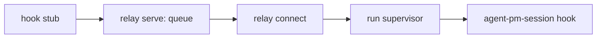

# Docker host

`agent-pm-broker` builds the worker image and starts and closes worker containers on macOS (Apple silicon) with
Docker Desktop. It keeps the logins and the GitHub App key in the login keychain and writes credentials only into a
container's tmpfs. Session's Docker Host calls it ([Run workers](#run-workers)); the sections up to [Close](#close)
install the broker and check it by hand. JSON interface: [Docker broker protocol](docker-broker-protocol.md); Codex:
[Codex operations](docker-codex.md); each credential's readers, lifetime and revocation: [Credentials](credentials.md).

The host needs no Node and no personal Codex: the clients run in the image. On subscriptions a container holds a
model credential; an API key behind a host model relay, so that containers hold none, is not supported.

Run every step as yourself, `HOME` your account home. `B` is `/usr/local/libexec/agent-pm/agent-pm-broker`; `PKG`
the installed agent-pm plugin directory.

## Install

Needs Docker Desktop (running) and `gh` (logged in).

```sh
sh "$PKG/broker/install.sh"
```

It downloads the broker asset of the plugin's version, installs it root-owned (`sudo` asks once) only after
`gh attestation verify` proves the agent-pm release workflow built it from that version's tag, and seeds
`~/.agent-pm/docker/worker/Dockerfile` (your image, edit freely) only if `~/.agent-pm/docker/worker` does not exist.
The asset appears a few minutes after a Release is published; until then it exits non-zero: retry. `--build`
instead builds and ad-hoc signs it locally with the hardened runtime (needs Go, `brew install go`, and the Xcode
command line tools).

To upgrade, rerun it (your Dockerfile is never overwritten), then [log in](#log-in) again. Claude Code upgrades with
the image, Codex by its [version policy](docker-codex.md#container-versions); the image's `gh` is the version agent-pm
pins (`broker/internal/launcher/assets/Dockerfile`), whatever your Dockerfile installs.

| Check | Expect |
|---|---|
| `codesign -dv --verbose=4 "$B" 2>&1 \| grep -E 'Identifier\|flags'` | `Identifier=com.github.ophis.agent-pm-broker`, `flags=0x10002(adhoc,runtime)` |
| `ls -ld /usr/local/libexec/agent-pm "$B"` | both `root wheel`, `drwxr-xr-x` / `-rwxr-xr-x` |
| `"$B" version` | `{"protocol_version":"13"}` |
| edit `~/.agent-pm/docker/worker/Dockerfile`, rerun `install.sh` | your edit stays |

## Log in

After every install or reinstall, run all three logins: `login claude`, `login github agent-pm-bot` and
`login codex` ([Codex operations](docker-codex.md#commands)). The keychain trusts the broker by its code requirement
(an ad hoc signature's cdhash), not its path, so a reinstalled broker cannot read the old one's items without asking;
`start` never asks, failing instead (`login_required`, or `keychain_failed` for an old GitHub item). Each login asks its terminal questions first, without
echo:

| Login | Terminal | macOS dialog, at most | Click |
|---|---|---|---|
| `login claude` | the token; the login keychain password only when the item's access needs a change | one change-access dialog, after the password; one read dialog, announced on the terminal first | Allow; Always Allow |
| `login github agent-pm-bot` | the login keychain password, when a step is not yet in place | one change-access dialog (Deny / Allow), after the password | Allow |
| `login codex` | the login keychain password, when a step is not yet in place, before the browser opens | one change-access dialog (Deny / Allow), after the password | Allow |
| `start` | none | none: a token it cannot read without one fails with `login_required`, naming unlocking the login keychain or `login claude` | |

What each login hands a container: [Credentials › Who logs in](credentials.md#who-logs-in).

**Claude**:

```sh
claude setup-token          # copy the token it prints
"$B" login claude           # paste it; nothing echoes
```

It saves the token in a new item, makes its access trust only the broker as `login github` does (prompt
`Login keychain password, to make Claude trust only the broker (hidden):`) and reads it back. If macOS would still
ask, it first prints `macOS will ask to let agent-pm-broker use agent-pm-claude: enter the login keychain password if
asked and click Always Allow`, then reads once with the dialog and once without, proving Always Allow was clicked.

| Check | Expect |
|---|---|
| output | `Claude setup-token saved; keychain trusts only the broker`, no token |
| `security dump-keychain -a ~/Library/Keychains/login.keychain-db \| grep -A20 agent-pm-claude` | service `agent-pm-claude`, account `setup-token`; the only trusted application is `$B` |
| shell history | no token |
| first Claude [start](#start) after it | no keychain dialog |

**GitHub**: the private key of the one GitHub App, `agent-pm-bot`, must be a generic-password item in the login
keychain, service `agent-pm-bot`, account its App ID, content the base64 key. Store it so (a bare `-w` prompts and
truncates the key at 128 characters):

```sh
security add-generic-password -s agent-pm-bot -a <App ID> -U -w "$(base64 -i <key>.pem)" ~/Library/Keychains/login.keychain-db
"$B" login github agent-pm-bot
```

The login restricts the item's access in place (content and account kept): partition list to only the broker's
partition ID, then read/export entries to only the broker (a wrong password: `keychain status -25293`). It reads the
access back and checks the key is not empty before printing success; else it exits non-zero saying what is done
and what is not: rerun it. Then it looks up `agent-pm-bot[bot]` on GitHub's public user API (no
credential; needs network) and keeps its ID in the broker-only item `agent-pm-github-users`, for the containers' git
identity. The App must be private (installable only on your account): every session gets a token for every repo of
every installation.

| Check | Expect |
|---|---|
| first run after an install | one hidden `Login keychain password` question; no macOS dialog, or one only after the password |
| output | `GitHub App agent-pm-bot private key (App ID <App ID>) now trusts only the broker`, then `GitHub App agent-pm-bot bot user agent-pm-bot[bot] has ID <ID>` (`gh api 'users/agent-pm-bot[bot]' --jq .id`), no key |
| `security dump-keychain -a ~/Library/Keychains/login.keychain-db \| grep -A40 '"agent-pm-bot"'` | every entry with `decrypt` or `export` lists only `$B`, none `/usr/bin/security`; `partition_id` lists only the `cdhash:` from `codesign -dv --verbose=4 "$B"` (its `CDHash=`), no `apple-tool:` |
| `security find-generic-password -s agent-pm-bot -a <App ID> -w` | asks for the keychain password; Cancel: non-zero exit, empty stdout |
| rerun the login | same output, no password question |

## Build

```sh
"$B" build --agent-pm "$PKG"              # Docker's progress on stderr, then {"image":"agent-pm-worker:<key>","digest":"sha256:…","rebuilt":true}
"$B" build --agent-pm "$PKG"              # the same, "rebuilt":false
"$B" build --agent-pm "$PKG" --max-age 0  # rebuild now
```

A changed Dockerfile or agent-pm version gives a new key. No build log shows a secret. Rebuilds skip Docker's cache,
so they install npm's latest Claude Code. `--max-age N` rebuilds an image N or more seconds old under the same key (a
start passes 604800, 7 days); if that rebuild fails (e.g. offline) it keeps the image, printing `agent-pm-broker: kept
<image>: refreshing it failed: <reason>`, except `--max-age 0`, which fails.

After a rebuild, `build` removes other keys' `agent-pm-user:<key>` and `agent-pm-worker:<key>` images not leased in
the last hour, and untagged ones a same-key rebuild left, keeping any image a container (running or stopped) came
from; it prints `agent-pm-broker: removed <image>` or `kept <image>: <reason>` for each. Every `build` leases its key
by touching `~/.agent-pm/docker/images/<key>` (at start, before the second stage, at the end of a rebuild), so
concurrent builds of two packages (two worktrees, a worker's check beside a board run) keep each other's images.
`~/.agent-pm/docker/images.lock` separates removal from leasing: a build that cannot take it fails with
`build_failed`; a removal pass removes nothing, printing `agent-pm-broker: kept older images: cannot take the image
lock: <reason>`.

| Check (`I` = the printed image) | Expect |
|---|---|
| `docker image inspect "$I" --format '{{json .Config.Labels}}'` | `agent-pm.version` equals the plugin's version; `agent-pm.key`, `agent-pm.agent-uid`, `agent-pm.agent-gid` |
| `docker history --no-trunc "$I" \| grep -c sk-ant` | `0` |
| `docker run --rm "$I" sh -c 'command -v python3; python3 -P /opt/agent-pm/team/tools/repo.py --help'` | `/opt/agent-pm/bin/python3` (it imports the Delegate), then `repo.py`'s usage: role runs use the plugin's own team at `/opt/agent-pm/team` |
| delete a line (e.g. `WORKDIR`) from your Dockerfile, rebuild | still the labels and `/opt/agent-pm/bin/with-secrets`; restore the line |
| `docker image ls --filter reference='agent-pm-*'` | the new pair and the older one, leased within the hour |
| `rm ~/.agent-pm/docker/images/<older key>`, rebuild with `--max-age 0`, list again | only the new pair, plus an older worker image a container still uses |
| `"$B" build --agent-pm "$PKG" --max-age 0 & "$B" build --agent-pm "$PKG2" --max-age 0; wait` (`PKG2` another worktree's, other content) | both `"rebuilt":true`; both pairs listed |
| `"$B" build --agent-pm "$PKG" --max-age 0` | `"rebuilt":true`, same `image`, new `digest`; `npm install` runs, not `CACHED` |

### Plugins

A container's clients load the plugins its image holds: `[session.hosts.docker] plugins`, default `["autopilot"]`
(the team's `/autopilot:build`, `/autopilot:light-build` and `/autopilot:review`); `[]`: none. Never agent-pm's own:
every session runs with it disabled, and the image holds the team at `/opt/agent-pm/team`.

```toml
[session.hosts.docker]
plugins = ["autopilot", "other@its-marketplace"]
```

Each name is a plugin installed in Claude Code at user scope (`claude plugin install`), `name` or `name@marketplace`
when two marketplaces have one. `build` passes each as `--plugin NAME`: the broker finds it in
`~/.claude/plugins/installed_plugins.json` and copies the version Claude Code loads now (its `installPath`) to
`/opt/agent-pm/plugins/<name>`, root-owned and read-only for `agent`, listed in `CLAUDE_CODE_PLUGIN_DIRS` (a launch
env's own replaces it), so it loads as `<name>@inline` with its `/<name>:` commands. The copies are part of the image
key: a whitelist change or `claude plugin update` rebuilds at the next start (Claude Code's `.in_use/` and
`.orphaned_at` markers are not copied). Codex uses the same payload ([Native plugins](docker-codex.md#native-plugins)).
One whitelist per account: another is another key, whose rebuild removes this one's images.

The build fails before Docker with `build_failed` naming the plugin (`Plugin <name> is not installed: no user-scope
entry in <record>.` when not installed) if a name matches two marketplaces, resolves outside the plugin cache, has no
valid `.claude-plugin/plugin.json` name, or holds a symlink leaving its directory or dangling; a start fails in
preflight the same way. Whitelisting trusts the plugin's code (Claude loads its hooks, MCP servers and scripts) beside
the container's credentials.

| Check | Expect |
|---|---|
| `"$B" build --agent-pm "$PKG" --plugin autopilot`, then `docker run --rm "$I" sh -c 'echo "$CLAUDE_CODE_PLUGIN_DIRS"; stat -c %U /opt/agent-pm/plugins/autopilot; touch /opt/agent-pm/plugins/autopilot/x'` | `/opt/agent-pm/plugins/autopilot`, `root`, `Permission denied` |
| `"$B" build --agent-pm "$PKG" --plugin no-such-plugin` | exit 8, `build_failed`, `Plugin no-such-plugin is not installed: …`; no Docker build |
| `claude plugin update autopilot@<marketplace>`, the same build | `"rebuilt":true`, a new key |
| `/autopilot:build` in a container's Claude | the skill starts |

## Start

```sh
mkdir -p ~/src/demo ~/.agent-pm/docker-state/worker_1/claude
cat > /tmp/worker_1.json <<EOF
{"name": "worker_1", "client": "claude", "generation": "$(openssl rand -hex 16)", "image": "$I",
 "cwd": "$HOME/src/demo", "workspace": "agent-pm-ws-worker_1",
 "claude_dir": "$HOME/.agent-pm/docker-state/worker_1/claude", "github": null, "labels": {}}
EOF
"$B" start --manifest /tmp/worker_1.json
```

It prints `container` (`C` below), `endpoint`, `image_digest` and the actual `clients` versions; Codex starts add the
[version audit](docker-broker-protocol.md#success-fields).

| Check | Expect |
|---|---|
| `docker inspect "$C" --format '{{.HostConfig.CapDrop}} {{.HostConfig.SecurityOpt}} {{.Config.User}} {{.HostConfig.Privileged}} {{.HostConfig.NetworkMode}} {{.HostConfig.PidMode}}'` | `[ALL] [no-new-privileges] agent false bridge ` (empty PidMode) |
| `docker inspect "$C" --format '{{json .Mounts}}'` | the volume `agent-pm-ws-worker_1` at cwd, one bind (claude_dir), no `docker.sock` |
| `docker exec "$C" grep -E "$HOME\|/run/agent-pm" /proc/mounts` | the volume at cwd, claude_dir at its host path, the `/run/agent-pm/secrets` tmpfs; nothing else from the host |
| `docker volume inspect agent-pm-ws-worker_1 --format '{{json .Labels}}'` | `agent-pm.kind` `ws`, `agent-pm.workspace` `$HOME/src/demo` |
| `docker exec "$C" sh -c 'touch x; stat -c %U .; echo $npm_config_cache'`, then `ls ~/src/demo` | `agent`, `$HOME/src/demo/.agent-pm-cache`; the host dir stays empty |
| `docker exec "$C" ps -o comm= -p 1` | `tini` |
| `docker exec "$C" sh -c 'id -u; command -v sudo; tmux -V; git --version; gh --version; python3 --version; uv --version; node --version; claude --version; codex --version'` | uid not 0, no sudo, every version prints |
| `docker exec "$C" ls -l /run/agent-pm/secrets` | one file `claude`, `-r--------`, owned by `agent` |
| `docker inspect "$C" \| grep -c sk-ant`; `docker logs "$C" \| grep -c sk-ant`; `grep -c sk-ant /tmp/worker_1.json`; `docker exec "$C" env \| grep -c sk-ant` | `0` each |
| `cat ~/.agent-pm/docker-state/worker_1/claude/.claude.json` | `hasCompletedOnboarding: true`, `projects["$HOME/src/demo"].hasTrustDialogAccepted: true` |
| `cat ~/.agent-pm/docker-state/worker_1/claude/settings.json` | the fixed values of [Lifecycle](#lifecycle) |
| `lsof -nP -a -iTCP -sTCP:LISTEN -c agent-pm` during a start | no listening TCP socket (Codex preparation and GitHub calls may open outbound HTTPS) |
| with `"github": {"app": "agent-pm-bot"}` in the manifest | start's `github` lists one `{"account", "expires_at"}` per installation, `github_user_id` the ID `login github` saved |
| then `docker exec "$C" ls -l /run/agent-pm/secrets/github` | one file per installation account, `-r--------`, owned by `agent` |
| `docker exec "$C" git ls-remote https://github.com/<account>/<private repo>`; `docker exec "$C" gh api repos/<account>/<private repo> --jq .full_name` | both work with no login |
| `docker exec -w <clone of a private repo> "$C" gh api 'repos/{owner}/{repo}' --jq .full_name` | works with no login (`{owner}` from `origin`) |
| `"$B" refresh --container "$C" --manifest /tmp/worker_1.json` | a new `github` list, each `expires_at` later |
| `"$B" close --container "$C"`, then `"$B" status` | `{"revocations":[]}` |

**Claude**: `docker exec -it "$C" with-secrets --client claude claude` opens with no login, theme or trust prompt and
answers one sentence.

**Hijack**: with `export DOCKER_HOST=tcp://127.0.0.1:9 DOCKER_CONTEXT=bogus`, a `~/.docker/config.json` naming another
context, and an executable `docker` first on `PATH` that runs `touch /tmp/fake-docker-ran`, `"$B" build --agent-pm
"$PKG"` still reports `"rebuilt":false` and `/tmp/fake-docker-ran` does not exist. Restore `~/.docker/config.json`.

## What a container gets

Each row's source holds the exact values.

| What | Source | Summary |
|---|---|---|
| `docker run` flags | `broker/internal/launcher/start.go` `create` | user `agent`, all capabilities dropped, `no-new-privileges`, bridge network, `tini` as PID 1, the `agent-pm.session` and `agent-pm.generation` labels |
| `docker run` env | `create` | the client home (`CLAUDE_CONFIG_DIR` or `CODEX_HOME`); npm, uv and pip caches under `<cwd>/.agent-pm-cache` |
| Mounts | `create`, `mounts.go` | the [workspace volume](#workspace-volumes) at cwd; Claude: its home bound at its host path; Codex: tmpfs home and runtime, its `sessions` bound |
| Secrets tmpfs | `create`; written by `broker/internal/broker/keychain.go` `Credentials.Inject`, `github.go` `Issue`/`Refresh`, `codex.go` `Codex.Inject` | `/run/agent-pm/secrets`, agent-owned, `noexec`: the client credential and one GitHub token per installation ([GitHub tokens](docker-broker-protocol.md#github-tokens)); read only through `with-secrets` and the `gh`/git credential wrappers |
| Start-time files | `create` (`bootstrap.py`, `hook-stub`) | client state that skips onboarding and trusts cwd; the hook stub |
| Exec env | `session/src/agent_pm/session/hosts/docker/host.py` `_exec_env` | the client's launch env without `PATH`; with `[session.hosts.docker.github] app`: `AGENT_PM_PR_AUTHOR` and the git author and committer `<app>[bot] <<bot user ID>+<app>[bot]@users.noreply.github.com>`, the ID from start's `github_user_id` |
| Image: base | `~/.agent-pm/docker/worker/Dockerfile` (seeded from `broker/worker/Dockerfile`) | your image: tools such as tmux, git, gh, Node, uv and Claude Code |
| Image: agent-pm layer | `broker/internal/launcher/assets/Dockerfile` | agent-pm's session, delegate and utils sources and venv, the [plugins](#plugins), Codex, the `gh` and git credential wrappers (`/etc/gitconfig`), `with-secrets`, `relay`, `/opt/agent-pm/bin` first on `PATH`; no git identity |

## Refusals

Each fails before any container exists (`docker ps -a` unchanged):

| Change to the manifest or host | Exit |
|---|---|
| add a field `"x": 1` | 3 `manifest_rejected` |
| `image` a tag not built by `build` (e.g. `agent-pm-worker:` + 64 `0`) | 6 `image_rejected` |
| `cwd` a missing dir, `/`, `/home`, `/usr/local/x`, `/opt/agent-pm`, `/home/agent` or `$HOME` (it holds `claude_dir`) | 4 `mount_rejected` |
| `claude_dir` any other path | 4 |
| `hook_path` inside `cwd` | 4 |
| `security delete-generic-password -s agent-pm-claude -a setup-token ~/Library/Keychains/login.keychain-db`, then start | 5 `login_required`, naming `agent-pm-broker login claude`; log in again after |
| reinstall the broker (`install.sh --build`), then start a Claude manifest without `login claude` | 5 `login_required`, "trusts another broker build"; no keychain dialog; log in again after |
| `security lock-keychain ~/Library/Keychains/login.keychain-db`, then start a Claude manifest | 5 `login_required`, "unlock the login keychain, or run agent-pm-broker login claude"; no dialog; `security unlock-keychain ~/Library/Keychains/login.keychain-db` after |
| start the same manifest while its container runs | 9 `start_failed`, "close it first"; the running container untouched |
| while `C` runs, the same manifest with a new `generation` | 4 `mount_rejected`: its volume is in use |
| `docker volume create agent-pm-ws-worker_3`, then a `worker_3` manifest | 4 `mount_rejected`: no workspace labels; `docker volume rm agent-pm-ws-worker_3` after |

## Close

```sh
"$B" close --container "$C"   # {"container":"…","removed":true}
"$B" close --container "$C"   # removed:false: already gone
```

`docker ps -a --filter name="$C"` lists nothing.

## Audit log

Every `start`, `refresh` and `close` appends one JSON line to `~/Library/Logs/agent-pm/broker.jsonl` (directory 0700,
file 0600, written as you) recording each credential it issued, renewed, withdrew or revoked, never a token or key. A
backlog retry (each `start`, `close` and `status`, and a `refresh` that queues a token) that revokes or drops another
container's token adds a line for that container. Past 10 MiB it moves to `broker.jsonl.1`, replacing the previous
one. Writing is best effort: an unwritable line is dropped, the result unchanged. No container mounts it. Source:
`broker/internal/audit/`. Query: `jq 'select(.session=="NAME")' ~/Library/Logs/agent-pm/broker.jsonl`.

| Field | Value |
|---|---|
| `time` | RFC 3339, UTC |
| `command` | the broker command |
| `event` | `start`, `refresh`, `close`, or `revocation-retry` (another container's backlog tokens) |
| `session`, `generation`, `container` | from `agent-pm-<session>-<generation>`; null when start could not read its manifest |
| `image`, `image_digest`, `mounts` | start only: the manifest's tag, the image ID, each `--mount`/`--tmpfs` as `{type, source, target, mode}`; null for a step not reached |
| `credentials` | one entry per credential, below |
| `error` | the error `code` ([Docker broker protocol](docker-broker-protocol.md)); null on success |

| Entry field | Value |
|---|---|
| `kind` | `claude-setup-token`, `codex-access-token` or `github-installation-token` |
| `result` | `issued`, `renewed`, `withdrawn` (deleted with its container), `revoked`, `pending` (in the backlog; a later `revocation-retry` line says `revoked`, or `expired-unrevoked` if it expired first) |
| `reason` | `pending` only: why not revoked yet |
| `expires_at` | RFC 3339; null when unknown (the setup-token, a withdrawn Codex token) |
| `account`, `installation` | GitHub: the installation's account and ID (no ID on retry lines) |
| `repository_selection`, `repositories` | GitHub `issued`/`renewed`: `all` or `selected`, and every repo the token reaches (all pages of `GET /installation/repositories`); both null with `repositories_error` if that listing failed (the token is still issued) |

## Run workers

Make the Docker Host the default in `~/.agent-pm/config.local.toml`:

```toml
[session.hosts]
default = "docker"
```

| `[session.hosts.docker]` key | Default | Meaning |
|---|---|---|
| `docker` | `/usr/local/bin/docker` | the docker CLI, an absolute path |
| `plugins` | `["autopilot"]` | the plugin payloads every image holds ([Plugins](#plugins)); `[]`: none |
| `github.app` | `agent-pm-bot` | the GitHub App whose installation tokens every session gets, as `AGENT_PM_PR_AUTHOR=<app>[bot]` names it; `""`: none |
| `isolated` | `true` | its sessions' clients run in yolo mode ([Permissions](#permissions)); `false`: auto mode, as on tmux |

Then `agent-pm-crew worker NAME --client claude` starts NAME in its own container; the other `agent-pm-crew` verbs,
the Viewer, `--display none`, `[session.viewer]` and `ls --descendants` work as on tmux. Every docker call goes to
`unix://<account home>/.docker/run/docker.sock`, whatever `DOCKER_HOST`, `DOCKER_CONTEXT` or `DOCKER_CONFIG` say.

A session's GitHub tokens are renewed 10 minutes before the first expires, by the TUI session's host run supervisor or
the headless run's harness; a failure writes `github_refresh_failed <reason>` to the session's events or the harness's
log, and retries every minute.

### Permissions

The container is the isolation boundary, so every Docker session (crew worker, role or headless run; start, restart
and resume) runs its client in yolo mode: no permission prompt or approval; it writes files, runs `gh` and reaches the
network unasked, within the container's reach (workspace volume, the session's GitHub tokens, the network). Flags:
[Client policy](sessions.md#client-policy).

### Role runs

Role runs (`agent-pm-crew role`, attended board runs) run their client in a container; their harness stays on the
host, on another Host:

```toml
[delegate.delegates]
harness_host = "tmux"
```

A headless agent (an unattended board run, `agent-pm-delegate run` without `--detach`) runs its client by
`docker exec -i` in its own container, with no tmux, hook relay or supervisor, its output streamed to the harness;
`ls`, `attach` and the Viewer do not show it, and a TUI start of its name is refused while it runs. Its container
closes when the client exits or is stopped, or, if the harness died, at the next Docker start or close. A run's
volume is `agent-pm-ws-<agent name>` at `<workdir>/agent`, kept across a board issue's revision rounds;
`agent-pm-crew reopen` resumes it on the Docker Host with the same history and volume, whichever mode started it.

On the Docker Host the Delegate:

- refuses, before any container and naming the key, a `harness_host` that is empty or the Docker Host, a `read` dir
  other than the image's team (`{{team}}`, a core role's `{{role_team}}`, the tasks dir), any `write` dir, a role
  `cwd`, a cwd other than the agent dir (a `trusted_dirs` project cwd included), a `team_dirs` role, and an input
  whose `Reference:` block names two `Repo:` lines or one off github.com;
- gives the agent the image's team at `/opt/agent-pm/team` and its `python3`;
- writes that `Repo:` line as `owner/name`, a local clone's read from its `origin`;
- sets `AGENT_PM_USERS`: the configured `users` without any `[bot]`;
- asks for the deliverable inline, never `deliverable_file` (`local` and `orchestrator` outputs still save it to
  `out`);
- drops the outcome's `files`, noting `files_dropped` in `run.jsonl`, so an engineer run posts no spec or plan to
  Linear.

Before the first role run, [log in](#log-in) to GitHub and install the App on every repo the runs need, `private_docs`
included: every Docker session can read and write exactly those private repos.

In the container `repo.py worktree` makes a fresh blobless clone at `<Workdir>/src/<owner>/<name>-<slug>`, never a
`[local_clones]` worktree; `repo.py` treats `AGENT_PM_PR_AUTHOR` as the PR author (its docstring:
`delegate/src/agent_pm/delegate/team/tools/repo.py`). An engineer opens its draft PR through the `gh` wrapper as `agent-pm-bot[bot]`; the Delegate's ready gate on the host
marks it ready, you approve with your own account, and revision rounds push to the same branch. Then
[review before pulling](#review-before-pulling).

### Lifecycle

Each start, restart or resume runs a new generation in a new container from the current image. `restart` closes the
running container first; `resume` (after `close`, or once the container is gone) starts one in the same cwd. Both
keep the client history and [workspace volume](#workspace-volumes) and continue the conversation; only a new start
clears them. A resume whose conversation file is missing or a symlink fails before any container with
`no native history to resume`. Resume with `agent-pm-session resume <name>`, never `client-resume`, which runs the
client on the host. Claude and [Codex](docker-codex.md#docker-sessions) terminals and headless runs are supported;
other clients, detached sessions and a start while a container of that name exists fail before creation.

**Preflight**, before every start: client and mode supported; the cwd exists (`Session.preflight` also accepts one
not yet made: a role run makes its agent dir after); the broker's `version` matches (else it points to
[Install](#install)); `build` succeeds, rebuilding an image 7 or more days old, its progress on stderr. `resume` runs it
before touching anything; `restart` closes first, so after a failed preflight `resume` continues the worker once
fixed. Missing client credentials fail at the broker's `start`, before creation, naming the host
`agent-pm-broker login <client>` command; the start is not retried.

**Waits**: `agent-pm-crew` waits up to 1920 s for a start or resume (a rebuild alone may take 1800 s), then sends
SIGTERM and, 60 s later, SIGKILL. From just before the broker's `start` until the client runs, a start holds SIGTERM,
SIGINT and SIGHUP back (an ignored one stays ignored); on one it removes its container, then the signal acts. Stopped
later, it leaves its worker running.

**Plan**: just before the broker's `start`, each generation freezes its plan in `<generation>.plan.json` and prints
it to stderr, to check against `docker inspect` (no env values, flags or token; the broker reads only the manifest):

```text
docker plan NAME GENERATION: image agent-pm-worker:<key> sha256:<digest>
docker plan NAME GENERATION: workspace agent-pm-ws-NAME at <cwd> rw
docker plan NAME GENERATION: mounts <claude dir> rw
docker plan NAME GENERATION: credential claude-setup-token
```

**State**, `~/.agent-pm/docker-state/<name>/`, kept by `close`: the client's config dir (cleared at each new
start); per generation the manifest `<generation>.json`, the plan, `<generation>.result.json` (container, image and
digest, client versions, the broker start's begin and end, [start timing](#start-timing) `phases` and `launched_at`),
`<generation>.seq` (last hook event delivered) and `<generation>.stale` (image no longer current); `host.json` (the
host's view, with the events path); a headless run's `pipe.lock` (held by its harness while the client runs); the
hook supervisor's `supervisor.lock` (holding the generation) and `supervisor.pid`; `rejected.jsonl` (`gen`, `seq`,
`reason` per refused event, never its content).

**Claude settings**: each new start writes a `settings.json` with the fixed unattended values of `UNATTENDED` in
`session/src/agent_pm/session/clients/claude/common.py` (no stop at the Workflow usage warning, a full context or a
usage limit; no prompt suggestions; concise; fullscreen), and the host Claude's `model`, `effortLevel`,
`modelSettings` and `env.CLAUDE_CODE_MAX_WEB_SEARCHES_PER_SESSION` (from `$CLAUDE_CONFIG_DIR/settings.json`, else
`~/.claude/settings.json`; unreadable: Claude's default model). No other host setting, credential, hook, plugin,
status line or permission reaches it. `--model`/`--effort` and role config still win; a resume keeps its session's
file.

### Start timing

Each start, restart or resume prints where its time went to stderr, three blocks, each once its part succeeded; each
phase counts from the end of the one before:

```text
docker timing NAME: preflight 41.20 s
agent-pm-broker: start preflight 0.01 s
…
agent-pm-broker: start total 38.75 s
docker timing NAME GENERATION: checks 0.12 s
…
```

| Line | Phase | Covers |
|---|---|---|
| `docker timing NAME` | `preflight` | cwd checks, broker `version` and `build` (a rebuild lands here) |
| `agent-pm-broker: start` | `preflight` | manifest, cwd and `claude_dir` rules, setup-token present |
| | `image`, `checks` | the image check; the container-name check and workspace volume (created for `agent` on first use) |
| | `create`, `bootstrap`, `clients` | `docker run`; Claude's bootstrap state and the hook stub; both clients' `--version` |
| | `client_update` | Codex only: [version preparation](docker-codex.md#container-versions) |
| | `credentials`, `total` | the token injection; the whole `start` |
| `docker timing NAME GENERATION` | `checks`, `image` | cwd, sweep, the container check; `version` and `build` again (cached), a new start's workspace reset and client home, manifest and plan |
| | `start` | the broker's `start` |
| | `relay`, `tmux`, `client` | supervisor lock and hook relay; the supervisor and the container's tmux session; until the client's pane runs |

`<generation>.result.json` keeps the last block as `phases` and the moment the pane ran as `launched_at` (ms). The
client is ready at its first hook: the first `~/.agent-pm/tui/NAME/hooks.jsonl` record with `ts` after `launched_at`.

### Recovery

Hook events go from the container's hook stub to a relay daemon queueing them in the container, then over
`docker exec` to the host run supervisor, which runs `agent-pm-session hook` for each
([relay protocol](docker-relay-protocol.md)).



- **Supervisor or daemon gone** (killed, not a host reboot): the worker's next `attach`, `read`, `send`, `status`,
  `restart` or `close` starts both and replays the queue; an event arrives once, or twice if its hook ran just before
  the kill, never lost. `next-event` restarts nothing: it reads only the events file. Until the daemon is restarted,
  the hook stub gives up on an event after 10 s and it is lost; `status` still shows the worker running, replies still come from
  the transcript.
- **Refused events**: one for another generation or session dir, a malformed one, or one whose hook exits non-zero
  adds a `rejected.jsonl` line and is not retried.
- **Older image** (by digest, after a plugin upgrade or rebuild): no supervisor restart; the command warns `restart it
  to upgrade`, and `close` does not wait for its supervisor. The first restart attempt after a plugin upgrade runs
  `build` to compare digests, once per generation: `<generation>.stale` records an older image; that first command
  waits for the rebuild.
- **Container gone** (Docker Desktop restart, `docker rm`): the worker shows `dead`; `agent-pm-session resume NAME`
  continues the conversation in a new container. Events queued in the old one are lost.
- **Leftover containers**: before every start and close, a container labelled for a session goes when the session has
  no `~/.agent-pm/tui/NAME/session.json`, it names another generation, or its tmux says the session is gone. A session
  starting or closing elsewhere is skipped. Each running worker of another name costs one `docker exec` (at most 10 s).

## Workspace volumes

A worker's workspace is a Docker volume, `agent-pm-ws-<name>`, never a host directory, where it could plant files
host tools run ([Review before pulling](#review-before-pulling)). It is mounted at the session's cwd; the host path
stays untouched. A worker starts empty, clones with the App's tokens, and its work reaches the host only through
GitHub. npm, uv and pip caches go to `.agent-pm-cache` in it.

The first start creates it, labelled `agent-pm.kind` (`ws`) and `agent-pm.workspace` (the cwd), root owned by `agent`;
every mount sets `volume-nocopy`, so that ownership stays. A volume of that name with other labels, or mounted by
another container, fails the start with `mount_rejected`; clear a foreign one with `docker volume rm`.

```sh
"$B" workspace-rm --volume agent-pm-ws-worker_1           # {"volume":"…","removed":true}
"$B" workspace-rm --volume agent-pm-ws-worker_1 --force   # skips the check
```

Without `--force` a check runs first in the newest worker image, offline, the volume read-only: a repo up to three
levels down with uncommitted, stashed or unpushed work, or a directory it cannot list, keeps the volume: exit 12
`workspace_dirty`, naming each repo and the `--force` command. The check sees only git: ignored files (autopilot plan
docs, progress logs) go with the volume. An absent volume is `removed:false`.

- **New start**: keeps the volume, so a session of the same name finds its checkouts; only a volume mounted at another
  cwd is deleted first, and unsaved work there fails the start, before its config dir is cleared, with that message
  and `or start it in <old cwd> again`.
- **Reclaim**: each `close` (never a start) runs `workspace-rm` on one volume with an `agent-pm.kind` label (protocol
  4's `agent-pm-crew-*` and `agent-pm-run-*` included) whose `agent-pm.workspace` path is gone from the host. A failed
  check keeps it, warns once `docker workspace <volume> kept: …` and leaves `~/.agent-pm/docker-state/.kept/<volume>`:
  unsaved work is never checked again (delete it with `--force` once saved); another failure, not for 24 hours.
- So a crew worker whose cwd stays keeps its volume for good (`workspace-rm` it), and a board issue that switches
  client gets a new name and empty volume; the old one goes when the issue is pruned, so fetch its unpushed work by
  hand.

| Check | Expect |
|---|---|
| in `C`, `git clone` a public repo into `src/x` and add a file; close; `"$B" workspace-rm --volume agent-pm-ws-worker_1` | exit 12, naming `src/x`; `docker volume ls` still lists it |
| `docker ps -a --filter label=agent-pm.check` during and after | the check container while it runs, nothing after |

## Review before pulling

A worker's branch can carry files your tools run. Review a bot PR on GitHub first; only then `gh pr checkout <number>`
in your own clone, and before running anything there read every change to:

- `Makefile` and `package.json` scripts;
- `.claude/` (settings hooks, commands, `CLAUDE.md`) and `.vscode/` (tasks, settings);
- `.envrc`;
- hooks config: `.githooks/`, `.husky/`, `.pre-commit-config.yaml`, `core.hooksPath`, `core.fsmonitor`.

Likewise for an output repo pm and researcher runs push straight to `main` (such as `private_docs`): `git fetch`, then
`git diff --stat HEAD @{upstream}`, before `git pull`. The target repo's `push` and `pull_request` workflows run a
worker's changed scripts with the repo's secrets before you review: require approval for workflow runs, or keep
secrets in environments that need it.

## Risks

- Container credentials are readable by every process in the container and by any process running as you
  ([Credentials](credentials.md)); each restart and resume writes them into a new container.
- A broker reinstall needs all three logins again ([Log in](#log-in)); until then starts fail (`login_required`, or
  `keychain_failed` for the GitHub items).
- A GitHub token the broker could not revoke stays valid until it expires (an hour); `"$B" status` lists it.
- Every Docker session can push to any unprotected branch of every repo the App is installed on, `private_docs`'s
  `main` included.
- The [audit log](#audit-log) is yours to change: it records what the broker did, not that nothing else happened.
- Image builds trust the client vendors' npm packages ([Codex's policy](docker-codex.md#container-versions)).
- A resume after an upgrade runs a newer Claude than the one that wrote the conversation; if it cannot read it, the
  resume fails rather than starting anew. Claude may show an onboarding prompt after a rebuild; the
  [Claude check](#start) catches it.
- Docker Desktop file sharing must include `~/.agent-pm/docker-state` (Settings > Resources > File sharing), or start
  fails with `start_failed`.
- A kept dirty volume takes disk until you act. Volumes are plain files in the Docker Desktop VM: anyone with Docker
  access reads them.
- `claude_dir` is a read-write bind: a worker can leave settings, hooks, `CLAUDE.md`, symlinks or large files there for
  its later generations; host readers must not follow symlinks.
- A headless run's output comes from its container, where client and tools share uid `agent`: a forged rate-limit line
  pauses the board for that client until its reset time, as a forged transcript record can for a TUI run. The harness
  holds up to 66 lines of up to 8 Mi characters each, both streams together (about 2 GiB at worst as Python strings),
  before reading them.
- A harness killed with `kill -9` leaves its headless client running, with its token, until the next Docker start or
  close.
- Containers reach the host through `host.docker.internal`: a host service listening on all interfaces or Docker's
  gateway is reachable from workers.
