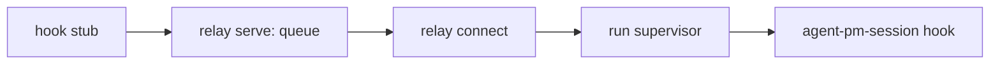

# Docker host

Codex installation, broker login and container runs: [Codex operations](docker-codex.md).
Renewal, failure repair and pending live acceptance: [Refresh and recovery](docker-codex.md#refresh-and-recovery).

`agent-pm-broker` builds the worker image and starts and closes worker containers on
macOS (Apple silicon) with Docker Desktop. It keeps the Claude setup-token in the login
keychain and writes it, and the GitHub App's installation tokens, only into a container's tmpfs. Its JSON interface:
[Docker broker protocol](docker-broker-protocol.md). Session's Docker Host calls it to run
workers ([Run workers](#run-workers)); the sections up to Close install the broker and
check it by hand.

Run every step as yourself, with `HOME` your account home. `B` below is
`/usr/local/libexec/agent-pm/agent-pm-broker`; `PKG` is the installed agent-pm plugin
directory.

## Install

Needs Docker Desktop (running) and `gh` (logged in).

```sh
sh "$PKG/broker/install.sh"
```

It downloads the broker release asset of the plugin's version, installs it only after
`gh attestation verify` proves the agent-pm release workflow built it from that version's
tag, seeds `~/.agent-pm/docker/worker/Dockerfile` (your worker image definition, edit it
freely) only if `~/.agent-pm/docker/worker` does not exist, and installs the broker
root-owned (`sudo` asks once). The asset appears a few minutes after a Release is published:
until then it exits non-zero, so retry. `sh "$PKG/broker/install.sh" --build` instead builds
it and signs it ad hoc with the hardened runtime locally (needs Go, `brew install go`, and
the Xcode command line tools).
To upgrade, rerun the same command; your Dockerfile is never overwritten. Claude Code
upgrades with the image; Codex follows its [container version policy](docker-codex.md#container-versions).
A start rebuilds an image built 7 or more days ago, and
[Build](#build) rebuilds it now.

| Check | Expect |
|---|---|
| `codesign -dv --verbose=4 "$B" 2>&1 \| grep -E 'Identifier\|flags'` | `Identifier=com.github.ophis.agent-pm-broker`, `flags=0x10002(adhoc,runtime)` |
| `ls -ld /usr/local/libexec/agent-pm "$B"` | both `root wheel`, `drwxr-xr-x` / `-rwxr-xr-x` |
| `"$B" version` | `{"protocol_version":"13"}` |
| edit `~/.agent-pm/docker/worker/Dockerfile`, rerun `install.sh` | your edit stays |

## Log in

After installing or reinstalling the broker, run all three logins: `login claude`,
`login github agent-pm-bot` and `login codex` ([Codex operations](docker-codex.md#commands)).
A reinstalled broker is another application to the keychain, so an item logged in by the old
one would ask at the next start. Each login asks its terminal questions first, without echo:

| Login | Terminal | macOS dialog, at most | Click |
|---|---|---|---|
| `login claude` | the token; the login keychain password only when the item's access needs a change | one change-access dialog, after the password; one read dialog, announced on the terminal first | Allow; Always Allow |
| `login github agent-pm-bot` | the login keychain password, when a step is not yet in place | one change-access dialog (Deny / Allow), after the password | Allow |
| `login codex` | the login keychain password, when a step is not yet in place, before the browser opens | one change-access dialog (Deny / Allow), after the password | Allow |
| `start` | none | none: a token it cannot read without one fails with `login_required` naming `login claude` | |

```sh
claude setup-token          # copy the token it prints
"$B" login claude           # paste it; nothing echoes
```

It saves the token in a new item trusting only the broker, then makes its access trust only the
broker as `login github` does below, with the prompt
`Login keychain password, to make Claude trust only the broker (hidden):`.
Then it reads the token back without a dialog. If macOS would still ask, it first prints
`macOS will ask to let agent-pm-broker use agent-pm-claude: enter the login keychain password if asked and click Always Allow`.
It then reads once with the dialog and once more without, to prove Always Allow (not Allow) was
clicked.

| Check | Expect |
|---|---|
| output of `login claude` | `Claude setup-token saved; keychain trusts only the broker`, no token |
| `security dump-keychain -a ~/Library/Keychains/login.keychain-db \| grep -A20 agent-pm-claude` | service `agent-pm-claude`, account `setup-token`; the only trusted application is `$B` |
| shell history | no token |
| first Claude [start](#start) after `login claude` | no keychain dialog |

GitHub: the private key of the one GitHub App, `agent-pm-bot`, must already be a
generic-password item in the login keychain, service `agent-pm-bot`, account its App ID,
content the base64 key. Change the item's access in place to trust only the broker; content and account stay. When a step is
not yet in place, the broker asks once on its terminal, without echo, for the login keychain
password (a wrong one fails with `keychain status -25293`); it then does only those steps,
both with that password: the partition list gets only the broker's partition ID, then the
entries that read or export the item get only the broker. If macOS refuses that second
change with the password, the keychain dialog asks instead (allow it). It reads the access back, then
the key once to check it is not empty, and only then prints its success line; otherwise it
exits non-zero saying whether it changed the item, what is done and what is not: rerun the
same command to finish. Then it looks up the App's bot user, `agent-pm-bot[bot]`, on GitHub's
public user API (no credential sent; needs network) and keeps its ID in the broker-only keychain
item `agent-pm-github-users`, for the containers' git identity ([What a container gets](#what-a-container-gets)). The broker is trusted by its code requirement (an ad hoc
signature's is its cdhash), not its path: after reinstalling it, rerun `login github agent-pm-bot`.
The App must be private (installable only on your account): every session gets a token for every
repository of every installation.

```sh
"$B" login github agent-pm-bot
```

| Check | Expect |
|---|---|
| first run after installing or reinstalling the broker | one hidden `Login keychain password` question on the terminal; no macOS dialog, or one only after the password |
| output | `GitHub App agent-pm-bot private key (App ID <App ID>) now trusts only the broker`, then `GitHub App agent-pm-bot bot user agent-pm-bot[bot] has ID <ID>` (`gh api 'users/agent-pm-bot[bot]' --jq .id`), no key |
| `security dump-keychain -a ~/Library/Keychains/login.keychain-db \| grep -A40 '"agent-pm-bot"'` | every entry with `decrypt` or `export` lists only `$B`, none `/usr/bin/security`; `partition_id` lists only the `cdhash:` from `codesign -dv --verbose=4 "$B"` (its `CDHash=`), no `apple-tool:` |
| `security find-generic-password -s agent-pm-bot -a <App ID> -w` | asks for the keychain password; Cancel: non-zero exit, empty stdout |
| rerun `login github agent-pm-bot` | same output, no password question |

## Build

```sh
"$B" build --agent-pm "$PKG"
"$B" build --agent-pm "$PKG"
```

The first streams Docker's build progress to stderr, then prints
`{"image":"agent-pm-worker:<key>","digest":"sha256:…","rebuilt":true}`, the second the
same with `"rebuilt":false`. Change the Dockerfile (or upgrade agent-pm)
and the next build rebuilds with a new key. Neither build log shows a secret.

Every rebuild builds your Dockerfile without Docker's build cache, so it installs npm's
latest Claude Code; Codex preparation follows [Codex operations](docker-codex.md#container-versions). To rebuild now:

```sh
"$B" build --agent-pm "$PKG" --max-age 0
```

`--max-age N` rebuilds an image built N or more seconds ago (`0`: always) under the same
key; a start passes 604800 (7 days). When such a refresh fails (e.g. offline), `build`
keeps the image, printing `agent-pm-broker: kept <image>: refreshing it failed: <reason>`;
`--max-age 0` fails instead.

After a rebuild, `build` removes the `agent-pm-user:<key>` and `agent-pm-worker:<key>`
images of older keys, and the untagged ones a same-key rebuild left, keeping the new pair and any image a container (running or
stopped) was created from, and prints `agent-pm-broker: removed <image>` to stderr for
each. An image it cannot remove stays, with an `agent-pm-broker: kept <image>: <reason>`
line; a kept image goes at a later rebuild once no container uses it. A reused image
removes nothing.

| Check (`I` = the printed image) | Expect |
|---|---|
| `docker image inspect "$I" --format '{{json .Config.Labels}}'` | `agent-pm.version` equals the plugin's version; `agent-pm.key`, `agent-pm.agent-uid`, `agent-pm.agent-gid` |
| `docker history --no-trunc "$I" \| grep -c sk-ant` | `0` |
| `docker run --rm "$I" sh -c 'command -v python3; python3 -P /opt/agent-pm/team/tools/repo.py --help'` | `/opt/agent-pm/bin/python3` (the image's interpreter, which imports agent-pm's Delegate), then `repo.py`'s usage: role runs read the team and run its tools from `/opt/agent-pm/team`, the plugin's own version |
| delete a line (e.g. `WORKDIR`) from your Dockerfile and rebuild | the new image still has the labels and `/opt/agent-pm/bin/with-secrets`; restore the line after |
| `docker image ls --filter reference='agent-pm-*'` after that rebuild | only the new key's pair, plus the older worker image of any container still on it |
| `"$B" build --agent-pm "$PKG" --max-age 0` | `"rebuilt":true`, the same `image`, a new `digest`; the log shows `npm install` running, not `CACHED` |

### Plugins

A container's clients load the plugins its image holds: the Docker Host's whitelist,
`[session.hosts.docker] plugins` ([Run workers](#run-workers)), default `["autopilot"]`,
which the team's `/autopilot:build`, `/autopilot:light-build` and `/autopilot:review` need.
Never agent-pm's own plugin: every session runs with it disabled, and the image already holds
the team at `/opt/agent-pm/team`. To change the whitelist, set the key in
`~/.agent-pm/config.local.toml`; `[]` gives containers no plugin:

```toml
[session.hosts.docker]
plugins = ["autopilot", "other@its-marketplace"]
```

Each name is a plugin you installed in Claude Code at user scope (`claude plugin install`),
as `name`, or `name@marketplace` when two marketplaces have one. `build` passes each as
`--plugin NAME`: the broker looks it up in `~/.claude/plugins/installed_plugins.json`, copies
the version Claude Code loads now (its `installPath`, under `~/.claude/plugins/cache/`) to
`/opt/agent-pm/plugins/<name>`, root-owned and read-only for `agent`, and sets
`CLAUDE_CODE_PLUGIN_DIRS` to those paths, so each loads as `<name>@inline` and keeps its
`/<name>:` commands. The copied files are part of the image key, so a whitelist change or a
plugin upgrade (`claude plugin update`) rebuilds the image at the next start; Claude Code's
`.in_use/` and `.orphaned_at` markers are not copied and change nothing. A launch env's own
`CLAUDE_CODE_PLUGIN_DIRS` replaces the image's. The whitelist names the account's Claude Code
plugins; [Codex's native adaptation](docker-codex.md#native-plugins) uses that same payload.

A build fails before Docker runs, with `build_failed` naming the plugin, when a name has no
user-scope install (`Plugin <name> is not installed: no user-scope entry in <record>.`),
matches two marketplaces, resolves outside the plugin cache, has no valid
`.claude-plugin/plugin.json` name, or holds a symlink leaving its directory or dangling; a start then
fails in preflight with that message. Install the plugin, or drop it from the whitelist.

Whitelisting a plugin trusts its code beside the container's client and GitHub credentials.
Claude loads its hooks, MCP servers and scripts; [Codex's adaptation](docker-codex.md#native-plugins)
defines which components it loads. Host-side upgrades reach containers at their next build.
One whitelist per account: a build with another whitelist
gives another key, and its rebuild removes the other's images.

| Check | Expect |
|---|---|
| `"$B" build --agent-pm "$PKG" --plugin autopilot`, then `docker run --rm "$I" sh -c 'echo "$CLAUDE_CODE_PLUGIN_DIRS"; stat -c %U /opt/agent-pm/plugins/autopilot; touch /opt/agent-pm/plugins/autopilot/x'` | `/opt/agent-pm/plugins/autopilot`, `root`, then `Permission denied` |
| `"$B" build --agent-pm "$PKG" --plugin no-such-plugin` | exit 8, `build_failed`, `Plugin no-such-plugin is not installed: …`; no Docker build |
| `claude plugin update autopilot@<marketplace>`, then the same `--plugin autopilot` build | `"rebuilt":true`, a new `image` key |
| `/autopilot:build` typed in a container's Claude | the skill starts |

## Start

```sh
mkdir -p ~/src/demo ~/.agent-pm/docker-state/worker_1/claude
cat > /tmp/worker_1.json <<EOF
{"name": "worker_1", "client": "claude", "generation": "$(openssl rand -hex 16)", "image": "$I",
 "cwd": "$HOME/src/demo", "workspace": "agent-pm-ws-worker_1",
 "claude_dir": "$HOME/.agent-pm/docker-state/worker_1/claude", "github": null, "labels": {}}
EOF
"$B" start --manifest /tmp/worker_1.json
```

It prints `container` (`C` below), `endpoint`, `image_digest` and actual `clients`
versions. Codex starts add the [version audit](docker-broker-protocol.md#success-fields).

| Check | Expect |
|---|---|
| `docker inspect "$C" --format '{{.HostConfig.CapDrop}} {{.HostConfig.SecurityOpt}} {{.Config.User}} {{.HostConfig.Privileged}} {{.HostConfig.NetworkMode}} {{.HostConfig.PidMode}}'` | `[ALL] [no-new-privileges] agent false bridge ` (empty PidMode) |
| `docker inspect "$C" --format '{{json .Mounts}}'` | the volume `agent-pm-ws-worker_1` at cwd, one bind (claude_dir) and no `docker.sock` |
| `docker exec "$C" grep -E "$HOME\|/run/agent-pm" /proc/mounts` | the volume at cwd, claude_dir at its host path, and the `/run/agent-pm/secrets` tmpfs; nothing else from the host |
| `docker volume inspect agent-pm-ws-worker_1 --format '{{json .Labels}}'` | `agent-pm.kind` `ws`, `agent-pm.workspace` `$HOME/src/demo` |
| `docker exec "$C" sh -c 'touch x; stat -c %U .; echo $npm_config_cache'`, then `ls ~/src/demo` | `agent`, `$HOME/src/demo/.agent-pm-cache`; the host dir stays empty |
| `docker exec "$C" ps -o comm= -p 1` | `tini` |
| `docker exec "$C" sh -c 'id -u; command -v sudo; tmux -V; git --version; gh --version; python3 --version; uv --version; node --version; claude --version; codex --version'` | uid not 0, no sudo path, every version prints |
| `docker exec "$C" ls -l /run/agent-pm/secrets` | one file `claude`, `-r--------`, owned by `agent` |
| `docker inspect "$C" \| grep -c sk-ant`; `docker logs "$C" \| grep -c sk-ant`; `grep -c sk-ant /tmp/worker_1.json`; `docker exec "$C" env \| grep -c sk-ant` | `0` each |
| `cat ~/.agent-pm/docker-state/worker_1/claude/.claude.json` | `hasCompletedOnboarding: true`, and `projects["$HOME/src/demo"].hasTrustDialogAccepted: true` |
| `lsof -nP -a -iTCP -sTCP:LISTEN -c agent-pm` during a start | no listening TCP socket; Codex version preparation and GitHub token operations may open outbound HTTPS connections |

**GitHub:** with `"github": {"app": "agent-pm-bot"}` in the manifest, start's `github` lists
one `{"account", "expires_at"}` per installation of the App, and `github_user_id` the bot user ID
`login github` saved.

| Check | Expect |
|---|---|
| `docker exec "$C" ls -l /run/agent-pm/secrets/github` | one file per installation account, `-r--------`, owned by `agent` |
| `docker exec "$C" git ls-remote https://github.com/<account>/<private repo>`; `docker exec "$C" gh api repos/<account>/<private repo> --jq .full_name` | both work, with no login |
| `"$B" refresh --container "$C" --manifest /tmp/worker_1.json` | a new `github` list, each `expires_at` later |
| `"$B" close --container "$C"`, then `"$B" status` | `{"revocations":[]}`: every token was revoked |

**Claude:** `docker exec -it "$C" with-secrets --client claude claude` opens with no login, theme or
trust prompt and answers one sentence.

**Hijack:** with `export DOCKER_HOST=tcp://127.0.0.1:9 DOCKER_CONTEXT=bogus`, a
`~/.docker/config.json` naming another context, and an executable `docker` that runs
`touch /tmp/fake-docker-ran` first on `PATH`, `"$B" build --agent-pm "$PKG"` still
reports `"rebuilt":false` and `/tmp/fake-docker-ran` does not exist. Restore
`~/.docker/config.json` after.

## What a container gets

Everything a worker container gets, each row pointing at its source; the source holds the exact values.

| What | Source | Summary |
|---|---|---|
| `docker run` flags | `broker/internal/launcher/start.go` `create` | user `agent`, all capabilities dropped, `no-new-privileges`, bridge network, `tini` as PID 1, the `agent-pm.session` and `agent-pm.generation` labels |
| `docker run` env | `create` | the client home (`CLAUDE_CONFIG_DIR` or `CODEX_HOME`); npm, uv and pip caches under `<cwd>/.agent-pm-cache` |
| Mounts | `create`, `mounts.go` | the workspace volume at cwd ([Workspace volumes](#workspace-volumes)); Claude: its home bound at its host path; Codex: tmpfs home and runtime, its `sessions` bound |
| Secrets tmpfs | `create`; written by `broker/internal/broker/keychain.go` `Credentials.Inject`, `github.go` `Issue`/`Refresh`, `codex.go` `Codex.Inject` | `/run/agent-pm/secrets`, agent-owned, `noexec`: the client credential and one GitHub token per installation ([GitHub tokens](docker-broker-protocol.md#github-tokens)); read only through `with-secrets` and the `gh`/git credential wrappers |
| Start-time files | `create` (`bootstrap.py`, `hook-stub`) | client state that skips onboarding and trusts cwd; the hook stub |
| Exec env | `session/src/agent_pm/session/hosts/docker/host.py` `_exec_env` | the client's launch env without `PATH`; with `[session.hosts.docker.github] app`: `AGENT_PM_PR_AUTHOR` and the git author and committer, `<app>[bot] <<bot user ID>+<app>[bot]@users.noreply.github.com>`, the ID from start's `github_user_id` ([Log in](#log-in)) |
| Image: base | `~/.agent-pm/docker/worker/Dockerfile` (seeded from `broker/worker/Dockerfile`) | your image: tools such as tmux, git, gh, Node, uv and Claude Code ([Build](#build)) |
| Image: agent-pm layer | `broker/internal/launcher/assets/Dockerfile` | agent-pm's session, delegate and utils sources and venv, the allowed plugins ([Plugins](#plugins)), Codex, the `gh` and git credential wrappers (`/etc/gitconfig`), `with-secrets`, `relay`, `/opt/agent-pm/bin` first on `PATH`; no git identity |

## Refusals

Each fails before any container exists (`docker ps -a` unchanged), with the exit code:

| Change to the manifest or host | Exit |
|---|---|
| add a field `"x": 1` | 3 `manifest_rejected` |
| `image` a tag not built by `build` (e.g. `agent-pm-worker:` + 64 `0`) | 6 `image_rejected` |
| `cwd` a missing dir, `/`, `/home`, `/usr/local/x`, `/opt/agent-pm`, `/home/agent` or `$HOME` (it holds `claude_dir`) | 4 `mount_rejected` |
| `claude_dir` any other path | 4 |
| `hook_path` inside `cwd` | 4 |
| `security delete-generic-password -s agent-pm-claude -a setup-token ~/Library/Keychains/login.keychain-db`, then start | 5 `login_required`, naming `agent-pm-broker login claude`; log in again after |
| reinstall the broker (`install.sh --build`), then start a Claude manifest without `login claude` | 5 `login_required`, "trusts another broker build"; no keychain dialog; log in again after |
| start the same manifest while its container runs | 9 `start_failed`, "close it first"; the running container is untouched |
| while `C` runs, the same manifest with a new `generation` | 4 `mount_rejected`: its volume is in use |
| `docker volume create agent-pm-ws-worker_3`, then a `worker_3` manifest | 4 `mount_rejected`: the volume has no workspace labels; `docker volume rm agent-pm-ws-worker_3` after |

## Close

```sh
"$B" close --container "$C"   # {"container":"…","removed":true}
"$B" close --container "$C"   # removed:false: already gone
```

`docker ps -a --filter name="$C"` lists nothing.

## Run workers

To run tui workers in containers, make the Docker Host the default in
`~/.agent-pm/config.local.toml`:

```toml
[session.hosts]
default = "docker"
```

| `[session.hosts.docker]` key | Default | Meaning |
|---|---|---|
| `docker` | `/usr/local/bin/docker` | the docker CLI, an absolute path |
| `plugins` | `["autopilot"]` | the installed plugin payloads every container's image holds ([Plugins](#plugins)); `[]`: none |
| `github.app` | `agent-pm-bot` | the GitHub App whose installation tokens every session gets, as `AGENT_PM_PR_AUTHOR=<app>[bot]` names it; `""`: none |
| `isolated` | `true` | its sessions' clients run in yolo mode ([Permissions](#permissions)); `false`: auto mode, as on tmux |

Each session's GitHub tokens are refreshed 10 minutes before the first one expires, a TUI
session's by its host run supervisor, a headless run's by its harness; a failed refresh writes
`github_refresh_failed <reason>` to the TUI session's events or the harness's log, and retries
every minute.

Then `agent-pm-crew worker NAME --client claude` starts NAME in its own container, and
`send`, `read`, `attach`, `status`, `report`, `next-event`, `pending` and `close` work as
on tmux. The Viewer shows it as it shows a tmux session: `--display none` starts it hidden,
`[session.viewer]` shapes its grid, and `ls --descendants` follows the sessions it opened. Every docker call goes to `unix://<account home>/.docker/run/docker.sock`,
whatever `DOCKER_HOST`, `DOCKER_CONTEXT` or `DOCKER_CONFIG` say.

### Permissions

The container is the isolation boundary, so every Docker session, crew worker, role run or
headless run, at start, restart and resume, runs its client in yolo mode: Claude
`--dangerously-skip-permissions`, Codex `--dangerously-bypass-approvals-and-sandbox`. No
permission prompt or approval appears; the client writes files, runs `gh` and reaches the
network unasked. Its reach is the container's: the workspace volume, the session's GitHub
tokens and the network. Flags and table: [Client policy](sessions.md#client-policy).

### Role runs

Role runs (`agent-pm-crew role` and attended board runs) run their client in a container
too, their harness staying on the host, which needs a Host of its own:

```toml
[delegate.delegates]
harness_host = "tmux"
```

A headless agent (an unattended board run, `agent-pm-delegate run` without `--detach`) runs
there too, under its agent name and the rules below. Its client runs by `docker exec -i` in
its own container, with no tmux, hook relay or supervisor, its output streamed back to the
harness; `ls`, `attach` and the Viewer do not show it, and a TUI start of its name is
refused while it runs. Its container closes when the client exits or is stopped; one whose
harness died is closed by the next Docker start or close. The Docker Host treats them as any
session: their volume is `agent-pm-ws-<agent name>`, mounted at `<workdir>/agent`, and a board
issue's revision rounds keep its name and volume. `agent-pm-crew reopen` resumes a Docker run
on the Docker Host under its agent name, with the same client history and volume, whichever
mode started it.
On the Docker Host the Delegate:

- refuses, before any container and naming the key, a `harness_host` that is empty or the
  Docker Host, a `read` dir other than the image's team (`{{team}}`, a core role's
  `{{role_team}}`, the tasks dir), any `write` dir, a role `cwd`, a cwd other than the agent
  dir (a `trusted_dirs` project cwd included), a `team_dirs` role, and an input whose
  `Reference:` block names two `Repo:` lines or one off github.com;
- gives the agent the image's team at `/opt/agent-pm/team` and its `python3`;
- writes that `Repo:` line as `owner/name`, a local clone's read from its `origin`;
- sets `AGENT_PM_USERS` in the session env: the configured `users` without any `[bot]`;
- asks for the deliverable inline in the outcome, never `deliverable_file`; `local` and
  `orchestrator` outputs still save it to `out`;
- drops the outcome's `files` before checking it, noting `files_dropped` in `run.jsonl`,
  so an engineer run posts no spec or plan to Linear.

Before the first role run, run `"$B" login github agent-pm-bot` ([Log in](#log-in)) and
install the App on every repo the runs need, `private_docs` included. Whichever repos the
App is installed on, every Docker session (role run or crew worker) can read and write;
no other private repo.

In the container, `repo.py worktree` makes a fresh blobless clone at
`<Workdir>/src/<owner>/<name>-<slug>`, never a worktree of a `[local_clones]` clone, and
counts a repo it can read as pushable. With `AGENT_PM_PR_AUTHOR` set, `repo.py status`
never calls `gh api user`: it finds the PR `agent-pm-bot[bot]` opened, and puts in `user`
only the comments and reviews by `AGENT_PM_USERS`, the bot's own in `others`. An engineer
opens its draft PR through the `gh` wrapper, authored by `agent-pm-bot[bot]`; the
Delegate's ready gate on the host marks it ready, you approve it with your own account, and
revision rounds push to the same branch. Then [review before pulling](#review-before-pulling).

Each start, restart or resume runs a new generation in a new container, built from the
current image. `restart` closes the running container and starts the next one; `resume`
(after `close`, or once the container is gone) starts one in the same cwd. Both keep the
client history and the [workspace volume](#workspace-volumes) and continue its
conversation; only a new start clears them. A resume
whose conversation file is missing, or is a symlink, fails before any container exists
with `no native history to resume`. The worker's resume command is
`agent-pm-session resume <name>`, never `client-resume`, which would start the client on the
host.

Docker supports Claude and [Codex](docker-codex.md#docker-sessions) terminals and headless runs.
Unsupported clients, detached sessions, and a start while a container
of that name still exists fail before container creation. The broker's Refusals above apply too.

Every start first runs a preflight: the client and mode are supported, the cwd exists
(`Session.preflight` also accepts one not yet made: a role run makes its agent dir after
it), the broker answers `version` with the expected protocol (else it points to
[Install](#install)), and
`build` succeeds, rebuilding an image built 7 or more days ago
(its Docker progress streams to the starting command's stderr). `resume` runs it before it touches anything;
`restart` closes the running container first, so a failed preflight leaves the worker
closed and `resume` continues it once fixed. Missing client credentials fail at the broker's `start`, before container creation, with
its matching host `agent-pm-broker login <client>` repair command; the start is not retried.

`agent-pm-crew` waits up to 1920 s for a start or resume, as the build alone may take
1800 s (the first start after an upgrade, or once the image is 7 days old, rebuilds it), then sends SIGTERM and,
60 s later, SIGKILL. From just before the broker's `start` until the client runs, a
start holds SIGTERM, SIGINT and SIGHUP back (an ignored one stays ignored); on one it
removes its container, then the signal takes effect. A start stopped after that leaves
its worker running.

Just before the broker's `start`, each generation freezes its plan in
`<generation>.plan.json` and prints it to the starting command's stderr, one line each:

```text
docker plan NAME GENERATION: image agent-pm-worker:<key> sha256:<digest>
docker plan NAME GENERATION: workspace agent-pm-ws-NAME at <cwd> rw
docker plan NAME GENERATION: mounts <claude dir> rw
docker plan NAME GENERATION: credential claude-setup-token
```

The plan is for you to check against `docker inspect`; it holds no env values, flags or
token, and the broker reads only the manifest.

`~/.agent-pm/docker-state/<name>/` holds the client's config dir (cleared at each new
start, kept by restart and resume), each generation's start manifest
(`<generation>.json`), plan (`<generation>.plan.json`, above) and result
(`<generation>.result.json`: container, image and digest, client versions, when the broker's start began and ended, and the [start timing](#start-timing)
`phases` and `launched_at`),
`host.json` (what the host knows of the session, with its events path), a headless run's
`pipe.lock` (held by its harness while its client runs), the hook
supervisor's `supervisor.lock` (holding the generation) and `supervisor.pid`, each
generation's `<generation>.seq` (the last hook event it delivered), `<generation>.stale`
(its image is no longer the current one) and `rejected.jsonl`
(one `gen`, `seq`, `reason` line per event refused, never its content); `close` keeps it.

Each new start writes the fresh Claude config dir a `settings.json` holding:

- `skipWorkflowUsageWarning`, `autoCompactEnabled` and `autoContinueAtUsageLimit`, all
  `true` whatever the host sets, so an unattended run never stops at the Workflow usage
  warning, a full context or a usage limit;
- `model`, `effortLevel`, `modelSettings` and `env.CLAUDE_CODE_MAX_WEB_SEARCHES_PER_SESSION`
  from the host Claude's (`$CLAUDE_CONFIG_DIR/settings.json`, else
  `~/.claude/settings.json`), so the worker runs the host's default model and effort.

No other host setting, credential, hook, plugin, status line or permission reaches it.
Without readable host settings it runs on Claude's default model. `--model`/`--effort` and
role config still win, as on tmux. A resume keeps the home, and so the `settings.json`, its
session started with.

### Start timing

Every start, restart or resume reports where its time went to the starting command's
stderr, in three blocks, each once its part succeeded (a failed broker or Session start
reports no block of its own). Each phase's seconds count from the end of the one before:

```text
docker timing NAME: preflight 41.20 s
agent-pm-broker: start preflight 0.01 s
…
agent-pm-broker: start total 38.75 s
docker timing NAME GENERATION: checks 0.12 s
…
```

| Line | Phase | Covers |
|---|---|---|
| `docker timing NAME` | `preflight` | cwd checks, broker `version` and `build`: a rebuild (after an upgrade, or of an image 7 days old) lands here |
| `agent-pm-broker: start` | `preflight` | manifest, cwd and `claude_dir` rules, setup-token present |
| | `image` | the image check |
| | `checks` | the container-name check and the workspace volume (created and given to the agent user on first use) |
| | `create` | `docker run`: the new container |
| | `bootstrap` | Claude's bootstrap state and the hook stub |
| | `clients` | both clients' `--version` in the container |
| | `client_update` | Codex starts only: [version preparation](docker-codex.md#container-versions) before secret injection |
| | `credentials` | the token injection |
| | `total` | the broker's whole `start` |
| `docker timing NAME GENERATION` | `checks` | cwd, sweep, the container check |
| | `image` | `version` and `build` again (cached), a new start's workspace reset and client home, the manifest and the plan |
| | `start` | the broker's `start`, as broken down above |
| | `relay` | the supervisor lock, the hook relay serving in the container |
| | `tmux` | the supervisor and the container's tmux session with the client |
| | `client` | until the client's pane runs |

`<generation>.result.json` keeps the last block as `phases` (phase → seconds) and the
moment the client's pane ran as `launched_at` (milliseconds). The client is ready when its
first hook arrives: the first record in `~/.agent-pm/tui/NAME/hooks.jsonl` whose `ts` is
after `launched_at`; their difference is the time from a running client to a ready one.

### Recovery

Hook events travel from the container's hook stub to a relay daemon, which queues them
in the container, then over `docker exec` to the host run supervisor, which runs
`agent-pm-session hook` for each ([relay protocol](docker-relay-protocol.md)).



- **Supervisor or daemon gone** (killed, not a host reboot): the next `attach`, `read`,
  `send`, `status`, `restart` or `close` of that worker starts both again and replays
  the queue. An event is delivered once; one whose hook ran just before the supervisor
  was killed may be delivered twice, never lost. `next-event` alone does not restart
  them: it reads only the events file.
- **Refused events**: an event for another generation or another session's dir, or a
  malformed one, runs nothing and adds a `rejected.jsonl` line; so does a hook that
  exits non-zero, which is not retried.
- **Older image**: a container whose image is not the one the current plugin builds
  (compared by image digest, after a plugin upgrade or a rebuild) gets no restart; the command
  warns `restart it to upgrade`, and its `close` does not wait for its supervisor.
- **Container gone** (Docker Desktop restart, `docker rm`): the worker shows `dead`;
  `agent-pm-session resume NAME` starts a new container and continues the conversation.
- **Leftover containers**: before every start and close, a container labelled for a
  session is removed when that session has no `~/.agent-pm/tui/NAME/session.json`,
  that file names another generation, or its tmux answers that the session is gone
  (a close killed before removing it). A session starting or closing elsewhere is
  skipped. Each running worker of another name costs one `docker exec` (at most 10 s).

## Workspace volumes

A worker's workspace is a Docker volume, never a host directory: `agent-pm-ws-<name>`
for every session, a crew worker or a [role run](#role-runs). The broker mounts it at the
session's cwd, the path it has on the host, which stays untouched and unshared. A worker starts in an empty directory and clones what
it works on with the App's tokens; its work reaches the host only through GitHub. npm, uv
and pip caches go to `.agent-pm-cache` inside it.

The broker creates the volume at its first start, labelled `agent-pm.kind` (`ws`) and
`agent-pm.workspace` (the cwd),
its root owned by the agent user. Every mount of it sets `volume-nocopy`, so Docker never
copies the mount point's owner onto it and the root stays the agent's. A volume of that name with other labels, or mounted by
another container, fails the start with `mount_rejected`; clear a foreign one with
`docker volume rm`.

```sh
"$B" workspace-rm --volume agent-pm-ws-worker_1           # {"volume":"…","removed":true}
"$B" workspace-rm --volume agent-pm-ws-worker_1 --force   # skips the check
```

Without `--force`, `workspace-rm` first runs a check in the newest worker image, offline
with the volume read-only: any repo up to three levels down with uncommitted, stashed or
unpushed work, or a directory it cannot list, keeps the volume and fails with exit 12
`workspace_dirty`, naming each repo and the `--force` command. An absent volume is `removed:false`.

- **New start**: keeps the volume, so a session of the same name finds its checkouts again.
  Only a volume mounted at another cwd (the same name, another `--cwd`) is deleted first;
  unsaved work there fails the start before its config dir is cleared, with that message
  and `or start it in <old cwd> again`; any other failure also stops it.
- **Reclaim**: each `close`, never a start, runs `workspace-rm` on one volume with an
  `agent-pm.kind` label (protocol 4's `agent-pm-crew-*` and `agent-pm-run-*` ones too) whose
  `agent-pm.workspace` path no longer exists on the host, so a close waits for at most one
  check. A volume whose check fails stays, with one warning `docker workspace <volume>
  kept: …` and a marker `~/.agent-pm/docker-state/.kept/<volume>`: for unsaved work it
  stops every later close checking it (delete the volume with `--force` once its work is
  saved); for any other failure it stops them for 24 hours.

| Check | Expect |
|---|---|
| in `C`, `git clone` a public repo into `src/x` and add a file; close; `"$B" workspace-rm --volume agent-pm-ws-worker_1` | exit 12, naming `src/x`; `docker volume ls` still lists it |
| `docker ps -a --filter label=agent-pm.check` during and after | the check container while it runs, nothing after |

## Review before pulling

A worker's branch can carry files your tools run. Review a bot PR on GitHub first; only
then `gh pr checkout <number>` in your own clone. Before running anything there, read every
change to:

- `Makefile` and `package.json` scripts;
- `.claude/` (settings hooks, commands, `CLAUDE.md`) and `.vscode/` (tasks, settings);
- `.envrc`;
- hooks config: `.githooks/`, `.husky/`, `.pre-commit-config.yaml`, `core.hooksPath`, `core.fsmonitor`.

The same goes for an output repo pm and researcher runs push straight to `main` (such as
`private_docs`): `git fetch`, then `git diff --stat HEAD @{upstream}`, before you `git pull`.

The target repo's own `push` and `pull_request` workflows run a worker's changed scripts
with the repo's secrets before you review: require approval for workflow runs, or keep
secrets in environments that need it.

## Risks

- The token sits in every running container's tmpfs, readable by any process there;
  `close` deletes the container but does not revoke the token (revoke it at claude.ai).
- So do the GitHub tokens, each valid for an hour; `close` revokes them. One the broker could
  not revoke stays valid until it expires: `"$B" status` lists it, and the next start, close or
  status retries it.
- Each reinstall changes the broker's ad-hoc code identity: the keychain asks once to let
  it read the Claude setup-token again, and each `login github` asks for the keychain
  password once to trust it.
- Image builds trust the client vendors' npm packages; Codex's policy is in
  [Codex operations](docker-codex.md#container-versions).
- A resume after an upgrade runs a newer Claude than the one that wrote the conversation;
  if it cannot read it, the resume fails rather than starting a new conversation.
- Every restart and resume writes the token into a new container: one copy per running
  container, each deleted with it.
- Events queued in a container are lost with it; the conversation itself continues from
  its transcript on `resume`.
- While the relay daemon is gone and no command has restarted it, the hook stub gives up
  after 10 s and that event is lost; `status` still shows the worker running, and its
  replies are still read from the transcript.
- The first supervisor restart a container needs after a plugin upgrade runs `build`,
  which rebuilds the image before that command finishes; once per generation, as
  `<generation>.stale` records an older image.
- Claude may still show an onboarding prompt after an image rebuild upgrades it; the Claude check above
  catches it.
- Docker Desktop file sharing must include `~/.agent-pm/docker-state`
  (Settings > Resources > File sharing); otherwise start fails with `start_failed`.
- Why workspaces are volumes: a worker writing to a host dir could plant files that host
  tools run, not only git hooks: `.claude/settings.json` hooks, `.envrc`, Makefile and
  `package.json` scripts, `.vscode` tasks, and a git `core.fsmonitor`.
- A workspace volume outlives its container: it stays until its cwd leaves the host or
  `workspace-rm`, and holds whatever the worker cloned. A crew worker whose cwd stays keeps
  its volume for good: remove it with `workspace-rm`.
- Volumes are named by session: a board issue that switches client gets a new sid, name
  and empty volume, and clones again; the old volume goes only when the issue is pruned, so
  its unpushed work must be fetched from it by hand.
- The `workspace-rm` check sees only git: ignored files (autopilot plan docs, progress
  logs) go with the volume; `--force` drops unpushed work too.
- A kept dirty volume takes disk until you deal with it; reclaiming runs only on a Docker close.
- Volumes are plain files in the Docker Desktop VM: anyone with Docker access can read them.
- `claude_dir` is still a read-write bind mount: a worker can leave settings, hooks,
  `CLAUDE.md`, symlinks or large files there, for its own later generations only; whatever
  on the host reads it must not follow symlinks.
- Every Docker session can push to any unprotected branch of every repo the App is
  installed on, `private_docs`'s `main` included, not only its issue's repo.
- A pulled branch, or a pull of an output repo a run pushed to `main`, brings files your
  tools run (`.claude/settings.json`, `.vscode/tasks.json`, …); only
  [review before pulling](#review-before-pulling) guards against it.
- A target repo's `push` and `pull_request` CI runs a worker's changed scripts with the
  repo's secrets before review ([Review before pulling](#review-before-pulling)).
- A headless run's output comes from its container, where its client and tools share uid
  `agent`: a forged rate-limit line pauses the board for that client until its reset time,
  as a forged transcript record already can for a TUI run. The harness holds up to 66 lines
  of up to 8 Mi characters each, both streams together (about 2 GiB at worst as Python
  strings), before it reads them.
- A harness killed with `kill -9` leaves its headless client running, with its token, until
  the next Docker start or close closes its container.
- Containers reach the host through `host.docker.internal`: a host service listening on
  all interfaces or on Docker's gateway is reachable from workers.
