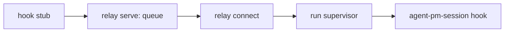

# Docker host

`agent-pm-broker` builds the worker image and starts and closes worker containers on
macOS (Apple silicon) with Docker Desktop. It keeps the Claude setup-token in the login
keychain and writes it only into a container's tmpfs. Its JSON interface:
[Docker broker protocol](docker-broker-protocol.md). Session's Docker Host calls it to run
workers ([Run workers](#run-workers)); the sections up to Close install the broker and
check it by hand.

Run every step as yourself, with `HOME` your account home. `B` below is
`/usr/local/libexec/agent-pm/agent-pm-broker`; `PKG` is the installed agent-pm plugin
directory.

## Install

Needs Docker Desktop (running), Go (`brew install go`) and the Xcode command line tools.

```sh
sh "$PKG/broker/install.sh"
```

It seeds `~/.agent-pm/docker/worker/Dockerfile` (your worker image definition, edit it
freely) only if `~/.agent-pm/docker/worker` does not exist, builds the broker, signs it
ad hoc with the hardened runtime and installs it root-owned (`sudo` asks once).
To upgrade, rerun the same command; your Dockerfile is never overwritten.

| Check | Expect |
|---|---|
| `codesign -dv --verbose=4 "$B" 2>&1 \| grep -E 'Identifier\|flags'` | `Identifier=com.github.ophis.agent-pm-broker`, flags include `runtime` |
| `ls -ld /usr/local/libexec/agent-pm "$B"` | both `root wheel`, `drwxr-xr-x` / `-rwxr-xr-x` |
| `"$B" version` | `{"protocol_version":"2"}` |
| edit `~/.agent-pm/docker/worker/Dockerfile`, rerun `install.sh` | your edit stays |

## Configure

Add to `~/.agent-pm/config.local.toml` (the only roots a cwd may sit under; keep
them to project folders):

```toml
[session.hosts.docker]
mount_roots = ["~/src"]
```

## Log in

```sh
claude setup-token          # copy the token it prints
"$B" login claude           # paste it; nothing echoes
```

| Check | Expect |
|---|---|
| output of `login claude` | `Claude setup-token saved`, no token |
| `security dump-keychain -a ~/Library/Keychains/login.keychain-db \| grep -A20 agent-pm-claude` | service `agent-pm-claude`, account `setup-token`; the only trusted application is `$B` |
| shell history | no token |

## Build

```sh
"$B" build --agent-pm "$PKG"
"$B" build --agent-pm "$PKG"
```

The first streams Docker's build progress to stderr, then prints
`{"image":"agent-pm-worker:<key>","digest":"sha256:…","rebuilt":true}`, the second the
same with `"rebuilt":false`. Change the Dockerfile (or upgrade agent-pm)
and the next build rebuilds with a new key. Neither build log shows a secret.

| Check (`I` = the printed image) | Expect |
|---|---|
| `docker image inspect "$I" --format '{{json .Config.Labels}}'` | `agent-pm.version` equals the plugin's version; `agent-pm.key`, `agent-pm.agent-uid`, `agent-pm.agent-gid` |
| `docker history --no-trunc "$I" \| grep -c sk-ant` | `0` |
| delete a line (e.g. `WORKDIR`) from your Dockerfile and rebuild | the new image still has the labels and `/opt/agent-pm/bin/with-secrets`; restore the line after |

## Start

```sh
mkdir -p ~/src/demo ~/.agent-pm/docker-state/worker_1/claude
cat > /tmp/worker_1.json <<EOF
{"name": "worker_1", "generation": "$(openssl rand -hex 16)", "image": "$I",
 "cwd": "$HOME/src/demo", "claude_dir": "$HOME/.agent-pm/docker-state/worker_1/claude",
 "labels": {}}
EOF
"$B" start --manifest /tmp/worker_1.json
```

It prints `container` (`C` below), `endpoint`, `image_digest`, the `clients` versions and
`update` (`updated`, or `fallback` with a `reason`).

| Check | Expect |
|---|---|
| `docker inspect "$C" --format '{{.HostConfig.CapDrop}} {{.HostConfig.SecurityOpt}} {{.Config.User}} {{.HostConfig.Privileged}} {{.HostConfig.NetworkMode}} {{.HostConfig.PidMode}}'` | `[ALL] [no-new-privileges] agent false bridge ` (empty PidMode) |
| `docker inspect "$C" --format '{{json .Mounts}}'` | two binds (cwd, claude_dir) and no `docker.sock` |
| `docker exec "$C" grep -E "$HOME\|/run/agent-pm" /proc/mounts` | cwd and claude_dir at their host paths, and the `/run/agent-pm/secrets` tmpfs; nothing else from the host |
| `docker exec "$C" ps -o comm= -p 1` | `tini` |
| `docker exec "$C" sh -c 'id -u; command -v sudo; tmux -V; git --version; gh --version; python3 --version; uv --version; node --version; claude --version; codex --version'` | uid not 0, no sudo path, every version prints |
| `docker exec "$C" ls -l /run/agent-pm/secrets` | one file `claude`, `-r--------`, owned by `agent` |
| `docker inspect "$C" \| grep -c sk-ant`; `docker logs "$C" \| grep -c sk-ant`; `grep -c sk-ant /tmp/worker_1.json`; `docker exec "$C" env \| grep -c sk-ant` | `0` each |
| `cat ~/.agent-pm/docker-state/worker_1/claude/.claude.json` | `hasCompletedOnboarding: true`, and `projects["$HOME/src/demo"].hasTrustDialogAccepted: true` |
| `lsof -nP -a -iTCP -c agent-pm` during a start | nothing: the broker opens no TCP socket |
| while `C` runs, start a `worker_2` manifest (its own `claude_dir`) with `cwd` `$HOME/src/other`; close it after | it starts: a sibling of a running worker's cwd is not nested |

**Claude:** `docker exec -it "$C" with-secrets claude` opens with no login, theme or
trust prompt and answers one sentence.

**Hijack:** with `export DOCKER_HOST=tcp://127.0.0.1:9 DOCKER_CONTEXT=bogus`, a
`~/.docker/config.json` naming another context, and an executable `docker` that runs
`touch /tmp/fake-docker-ran` first on `PATH`, `"$B" build --agent-pm "$PKG"` still
reports `"rebuilt":false` and `/tmp/fake-docker-ran` does not exist. Restore
`~/.docker/config.json` after.

**Client update:** with the network off (Wi-Fi off), a new start still succeeds with
`"update":{"status":"fallback","reason":"network",…}` and the image's versions in
`clients`. With the network on, `clients.claude` is npm's latest Claude Code.

## Refusals

Each fails before any container exists (`docker ps -a` unchanged), with the exit code:

| Change to the manifest or host | Exit |
|---|---|
| add a field `"x": 1` | 3 `manifest_rejected` |
| `image` a tag not built by `build` (e.g. `agent-pm-worker:` + 64 `0`) | 6 `image_rejected` |
| `cwd` `$HOME`, `$HOME/.agent-pm/x`, `$HOME/.ssh`, `$HOME/Library`, `/Users`, or a symlink in `~/src` to one of them | 4 `mount_rejected` |
| `cwd` outside every `mount_roots` entry | 4 |
| `claude_dir` any other path | 4 |
| `hook_path` inside `cwd` | 4 |
| `security delete-generic-password -s agent-pm-claude -a setup-token ~/Library/Keychains/login.keychain-db`, then start | 5 `login_required`, naming `agent-pm-broker login claude`; log in again after |
| start the same manifest while its container runs | 9 `start_failed`, "close it first"; the running container is untouched |
| while `C` runs, a `worker_2` manifest (its own `claude_dir`) with `cwd` `$HOME/src/demo/sub` | 4 `mount_rejected`: inside a running worker's cwd |

## Close

```sh
"$B" close --container "$C"   # {"container":"…","removed":true}
"$B" close --container "$C"   # removed:false: already gone
```

`docker ps -a --filter name="$C"` lists nothing.

## Run workers

To run tui workers in containers, make the Docker Host the default in the same file:

```toml
[session.hosts]
default = "docker"
```

| `[session.hosts.docker]` key | Default | Meaning |
|---|---|---|
| `docker` | `/usr/local/bin/docker` | the docker CLI, an absolute path |
| `mount_roots` | `[]` | the roots above; empty: every start fails and asks you to set it |

Then `agent-pm-crew worker NAME --client claude` starts NAME in its own container, and
`send`, `read`, `attach`, `status`, `report`, `next-event`, `pending` and `close` work as
on tmux. Every docker call goes to `unix://<account home>/.docker/run/docker.sock`,
whatever `DOCKER_HOST`, `DOCKER_CONTEXT` or `DOCKER_CONFIG` say.

Each start, restart or resume runs a new generation in a new container, built from the
current image. `restart` closes the running container and starts the next one; `resume`
(after `close`, or once the container is gone) starts one in the same cwd. Both keep the
Claude config dir and continue its conversation; only a new start clears it. A resume
whose conversation file is missing, or is a symlink, fails before any container exists
with `no native history to resume`. The worker's resume command is
`agent-pm-session resume <name>`, never `client-resume`, which would start Claude on the
host.

Refused before any container exists, as not supported on the Docker Host yet: a client
other than Claude, role runs (a cwd under `~/.agent-pm`), detached sessions, and a start
while a container of that name still exists. The broker's Refusals above apply too, and
Session checks the same cwd rules first.

Every start first runs a preflight: the client is Claude, the cwd exists and passes the
mount rules, the broker answers `version` with the expected protocol (else it points to
[Install](#install)), and `build` succeeds (its Docker progress streams to the starting
command's stderr). `resume` runs it before it touches anything;
`restart` closes the running container first, so a failed preflight leaves the worker
closed and `resume` continues it once fixed. A missing setup-token surfaces at the
broker's `start`, still before any container: the start fails with the broker's own
`agent-pm-broker login claude` message and is not retried.

`agent-pm-crew` waits up to 1920 s for a start or resume, as the build alone may take
1800 s (the first start after an upgrade rebuilds the image), then sends SIGTERM and,
60 s later, SIGKILL. From just before the broker's `start` until the client runs, a
start holds SIGTERM, SIGINT and SIGHUP back (an ignored one stays ignored); on one it
removes its container, then the signal takes effect. A start stopped after that leaves
its worker running.

Just before the broker's `start`, each generation freezes its plan in
`<generation>.plan.json` and prints it to the starting command's stderr, one line each:

```text
docker plan NAME GENERATION: image agent-pm-worker:<key> sha256:<digest>
docker plan NAME GENERATION: mounts <cwd> rw, <claude dir> rw
docker plan NAME GENERATION: credential claude-setup-token
```

The plan is for you to check against `docker inspect`; it holds no env values, flags or
token, and the broker reads only the manifest.

`~/.agent-pm/docker-state/<name>/` holds the client's config dir (cleared at each new
start, kept by restart and resume), each generation's start manifest
(`<generation>.json`), plan (`<generation>.plan.json`, above) and result
(`<generation>.result.json`: container, image and digest, client versions, update
result, and when the broker's start began and ended),
`host.json` (what the host knows of the session, with its events path), the hook
supervisor's `supervisor.lock` (holding the generation) and `supervisor.pid`, each
generation's `<generation>.seq` (the last hook event it delivered), `<generation>.stale`
(its image is older than the current plugin's) and `rejected.jsonl`
(one `gen`, `seq`, `reason` line per event refused, never its content); `close` keeps it.

Each new start writes the fresh Claude config dir a `settings.json` holding only `model`,
`effortLevel` and `modelSettings` from the host Claude's (`$CLAUDE_CONFIG_DIR/settings.json`,
else `~/.claude/settings.json`), so the worker runs the host's default model and effort; no
other host setting, credential, hook or permission reaches it. Without readable host
settings it runs on Claude's default. `--model`/`--effort` and role config still win, as on
tmux.

### Recovery

Hook events travel from the container's hook stub to a relay daemon, which queues them
in the container, then over `docker exec` to the host run supervisor, which runs
`agent-pm-session hook` for each ([relay protocol](docker-relay-protocol.md)).



- **Supervisor or daemon gone** (killed, not a host reboot): the next `attach`, `read`,
  `send`, `status`, `restart` or `close` of that worker starts both again and replays
  the queue. An event is delivered once; one whose hook ran just before the supervisor
  was killed may be delivered twice, never lost. `next-event` alone does not restart
  them: it reads only the events file.
- **Refused events**: an event for another generation or another session's dir, or a
  malformed one, runs nothing and adds a `rejected.jsonl` line; so does a hook that
  exits non-zero, which is not retried.
- **Older image**: a container whose image is not the one the current plugin builds
  (compared by image digest, after a plugin upgrade) gets no restart; the command
  warns `restart it to upgrade`, and its `close` does not wait for its supervisor.
- **Container gone** (Docker Desktop restart, `docker rm`): the worker shows `dead`;
  `agent-pm-session resume NAME` starts a new container and continues the conversation.
- **Leftover containers**: before every start and close, a container labelled for a
  session is removed when that session has no `~/.agent-pm/tui/NAME/session.json`,
  that file names another generation, or its tmux answers that the session is gone
  (a close killed before removing it). A session starting or closing elsewhere is
  skipped. Each running worker of another name costs one `docker exec` (at most 10 s).

## Risks

- The token sits in every running container's tmpfs, readable by any process there;
  `close` deletes the container but does not revoke the token (revoke it at claude.ai).
- Each reinstall changes the broker's ad-hoc code identity, so the keychain asks once to
  allow it again.
- Every start installs npm's latest Claude Code and Codex releases into the container,
  trusting their vendors' npm packages.
- A resume after an upgrade runs a newer Claude than the one that wrote the conversation;
  if it cannot read it, the resume fails rather than starting a new conversation.
- Every restart and resume writes the token into a new container: one copy per running
  container, each deleted with it.
- Events queued in a container are lost with it; the conversation itself continues from
  its transcript on `resume`.
- While the relay daemon is gone and no command has restarted it, the hook stub gives up
  after 10 s and that event is lost; `status` still shows the worker running, and its
  replies are still read from the transcript.
- The first supervisor restart a container needs after a plugin upgrade runs `build`,
  which rebuilds the image before that command finishes; once per generation, as
  `<generation>.stale` records an older image.
- Claude may still show an onboarding prompt after an update; the Claude check above
  catches it.
- A cwd that covers the agent-pm plugin directory lets the worker change what the next
  `build` copies into `/opt/agent-pm`.
- Everything under a `mount_roots` entry can become worker-writable: no root should cover
  host executables or shell startup files (e.g. `~/.local`, `~/bin`).
- A worker can plant `.git` hooks or an fsmonitor in its cwd: run host git there as
  `git -c core.fsmonitor= -c core.hooksPath=/dev/null …`.
- A running worker whose cwd was deleted makes every start fail with `mount_rejected`
  (its mount cannot be resolved) until you close it.
- Docker Desktop file sharing must include the cwd and `~/.agent-pm/docker-state`
  (Settings > Resources > File sharing); otherwise start fails with `start_failed`.
- Containers reach the host through `host.docker.internal`: a host service listening on
  all interfaces or on Docker's gateway is reachable from workers.
