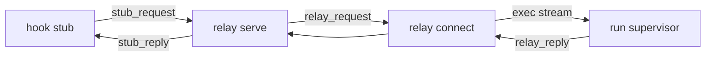

# Docker relay protocol

The wire format between a Docker worker's hook stub, the relay daemon in its container
and the run supervisor on the host, which runs `agent-pm-session hook` for each event.
The stub, relay and supervisor are `session/src/agent_pm/session/hosts/docker/stub.py`,
`relay.py` and `supervisor.py`; recovery: [Docker Host](docker-host.md#recovery).

The relay protocol has no version of its own. The broker installs the stub, so
[broker protocol](docker-broker-protocol.md) `4` covers this format: each change to the
stub's wire format bumps the broker's `protocol_version`.

`relay connect` only forwards between `docker exec -i` and `relay-up.sock`.

## Messages

[protocol.schema.json](../protocol/docker-relay/protocol.schema.json) uses JSON Schema
Draft 2020-12 with internal references only. Each message is a `#/$defs/<name>` entry
point; the document root has none.

| Definition | Direction and channel | Fields |
|---|---|---|
| `stub_request` | stub → daemon, `/run/agent-pm/relay.sock` | `id`, `argv`, `payload` |
| `stub_reply` | daemon → stub | `id`, `queued`; a malformed request gets exactly `{"queued":false}` |
| `relay_request` | daemon → supervisor, `/run/agent-pm/relay-up.sock` and the `relay connect` exec stream | `id`, `gen`, `seq`, `argv`, `payload` |
| `relay_reply` | supervisor → daemon | `gen`, `seq`, `ok`; a malformed request gets exactly `{"ok":false}` |

| Field | Contract |
|---|---|
| `id` | Non-negative integer chosen by the stub; the relay request carries it unchanged |
| `argv` | Exactly `["hook", <directory>, <label>]`: absolute directory, label `[A-Za-z0-9_.-]{1,64}` |
| `payload` | Standard padded base64 (RFC 4648 §4) of the hook's stdin, decoding to at most 64 MiB |
| `gen` | 32 lowercase hexadecimal characters, the session generation |
| `seq` | Integer from 1, assigned by the daemon |
| `queued` | `true`: the request is written to the queue |
| `ok` | `true` or `false`: either way the supervisor has handled the message |

Each message is one UTF-8 JSON object plus LF. Reject duplicate keys, trailing values,
unknown fields, missing fields and control characters in strings. The schema states the
size limit exactly: at most 89478488 base64 characters, ending `==` at that length.

## Behaviour

These rules are not in the schema.

- `/opt/agent-pm/bin/relay serve <generation>` is the daemon. If a daemon already
  answers on `relay.sock`, it exits 0 at once, so starting it again is safe.
- `/opt/agent-pm/bin/relay connect` forwards between the exec stream and
  `relay-up.sock`, and exits when either side closes.
- The daemon accepts one uplink connection at a time; a new one waits until the old one closes.
- **Stop-and-wait**: the daemon sends one message at a time. Any reply, `ok` true or
  false, deletes that message before the next is sent. `ok: false` means the supervisor
  recorded and dropped the message; the daemon does not resend it. A new connection
  replays from the smallest undeleted `seq`.
- A reply that fails `relay_reply`, or a full reply whose `gen` and `seq` differ from
  the message in flight, counts as no reply: the daemon closes the uplink and keeps the
  message for replay.
- The `seq` counter and undeleted messages live in the daemon's queue directory,
  `/run/agent-pm/relay-queue/`; a restarted daemon continues from them.
- The stub sends one request and exits 0 on `{"id":<its id>,"queued":true}`. It also
  exits 0, writing one stderr line, when `relay.sock` is absent, no valid reply arrives
  within 10 seconds, or the reply is not a `queued: true` for its `id`.

## Shared fixtures

[fixtures/index.json](../protocol/docker-relay/fixtures/index.json) lists every `.json`
sample beside it. Stub, relay and supervisor tests read these files, never copies.

| Index field | Meaning |
|---|---|
| `broker_protocol_version` | Broker protocol that covers these fixtures; equals the broker schema's |
| `definition` | Schema entry point under `$defs` |
| `valid` | Expected schema acceptance |
| `payload_bytes` | Replace `payload` with the base64 of this many zero bytes before use |
| `expected.stage` | `schema` for requests; `response` for replies |
| `expected.reply` | The receiver's reply to a request: the malformed reply when invalid, else the reply when every later step succeeds; `null` for replies |
| `note` | Optional explanation for readers |

Install the pinned test dependency and use the supervised test command in
[docs/tests.md](tests.md); the fixture test is `tests/unit/docker_relay_protocol_test.py`.
