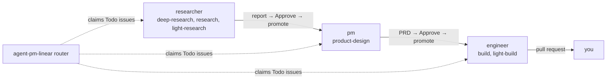

#  agent-pm

[English](../../README.md) · [中文](README.zh-CN.md) · [日本語](README.ja.md) · [한국어](README.ko.md) · **Español** · [Français](README.fr.md) · [Português](README.pt.md)

  

*Esto es una traducción; la versión de referencia es el README en inglés.*

Ejecuta agentes de programación (Claude Code, Codex y más en el futuro) sin supervisión desde un tablero de Linear. Cada project de Linear es un producto, y el assignee de un issue (una cuenta de role) es su etapa. Cada role trabaja hasta en `max_runs` issues a la vez y te devuelve su resultado para que lo revises. Cuando lo apruebas, lo toma el siguiente role.

Desarrolladores: [`AGENTS.md`](../../AGENTS.md).

## Arquitectura en capas

agent-pm está construido en capas: cada una hace un solo trabajo y solo llama a la de abajo. Las dos capas de abajo, Session y Delegate, son piezas genéricas que puedes usar por separado, y la de arriba se puede cambiar: tu propio flujo de trabajo puede sustituir al Linear orchestrator. Para ampliarlo, un nuevo client de agente se conecta en Session, y los nuevos roles y tasks se añaden en Delegate.

| Capa | Qué hace | Empieza en |
|---|---|---|
| Manager | Un conductor para las capas de abajo: un agente con el que hablas, que lanza workers, role runs y runs del tablero, los vigila e informa. | [Demo](#demo-un-manager-muchos-workers) |
| Linear orchestrator | Ejecuta los roles desde un tablero de Linear: mi propio flujo de trabajo. | [Tablero de Linear](../board.md) |
| Delegate (núcleo) | Ejecuta un role sobre una task a través de una session y devuelve un resultado verificado. Un plugin de Claude Code y Codex que puedes usar por separado. | [Instalación](#instalación) |
| Session | Inicia, vigila y reanuda un agente de programación (Claude Code, Codex) en tmux o en un pty, igual para todos los clients. | [Sessions](../sessions.md) |

El Linear orchestrator es mi filosofía de cómo deberían trabajar los agentes (investigación, luego un PRD, luego un build, con revisión humana entre cada etapa). Los roles y las tasks también son tuyos para editar ([Personalizar roles y tasks](../customizing-roles-and-tasks.md)).

## Por qué agent-pm

Un solo agente te hace esperar; con muchos agentes a mano, cada prompt, revisión y aprobación pasa por ti. Con agent-pm hablas con un manager, que lanza, vigila e informa sobre los workers.

## Cinco levels para dominar los AI agents

Trabajar con agents de programación es una escalera: cada level suma una disciplina de ingeniería sobre las de abajo, y la habilidad está en elegir el level que pide el problema.

| Level | Disciplina | Qué significa |
|---|---|---|
| 1. Drive | prompt engineering y context engineering | Prompting conversacional, gestión del context, saber qué modelo sirve para cada trabajo. |
| 2. Equip | tools, skills, MCP | Dar al agent herramientas para alcanzar y actuar sobre el mundo (archivos, APIs, un navegador, MCP servers), dentro de permisos y un sandbox. |
| 3. Systematize | state engineering | Un workflow ejecutado como máquina de estados: etapas definidas, reintentos, pasos idempotentes, traspasos. |
| 4. Orchestrate | loop engineering | Muchos agents: fan-out, planner y verifier, enrutamiento, límites de concurrencia y de cuota. |
| 5. Master | environment engineering | Barreras de seguridad y un entorno agent-oriented: herramientas, checks y verificación hechos para agents, no para humanos, para que el camino más fácil sea el correcto (una idea de Lauren Tan). |

¿Aún no llegas al level 3? Prueba [autopilot](https://github.com/ophis/claude-autopilot): al menos te lleva hasta ahí. Las capas de agent-pm (la tabla del principio) suben más: Session lleva la conversación del agent y le da un host donde actuar (levels 1–2), Delegate ejecuta un role sobre una task como un workflow verificado (3), y el Linear orchestrator, con el manager encima, coordina muchos agents (entre 4 y 5). Ponte tú encima, fijando el entorno, los límites y las puertas, y eso es Master, aunque la verificación de agent-pm todavía se queda un poco corta. La meta es el level 5 y más allá.

## Demo: un manager, muchos workers

Sin el tablero, puedes usar agent-pm hablando con un solo agente, el manager. Abre su session con `ctmux <name>`, inicia Claude Code o Codex en ella e invoca `/agent-pm:manage`. Le das trabajo con palabras normales; lanza un worker por cada task, vigila sus eventos, revisa sus pull requests e informa.

- **Izquierda:** el manager, aquí Claude Code. Lista qué issues están en marcha, esperando o sin empezar, e informa de lo que acaba de hacer cada worker.
- **Derecha:** un panel por cada worker engineer, cada uno construyendo un issue en su propio worktree. Los workers mezclan clients: la mayoría de los paneles son Claude Code (`auto mode on` abajo), y el del centro a la izquierda es Codex (`GPT-6.1-Sol xhigh`, `Ask Codex to do anything`). Los paneles llenan una cuadrícula a medida que arrancan los workers y se cierran cuando terminan.

Comandos: [Inicio rápido](#inicio-rápido).

## Instalación

Cada client instala el plugin por su cuenta. Antes de actualizar, consulta [Upgrading](../upgrading.md).

| Client | Instalación |
|---|---|
| Claude Code | `/plugin marketplace add ophis/agent-pm`, luego `/plugin install agent-pm@agent-pm` |
| Codex 0.156.0+ | `codex plugin marketplace add ophis/agent-pm` (para refrescar uno ya añadido: `codex plugin marketplace upgrade agent-pm`), luego `codex plugin add agent-pm@agent-pm`. `codex plugin list -m agent-pm` debe mostrarlo instalado y habilitado. |

Nada de esto se comprueba. Si falta algo, el run del agente falla.

| Requisito | Para |
|---|---|
| CLI `claude`, Python 3.11+ | cada run de agente |
| el plugin [`autopilot`](https://github.com/ophis/claude-autopilot), en cada client: Claude Code `/plugin marketplace add ophis/claude-autopilot`, luego `/plugin install autopilot@claude-autopilot`; Codex `codex plugin marketplace add ophis/claude-autopilot`, luego `codex plugin add autopilot@claude-autopilot` | las build tasks del engineer (`/autopilot:build`, `/autopilot:light-build`) y la revisión del PRD del PM (`/autopilot:review`). No hace falta en otro caso. |
| tmux 3.3+ | tui runs en el Host `tmux` |
| `git`, `gh` con sesión iniciada | programar (checkouts, pull requests) y destinos de GitHub. No hace falta en otro caso. |
| iTerm2 en ejecución | la división de iTerm2 por defecto |

Cómo cargan tu configuración las sessions que inicia agent-pm, y por qué algunos comandos se niegan dentro de ellas: [Session settings](../sessions.md#session-settings).

| Comando | Hace |
|---|---|
| `ctmux <name>` | Abre la session de tmux del commander: ventanas nativas en iTerm2, un tmux attach normal en otros terminales, un cambio de session desde dentro de tmux. `ctmux --install` pone ctmux y los cuatro comandos `agent-pm-crew`, `agent-pm-session`, `agent-pm-delegate` y `agent-pm-linear` en `~/.agent-pm/bin/`: ejecútalos con esa ruta o añádela a `PATH`. Cada uno ejecuta ese comando desde el plugin instalado en el momento de ejecutarse (primero la instalación de Claude Code, luego la más reciente de Codex), así que una actualización no requiere reinstalar; vuelve a ejecutar `--install` para refrescarlos. |
| `/agent-pm:manage` | Lanza y dirige workers, role runs y pipeline runs, con las pautas del commander. |
| `/agent-pm:act-as <role>[:<task>] <input>` | Ejecuta un role del núcleo en esta conversación. |
| `agent-pm-delegate run --list` | Lista todos los roles y tasks. |

## Inicio rápido

1. [Instala](#instalación) el plugin.
2. En una session nueva de Claude Code, compruébalo: `/agent-pm:act-as dummy-tester:echo hello` devuelve `hello`.
3. Ejecuta un role: `/agent-pm:act-as researcher <question>`. Sin configuración local, el informe se guarda en `~/.agent-pm/adhoc/<date>-researcher-<name>/agent/prompt.md`; para publicarlo, configura el destination del role ([Personalizar roles y tasks](../customizing-roles-and-tasks.md#change-a-roles-run-settings)).
4. Para ejecutar roles desde Linear: [Tablero de Linear](../board.md).

## Personalizar roles y tasks

- Ajustes de run por role (nivel de modelo, effort, client, destination, comandos): `[delegate.roles.<role>]` en `~/.agent-pm/config.local.toml`.
- Tus propios roles, tasks y plantillas: un directorio de team listado en `[delegate] team_dirs`. Solo añade; nunca cambia un role integrado.
- Comprobar: `agent-pm-delegate run --list`, luego `agent-pm-delegate run --role <role> --input <text> --dry-run`.

Formatos, reglas y los límites del tablero: [Personalizar roles y tasks](../customizing-roles-and-tasks.md).

## Documentación

Estas páginas están en inglés.

| Página | Cubre |
|---|---|
| [Customizing roles and tasks](../customizing-roles-and-tasks.md) | ajustes de run, directorios de team, archivos de role y task, comprobaciones |
| [Linear board](../board.md) | configuración, estados de issue y etiquetas de task, operar el router, etiquetas Agent (client por issue) |
| [Sessions and client policy](../sessions.md) | ajustes de session, `agent-pm-session`, flags de client de los role runs |
| [State root](../state-root.md) | estructura de `~/.agent-pm/`, qué limpia cada entrada, qué puedes borrar |
| [Upgrading](../upgrading.md) | pasos de actualización, migrar desde v1, lista de smoke tests |
| [Core architecture](../architecture.md) | capas y paquetes (desarrolladores) |
| [Tests](../tests.md) | lint, suites de tests, cobertura (desarrolladores) |
