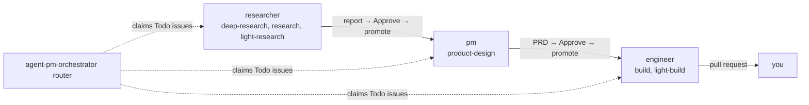

#  agent-pm

[English](../../README.md) · [中文](README.zh-CN.md) · [日本語](README.ja.md) · [한국어](README.ko.md) · [Español](README.es.md) · **Français** · [Português](README.pt.md)

  

*Ceci est une traduction ; la version de référence est le README en anglais.*

Fait tourner des agents de code (Claude Code, Codex, OpenCode sur les modèles Ollama de l'hôte) sans surveillance depuis un tableau Linear. Chaque project Linear est un produit, et l'assignee d'une issue (un compte de role) est son étape. Chaque role traite jusqu'à `max_runs` issues à la fois et vous rend son résultat pour relecture. Une fois que vous approuvez, le role suivant prend le relais.

Développeurs : [`AGENTS.md`](../../AGENTS.md).

## Architecture en couches

agent-pm est construit en couches : chacune fait un seul travail et n'appelle que celle du dessous. Les deux couches du bas, Session et Delegate, sont des briques génériques utilisables seules, et celle du haut se remplace : votre propre workflow peut prendre la place du Linear orchestrator. Pour l'étendre, un nouveau client d'agent se branche sur Session, et de nouveaux roles et tasks s'ajoutent dans Delegate.

| Couche | Ce qu'elle fait | Commencer par |
|---|---|---|
| Manager | Un pilote pour les couches du dessous : un agent à qui vous parlez, qui lance des workers, des role runs et des runs du tableau, les surveille et vous fait un rapport. | [Démo](#démo--un-manager-plusieurs-workers) |
| Linear orchestrator | Fait tourner les roles depuis un tableau Linear : mon propre workflow. | [Tableau Linear](../board.md) |
| Delegate (cœur) | Fait exécuter une task à un role via une session et renvoie un résultat vérifié. Un plugin Claude Code et Codex utilisable seul. | [Installation](#installation) |
| Session | Démarre, surveille et reprend un agent de code (Claude Code, Codex, OpenCode) dans tmux ou un conteneur Docker, de la même façon pour chaque client. | [Sessions](../sessions.md) |

Le Linear orchestrator est ma philosophie de la façon dont les agents devraient travailler (recherche, puis un PRD, puis un build, avec une relecture humaine entre chaque étape). Les roles et les tasks sont aussi à vous de modifier ([Personnaliser les roles et les tasks](../customizing-roles-and-tasks.md)).

## Pourquoi agent-pm

Un seul agent vous fait attendre ; plusieurs agents à la main font passer chaque prompt, vérification et approbation par vous. Avec agent-pm, vous parlez à un manager, qui lance les workers, les surveille et vous en rend compte.

## Cinq levels pour maîtriser les AI agents

Travailler avec des agents de code, c'est une échelle : chaque level ajoute une discipline d'ingénierie au-dessus des précédentes, et tout l'art consiste à choisir le level adapté au problème.

| Level | Discipline | Ce que cela veut dire |
|---|---|---|
| 1. Drive | prompt engineering et context engineering | Prompting conversationnel, gestion du context, savoir quel modèle convient à quelle tâche. |
| 2. Equip | tools, skills, MCP | Donner à l'agent des outils pour atteindre le monde et agir dessus (fichiers, APIs, navigateur, MCP servers), dans les limites des permissions et d'un sandbox. |
| 3. Systematize | state engineering | Un workflow exécuté comme une machine à états : étapes définies, relances, étapes idempotentes, passages de relais. |
| 4. Orchestrate | loop engineering | Plusieurs agents : fan-out, planner et verifier, routage, limites de concurrence et de quota. |
| 5. Master | environment engineering | Garde-fous et environnement agent-oriented : outils, checks et vérification pensés pour les agents, pas pour les humains, pour que le chemin le plus facile soit le bon (une idée de Lauren Tan). |

Pas encore au level 3 ? Essayez [autopilot](https://github.com/ophis/claude-autopilot) : il vous y mène, au moins. Les couches d'agent-pm (le tableau du début) montent plus haut : Session porte la conversation de l'agent et lui donne un host où agir (levels 1–2), Delegate exécute un role sur une task comme un workflow vérifié (3), et le Linear orchestrator, avec le manager au-dessus, coordonne plusieurs agents (entre 4 et 5). Placez-vous au sommet, à fixer l'environnement, les limites et les points de contrôle, et c'est Master, même si la vérification d'agent-pm reste un peu légère. L'objectif : le level 5 et au-delà.

## Démo : un manager, plusieurs workers

Sans le tableau, vous pouvez utiliser agent-pm en parlant à un seul agent, le manager. Ouvrez sa session avec `ctmux <name>`, lancez-y Claude Code ou Codex et invoquez `/agent-pm:manage`. Vous lui confiez le travail avec des mots simples ; il lance un worker par task, surveille leurs événements, vérifie leurs pull requests et vous fait un rapport.

- **À gauche :** le manager, ici Claude Code. Il liste les issues en cours, en attente ou pas commencées, et rapporte ce que chaque worker vient de faire.
- **À droite :** un panneau par worker engineer, chacun construisant une issue dans son propre worktree. Les workers mélangent les clients : la plupart des panneaux sont Claude Code (`auto mode on` en bas), et celui du milieu à gauche est Codex (`GPT-6.1-Sol xhigh`, `Ask Codex to do anything`). Les panneaux remplissent une grille à mesure que les workers démarrent et se ferment quand leur travail est fini.

Commandes : [Démarrage rapide](#démarrage-rapide).

## Installation

Chaque client installe le plugin lui-même. Avant une mise à jour, voir [Upgrading](../upgrading.md).

| Client | Installation |
|---|---|
| Claude Code | `/plugin marketplace add ophis/agent-pm`, puis `/plugin install agent-pm@agent-pm` |
| Codex 0.156.0+ | `codex plugin marketplace add ophis/agent-pm` (pour rafraîchir un marketplace déjà ajouté : `codex plugin marketplace upgrade agent-pm`), puis `codex plugin add agent-pm@agent-pm`. `codex plugin list -m agent-pm` doit l'afficher installé et activé. |

Rien de tout cela n'est vérifié. S'il en manque un, le run de l'agent échoue.

| Prérequis | Pour |
|---|---|
| CLI `claude`, Python 3.11+ | chaque run d'agent |
| le plugin [`autopilot`](https://github.com/ophis/claude-autopilot), pour les workers sur le host : Claude Code `/plugin marketplace add ophis/claude-autopilot`, puis `/plugin install autopilot@claude-autopilot` ; Codex `codex plugin marketplace add ophis/claude-autopilot`, puis `codex plugin add autopilot@claude-autopilot`. Les workers Docker l’installent dans l’image ([plugins](../docker-host.md#plugins)). | les build tasks de l'engineer (`/autopilot:build`, `/autopilot:light-build`) et la revue du PRD par le PM (`/autopilot:review`). Inutile sinon. |
| tmux 3.3+ | les tui runs sur le Host `tmux` |
| [Ollama](https://ollama.com) sur `127.0.0.1` seulement, contexte d'au moins 65536, modèle du tier téléchargé ; sur `tmux` aussi OpenCode 1.x (`npm install -g opencode-ai@1.19.3`) | OpenCode seulement ([Docker host › OpenCode](../docker-host.md#opencode), [OpenCode sessions](../sessions.md#opencode-sessions)) |
| `git`, `gh` connecté | coder (checkouts, pull requests) et destinations GitHub. Inutile sinon. |
| iTerm2 lancé | le split iTerm2 par défaut |
| Docker Desktop lancé ; le broker `B` (`/usr/local/libexec/agent-pm/agent-pm-broker`), installé par `sh <plugin dir>/broker/install.sh` (demande `sudo` et `gh` connecté) ; une connexion chacun : `B login claude` (collez un `claude setup-token`), `B login github agent-pm-bot` et, pour Codex, `sudo B install-codex <version>` puis `B login codex` ; OpenCode n'en demande aucune | le Docker Host seulement ([Docker host](../docker-host.md)) ; pas de Node sur l'hôte. Ce que permet chaque identifiant, où il est stocké et comment le révoquer : [Credentials](../credentials.md). |

Comment les sessions lancées par agent-pm chargent vos réglages, et pourquoi certaines commandes y refusent de s'exécuter : [Session settings](../sessions.md#session-settings).

| Commande | Rôle |
|---|---|
| `ctmux <name>` | Ouvre la session tmux du commander : fenêtres natives dans iTerm2, un simple tmux attach dans les autres terminaux, un basculement depuis l'intérieur de tmux. `ctmux --install` place ctmux et les quatre commandes `agent-pm-crew`, `agent-pm-session`, `agent-pm-delegate` et `agent-pm-orchestrator` dans `~/.agent-pm/bin/` : lancez-les par ce chemin, ou ajoutez-le au `PATH`. Chacune exécute la commande depuis le plugin installé au moment où elle tourne (d'abord l'installation de Claude Code, puis la plus récente de Codex), donc une mise à jour ne demande pas de réinstallation ; relancez `--install` pour les rafraîchir. |
| `/agent-pm:manage` | Lance et dirige des workers, des role runs et des pipeline runs, selon les consignes du commander. |
| `/agent-pm:act-as <role>[:<task>] <input>` | Exécute un role du cœur dans cette conversation. |
| `/agent-pm:board` | Lit, trouve, crée, modifie, déplace et archive les issues du tableau avec les commandes fixes `agent-pm-orchestrator issue`. |
| `agent-pm-delegate run --list` | Liste tous les roles et toutes les tasks. |

## Démarrage rapide

1. [Installez](#installation) le plugin.
2. Dans une nouvelle session Claude Code, vérifiez-le : `/agent-pm:act-as dummy-tester:echo hello` renvoie `hello`.
3. Lancez un role : `/agent-pm:act-as researcher <question>`. Sans configuration locale, le rapport est enregistré dans `~/.agent-pm/adhoc/<date>-researcher-<name>/agent/prompt.md` ; pour le publier, définissez la destination du role ([Personnaliser les roles et les tasks](../customizing-roles-and-tasks.md#change-a-roles-run-settings)).
4. Pour faire tourner les roles depuis Linear : [Tableau Linear](../board.md).

## Personnaliser les roles et les tasks

- Réglages de run par role (niveau de modèle, effort, client, destination, commandes) : `[delegate.roles.<role>]` dans `~/.agent-pm/config.local.toml`.
- Vos propres roles, tasks et modèles : un répertoire de team listé dans `[delegate] team_dirs`. Il ne fait qu'ajouter ; il ne modifie jamais un role intégré.
- Vérifier : `agent-pm-delegate run --list`, puis `agent-pm-delegate run --role <role> --input <text> --dry-run`.

Formats, règles et limites du tableau : [Personnaliser les roles et les tasks](../customizing-roles-and-tasks.md).

## Documentation

Ces pages sont en anglais.

| Page | Contenu |
|---|---|
| [Customizing roles and tasks](../customizing-roles-and-tasks.md) | réglages de run, répertoires de team, fichiers de role et de task, vérifications |
| [Linear board](../board.md) | mise en place, états d'issue et labels de task, exploitation du router, labels Agent (client par issue) |
| [Sessions and client policy](../sessions.md) | réglages de session, `agent-pm-session`, flags de client des role runs, sessions OpenCode |
| [State root](../state-root.md) | structure de `~/.agent-pm/`, ce qui nettoie chaque entrée, ce que vous pouvez supprimer |
| [Upgrading](../upgrading.md) | étapes de mise à jour depuis la v0.6.20 |
| [Core architecture](../architecture.md) | couches et paquets (développeurs) |
| [Tests](../tests.md) | lint, suites de tests, couverture, tests réels qu'un modèle local peut valider (développeurs) |
