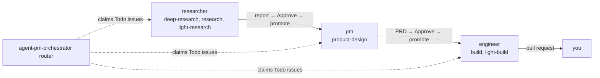

#  agent-pm

[English](../../README.md) · [中文](README.zh-CN.md) · **日本語** · [한국어](README.ko.md) · [Español](README.es.md) · [Français](README.fr.md) · [Português](README.pt.md)

  

*これは翻訳です。正式な内容は英語版 README を参照してください。*

Linear ボードからコーディングエージェント（Claude Code、Codex、ホストの Ollama モデルで動く OpenCode）を無人で動かします。各 Linear project が 1 つのプロダクトで、issue の assignee（role アカウント）がそのステージです。各 role は同時に最大 `max_runs` 件の issue を処理し、成果物をレビューのために戻します。承認すると次の role が引き継ぎます。

開発者向け：[`AGENTS.md`](../../AGENTS.md)。

## レイヤー構成

agent-pm はレイヤーで構成され、各レイヤーは 1 つの役割だけを担い、すぐ下のレイヤーだけを呼び出します。下の 2 つのレイヤー、Session と Delegate は単体で使える汎用の部品です。一番上は差し替えられ、Linear orchestrator の代わりに自分のワークフローを置けます。拡張するときは、新しいエージェント client を Session に、新しい role と task を Delegate に追加します。

| レイヤー | 役割 | 入口 |
|---|---|---|
| Manager | 下位レイヤーのドライバー。対話するエージェントで、worker、role run、ボード run を起動し、監視して報告します。 | [デモ](#デモ1-つの-manager複数の-worker) |
| Linear orchestrator | Linear ボードから role を動かします。私自身のワークフローです。 | [Linear ボード](../board.md) |
| Delegate（コア） | session を通じて role に 1 つの task を実行させ、チェック済みの結果を返します。単体でも使える Claude Code / Codex プラグインです。 | [インストール](#インストール) |
| Session | tmux または Docker コンテナでコーディングエージェント（Claude Code、Codex、OpenCode）を起動・監視・再開します。どの client でも同じ方法です。 | [Sessions](../sessions.md) |

Linear orchestrator は、エージェントがどう働くべきかについての私の考え方です（調査、PRD、ビルドの順に進み、各ステージの間に人間のレビューを挟む）。role と task 自体も自由に編集できます（[role と task のカスタマイズ](../customizing-roles-and-tasks.md)）。

## agent-pm を使う理由

エージェント 1 つでは待たされます。複数のエージェントを手作業で回すと、すべてのプロンプト、チェック、承認があなたを経由します。agent-pm では manager と話すだけで、manager が worker を起動・監視し、報告します。

## AI agent を使いこなす 5 つの level

コーディング agent との協働ははしごのようなものです。各 level は下の level の上に新しいエンジニアリングを積み重ね、肝心なのは問題に合った level を選ぶことです。

| Level | 分野 | 内容 |
|---|---|---|
| 1. Drive | prompt engineering と context engineering | 対話的な prompting、context の管理、どの仕事にどのモデルを使うかの判断。 |
| 2. Equip | tools、skills、MCP | agent にツールを与え、外の世界（ファイル、API、ブラウザ、MCP server）に手を伸ばして操作させる。ただし権限と sandbox の範囲内で。 |
| 3. Systematize | state engineering | 1 つの workflow を状態機械として回す：決まったステージ、リトライ、冪等なステップ、引き継ぎ。 |
| 4. Orchestrate | loop engineering | 複数の agent：fan-out、planner と verifier、ルーティング、並行数と quota の上限。 |
| 5. Master | environment engineering | ガードレールと agent-oriented な環境：人間ではなく agent のために作ったツール、チェック、検証で、いちばん楽な道が正しい道になるようにする（Lauren Tan の考え方）。 |

まだ level 3 に届いていない？[autopilot](https://github.com/ophis/claude-autopilot) をどうぞ。少なくともそこまでは連れて行ってくれます。agent-pm の各層（冒頭の表）はさらに上へ登ります。Session は agent の対話を回し、手を動かせる host を与えます（level 1–2）。Delegate は 1 つの role を 1 つの task でチェック付きの workflow として回します（3）。Linear orchestrator とその上の manager は複数の agent を調整します（4 と 5 の間）。そこにあなたが上に立ち、環境、境界、関門を決めれば Master です。ただし agent-pm の検証はまだ少し手薄です。目標は level 5、そしてその先です。

## デモ：1 つの manager、複数の worker

ボードを使わずに、1 つのエージェント（manager）と話すだけで agent-pm を動かせます。`ctmux <name>` でその session を開き、Claude Code か Codex を起動して `/agent-pm:manage` を呼び出します。普通の言葉で仕事を伝えると、task ごとに worker を起動し、イベントを監視し、pull request をチェックして報告します。

- **左：** manager（ここでは Claude Code）。実行中・待機中・未着手の issue を一覧にし、各 worker が今何をしたかを報告します。
- **右：** engineer worker ごとに 1 つのペイン。それぞれ自分の worktree で 1 つの issue をビルドしています。worker の client は混在できます。ほとんどのペインは Claude Code（下部に `auto mode on`）で、中央左のペインは Codex（`GPT-6.1-Sol xhigh`、`Ask Codex to do anything`）です。worker が起動するとペインがグリッドを埋め、作業が終わると閉じます。

コマンド：[クイックスタート](#クイックスタート)。

## インストール

各 client がそれぞれプラグインをインストールします。アップグレード前に [Upgrading](../upgrading.md) を確認してください。

| Client | インストール |
|---|---|
| Claude Code | `/plugin marketplace add ophis/agent-pm`、続けて `/plugin install agent-pm@agent-pm` |
| Codex 0.156.0+ | `codex plugin marketplace add ophis/agent-pm`（追加済みのものを更新するには `codex plugin marketplace upgrade agent-pm`）、続けて `codex plugin add agent-pm@agent-pm`。`codex plugin list -m agent-pm` でインストール済みかつ有効と表示される必要があります。 |

以下は何もチェックされません。1 つでも欠けているとエージェント run は失敗します。

| 必要なもの | 用途 |
|---|---|
| `claude` CLI、Python 3.11+ | すべてのエージェント run |
| [`autopilot`](https://github.com/ophis/claude-autopilot) プラグイン（各 client に）：Claude Code は `/plugin marketplace add ophis/claude-autopilot`、続けて `/plugin install autopilot@claude-autopilot`。Codex は `codex plugin marketplace add ophis/claude-autopilot`、続けて `codex plugin add autopilot@claude-autopilot` | engineer の build task（`/autopilot:build`、`/autopilot:light-build`）と PM の PRD レビュー（`/autopilot:review`）。それ以外では不要。 |
| tmux 3.3+ | `tmux` Host 上の tui run |
| `127.0.0.1` だけで待ち受け、コンテキスト長 65536 以上、tier のモデルを pull 済みの [Ollama](https://ollama.com)。`tmux` ではさらに OpenCode 1.x（`npm install -g opencode-ai@1.19.3`） | OpenCode のみ（[Docker host › OpenCode](../docker-host.md#opencode), [OpenCode sessions](../sessions.md#opencode-sessions)） |
| `git`、ログイン済みの `gh` | コーディング（checkout、pull request）と GitHub の出力先。それ以外では不要。 |
| 起動中の iTerm2 | デフォルトの iTerm2 分割 |
| 起動中の Docker Desktop。broker `B`（`/usr/local/libexec/agent-pm/agent-pm-broker`）、`sh <plugin dir>/broker/install.sh` でインストール（`sudo` とログイン済みの `gh` が必要）。ログインはそれぞれ 1 回：`B login claude`（`claude setup-token` を貼り付け）、`B login github agent-pm-bot`、Codex は `sudo B install-codex <version>` の後に `B login codex`。OpenCode は不要 | Docker Host のみ（[Docker host](../docker-host.md)）。ホストに Node は不要。各認証情報の権限、保存場所、取り消し方法：[Credentials](../credentials.md)。 |

agent-pm が起動する session があなたの設定をどう読み込むか、そしてその中で一部のコマンドが拒否される理由：[Session settings](../sessions.md#session-settings)。

| コマンド | 内容 |
|---|---|
| `ctmux <name>` | commander の tmux session を開きます。iTerm2 ではネイティブウィンドウ、他のターミナルでは通常の tmux attach、tmux の中からは切り替えになります。`ctmux --install` は ctmux と 4 つのコマンド `agent-pm-crew`、`agent-pm-session`、`agent-pm-delegate`、`agent-pm-orchestrator` を `~/.agent-pm/bin/` に置きます。そのパスで実行するか、`PATH` に追加してください。各コマンドは実行時にインストールされているプラグイン（Claude Code のものを優先し、次に Codex の最新版）から動くので、アップグレード後の再インストールは不要です。`--install` を再実行すると更新されます。 |
| `/agent-pm:manage` | commander のガイドラインに沿って worker、role run、pipeline run を起動・指示します。 |
| `/agent-pm:act-as <role>[:<task>] <input>` | この会話の中でコア role を実行します。 |
| `/agent-pm:linear` | 固定の `agent-pm-orchestrator issue` コマンドで Linear の issue を読み、探し、作成し、変更します。 |
| `agent-pm-delegate run --list` | すべての role と task を一覧表示します。 |

## クイックスタート

1. プラグインを[インストール](#インストール)します。
2. 新しい Claude Code session で確認します：`/agent-pm:act-as dummy-tester:echo hello` が `hello` を返します。
3. role を実行します：`/agent-pm:act-as researcher <question>`。ローカル設定がなければ、レポートは `~/.agent-pm/adhoc/<date>-researcher-<name>/agent/prompt.md` に保存されます。公開したい場合は role の destination を設定してください（[role と task のカスタマイズ](../customizing-roles-and-tasks.md#change-a-roles-run-settings)）。
4. Linear から role を動かすには：[Linear ボード](../board.md)。

## role と task のカスタマイズ

- role ごとの実行設定（モデルの tier、effort、client、destination、コマンド）：`~/.agent-pm/config.local.toml` の `[delegate.roles.<role>]`。
- 独自の role、task、テンプレート：`[delegate] team_dirs` に列挙した team ディレクトリ。追加するだけで、組み込みの role を変えることはありません。
- 確認：`agent-pm-delegate run --list`、続けて `agent-pm-delegate run --role <role> --input <text> --dry-run`。

形式、ルール、ボードの制限：[role と task のカスタマイズ](../customizing-roles-and-tasks.md)。

## ドキュメント

以下のドキュメントは英語です。

| ページ | 内容 |
|---|---|
| [Customizing roles and tasks](../customizing-roles-and-tasks.md) | 実行設定、team ディレクトリ、role と task のファイル、チェック |
| [Linear board](../board.md) | セットアップ、issue の状態と task ラベル、router の運用、Agent ラベル（issue ごとの client） |
| [Sessions and client policy](../sessions.md) | session 設定、`agent-pm-session`、role run の client フラグ、OpenCode の session |
| [State root](../state-root.md) | `~/.agent-pm/` の構成、各エントリを何が掃除するか、削除してよいもの |
| [Upgrading](../upgrading.md) | v0.6.20 以降からのアップグレード手順 |
| [Core architecture](../architecture.md) | レイヤーとパッケージ（開発者向け） |
| [Tests](../tests.md) | lint、テストスイート、カバレッジ、ローカルモデルで判定できる実機テスト（開発者向け） |
