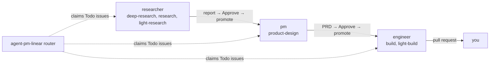

#  agent-pm

[English](../../README.md) · [中文](README.zh-CN.md) · [日本語](README.ja.md) · **한국어** · [Español](README.es.md) · [Français](README.fr.md) · [Português](README.pt.md)

 

*이 문서는 번역본입니다. 공식 버전은 영어 README입니다.*

Linear 보드에서 코딩 에이전트(Claude Code, Codex, 앞으로 더 추가 예정)를 무인으로 실행합니다. 각 Linear project는 하나의 제품이고, issue의 assignee(role 계정)가 그 단계입니다. 각 role은 한 번에 최대 `max_runs`개의 issue를 처리하고 결과물을 검토하도록 돌려줍니다. 승인하면 다음 role이 이어받습니다.

| 레이어 | 하는 일 | 시작점 |
|---|---|---|
| Session | tmux 또는 pty에서 코딩 에이전트(Claude Code, Codex)를 시작, 감시, 재개합니다. 모든 client에서 같은 방식입니다. | [Sessions](../sessions.md) |
| Delegate (코어) | session을 통해 role이 하나의 task를 실행하게 하고, 검사된 결과를 돌려줍니다. 단독으로도 쓸 수 있는 Claude Code 및 Codex 플러그인입니다. | [설치](#설치) |
| Linear orchestrator | Linear 보드에서 role을 실행합니다. 제 워크플로입니다. | [Linear 보드](../board.md) |
| Manager | 아래 레이어들의 드라이버. 대화하는 에이전트로, worker, role run, 보드 run을 시작하고 감시하며 보고합니다. | [데모](#데모-manager-하나-worker-여럿) |

아래 두 레이어인 Session과 Delegate는 범용 구성 요소입니다. 그 위에 자신만의 흐름을 만드세요. Linear orchestrator는 에이전트가 어떻게 일해야 하는지에 대한 제 철학입니다(리서치, PRD, 빌드 순으로, 각 단계 사이에 사람의 검토). 그대로 쓰거나, 건너뛰거나, 바꿔도 됩니다. role과 task 자체도 직접 편집할 수 있습니다([role과 task 사용자 지정](../customizing-roles-and-tasks.md)).

개발자: [`AGENTS.md`](../../AGENTS.md).

## 왜 agent-pm인가

에이전트 하나로는 계속 기다려야 합니다. 여러 에이전트를 수동으로 돌리면 모든 프롬프트, 검사, 승인이 당신을 거칩니다. agent-pm에서는 manager와 대화하고, manager가 worker를 시작하고 감시하며 보고합니다.

## AI agent를 마스터하는 다섯 level

코딩 agent와 일하는 것은 사다리와 같습니다. 각 level은 아래 level 위에 엔지니어링 분야를 하나씩 더하고, 핵심은 문제에 맞는 level을 고르는 것입니다.

| Level | 분야 | 의미 |
|---|---|---|
| 1. Drive | prompt engineering과 context engineering | 대화형 prompting, context 관리, 어떤 일에 어떤 모델을 쓸지 아는 것. |
| 2. Equip | tools, skills, MCP | agent에게 도구를 줘서 바깥 세계(파일, API, 브라우저, MCP server)에 닿아 직접 다루게 하되, 권한과 sandbox 안에서. |
| 3. Systematize | state engineering | 하나의 workflow를 상태 기계로 돌리기: 정해진 단계, 재시도, 멱등한 단계, 인계. |
| 4. Orchestrate | loop engineering | 여러 agent: fan-out, planner와 verifier, 라우팅, 동시 실행과 quota 한도. |
| 5. Master | environment engineering | 가드레일과 agent-oriented 환경: 사람이 아니라 agent를 위해 만든 도구, 검사, 검증으로 가장 쉬운 길이 곧 옳은 길이 되게 하기(Lauren Tan의 생각). |

아직 level 3이 아니라고요? [autopilot](https://github.com/ophis/claude-autopilot)을 써 보세요. 적어도 거기까지는 데려다줍니다. agent-pm의 레이어(맨 위 표)는 더 올라갑니다. Session은 agent의 대화를 돌리고 손을 쓸 host를 줍니다(level 1–2). Delegate는 role 하나를 task 하나에 검사가 붙은 workflow로 돌립니다(3). Linear orchestrator와 그 위의 manager는 여러 agent를 조율합니다(4와 5 사이). 여기에 당신이 맨 위에서 환경, 경계, 관문을 정하면 Master가 됩니다. 다만 agent-pm의 검증은 아직 조금 부족합니다. 목표는 level 5, 그리고 그 너머입니다.

## 데모: manager 하나, worker 여럿

보드 없이, 에이전트 하나(manager)와 대화하는 것만으로 agent-pm을 실행할 수 있습니다. `ctmux <name>`으로 그 session을 열고, Claude Code나 Codex를 시작한 뒤 `/agent-pm:manage`를 호출합니다. 평범한 말로 일을 맡기면 task마다 worker를 시작하고, 이벤트를 감시하고, pull request를 검사한 뒤 보고합니다.

- **왼쪽:** manager, 여기서는 Claude Code. 실행 중, 대기 중, 시작 전인 issue를 나열하고 각 worker가 방금 한 일을 보고합니다.
- **오른쪽:** engineer worker마다 패널 하나. 각자 자기 worktree에서 issue 하나를 빌드합니다. worker는 client를 섞어 쓸 수 있습니다. 대부분의 패널은 Claude Code(하단에 `auto mode on`)이고, 가운데 왼쪽 패널은 Codex(`GPT-6.1-Sol xhigh`, `Ask Codex to do anything`)입니다. worker가 시작되면 패널이 그리드를 채우고, 작업이 끝나면 닫힙니다.

명령: [빠른 시작](#빠른-시작).

## 설치

각 client가 플러그인을 직접 설치합니다. 업그레이드 전에 [Upgrading](../upgrading.md)을 확인하세요.

| Client | 설치 |
|---|---|
| Claude Code | `/plugin marketplace add ophis/agent-pm`, 다음 `/plugin install agent-pm@agent-pm` |
| Codex 0.156.0+ | `codex plugin marketplace add ophis/agent-pm`(이미 추가한 것을 갱신하려면 `codex plugin marketplace upgrade agent-pm`), 다음 `codex plugin add agent-pm@agent-pm`. `codex plugin list -m agent-pm`에 설치되고 활성화된 것으로 보여야 합니다. |

아래 항목은 아무것도 검사하지 않습니다. 하나라도 없으면 에이전트 run이 실패합니다.

| 요구 사항 | 용도 |
|---|---|
| `claude` CLI, Python 3.11+ | 모든 에이전트 run |
| [`autopilot`](https://github.com/ophis/claude-autopilot) 플러그인, 각 client에: Claude Code는 `/plugin marketplace add ophis/claude-autopilot`, 다음 `/plugin install autopilot@claude-autopilot`; Codex는 `codex plugin marketplace add ophis/claude-autopilot`, 다음 `codex plugin add autopilot@claude-autopilot` | 코딩: engineer의 build task(`/autopilot:build`, `/autopilot:light-build`). 그 외에는 필요 없음. |
| tmux 3.3+ | `tmux` Host의 tui run |
| `git`, 로그인된 `gh` | 코딩(checkout, pull request)과 GitHub 대상. 그 외에는 필요 없음. |
| 실행 중인 iTerm2 | 기본 iTerm2 분할 |

agent-pm이 시작하는 session이 당신의 설정을 어떻게 불러오는지, 그리고 그 안에서 일부 명령이 거부되는 이유: [Session settings](../sessions.md#session-settings).

| 명령 | 하는 일 |
|---|---|
| `ctmux <name>` | commander의 tmux session을 엽니다. iTerm2에서는 네이티브 창, 다른 터미널에서는 일반 tmux attach, tmux 안에서는 전환입니다. `ctmux --install`은 ctmux와 네 명령 `agent-pm-crew`, `agent-pm-session`, `agent-pm-delegate`, `agent-pm-linear`를 `~/.agent-pm/bin/`에 둡니다. 그 경로로 실행하거나 `PATH`에 추가하세요. 각 명령은 실행 시점에 설치된 플러그인(Claude Code 설치를 먼저, 그다음 Codex의 최신 설치)에서 실행되므로 업그레이드 후 재설치가 필요 없습니다. `--install`을 다시 실행하면 갱신됩니다. |
| `/agent-pm:manage` | commander의 가이드라인에 따라 worker, role run, pipeline run을 시작하고 지시합니다. |
| `/agent-pm:act-as <role>[:<task>] <input>` | 이 대화에서 코어 role을 실행합니다. |
| `agent-pm-delegate run --list` | 모든 role과 task를 나열합니다. |

## 빠른 시작

1. 플러그인을 [설치](#설치)합니다.
2. 새 Claude Code session에서 확인합니다: `/agent-pm:act-as dummy-tester:echo hello`가 `hello`를 출력합니다.
3. role을 실행합니다: `/agent-pm:act-as researcher <question>`. 로컬 설정이 없으면 보고서는 `~/.agent-pm/adhoc/<date>-researcher-<name>/agent/prompt.md`에 저장됩니다. 대신 게시하려면 role의 destination을 설정하세요([role과 task 사용자 지정](../customizing-roles-and-tasks.md#change-a-roles-run-settings)).
4. Linear에서 role을 실행하려면: [Linear 보드](../board.md).

## role과 task 사용자 지정

- role별 실행 설정(모델 tier, effort, client, destination, 명령): `~/.agent-pm/config.local.toml`의 `[delegate.roles.<role>]`.
- 자신만의 role, task, 템플릿: `[delegate] team_dirs`에 나열한 team 디렉터리. 추가만 하며, 내장 role은 절대 바꾸지 않습니다.
- 확인: `agent-pm-delegate run --list`, 다음 `agent-pm-delegate run --role <role> --input <text> --dry-run`.

형식, 규칙, 보드의 제한: [role과 task 사용자 지정](../customizing-roles-and-tasks.md).

## 문서

아래 문서는 영어입니다.

| 페이지 | 내용 |
|---|---|
| [Customizing roles and tasks](../customizing-roles-and-tasks.md) | 실행 설정, team 디렉터리, role과 task 파일, 검사 |
| [Linear board](../board.md) | 설정, issue 상태와 task 라벨, router 운영, Agent 라벨(issue별 client) |
| [Sessions and client policy](../sessions.md) | session 설정, `agent-pm-session`, role run의 client 플래그 |
| [State root](../state-root.md) | `~/.agent-pm/` 구조, 각 항목을 정리하는 주체, 삭제해도 되는 것 |
| [Upgrading](../upgrading.md) | 업그레이드 단계, v1에서 전환, 스모크 체크리스트 |
| [Core architecture](../architecture.md) | 레이어와 패키지(개발자) |
| [Tests](../tests.md) | lint, 테스트 스위트, 커버리지(개발자) |
