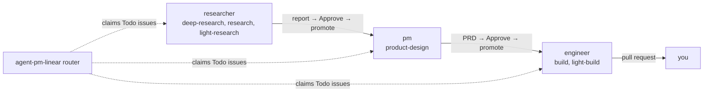

#  agent-pm

[English](../../README.md) · [中文](README.zh-CN.md) · [日本語](README.ja.md) · [한국어](README.ko.md) · [Español](README.es.md) · [Français](README.fr.md) · **Português**

  

*Esta é uma tradução; a versão de referência é o README em inglês.*

Executa agentes de programação (Claude Code, Codex e OpenCode com os modelos Ollama do host) sem supervisão a partir de um quadro do Linear. Cada project do Linear é um produto, e o assignee de uma issue (uma conta de role) é a sua etapa. Cada role trabalha em até `max_runs` issues ao mesmo tempo e devolve o resultado para você revisar. Depois que você aprova, o próximo role assume.

Desenvolvedores: [`AGENTS.md`](../../AGENTS.md).

## Arquitetura em camadas

O agent-pm é construído em camadas: cada uma faz um só trabalho e só chama a de baixo. As duas camadas de baixo, Session e Delegate, são blocos genéricos que você pode usar sozinhos, e a de cima pode ser trocada: o seu próprio fluxo de trabalho pode substituir o Linear orchestrator. Para estendê-lo, um novo client de agente se conecta em Session, e novos roles e tasks entram em Delegate.

| Camada | O que faz | Comece em |
|---|---|---|
| Manager | Um condutor para as camadas abaixo: um agente com quem você conversa, que lança workers, role runs e runs do quadro, acompanha-os e reporta. | [Demo](#demo-um-manager-vários-workers) |
| Linear orchestrator | Executa os roles a partir de um quadro do Linear: o meu próprio fluxo de trabalho. | [Quadro do Linear](../board.md) |
| Delegate (núcleo) | Executa um role numa task por meio de uma session e devolve um resultado verificado. Um plugin do Claude Code e do Codex que você pode usar sozinho. | [Instalação](#instalação) |
| Session | Inicia, acompanha e retoma um agente de programação (Claude Code, Codex, OpenCode) no tmux ou num pty, da mesma forma para todo client. | [Sessions](../sessions.md) |

O Linear orchestrator é a minha filosofia de como os agentes devem trabalhar (pesquisa, depois um PRD, depois um build, com revisão humana entre cada etapa). Os roles e as tasks também são seus para editar ([Personalizar roles e tasks](../customizing-roles-and-tasks.md)).

## Por que agent-pm

Um único agente deixa você esperando; vários agentes à mão fazem cada prompt, verificação e aprovação passar por você. Com o agent-pm você conversa com um manager, que lança os workers, os acompanha e reporta.

## Cinco levels para dominar AI agents

Trabalhar com agents de programação é uma escada: cada level soma uma disciplina de engenharia às de baixo, e a habilidade está em escolher o level que o problema pede.

| Level | Disciplina | O que significa |
|---|---|---|
| 1. Drive | prompt engineering e context engineering | Prompting conversacional, gestão do context, saber que modelo serve para cada trabalho. |
| 2. Equip | tools, skills, MCP | Dar ao agent ferramentas para alcançar e agir sobre o mundo (arquivos, APIs, um navegador, MCP servers), dentro de permissões e de um sandbox. |
| 3. Systematize | state engineering | Um workflow executado como máquina de estados: etapas definidas, novas tentativas, passos idempotentes, passagens de bastão. |
| 4. Orchestrate | loop engineering | Muitos agents: fan-out, planner e verifier, roteamento, limites de concorrência e de cota. |
| 5. Master | environment engineering | Guardrails e um ambiente agent-oriented: ferramentas, checks e verificação feitos para agents, não para humanos, para que o caminho mais fácil seja o certo (uma ideia de Lauren Tan). |

Ainda não chegou ao level 3? Experimente o [autopilot](https://github.com/ophis/claude-autopilot): pelo menos até lá ele te leva. As camadas do agent-pm (a tabela do início) sobem mais: Session conduz a conversa do agent e lhe dá um host onde agir (levels 1–2), Delegate executa um role numa task como um workflow verificado (3), e o Linear orchestrator, com o manager por cima, coordena muitos agents (entre 4 e 5). Coloque você no topo, definindo o ambiente, os limites e os portões, e isso é Master, embora a verificação do agent-pm ainda esteja um pouco fraca. A meta é o level 5 e além.

## Demo: um manager, vários workers

Sem o quadro, você pode usar o agent-pm conversando com um único agente, o manager. Abra a session dele com `ctmux <name>`, inicie o Claude Code ou o Codex nela e invoque `/agent-pm:manage`. Você passa o trabalho em palavras simples; ele lança um worker por task, acompanha os eventos, verifica os pull requests e reporta.

- **Esquerda:** o manager, aqui o Claude Code. Ele lista quais issues estão em execução, aguardando ou não iniciadas, e reporta o que cada worker acabou de fazer.
- **Direita:** um painel por worker engineer, cada um construindo uma issue no seu próprio worktree. Os workers misturam clients: a maioria dos painéis é Claude Code (`auto mode on` embaixo), e o do meio à esquerda é Codex (`GPT-6.1-Sol xhigh`, `Ask Codex to do anything`). Os painéis preenchem uma grade conforme os workers iniciam e fecham quando o trabalho termina.

Comandos: [Início rápido](#início-rápido).

## Instalação

Cada client instala o plugin por conta própria. Antes de atualizar, veja [Upgrading](../upgrading.md).

| Client | Instalação |
|---|---|
| Claude Code | `/plugin marketplace add ophis/agent-pm`, depois `/plugin install agent-pm@agent-pm` |
| Codex 0.156.0+ | `codex plugin marketplace add ophis/agent-pm` (para atualizar um já adicionado: `codex plugin marketplace upgrade agent-pm`), depois `codex plugin add agent-pm@agent-pm`. `codex plugin list -m agent-pm` deve mostrá-lo instalado e habilitado. |

Nada disto é verificado. Se faltar algum, o run do agente falha.

| Requisito | Para |
|---|---|
| CLI `claude`, Python 3.11+ | todo run de agente |
| o plugin [`autopilot`](https://github.com/ophis/claude-autopilot), em cada client: Claude Code `/plugin marketplace add ophis/claude-autopilot`, depois `/plugin install autopilot@claude-autopilot`; Codex `codex plugin marketplace add ophis/claude-autopilot`, depois `codex plugin add autopilot@claude-autopilot` | as build tasks do engineer (`/autopilot:build`, `/autopilot:light-build`) e a revisão do PRD pelo PM (`/autopilot:review`). Desnecessário fora isso. |
| tmux 3.3+ | tui runs no Host `tmux` |
| [Ollama](https://ollama.com) só em `127.0.0.1`, com contexto de pelo menos 65536 e o modelo do tier baixado; no `tmux` e no `pty` também OpenCode 1.x (`npm install -g opencode-ai@1.19.3`) | só OpenCode ([Docker host › OpenCode](../docker-host.md#opencode), [OpenCode sessions](../sessions.md#opencode-sessions)) |
| `git`, `gh` autenticado | programar (checkouts, pull requests) e destinos no GitHub. Desnecessário fora isso. |
| iTerm2 em execução | a divisão padrão do iTerm2 |
| Docker Desktop em execução; o broker `B` (`/usr/local/libexec/agent-pm/agent-pm-broker`), instalado com `sh <plugin dir>/broker/install.sh` (precisa de `sudo` e `gh` autenticado); um login de cada: `B login claude` (cole um `claude setup-token`), `B login github agent-pm-bot` e, para o Codex, `sudo B install-codex <version>` e depois `B login codex`; o OpenCode não precisa de nenhum | só o Docker Host ([Docker host](../docker-host.md)); o host não precisa de Node. O que cada credencial permite, onde fica e como revogá-la: [Credentials](../credentials.md). |

Como as sessions que o agent-pm inicia carregam as suas configurações, e por que alguns comandos se recusam a rodar dentro delas: [Session settings](../sessions.md#session-settings).

| Comando | Faz |
|---|---|
| `ctmux <name>` | Abre a session tmux do commander: janelas nativas no iTerm2, um tmux attach simples em outros terminais, uma troca de session de dentro do tmux. `ctmux --install` coloca o ctmux e os quatro comandos `agent-pm-crew`, `agent-pm-session`, `agent-pm-delegate` e `agent-pm-linear` em `~/.agent-pm/bin/`: execute-os por esse caminho ou adicione-o ao `PATH`. Cada um executa o comando a partir do plugin instalado no momento da execução (primeiro a instalação do Claude Code, depois a mais recente do Codex), então uma atualização não exige reinstalar; rode `--install` de novo para atualizá-los. |
| `/agent-pm:manage` | Lança e dirige workers, role runs e pipeline runs, com as diretrizes do commander. |
| `/agent-pm:act-as <role>[:<task>] <input>` | Executa um role do núcleo nesta conversa. |
| `/agent-pm:linear` | Lê, encontra, cria e altera issues do Linear com comandos fixos `agent-pm-linear issue`. |
| `agent-pm-delegate run --list` | Lista todos os roles e tasks. |

## Início rápido

1. [Instale](#instalação) o plugin.
2. Numa nova session do Claude Code, verifique: `/agent-pm:act-as dummy-tester:echo hello` devolve `hello`.
3. Execute um role: `/agent-pm:act-as researcher <question>`. Sem configuração local, o relatório é salvo em `~/.agent-pm/adhoc/<date>-researcher-<name>/agent/prompt.md`; para publicá-lo, defina o destination do role ([Personalizar roles e tasks](../customizing-roles-and-tasks.md#change-a-roles-run-settings)).
4. Para executar roles a partir do Linear: [Quadro do Linear](../board.md).

## Personalizar roles e tasks

- Configurações de run por role (nível do modelo, effort, client, destination, comandos): `[delegate.roles.<role>]` em `~/.agent-pm/config.local.toml`.
- Os seus próprios roles, tasks e templates: um diretório de team listado em `[delegate] team_dirs`. Ele só adiciona; nunca altera um role embutido.
- Verificar: `agent-pm-delegate run --list`, depois `agent-pm-delegate run --role <role> --input <text> --dry-run`.

Formatos, regras e os limites do quadro: [Personalizar roles e tasks](../customizing-roles-and-tasks.md).

## Documentação

Estas páginas estão em inglês.

| Página | Cobre |
|---|---|
| [Customizing roles and tasks](../customizing-roles-and-tasks.md) | configurações de run, diretórios de team, arquivos de role e task, verificações |
| [Linear board](../board.md) | configuração, estados de issue e labels de task, operação do router, labels Agent (client por issue) |
| [Sessions and client policy](../sessions.md) | configurações de session, `agent-pm-session`, flags de client dos role runs, sessions do OpenCode |
| [State root](../state-root.md) | estrutura de `~/.agent-pm/`, o que limpa cada entrada, o que você pode apagar |
| [Upgrading](../upgrading.md) | passos de atualização a partir da v0.6.20 |
| [Core architecture](../architecture.md) | camadas e pacotes (desenvolvedores) |
| [Tests](../tests.md) | lint, suítes de testes, cobertura, testes ao vivo que um modelo local pode validar (desenvolvedores) |
