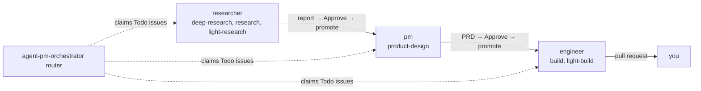

#  agent-pm

[English](../../README.md) · **中文** · [日本語](README.ja.md) · [한국어](README.ko.md) · [Español](README.es.md) · [Français](README.fr.md) · [Português](README.pt.md)

  

*本文为译文，以英文 README 为准。*

从 Linear 看板无人值守地运行编码 agent（Claude Code、Codex，以及用宿主 Ollama 模型的 OpenCode）。每个 Linear project 是一个产品，issue 的 assignee（一个 role 账号）就是它所处的阶段。每个 role 同时最多处理 `max_runs` 个 issue，并把产出交回给你审阅。你批准后，下一个 role 接手。

开发者：[`AGENTS.md`](../../AGENTS.md)。

## 分层架构

agent-pm 是分层构建的：每层只做一件事，只调用它下面的一层。底下两层 Session 和 Delegate 是通用的构建块，可以单独拿去用；最上层也可以换掉，用你自己的工作流替代 Linear orchestrator。要扩展，新的 agent client 接在 Session，新的 role 和 task 加在 Delegate。

| 层 | 做什么 | 从这里开始 |
|---|---|---|
| Manager | 下面各层的驱动：一个你与之对话的 agent，它启动 worker、role run 和看板 run，监视它们并向你汇报。 | [演示](#演示一个-manager多个-worker) |
| Linear orchestrator | 从 Linear 看板运行各 role：我自己的工作流。 | [Linear 看板](../board.md) |
| Delegate（核心） | 通过一个 session 让某个 role 执行一个 task，并返回经过检查的结果。是一个可单独使用的 Claude Code 和 Codex 插件。 | [安装](#安装) |
| Session | 在 tmux 或 Docker 容器中启动、监视和恢复编码 agent（Claude Code、Codex、OpenCode），对每个 client 方式相同。 | [Sessions](../sessions.md) |

Linear orchestrator 是我对 agent 应如何工作的理念（先研究，再写 PRD，再构建，每个阶段之间都有人工审阅）。role 和 task 本身也都由你编辑（[自定义 role 和 task](../customizing-roles-and-tasks.md)）。

## 为什么用 agent-pm

单个 agent 让你一直等；手动管理多个 agent，每个 prompt、检查和批准都要经过你。用 agent-pm，你只和一个 manager 对话，由它启动、监视 worker 并汇报。

## 精通 AI agent 的五个 level

和编码 agent 协作是一架梯子：每个 level 在下面几层之上再加一门工程功夫，真正的本事是让 level 匹配问题。

| Level | 工程方向 | 含义 |
|---|---|---|
| 1. Drive | prompt engineering 和 context engineering | 对话式 prompting、管理 context、知道什么活用什么模型。 |
| 2. Equip | tools、skills、MCP | 给 agent 工具，让它能触及并操作外部世界（文件、API、浏览器、MCP server），但都在权限和 sandbox 之内。 |
| 3. Systematize | state engineering | 把一套 workflow 跑成状态机：明确的阶段、重试、幂等步骤、交接。 |
| 4. Orchestrate | loop engineering | 多个 agent：fan-out、planner 和 verifier、路由、并发和配额上限。 |
| 5. Master | environment engineering | 护栏，加上 agent-oriented 的环境：工具、检查和验证都为 agent 而不是为人设计，让最省事的路就是对的路（Lauren Tan 的观点）。 |

还没到 level 3？试试 [autopilot](https://github.com/ophis/claude-autopilot)：至少能把你带到那儿。agent-pm 的各层（见开头的表格）爬得更高：Session 跑 agent 的对话并给它一个能动手的 host（level 1–2），Delegate 把一个 role 在一个 task 上跑成带检查的 workflow（3），Linear orchestrator 加上其上的 manager 协调多个 agent（4 和 5 之间）。再加上你在最上面设定环境、边界和关卡，就是 Master，只是 agent-pm 的验证还差一点。目标是 level 5，乃至更高。

## 演示：一个 manager，多个 worker

不用看板时，你可以通过和一个 agent（manager）对话来运行 agent-pm。用 `ctmux <name>` 打开它的 session，在里面启动 Claude Code 或 Codex，然后调用 `/agent-pm:manage`。你用平常的话交代工作；它为每个 task 启动一个 worker，监视它们的事件，检查它们的 pull request 并向你汇报。

- **左侧：** manager，这里是 Claude Code。它列出哪些 issue 在运行、在等待或尚未开始，并汇报每个 worker 刚做了什么。
- **右侧：** 每个 engineer worker 一个窗格，各自在自己的 worktree 中构建一个 issue。worker 可混用不同 client：大多数窗格是 Claude Code（底部显示 `auto mode on`），中间偏左的是 Codex（`GPT-6.1-Sol xhigh`、`Ask Codex to do anything`）。worker 启动时窗格依次填满网格，工作完成后关闭。

命令：[快速上手](#快速上手)。

## 安装

每个 client 自行安装插件。升级前请看 [Upgrading](../upgrading.md)。

| Client | 安装 |
|---|---|
| Claude Code | `/plugin marketplace add ophis/agent-pm`，然后 `/plugin install agent-pm@agent-pm` |
| Codex 0.156.0+ | `codex plugin marketplace add ophis/agent-pm`（刷新已添加的：`codex plugin marketplace upgrade agent-pm`），然后 `codex plugin add agent-pm@agent-pm`。`codex plugin list -m agent-pm` 必须显示已安装并已启用。 |

以下各项不会被检查。缺少任何一项都会使 agent run 失败。

| 依赖 | 用途 |
|---|---|
| `claude` CLI、Python 3.11+ | 每次 agent run |
| [`autopilot`](https://github.com/ophis/claude-autopilot) 插件，每个 client 都要装：Claude Code `/plugin marketplace add ophis/claude-autopilot`，然后 `/plugin install autopilot@claude-autopilot`；Codex `codex plugin marketplace add ophis/claude-autopilot`，然后 `codex plugin add autopilot@claude-autopilot` | engineer 的 build task（`/autopilot:build`、`/autopilot:light-build`）和 PM 的 PRD 评审（`/autopilot:review`）。其他情况不需要。 |
| tmux 3.3+ | 在 `tmux` Host 上的 tui run |
| [Ollama](https://ollama.com) 只听 `127.0.0.1`，上下文长度至少 65536，已拉取 tier 模型；在 `tmux` 上还要 OpenCode 1.x（`npm install -g opencode-ai@1.19.3`） | 只有 OpenCode 需要（[Docker host › OpenCode](../docker-host.md#opencode), [OpenCode sessions](../sessions.md#opencode-sessions)） |
| `git`、已登录的 `gh` | 写代码（checkout、pull request）和 GitHub 目标。其他情况不需要。 |
| 正在运行的 iTerm2 | 默认的 iTerm2 分屏 |
| 正在运行的 Docker Desktop；broker `B`（`/usr/local/libexec/agent-pm/agent-pm-broker`），用 `sh <plugin dir>/broker/install.sh` 安装（需要 `sudo` 和已登录的 `gh`）；每项登录一次：`B login claude`（粘贴一个 `claude setup-token`）、`B login github agent-pm-bot`，Codex 先 `sudo B install-codex <version>`，再 `B login codex`；OpenCode 不需要 | 只有 Docker Host 需要（[Docker host](../docker-host.md)）；宿主不需要 Node。每份凭据的权限、存放位置和吊销方式：[Credentials](../credentials.md)。 |

agent-pm 启动的 session 如何加载你的设置，以及为什么有些命令在其中会拒绝执行：[Session settings](../sessions.md#session-settings)。

| 命令 | 作用 |
|---|---|
| `ctmux <name>` | 打开 commander 的 tmux session：在 iTerm2 中是原生窗口，在其他终端中是普通的 tmux attach，在 tmux 内部则是切换。`ctmux --install` 把 ctmux 和四个命令 `agent-pm-crew`、`agent-pm-session`、`agent-pm-delegate`、`agent-pm-orchestrator` 放进 `~/.agent-pm/bin/`：按该路径运行，或把它加到 `PATH`。每个命令运行时都从当时已安装的插件中执行（先找 Claude Code 的安装，再找 Codex 最新的），所以升级后无需重装；重新运行 `--install` 可刷新它们。 |
| `/agent-pm:manage` | 按 commander 的准则启动并指挥 worker、role run 和 pipeline run。 |
| `/agent-pm:act-as <role>[:<task>] <input>` | 在当前对话中运行一个核心 role。 |
| `/agent-pm:board` | 用固定的 `agent-pm-orchestrator issue` 命令读取、查找、创建、编辑、移动和归档看板上的 issue。 |
| `agent-pm-delegate run --list` | 列出所有 role 和 task。 |

## 快速上手

1. [安装](#安装)插件。
2. 在新的 Claude Code session 中检查：`/agent-pm:act-as dummy-tester:echo hello` 会回显 `hello`。
3. 运行一个 role：`/agent-pm:act-as researcher <question>`。没有本地配置时，报告保存在 `~/.agent-pm/adhoc/<date>-researcher-<name>/agent/prompt.md`；若要发布，请设置该 role 的 destination（[自定义 role 和 task](../customizing-roles-and-tasks.md#change-a-roles-run-settings)）。
4. 从 Linear 运行各 role：[Linear 看板](../board.md)。

## 自定义 role 和 task

- 每个 role 的运行设置（模型档位、effort、client、destination、命令）：`~/.agent-pm/config.local.toml` 中的 `[delegate.roles.<role>]`。
- 你自己的 role、task 和模板：放在 `[delegate] team_dirs` 列出的 team 目录中。它只能新增，从不改动内置 role。
- 检查：`agent-pm-delegate run --list`，然后 `agent-pm-delegate run --role <role> --input <text> --dry-run`。

格式、规则和看板的限制：[自定义 role 和 task](../customizing-roles-and-tasks.md)。

## 文档

以下文档为英文。

| 页面 | 内容 |
|---|---|
| [Customizing roles and tasks](../customizing-roles-and-tasks.md) | 运行设置、team 目录、role 和 task 文件、检查 |
| [Linear board](../board.md) | 设置、issue 状态和 task 标签、运营 router、Agent 标签（每个 issue 的 client） |
| [Sessions and client policy](../sessions.md) | session 设置、`agent-pm-session`、role run 的 client 参数、OpenCode session |
| [State root](../state-root.md) | `~/.agent-pm/` 结构、每项由谁清理、哪些可以删除 |
| [Upgrading](../upgrading.md) | 从 v0.6.20 起的升级步骤 |
| [Core architecture](../architecture.md) | 层和包（开发者） |
| [Tests](../tests.md) | lint、测试套件、覆盖率、本地模型可作门槛的实机测试（开发者） |
