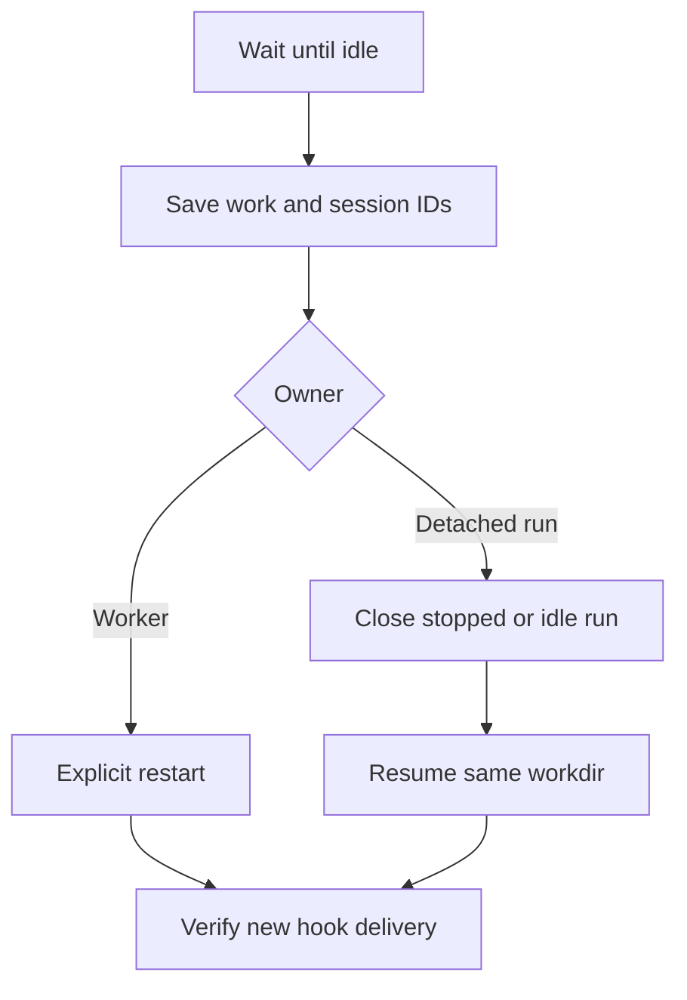

# Sessions and client policy

How the sessions agent-pm starts are set up, how to list and show them, and the flags role runs pass their client.

## Session settings

Every session agent-pm starts, agent runs and workers, loads your user settings with every plugin except `agent-pm` (`[clients.<client>] flags` in `session/src/agent_pm/session/config.toml`): only a client you start, the commander, has `/agent-pm:manage`. Each such session's client also carries `AGENT_PM_AGENT_SESSION=1`, under which `agent-pm-crew` `run`/`hold`/`resume`, `agent-pm-session` `start`/`restart`/`resume`/`client-resume`, `agent-pm-delegate` `run`/`resume` and `agent-pm-linear` `router`/`resume` exit 2 (their forms that start nothing, such as `--dry-run`, `--list` and `--brake`, still run), even run by a checkout's `bin/` path: a guard against slips, not isolation (`env -u` clears it). Agent runs load no MCP servers. A trusted cwd adds its project settings (`trusted_dirs` in `delegate/src/agent_pm/delegate/config.toml`).

In the commander's Claude Code session the plugin's mod (`manager/hooks/quiet.tsx`) hides Monitor notices (each event, the expiry, the stream's end) from the screen; other notices and folded tool lines draw as usual, the model still reads them, and ctrl+o shows them. `/quiet` shows or hides them for the session; the plugin option `quiet_background` off (`/config`) turns the mod off.

## agent-pm-session

`bin/agent-pm-session --help` lists its subcommands. `ls` prints a header, then one tab-separated row per session: `name`, `state` (`working`, `done`, `blocked`, `dead`), `client`, `sid`, `display`, with `-` for an empty value.

Sessions run on `[session.hosts] default`: `tmux`, or `pty` (each on a pty its own supervisor holds, state in `~/.agent-pm/pty/<name>/`). A `pty` session cannot be shown: `show`, `hide`, `attach-command`, `read` and `tile` exit 1, and its `status` `attach` is null. `[delegate.delegates] harness_host = "pty"` puts only detached runs' harnesses there.

`start --display none` starts a worker without a pane, still opened by the caller, and hidden. Hidden (from that, `hide`, or closing its pane by hand; not from losing the manager's window or detaching its viewer) lasts through `restart` and `resume` until `show`.

## Codex plugin upgrades and recovery

Codex runs retain their starting plugin's runtime files under `~/.agent-pm/installations/`. Hook executables, callback modules/resources, harness imports and write-back commands use that copy. The harness and terminal own separate copies: a terminal can remain open after the outcome. Each owner removes its copy when it exits; the next Codex launch collects unlocked crash leftovers older than 60 seconds. Active leases are never collected. Preflight creates no copy; writable roots overlapping this executable tree are refused. Claude and other clients retain their existing launch behavior.

An already-running stale process keeps its old hook command. Installing this fix does not change its startup configuration. Keep the workdir, worker/run metadata, Codex recovery mappings and native transcript. Do recovery from the commander or an ordinary terminal, using the new installation's `bin/` commands.



The close/restart actions are manual and terminate the selected processes. Never interrupt a busy run automatically.

| Owner | Recovery using the new installation |
|---|---|
| Named worker | Inspect `agent-pm-session status NAME` and `read NAME`; when idle, run `agent-pm-session restart NAME`. If already gone, use `resume NAME`. Both preserve its saved session/native conversation binding. |
| Interrupted detached run | Inspect `agent-pm-delegate status WORKDIR` and `content WORKDIR`. After it is idle/stopped, explicitly `close WORKDIR` if needed, then `resume WORKDIR`. Answer an existing `needs_input` result with `resume WORKDIR --input TEXT`. Pipeline answers go through their issue board. |

Live `resume` returns the existing process; it does not refresh hooks. A completed run returns its recorded outcome. Legacy Codex records with a missing packaged default-team installation rebind to the current installation; custom team directories must still exist. Native `client-resume` alone omits agent-pm's managed hooks.

After recovery, inspect Codex `/hooks` and send a short follow-up: hook delivery must succeed, the native session ID must match, and saved work/history must remain. Trust still follows the existing [Codex hook review](https://learn.chatgpt.com/docs/hooks) flow; [Codex resume](https://learn.chatgpt.com/docs/developer-commands?surface=cli) continues the saved conversation. No user configuration edits are required.

Verification fixtures: `session/tests/integration/clients/codex/installation_integration_test.py` covers six hooks after installation removal and an idle live legacy session with exit 127; `delegate/tests/integration/installation_integration_test.py` covers retained outcome/write-back, the surviving terminal and pre-fix metadata recovery on the new installation. Fixtures preserve work and conversation identity without touching real caches.

## Client policy

Role runs' client flags are `[policy.claude]` and `[policy.codex]` in `delegate/src/agent_pm/delegate/config.toml`. A local list replaces the default whole. Codex defaults to `danger-full-access`, which ignores writable roots and team dirs. For `workspace-write`:

```toml
[delegate.policy.codex]
flags = ["-s", "workspace-write", "-c", 'approval_policy="on-request"', "-c", 'approvals_reviewer="auto_review"', "-c", "sandbox_workspace_write.network_access=false", "-c", "sandbox_workspace_write.writable_roots=[]"]
```
