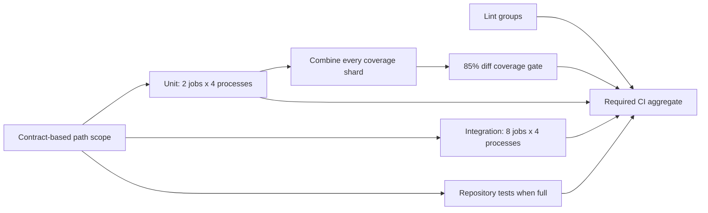

# Tests

```bash
export PYTHONPATH=.:.github:delegate/src:session/src:utils/src:manager/src:linear-orchestrator/src:linear-orchestrator/tests   # from the repo root
```

Lint (tool versions pinned in `.github/workflows/test.yml`):

```bash
python3 .github/comment_budget.py
ruff check --no-cache
ruff format --check --no-cache
python3 -m tests.unit_imports
pyright
lint-imports --no-cache
pylint --disable=all --enable=cyclic-import,duplicate-code manager/src linear-orchestrator/src delegate/src session/src utils/src
vulture
python3 -m tests.checks
python3 .github/run_tests.py "Repository integration" tests/integration
python3 .github/integration_jobs.py --check
actionlint -shellcheck= -pyflakes=
typos --config pyproject.toml
```

| Suite | Command |
|---|---|
| one project's unit tests | `python3 .github/run_tests.py "Session unit" session/tests/unit` |
| all unit tests | `python3 .github/run_tests.py Unit --unit` |
| one unit shard | `python3 .github/run_tests.py Unit --unit --shard 1/8` |
| one four-process unit job | `python3 .github/run_tests.py Unit --unit --parallel 4 --shard 1/2` |
| one complete test ID | `python3 .github/run_tests.py Integration manager.tests.integration.crew_close_all_integration_test.CloseAllTest.test_close_all_closes_what_mgr_opened_and_only_that` |
| one test file | `python3 .github/run_tests.py Integration manager/tests/integration/crew_close_all_integration_test.py` |
| integration shard (labels in `.github/workflows/test.yml`) | `python3 .github/integration_jobs.py <N>` |

Run tests only through these supervised, sandboxed entries; they retain diagnostics and cleanup.

Single-test and file selection need the same repository-root `PYTHONPATH` above and the
selected test's dependencies (tmux for live tmux tests). Copy the complete ID from the
failure annotation or summary; no shard number is needed. Files must be repository test
files named `*_test.py`; invalid, missing, empty or ambiguous selections fail without
running a broader suite.
Subtest annotations use the method ID and keep parameters in the error text; selecting
that method runs all its subtests.

Docker protocol fixtures need `python3 -m pip install jsonschema==4.26.0` (test only).
Run `python3 .github/run_tests.py Protocol tests/unit/docker_broker_protocol_test.py tests/unit/docker_relay_protocol_test.py`.

Integration jobs upload `integration-<run-id>-<attempt>-<job>` artifacts containing
the discovered IDs, assigned IDs, expected load, Python/tmux versions, runner type, supervised
exit status and per-test seconds. A failed attempt remains available for diagnosis;
only complete successful Ubuntu attempts can regenerate the timing table.
Regeneration requires full scope; upper-only artifacts remain diagnostic samples.
Each matrix job runs `INTEGRATION_WORKERS` independently supervised workers. Their
numbered shard directories retain separate logs and timing manifests; the coordinator
waits for every worker and fails if any worker fails to launch, run or clean up.
`integration_jobs.py --check` validates all worker shards against the actual matrix.

To recollect, open a PR and let the entire `CI` workflow finish. Run
`gh run rerun <run-id> --repo ophis/agent-pm` after each completed attempt for more samples.
For each attempt, download into a separate empty directory, replacing the angle-bracket values:

```bash
gh run download <run-id> --repo ophis/agent-pm --pattern 'integration-<run-id>-<attempt>-*' --dir /tmp/integration-samples/<attempt>
gh api repos/ophis/agent-pm/actions/runs/<run-id>/attempts/<attempt> > /tmp/integration-samples/<attempt>/run.json
python3 .github/integration_timings.py /tmp/integration-samples
python3 .github/integration_timings.py /tmp/integration-samples --output .github/integration_durations.json
python3 .github/integration_jobs.py --check
```

Validation compares every attempt against this checkout's discovery and rejects mixed
commits/environments/events, missing or duplicate shards/tests, failures and invalid seconds.
The downloaded `run.json` must identify the same completed, successful workflow attempt,
including its other required checks. Regeneration uses the per-test median and writes
`.github/integration_durations.sources.json` with source runs, commits, versions and shard
labels. Normal tests never rewrite either file. Keep failed attempts
outside the regeneration input, alongside their original logs and workflow/job metadata.

A PR's added and changed `*/src` lines need unit coverage (lines and branches) of at least `THRESHOLD` in `.github/coverage_gate.py` (CI job `Coverage`). With coverage.py installed (version: `COVERAGE_VERSION` in `.github/workflows/test.yml`):

```bash
RUN_TESTS_COVERAGE=/tmp/coverage-data python3 .github/run_tests.py Unit --unit
python3 .github/coverage_gate.py /tmp/coverage-data origin/main
```


Unit shards use sorted test IDs; integration shards use recorded durations. Every ID
occurs exactly once. Coverage applies to pull requests; `CI` requires every applicable result.

| Change/event | Unit and integration tests | Repository tests |
|---|---|---|
| PR touching only `manager/` and/or `linear-orchestrator/`, including their docs/skills | both upper layers | intentionally skipped |
| PR touching only root `*.md` files and/or `docs/` | upper-layer unit tests (they check the docs skills cite); integration, type and design lints skipped | intentionally skipped |
| PR touching a lower layer, `tests/`, `.github/`, shared config, an unknown path, or an empty diff | all layers, plus shared unit tests | run |
| push to `main` | all layers, plus shared unit tests | run |

`.github/ci_scope.py` derives project roots from the import-linter `layers` contract and
their `src` packages. Layers before `agent_pm.delegate` form the upper group; every
other path selects the full suite. Renames consider both endpoints. `TEST_PROJECTS`
passes the selected group to discovery. Static lint remains required; `Lint style` checks
unit import boundaries on every change. `CI` accepts a skipped repository job only for
the upper-only decision, and rejects failures,
cancellation or unexpected skips.

```bash
python3 .github/ci_scope.py --event pull_request --paths manager/skills/manage/SKILL.md
python3 .github/ci_scope.py --event pull_request --paths session/src/agent_pm/session/cli.py
```

Measure the whole workflow from its start until every job completes, including
scheduling, setup and cleanup. Report observed times and flakes; no hard timing gate.

`# pragma: no cover` is allowed only in the header (`def` through its colon) of a function that only integration tests run, registered with a reason in `NO_COVER_ALLOWED` of its layer's `tests/guard_data/<package>.py` (check: `tests/guard_checks/suppressions.py` `coverage_pragmas`).

| | Unit | Integration |
|---|---|---|
| Tests | pure logic, with fakes and recorded output | real tools in `utils/tests/sandbox.py` |
| Limits | no processes, no sockets, writes only in the runner's temp dir | tmux only on `session/tests/live_tmux.py` servers |
