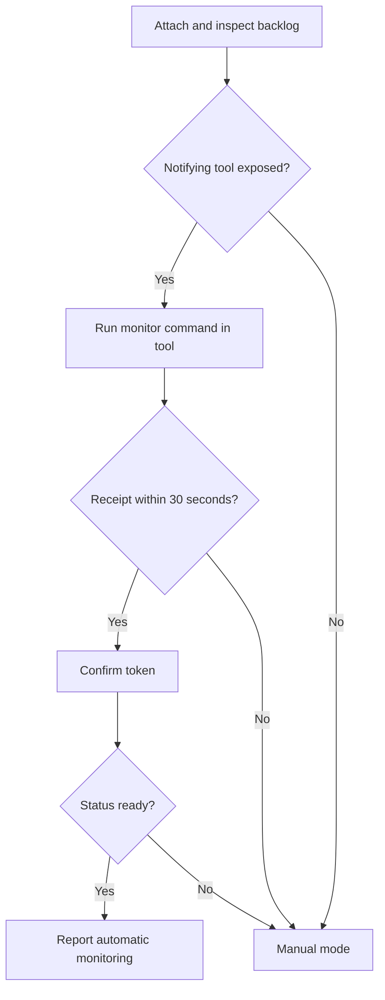
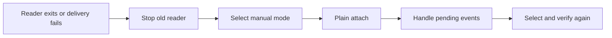

# Commander monitoring

Read this contract from `/agent-pm:manage` before launch, on every active turn, and after resume, compaction or takeover. Commands inherit the commander's manager and holder environment; elsewhere supply `--manager <manager>`.

## Selection

Inspect the tools actually exposed in this conversation and their runtime contract.

| Capability | Mode |
|---|---|
| Exposed tool documents automatic output delivery into this conversation | Candidate automatic path; verify Receipt |
| Commands/output require explicit reads or waits | `agent-pm-crew monitor --mode manual` |
| Event commands cannot run | Report unavailable, including the failed command and recovery action; record `agent-pm-crew monitor --mode unavailable` when possible |

Client name, process id, shell `&`, a persistent terminal, stdout and successful launch never establish notification delivery. The current Codex exec/write_stdin contract requires explicit reads; a different host needs its own documented capability. [OpenAI command execution](https://developers.openai.com/codex/app-server/#command-execution) describes output notifications to a protocol client, without promising a commander turn.

[Claude Code Monitor](https://code.claude.com/docs/en/tools-reference#monitor-tool) documents conversation delivery. Use it only when exposed here. Generic `run_in_background` is not a substitute: no completion adapter is verified by this contract.

## Receipt

**Receipt** means the commander received the isolated `readiness <token>` through the notifying tool, without explicitly reading a task, output file or terminal. Never obtain readiness from a fabricated worker event, nor let the reader acknowledge its own probe.

The command records the commander's attestation; it cannot authenticate host notification provenance.

The probe uses no worker-event line or handling cursor.

- Stop your previous reader through its runtime cancellation tool before rearming. Run attach's `monitor:` command, `next-event … --content --follow --notify`, in Monitor with `timeout_ms` 1800000, bounded by that runtime's allowed deadline. It emits a probe, then event line, then its content.
- On Receipt, run `agent-pm-crew monitor --receipt <token>`. Report automatic monitoring only if its result has `ready: true`. A missing, late, wrong, stopped, replaced or fenced reader's probe fails confirmation. Stop it and select manual mode after failure.
- `agent-pm-crew monitor` inspects mode, reader liveness, latest receipt time, handling cursor, generation and pending physical-line count. `reader: unknown` covers uninstrumented readers. Historical receipt alone confers no readiness. A live lock proves only reader liveness; a receipt proves delivery at that time, not future delivery.
- Manual launch report: `Manual monitoring; no idle notifications. Read: agent-pm-crew pending --content. Recovery: agent-pm-crew attach.` Include the manager option when needed. Monitoring limitations do not cancel authorized launches.

## Handling

**Handled cursor** is the contiguous prefix whose business actions the commander has confirmed. At the beginning of every active turn, inspect `agent-pm-crew pending --content` before status reports or new launches, in every mode. Handle the backlog in order using `/agent-pm:manage` Events.

`pending`, one-shot `next-event`, and streaming `next-event --follow` read without acknowledgment. Stream rearming uses the handled cursor from `pending` or `attach`, never the last printed line. `--after end` skips only for that reader; pending events remain recoverable.

After confirming each action's result, run `agent-pm-crew ack --through <line> --gen <generation>`. This acknowledges the entire prefix: leave a failed or unresolved action and everything after it pending. Repeating an acknowledgment is safe. `attach --after N --gen G` retains its legacy explicit prefix-acknowledgment meaning; use plain attach for recovery.

**Event identity** is manager, generation and physical line, with the entry's session id identifying its work. Redelivery is expected. Before repeating a side effect, reconcile its durable result (outcome, sent message, issue state or existing pull request); reuse the result already established. If its result is unknown, retain the event and resolve it before retrying. A printed event or reply is never proof of handling.

## Recovery

Apply this flow also to runtime expiration, resumed commander, takeover and stale generation. An ended one-shot read rearms from the handled cursor; it remains manual. If reads are unavailable, report that failure and retry the printed recovery command on the next active turn.

The lease fences old readers and acknowledgments. Rotation retains the unhandled suffix and changes generation; discard old line/token pairs and use attach's new `N` and `GEN`. Stop your own listener before `agent-pm-crew release`.

## Compatibility

Roster version 3 adds `monitor` state (selection, probe, start, confirmation, latest receipt, lease/event generations) and a kernel-held `reader.lock`; no daemon or user configuration. Version 2 reads as manual with unknown receipt, preserving its existing cursor. The next write upgrades it; older binaries reject version 3. Historical acknowledgments cannot be undone automatically. Session and Delegate interfaces are unchanged.
